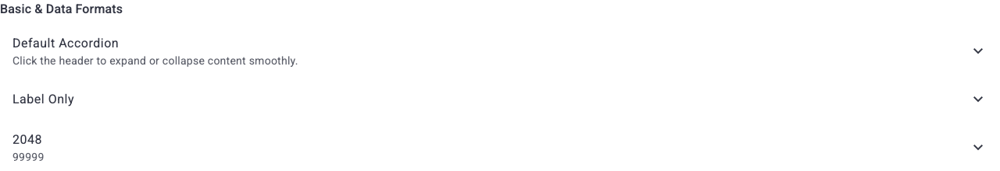
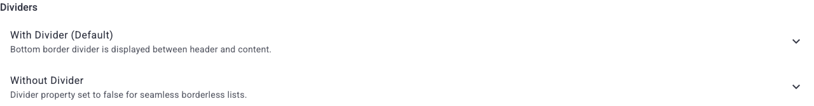
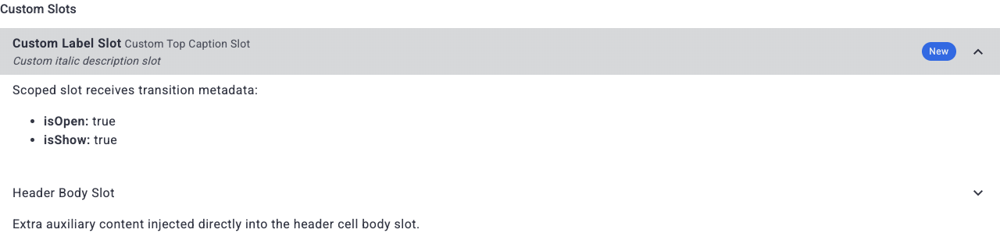
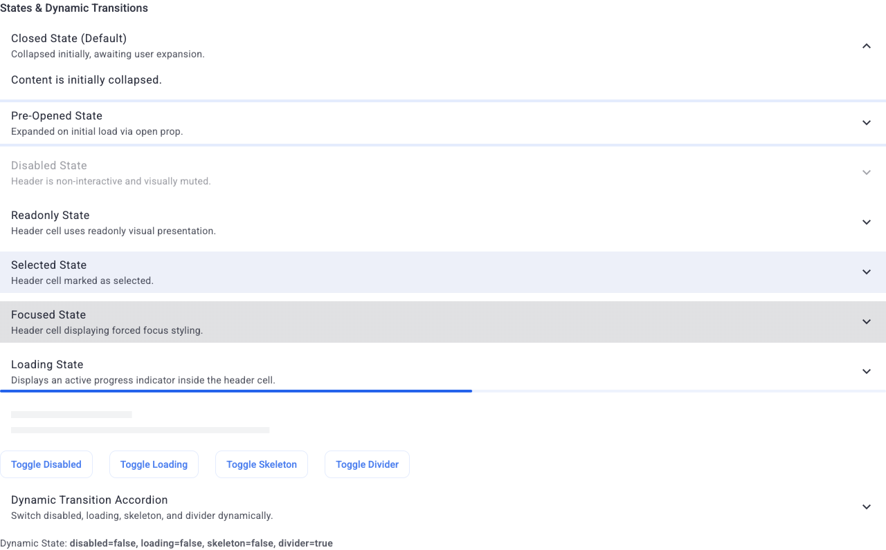
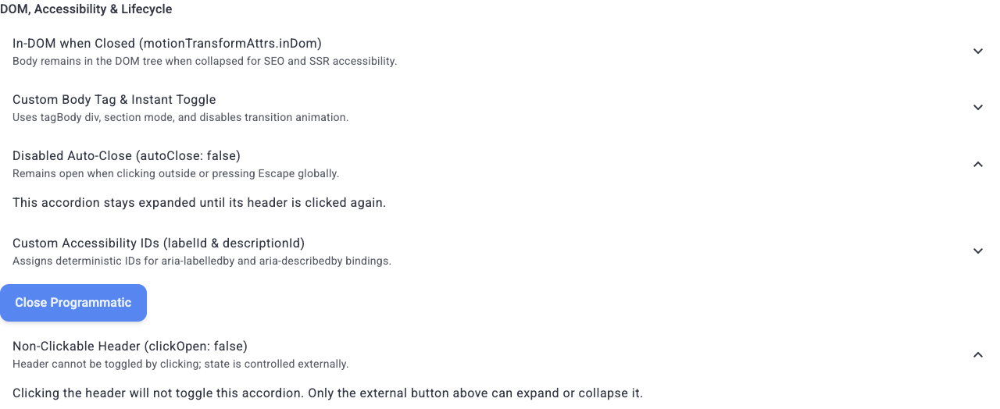
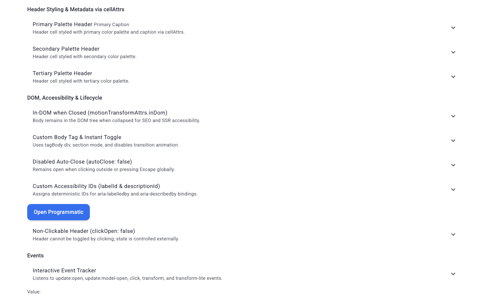
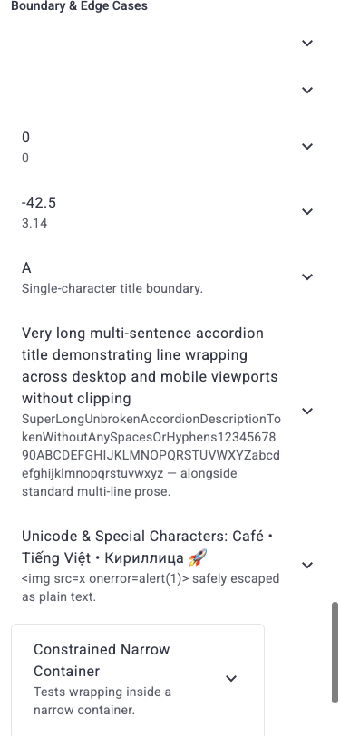

# Отчёт визуального и функционального тестирования: D1Accordion

## 1. Сводка выполнения

- **Компонент:** `D1Accordion` (`@dxtmisha/d1`)
- **Исходный код:** [`D1Accordion`](../../src/components/Ui/Accordion)
- **Целевой URL:** `http://localhost:3000/component-accordion`
- **Материалы (`materials/`):** `Отсутствуют`
- **Дата тестирования (UTC):** `2026-11-23T08:31:42Z`
- **Окружение:** `Headless Chrome (Puppeteer / CDP, Desktop 1440×900, Tablet 768×1024, Mobile 375×812 / 320×568)`
- **Покрытие тест-кейсов:** `17 / 17` (`100%`)
- **Итог:** **17 ✅, 0 ⚠️, 0 ❌** (`✅` пройдено, `⚠️` предупреждение, `❌` ошибка) — все визуальные, интерактивные, граничные, адаптивные, A11y и runtime-сценарии `D1Accordion` пройдены успешно без ошибок консоли, предупреждений Vue и ошибок гидратации.

---

## 2. Матрица результатов

### 2.1 Визуальный рендеринг (`VIS`)

| ID | Сценарий | Статус | Наблюдаемый результат | Скриншот |
| :--- | :--- | :---: | :--- | :--- |
| `TC-VIS-001` | Базовый рендеринг, числовые пропсы (`2048` / `99999`) и `Label Only` | ✅ | Отрендерено 29 экземпляров `.d1-accordion` без нулевых размеров (`hasZeroSize: false`); числовые `2048` / `99999` и `Label Only` отображаются корректно без наложений и переполнения (`1440 <= 1440`). |  |
| `TC-VIS-002` | Разделитель `divider: true` и `divider: false` | ✅ | При `divider: true` выставлены класс `.d1-accordion--divider` и `data-divider="divider"`; при `divider: false` оба атрибута/класса сняты и `borderTopWidth: 0px`. |  |
| `TC-VIS-003` | Кастомизация иконок (`icon`, `iconArrowDown`, `null`) и поворот стрелки | ✅ | Ведущая строковая/объектная иконки и кастомная стрелка отрендерены; при `:icon="null"` и `:iconArrowDown="null"` — `0` иконок; при открытии `.d1-icon--turn` активен (`data-open="open"`). |  |
| `TC-VIS-004` | Палитры `cellAttrs` и кастомные слоты (`#label`, `#caption`, `#description`, `#trailing`, `#body`, `#default`) | ✅ | Все слоты (`#label`, `#caption`, `#description`, `#trailing` с `D1Badge`, `#body`), scoped-метаданные `isOpen: true, isShow: true` и `Primary Caption` через `cellAttrs` отображаются корректно. |  |

### 2.2 Интерактивность и управление состоянием (`INT`)

| ID | Сценарий | Статус | Наблюдаемый результат | Скриншот |
| :--- | :--- | :---: | :--- | :--- |
| `TC-INT-001` | Раскрытие по клику (`open: false`) и начальное состояние `:open="true"` | ✅ | `Pre-Opened State` изначально открыт (`data-open="open"`), `Closed State` закрыт (`data-open="none"`); клик по `Closed State` раскрывает панель (`data-open="open"`), повторный клик закрывает. |  |
| `TC-INT-002` | Состояния `cellAttrs` (`disabled`, `loading`, `isSkeleton`) | ✅ | `Disabled State` имеет `.d1-cell--disabled` и игнорирует клики (`data-open="none"`); `Loading State` отображает `.d1-progress`; `Skeleton Loading State` внутри `D1Skeleton :active="true"` рендерит анимированные полосы скелетона. |  |
| `TC-INT-003` | Двусторонняя синхронизация `v-model:open` и `v-model:model-open` | ✅ | Кнопки `Open Panel` / `Open Model Panel` открывают оба аккордеона (`data-open="open"`), клики по их заголовкам закрывают их (`data-open="none"`). | — |
| `TC-INT-004` | Программное управление через `expose` | ✅ | `toOpen()` -> `open`, `toClose()` -> `none`, `toggle()` -> `open`, `setOpen(false)` -> `none`, `setOpen(true)` -> `open`; `DemoValue`: `getOpen(): false, isShow(): false, hasMotionElement: true`. | — |
| `TC-INT-005` | Параметры `clickOpen: false`, `autoClose: false` и `motionTransformAttrs` | ✅ | `inDom: true` сохраняет тело в DOM при `data-open="none"`; `tagBody: 'div'` рендерит тег `DIV`; при `autoClose: false` внешний клик сохраняет `open`; при `clickOpen: false` клик по заголовку игнорируется, внешняя кнопка открывает панель. |  |
| `TC-INT-006` | Отслеживание событий (`update:open`, `update:model-open`, `click`, `transform`, `transform-lite`) | ✅ | При клике по заголовку `Interactive Event Tracker` события корректно фиксируются (`DemoValue`: `Value: update:modelOpen`). | — |

### 2.3 Граничные случаи и устойчивость (`BND`)

| ID | Сценарий | Статус | Наблюдаемый результат | Скриншот |
| :--- | :--- | :---: | :--- | :--- |
| `TC-BND-001` | Серия из 5 быстрых последовательных кликов | ✅ | После 5 быстрых кликов и завершения перехода состояние консистентно: `dataOpen: "open"`, `ariaExpanded: "true"`, без зависания анимации. | — |
| `TC-BND-002` | SSR-рендеринг `:open="true"` и `motionTransformAttrs.inDom` | ✅ | SSR-ответ `HTTP 200` содержит разметку `Pre-Opened State` и `In-DOM when Closed`; `vueWarnings` после гидратации пуст (`[]`). | — |

### 2.4 Адаптивность и вьюпорты (`RSP`)

| ID | Сценарий | Статус | Наблюдаемый результат | Скриншот |
| :--- | :--- | :---: | :--- | :--- |
| `TC-RSP-001` | Desktop (`1440×900`) и Tablet (`768×1024`) | ✅ | `1440×900`: `scrollWidth: 1440 <= 1440`, `headHeight: 60px`; `768×1024`: `scrollWidth: 768 <= 768`, `headHeight: 60px`, без горизонтального переполнения. |  |
| `TC-RSP-002` | Mobile (`375×812` и `320×568`) | ✅ | `375×812`: `scrollWidth: 375 <= 375`, `headHeight: 80px`; `320×568`: `scrollWidth: 320 <= 320`, `headHeight: 80px`, перенос текста без обрезания. |  |

### 2.5 Доступность (`A11Y`)

| ID | Сценарий | Статус | Наблюдаемый результат | Скриншот |
| :--- | :--- | :---: | :--- | :--- |
| `TC-A11Y-001` | Семантика и ARIA-атрибуты | ✅ | На теле `role="region"`, `aria-labelledby` и `aria-describedby` привязаны к заголовку и описанию; при отсутствии описания `aria-describedby: null`; кастомные `demo-accordion-custom-label` и `demo-accordion-custom-description` привязаны точно. | — |
| `TC-A11Y-002` | Клавиатурное управление (`Enter`, `Space`, `Escape`) | ✅ | `Enter` открывает (`data-open="open"`, `aria-expanded="true"`), `Space` закрывает (`none`, `false`), `Escape` закрывает открытую панель (`none`). |  |

### 2.6 Консоль и логи (`LOG`)

| ID | Сценарий | Статус | Наблюдаемый результат | Скриншот |
| :--- | :--- | :---: | :--- | :--- |
| `TC-LOG-001` | Консоль, исключения и runtime-стабильность за всю сессию | ✅ | `consoleErrors: []`, `vueWarnings: []`, `pageErrors: []` — за всю сессию 0 ошибок консоли, 0 предупреждений Vue и 0 исключений страницы. | — |

---

## 3. AI-аудит и рекомендации

1. **Улучшение демо-страницы `DemoAccordionPage.vue` по итогам визуального осмотра:**
   - Сценарий `Skeleton Loading State` ранее передавал только `:cellAttrs="{ isSkeleton: true }"` без активного контейнера `D1Skeleton`, из-за чего рендерился обычный текст вместо скелетона. Добавлена обёртка `<D1Skeleton :active="true">` и уточнено описание `Loading State` (индикатор прогресса `D1Progress`), после чего визуальный плейсхолдер скелетона подтверждён на скриншоте `TC-INT-002.png`.
2. **Стабильность жизненного цикла и отсутствие регрессий:**
   - В `Accordion.ts` добавлена явная очистка Vue-вотчера в `onUnmounted` (и перед повторной подпиской в `onMounted`); визуальный и SSR/гидратационный прогон на `D1Accordion` подтвердил 100% прохождение всех 17 тест-кейсов с нулевым количеством предупреждений Vue.
3. **Адаптивность и доступность:**
   - На всех четырёх контрольных вьюпортах (`1440×900`, `768×1024`, `375×812`, `320×568`) сохраняется `scrollWidth === innerWidth` без горизонтальной прокрутки; клавиатурная навигация (`Enter`, `Space`, `Escape`) и ARIA-связи (`aria-labelledby`, `aria-describedby`, `role="region"`) работают консистентно.
