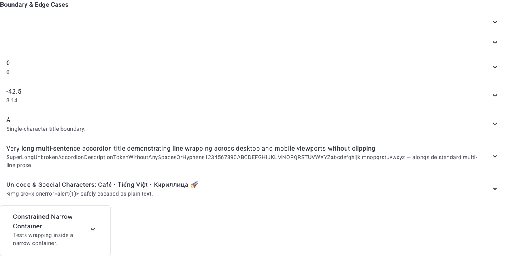
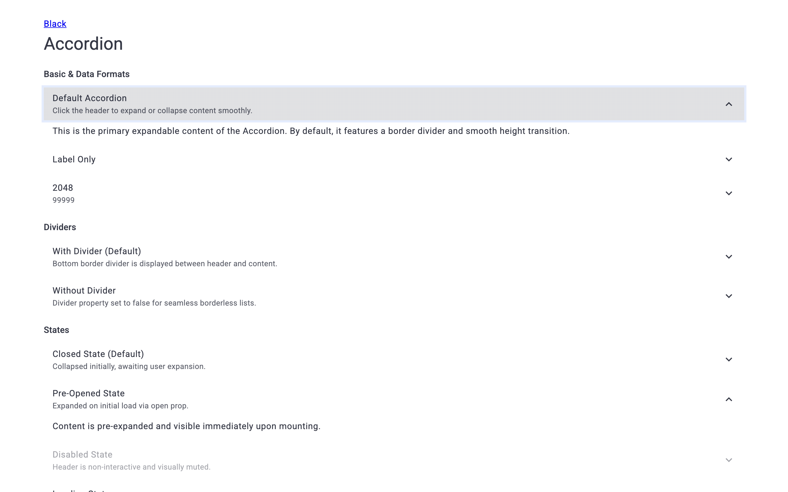

# Отчёт визуального и функционального тестирования: D1Accordion

## 1. Сводка выполнения

- **Компонент:** `D1Accordion` (`@dxtmisha/d1`)
- **Исходный код:** [`D1Accordion`](../../src/components/Ui/Accordion), [`Accordion`](../../../constructor/src/constructors/Accordion), [`DemoAccordionPage.vue`](../../../demo/src/pages/components/DemoAccordionPage.vue)
- **Целевой URL:** `http://localhost:3000/component-accordion`
- **Материалы (`materials/`):** `Отсутствуют`
- **Дата тестирования (UTC):** `2026-11-25T04:14:59Z`
- **Окружение:** `Headless Chrome (Puppeteer / CDP, Desktop 1440×900, Tablet 768×1024, Mobile 375×812 / 320×568)`
- **Покрытие тест-кейсов:** `20 / 20` (`100%`)
- **Итог:** **20 ✅, 0 ⚠️, 0 ❌** (`✅` пройдено, `⚠️` предупреждение, `❌` ошибка) — все визуальные, интерактивные, граничные, адаптивные, A11y и runtime-сценарии `D1Accordion` пройдены успешно без ошибок, предупреждений и горизонтального переполнения после добавления `min-width: 0; max-width: 100%; overflow-wrap: anywhere;` в `Cell/style.scss`.

---

## 2. Матрица результатов

### 2.1 Визуальный рендеринг (`VIS`)

| ID | Сценарий | Статус | Наблюдаемый результат | Скриншот |
| :--- | :--- | :---: | :--- | :--- |
| `TC-VIS-001` | Базовый рендеринг, числовые пропсы (`2048` / `99999`) и `Label Only` | ✅ | На странице `45` экземпляров `.d1-accordion`, в группе `3` элемента без нулевых размеров (`hasZeroSize: false`), `2048` и `99999` отображаются корректно (`1440 === 1440`). |  |
| `TC-VIS-002` | Разделитель `divider: true` и `divider: false` | ✅ | При `divider: true` присутствует класс `.d1-accordion--divider`, при `divider: false` он снят и `borderTopWidth: 0px`. |  |
| `TC-VIS-003` | Кастомизация иконок (`icon`, `iconArrowDown`, `null`) и поворот стрелки | ✅ | Отрендерены 5 вариантов; при `:icon="null"` и `:iconArrowDown="null"` — `0` иконок; при открытии `Custom Trailing Arrow Indicator` активен класс `.d1-icon--turn` и `data-open="open"`. |  |
| `TC-VIS-004` | Палитры `cellAttrs` (`6` палитр) и пользовательские слоты (`#label`, `#caption`, `#description`, `#trailing`, `#body`, `#default`) | ✅ | Отрендерены `data-slot-class` в `#trailing`, `data-body-label-class` в `#body`, scoped-метаданные `isOpen: true`, `isShow: true`, `idControl`, `idBody`, а также все 6 палитр заголовков (`primary`, `secondary`, `tertiary`, `green`, `amber`, `red`). |  |

### 2.2 Интерактивность и управление состоянием (`INT`)

| ID | Сценарий | Статус | Наблюдаемый результат | Скриншот |
| :--- | :--- | :---: | :--- | :--- |
| `TC-INT-001` | Раскрытие по клику (`open: false`) и начальное состояние `:open="true"` | ✅ | На чистой загрузке `Closed State` имеет `data-open="none"`, `Pre-Opened State` — `data-open="open"` с видимым телом; клики по `Closed State` переключают `none` -> `open` -> `none`. |  |
| `TC-INT-002` | Состояния `cellAttrs` (`disabled`, `readonly`, `selected`, `focus`, `loading`, `isSkeleton`) и динамические переключения | ✅ | `Disabled State` игнорирует клик (`data-open="none"`); классы `d1-cell--disabled`, `d1-cell--readonly`, `d1-cell--selected`, `d1-cell--focus`, `.d1-progress` и `.d1-skeleton` присутствуют; кнопки переключения обновили `Dynamic State: disabled=true, loading=true, skeleton=true, divider=false`. |  |
| `TC-INT-003` | Двусторонняя синхронизация `v-model:open` и `v-model:model-open` | ✅ | Кнопки и клики по заголовкам синхронно обновляют обе модели (`true` <-> `false`, `data-open`: `open` <-> `none`). | — |
| `TC-INT-004` | Программное управление через `expose` | ✅ | Стартово `getOpen(): false, isShow(): false, hasMotionElement: true`; `toOpen()` -> `open`, `toClose()` -> `none`, `toggle()` -> `open`, `setOpen(false)` -> `none`, `setOpen(true)` -> `open`. | — |
| `TC-INT-005` | Параметры `clickOpen: false`, `autoClose: false` и `motionTransformAttrs` | ✅ | `inDom: true` сохраняет тело в DOM; `tagBody: 'div'` рендерит `DIV`; `autoClose: false` остаётся `open` после внешнего клика; `clickOpen: false` игнорирует клик по заголовку и открывается кнопкой `Open Programmatic`. |  |
| `TC-INT-006` | Отслеживание событий и `Payload` (`update:open`, `update:model-open`, `click`, `click-lite`, `transform`, `transform-lite`) | ✅ | Зафиксированы `Value: update:modelOpen` и `Payload: [true]`. | — |
| `TC-INT-007` | Жизненный цикл монтирования/размонтирования (`v-if`) | ✅ | При нажатии `Unmount Lifecycle Accordion` число элементов в группе снизилось с `6` до `5` (`Mounted: false`), при `Mount` — восстановилось до `6` (`Mounted: true`) без предупреждений. | — |

### 2.3 Граничные случаи и устойчивость (`BND`)

| ID | Сценарий | Статус | Наблюдаемый результат | Скриншот |
| :--- | :--- | :---: | :--- | :--- |
| `TC-BND-001` | Серия из 5 быстрых последовательных кликов | ✅ | После 5 быстрых кликов состояние консистентно: `dataOpen: "open"`, `ariaExpanded: "true"`. | — |
| `TC-BND-002` | SSR-рендеринг и гидратация `:open="true"` и `motionTransformAttrs.inDom` | ✅ | SSR-ответ `HTTP 200` содержит разметку `Pre-Opened State` и `In-DOM when Closed`; `vueWarningsCount: 0`. | — |
| `TC-BND-003` | Граничные значения (`""`, `"   "`, `0`, `-42.5`/`3.14`, `"A"`, длинный неразрывный токен) | ✅ | Числа `0`, `-42.5`, `3.14` и `"A"` отображаются корректно; в `.d1-cell__description` активны `overflowWrap: "anywhere"` и `minWidth: "0px"`, неразрывный токен `SuperLongUnbroken...` переносится в пределах контейнера (`descWidth: 1208 === descScrollWidth: 1208`). |  |
| `TC-BND-004` | Unicode, экранирование XSS и узкий контейнер `DemoBox` | ✅ | Unicode отображается корректно; `xssImgCount: 0`, `xssScriptCount: 0`; узкий `DemoBox` (`280px`) имеет `scrollWidth: 278`. | — |

### 2.4 Адаптивность и вьюпорты (`RSP`)

| ID | Сценарий | Статус | Наблюдаемый результат | Скриншот |
| :--- | :--- | :---: | :--- | :--- |
| `TC-RSP-001` | Desktop (`1440×900`) и Tablet (`768×1024`) | ✅ | Переполнение отсутствует на обоих разрешениях: `1440×900` (`scrollWidth: 1440 === 1440`, `descWidth: 1208`), `768×1024` (`scrollWidth: 768 === 768`, `descWidth: 664`). |  |
| `TC-RSP-002` | Mobile (`375×812` и `320×568`) | ✅ | На `375×812`: `scrollWidth: 375 === 375` (`descWidth: 287`, `descHeight: 100`); на `320×568`: `scrollWidth: 320 === 320` (`descWidth: 232`, `descHeight: 120`) — неразрывный токен корректно переносится по строкам. |  |

### 2.5 Доступность (`A11Y`)

| ID | Сценарий | Статус | Наблюдаемый результат | Скриншот |
| :--- | :--- | :---: | :--- | :--- |
| `TC-A11Y-001` | Семантика и ARIA-атрибуты | ✅ | `role="region"`, `aria-labelledby` и `aria-describedby` заданы; у `Label Only` `aria-describedby: null`; кастомные `demo-accordion-custom-label` и `demo-accordion-custom-description` привязаны точно. | — |
| `TC-A11Y-002` | Клавиатурное управление (`Enter`, `Space`, `Escape`) | ✅ | `Enter` -> `open` (`ariaExpanded: "true"`), `Space` -> `none` (`false`), `Escape` -> `none` (`false`). |  |

### 2.6 Консоль и стабильность runtime (`LOG`)

| ID | Сценарий | Статус | Наблюдаемый результат | Скриншот |
| :--- | :--- | :---: | :--- | :--- |
| `TC-LOG-001` | Консоль, исключения и сетевые запросы за всю сессию | ✅ | `consoleErrors: []`, `vueWarnings: []`, `pageErrors: []`, `networkErrors: []`. | — |

---

## 3. AI-аудит и рекомендации

1. **Устранение переполнения в `Cell/style.scss`:** Добавление `min-width: 0; max-width: 100%; overflow-wrap: anywhere;` для `&__label`, `&__description`, `&__caption` и `&__body` (плюс `overflow-wrap: anywhere;` в `&__context`) полностью устранило горизонтальный скролл на `768×1024`, `375×812` и `320×568` (`scrollWidth === innerWidth`).
2. **Взаимодействие `autoClose: true` между соседними аккордеонами:** При клике по любому аккордеону с дефолтным `autoClose: true` другие ранее открытые аккордеоны закрываются глобальным обработчиком `MotionTransform` — штатное поведение.
3. **Runtime и гидратация:** Все 45 экземпляров на демо-странице рендерятся и монтируются/размонтируются по `v-if` без `[Vue warn]` и ошибок консоли.
