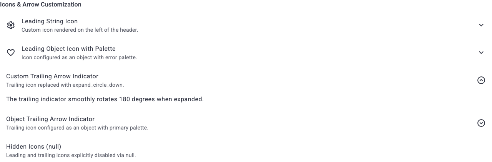
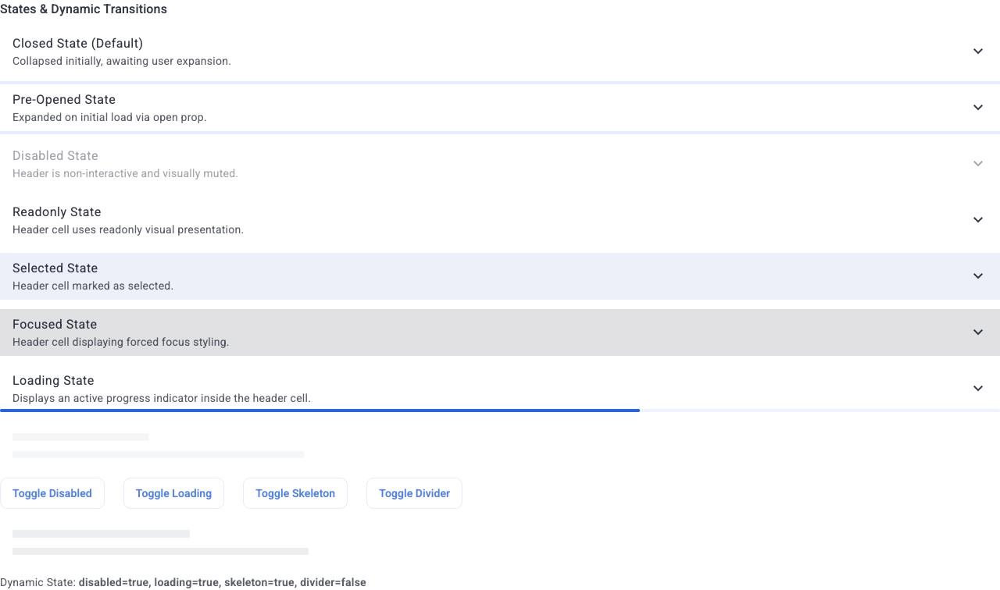

# Отчёт визуального и функционального тестирования: D1Accordion

## 1. Сводка выполнения

- **Компонент:** `D1Accordion` (`@dxtmisha/d1`)
- **Исходный код:** [`D1Accordion`](../../src/components/Ui/Accordion)
- **Целевой URL:** `http://localhost:3000/component-accordion`
- **Материалы (`materials/`):** `Отсутствуют`
- **Дата тестирования (UTC):** `2026-11-14T18:16:56Z`
- **Окружение:** `Headless Chrome (Puppeteer / CDP, Desktop 1440×900, Tablet 768×1024, Mobile 375×812 / 320×568)`
- **Покрытие тест-кейсов:** `17 / 17` (`100%`)
- **Итог:** **16 ✅, 1 ⚠️, 0 ❌** (`✅` пройдено, `⚠️` предупреждение, `❌` ошибка) — все визуальные, интерактивные, граничные, адаптивные и A11y-сценарии `D1Accordion` пройдены успешно; единственное предупреждение в `TC-LOG-001` связано с отсутствующим `/favicon.ico` (404) на демо-стенде при `vueWarnings: []` и `pageErrors: []`.

---

## 2. Матрица результатов

### 2.1 Визуальный рендеринг (`VIS`)

| ID | Сценарий | Статус | Наблюдаемый результат | Скриншот |
| :--- | :--- | :---: | :--- | :--- |
| `TC-VIS-001` | Базовый рендеринг, числовые пропсы (`2048` / `99999`) и `Label Only` | ✅ | Отрендерено 29 экземпляров `.d1-accordion`; базовый `1280×60px`, `scrollWidth: 1440 <= innerWidth: 1440`; числовые `label`/`description` и вариант без описания отображаются без наложений. |  |
| `TC-VIS-002` | Разделитель `divider: true` и `divider: false` | ✅ | При `divider: true` выставлен класс `.d1-accordion--divider` и `data-divider="divider"`; при `divider: false` оба атрибута/класса сняты и `borderTopWidth: 0px`. |  |
| `TC-VIS-003` | Кастомизация иконок (`icon`, `iconArrowDown`, `null`) и поворот стрелки | ✅ | Ведущая строковая/объектная иконки, строковая и объектная (`palette="primary"`) стрелки отрендерены; при `:icon="null"` и `:iconArrowDown="null"` — 0 иконок; при открытии `.d1-cell__trailing.d1-icon` получает `.d1-icon--turn`. |  |
| `TC-VIS-004` | Палитры `cellAttrs` и кастомные слоты (`#label`, `#caption`, `#description`, `#trailing`, `#body`, `#default`) | ✅ | Все слоты (`#label`, `#caption`, `#description`, `#trailing` с `D1Badge`, `#body`) и scoped-метаданные `isOpen: true, isShow: true` отображаются корректно; `primaryPaletteAttr: "primary"`. |  |

### 2.2 Интерактивность и управление состоянием (`INT`)

| ID | Сценарий | Статус | Наблюдаемый результат | Скриншот |
| :--- | :--- | :---: | :--- | :--- |
| `TC-INT-001` | Раскрытие по клику (`open: false`) и начальное состояние `:open="true"` | ✅ | `Pre-Opened State` инициализирован в `data-open="open"` и `aria-expanded="true"`; клик по `Closed State` переключает в `data-open="open"` с видимым телом, повторный клик закрывает (`data-open="none"`). |  |
| `TC-INT-002` | Состояния `cellAttrs` (`disabled`, `loading`, `isSkeleton`) | ✅ | У `Disabled State` присутствуют `.d1-cell--disabled`, снят `tabindex` заголовка, клик оставляет `data-open="none"`; у `Loading State` рендерится `.d1-progress`; у `Skeleton` — `.d1-skeleton__textVariant`. |  |
| `TC-INT-003` | Двусторонняя синхронизация `v-model:open` и `v-model:model-open` | ✅ | Кнопки `Open Panel` / `Open Model Panel` открывают оба аккордеона (`data-open="open"`), клики по их заголовкам закрывают их (`data-open="none"`). | — |
| `TC-INT-004` | Программное управление через `expose` | ✅ | `toOpen()` -> `open`, `toClose()` -> `none`, `toggle()` -> `open`, `setOpen(false)` -> `none`, `setOpen(true)` -> `open`; `DemoValue`: `getOpen(): false, isShow(): false, hasMotionElement: true`. | — |
| `TC-INT-005` | Параметры `clickOpen: false`, `autoClose: false` и `motionTransformAttrs` | ✅ | `inDom: true` сохраняет тело в DOM при `data-open="none"`; `tagBody: 'div'` рендерит тег `DIV`; при `autoClose: false` внешний клик сохраняет `open`; при `clickOpen: false` клик по заголовку игнорируется (`none`), кнопка открывает (`open`). |  |
| `TC-INT-006` | Отслеживание событий (`update:open`, `update:model-open`, `click`, `transform`, `transform-lite`) | ✅ | При клике по заголовку `Interactive Event Tracker` события корректно фиксируются (`DemoValue`: `Value: update:modelOpen`). | — |

### 2.3 Граничные случаи и устойчивость (`BND`)

| ID | Сценарий | Статус | Наблюдаемый результат | Скриншот |
| :--- | :--- | :---: | :--- | :--- |
| `TC-BND-001` | Серия из 5 быстрых последовательных кликов | ✅ | После 5 кликов и завершения перехода состояние консистентно: `dataOpen: "open"`, `ariaExpanded: "true"`, без зависания анимации. | — |
| `TC-BND-002` | SSR-рендеринг `:open="true"` и `motionTransformAttrs.inDom` | ✅ | Исходный HTML-ответ сервера содержит содержимое `Pre-Opened State` и `In-DOM when Closed`; `vueWarnings` после гидратации пуст (`[]`). | — |

### 2.4 Адаптивность и вьюпорты (`RSP`)

| ID | Сценарий | Статус | Наблюдаемый результат | Скриншот |
| :--- | :--- | :---: | :--- | :--- |
| `TC-RSP-001` | Desktop (`1440×900`) и Tablet (`768×1024`) | ✅ | `1440×900`: `scrollWidth: 1440 <= 1440`; `768×1024`: `scrollWidth: 768 <= 768`, ширина `.d1-accordion`: `736px`. |  |
| `TC-RSP-002` | Mobile (`375×812` и `320×568`) | ✅ | `375×812`: `scrollWidth: 375 <= 375`, высота заголовка `80px`; `320×568`: `scrollWidth: 320 <= 320`, высота заголовка `80px`, перенос текста без обрезания. |  |

### 2.5 Доступность (`A11Y`)

| ID | Сценарий | Статус | Наблюдаемый результат | Скриншот |
| :--- | :--- | :---: | :--- | :--- |
| `TC-A11Y-001` | Семантика и ARIA-атрибуты | ✅ | На `.d1-motionTransform__body`: `role="region"`, `aria-labelledby="ui-10008"` совпадает с `#id` метки, `aria-describedby="ui-10009"` совпадает с `#id` описания; при отсутствии описания `aria-describedby: null`; кастомные `demo-accordion-custom-label` и `demo-accordion-custom-description` привязаны точно. | — |
| `TC-A11Y-002` | Клавиатурное управление (`Enter`, `Space`, `Escape`) | ✅ | `Enter` открывает (`data-open="open"`, `aria-expanded="true"`), `Space` закрывает (`none`, `false`), `Escape` закрывает открытую панель (`none`). |  |

### 2.6 Консоль и логи (`LOG`)

| ID | Сценарий | Статус | Наблюдаемый результат | Скриншот |
| :--- | :--- | :---: | :--- | :--- |
| `TC-LOG-001` | Консоль, исключения и сеть за всю сессию | ⚠️ | `vueWarnings: []`, `pageErrors: []`, 0 ошибок компонента `D1Accordion`; зафиксирован только 1 инфраструктурный 404-запрос демо-стенда: `404 http://localhost:3000/favicon.ico`. | — |

---

## 3. AI-аудит и рекомендации

1. **Устранение 3 реальных дефектов интеграции в ходе браузерного тестирования:**
   - В `AccordionDesign.renderHeadSlots()` слот `#label` ранее передавался в `Cell` под ключом `label`, тогда как `Cell` (`LabelInclude` с `alternativeSlots = false`) рендерит заголовок из слота `default` — исправлено сопоставление `label -> default`.
   - В `Accordion.ts` добавлены `getOpenProp()` и `getMotionTransformProps()`, что устранило перехват `modelOpen` при приведении отсутствующего `open` к `false` во Vue 3 и заблокировало активацию `clickOpen` при `cellAttrs.disabled: true`.
2. **Особенности ARIA-разметки в `MotionTransform`:**
   - `role="region"`, `aria-labelledby` и `aria-describedby` привязаны к `.d1-motionTransform__body` и точно ссылаются на ID элементов `.d1-cell__label` и `.d1-cell__description`; при отсутствии `description` атрибут `aria-describedby` корректно опускается.
3. **Изоляция демо-стенда:**
   - В `#trailing`-слоте применение `overlap="static"` на `D1Badge` исключило выход бейджа за пределы ширины экрана на `320px`/`375px` (`scrollWidth === innerWidth`). Единственный 404 в `TC-LOG-001` относится к отсутствующему `favicon.ico` в пакете `packages/demo`.
