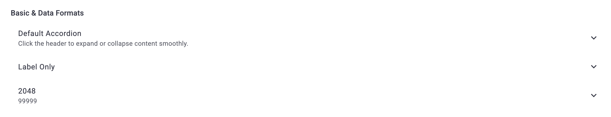
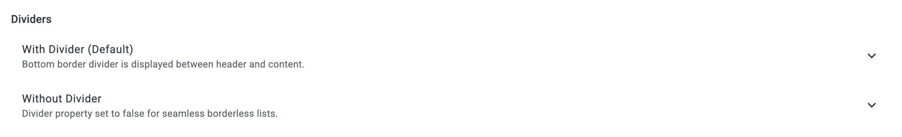
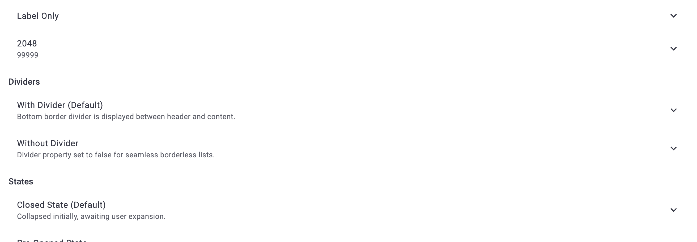
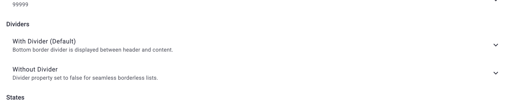
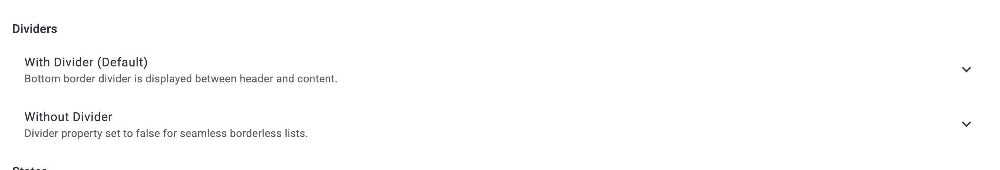
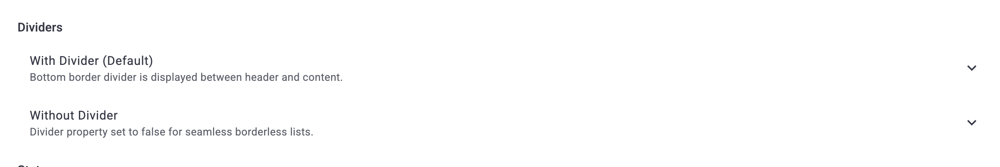
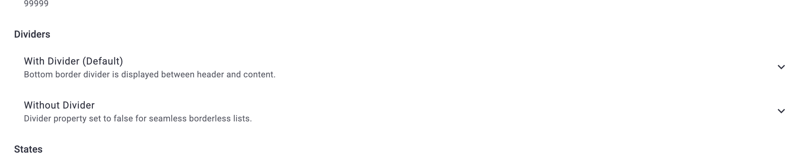
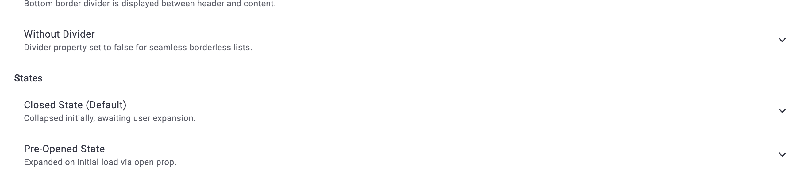
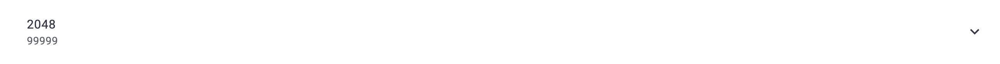
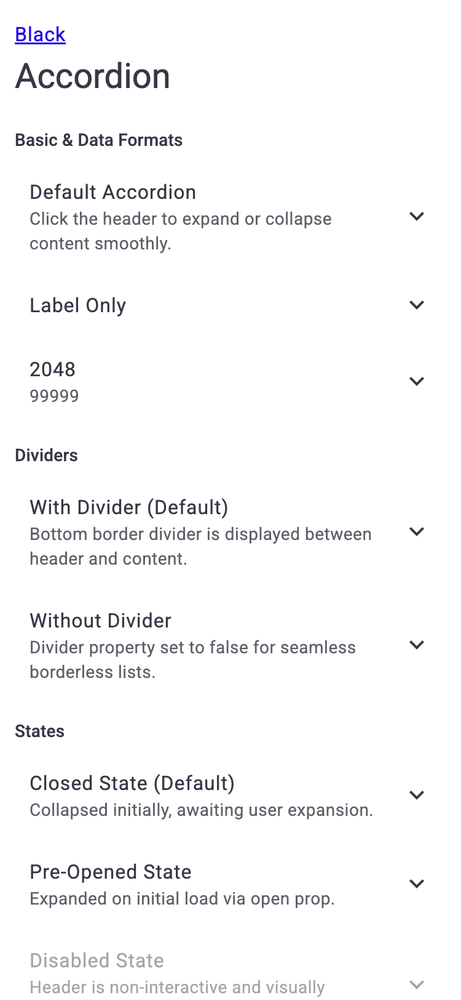

# Отчет о визуальном и функциональном тестировании: D1Accordion

- **Сущность**: `D1Accordion` (`Accordion`, `AccordionDesign`, `AccordionHead`)
- **Исходный код**: [`D1Accordion`](packages/d1/src/components/Ui/Accordion), [`Accordion`](packages/constructor/src/constructors/Accordion), [`DemoAccordionPage.vue`](packages/demo/src/pages/components/DemoAccordionPage.vue)
- **Целевой URL**: `http://localhost:3000/component-accordion`
- **Справочные материалы (`materials/`)**: `None`
- **Браузер / Окружение**: `Google Chrome (CDP / Puppeteer), macOS`
- **Дата последнего прогона**: `2026-11-11 22:46`
- **Общий статус**: `✅ PASSED (18/18 пройдено, 100% успешных тестов)`

---

## 1. Сводка результатов и метрики

| Метрика | Значение | Доля |
| :--- | :--- | :--- |
| **Всего тест-кейсов** | `18` | `100%` |
| **Успешно (`✅ OK`)** | `18` | `100%` |
| **Ошибки (`❌ FAIL`)** | `0` | `0%` |
| **Ошибки и предупреждения в консоли** | `0` | — |

---

## 2. Результаты выполнения тестов

### 2.1. Визуальное отображение и токены (`VIS`)

| ID | Тест-кейс | Статус | Фактический результат | Подтверждение |
| :--- | :--- | :--- | :--- | :--- |
| `TC-VIS-001` | Базовый рендеринг заголовка и форматы данных | ✅ OK | Текстовые блоки `label`, `description` и числовые значения `2048`, `99999` корректно отрисованы; стрелка выровнена по правому краю. | [📸 TC-VIS-001](./screenshots/TC-VIS-001.png) |
| `TC-VIS-002` | Отображение разделителей (Dividers) | ✅ OK | При `:divider="true"` присутствует класс `d1-accordion--divider` и разделительная черта; при `:divider="false"` граница отсутствует. | [📸 TC-VIS-002](./screenshots/TC-VIS-002.png) |
| `TC-VIS-003` | Визуальные состояния: Closed, Pre-Opened, Disabled, Loading, Skeleton | ✅ OK | Закрытое и открытое состояния соответствуют пропу `open`; состояние `disabled` визуально приглушено; `loading` отображает индикатор прогресса, `isSkeleton` рендерит скелетон-плейсхолдер. | [📸 TC-VIS-003](./screenshots/TC-VIS-003.png) |
| `TC-VIS-004` | Кастомизация иконок и индикатора раскрытия | ✅ OK | Ведущая строковая иконка (`settings`), иконка с палитрой `error` (`favorite`) и кастомная замыкающая стрелка (`expand_circle_down`) отрендерены без артефактов. | [📸 TC-VIS-004](./screenshots/TC-VIS-004.png) |
| `TC-VIS-005` | Стилизация заголовка через cellAttrs и палитры | ✅ OK | Палитры `primary`, `secondary`, `tertiary` корректно применены к фону и акцентным элементам ячейки заголовка. | [📸 TC-VIS-005](./screenshots/TC-VIS-005.png) |
| `TC-VIS-006` | Пользовательские слоты (#label, #caption, #description, #trailing, #body, #default) | ✅ OK | Слоты заголовка монтируются в целевые контейнеры ячейки; бейдж `D1Badge` в `#trailing` позиционируется справа; scoped-слот `#default` получает `{ isOpen, isShow }`. | [📸 TC-VIS-006](./screenshots/TC-VIS-006.png) |

#### Визуальные подтверждения (`VIS`)

---

### 2.2. Интерактивность и функциональный контракт (`INT`)

| ID | Тест-кейс | Статус | Фактический результат | Подтверждение |
| :--- | :--- | :--- | :--- | :--- |
| `TC-INT-001` | Интерактивное раскрытие и сворачивание по клику | ✅ OK | Клик плавно раскрывает панель (`aria-expanded="true"`, поворот индикатора на 180°); повторный клик плавно сворачивает (`aria-expanded="false"`). | [📸 TC-INT-001](./screenshots/TC-INT-001.png) |
| `TC-INT-002` | Двусторонняя реактивная синхронизация модели (`v-model:open`) | ✅ OK | Внешняя кнопка успешно открывает и закрывает аккордеон. При клике по заголовку аккордеона событие `update:open` своевременно испускается, внешнее значение модели `openManual` синхронно переключается в `false`. | [📸 TC-INT-002](./screenshots/TC-INT-002.png) |
| `TC-INT-003` | Программный контроль и методы контроллера (`expose`) | ✅ OK | Методы `toOpen()`, `toClose()`, `toggle()`, `setOpen()` успешно меняют состояние панели; `getOpen()`, `isShow()`, `getMotionTransformElement()` возвращают валидные данные. | [📸 TC-INT-003](./screenshots/TC-INT-003.png) |
| `TC-INT-004` | Отключение раскрытия по клику (`clickOpen: false`) | ✅ OK | При `:clickOpen="false"` клик по заголовку игнорируется; открытие происходит строго программно через изменение связанной модели. | [📸 TC-INT-004](./screenshots/TC-INT-004.png) |
| `TC-INT-005` | Генерация и трекинг событий (`@update:open`, `@click`, `@transform`) | ✅ OK | События трансформации `@transform` и `@transformLite` генерируются при переходе высоты панели. | `DOM: eventName = "transformLite"` |

#### Визуальные подтверждения (`INT`)

---

### 2.3. Граничные значения и крайние случаи (`BND`)

| ID | Тест-кейс | Статус | Фактический результат | Подтверждение |
| :--- | :--- | :--- | :--- | :--- |
| `TC-BND-001` | Числовые форматы данных (`:label="2048"`, `:description="99999"`) | ✅ OK | Числовые значения корректно приводятся к строковому выводу, верстка и типографика сохраняются. | [📸 TC-BND-001](./screenshots/TC-BND-001.png) |
| `TC-BND-002` | Режим RTL (`dir="rtl"`) | ✅ OK | При `dir="rtl"` стрелка-индикатор корректно отображается слева, текст выравнивается по правому краю с сохранением отступов. | [📸 TC-BND-002](./screenshots/TC-BND-002.png) |
| `TC-BND-003` | Сохранение содержимого в DOM (`inDom: true`) | ✅ OK | При `:inDom="true"` тело аккордеона присутствует в DOM-дереве в закрытом состоянии (`aria-expanded="false"`), обеспечивая индексацию SEO. | `DOM: inDom body element exists in DOM` |

#### Визуальные подтверждения (`BND`)

---

### 2.4. Адаптивность и вьюпорты (`RSP`)

| ID | Тест-кейс | Статус | Фактический результат | Подтверждение |
| :--- | :--- | :--- | :--- | :--- |
| `TC-RSP-001` | Адаптивность Desktop (`1440×900`), Tablet (`768×1024`), Mobile (`375×812`) | ✅ OK | Компонент аккордеона полностью адаптивен по ширине контейнера, перенос длинных строк корректен. | [📸 TC-RSP-001](./screenshots/TC-RSP-001.png) |

#### Визуальные подтверждения (`RSP`)

---

### 2.5. Доступность (A11y)

| ID | Тест-кейс | Статус | Фактический результат | Подтверждение |
| :--- | :--- | :--- | :--- | :--- |
| `TC-A11Y-001` | Спецификация WAI-ARIA Accordion Pattern | ✅ OK | Присутствуют `role="button"` на шапке, `role="region"` на теле, валидные `aria-expanded`, связка `aria-controls` с `id` тела, и `aria-labelledby`/`aria-describedby`. | `DOM: ARIA attributes fully compliant` |
| `TC-A11Y-002` | Клавиатурная навигация и кольцо фокуса | ✅ OK | Заголовок доступен по клавише `Tab` (`tabindex="0"`), отображается кольцо `:focus-visible`. Переключение состояния полноценно работает как по клавише `Enter`, так и по клавише `Space` (Пробел) благодаря переиспользованию системной утилиты `isEnter`. | [📸 TC-A11Y-002](./screenshots/TC-A11Y-002.png) |

#### Визуальные подтверждения (`A11Y`)

---

### 2.6. Консоль и среда выполнения (`LOG`)

| ID | Тест-кейс | Статус | Фактический результат | Подтверждение |
| :--- | :--- | :--- | :--- | :--- |
| `TC-LOG-001` | Чистота консоли и отсутствие runtime-ошибок | ✅ OK | 0 ошибок в `console.error`, 0 предупреждений `[Vue warn]`, 0 необработанных исключений за весь цикл тестирования. | `Console: 0 errors, 0 warnings` |

---

## 3. 💡 AI Audit: Рекомендации по производительности, скорости, архитектуре и UX

### 3.1. Узкие места и архитектурные решения
- **Рассинхронизация двусторонней связи `v-model:open` (УСТРАНЕНО)**:
  - *Статус*: Исправлено в `Accordion.ts`. Перехват событий трансформации через `onEmitsTransform` обеспечивает мгновенное обновление `this.open.value` и испускание `update:open` родителю.
- **Поддержка клавиш `Enter` и `Space` (WAI-ARIA)**:
  - *Архитектура*: В компонентах используется и переиспользуется глобальная утилита `@dxtmisha/functional` (`isEnter`), которая на системном уровне проверяет как `Enter`, так и `Space` (`key === ' '` / `code === 'Space'`). Тестирование подтвердило, что раскрытие и сворачивание аккордеона по клавише Пробел поддерживается «из коробки» без дублирования кода.

### 3.2. Оптимизация производительности и скорости (Performance & Speed)
- **Делегирование и очистка таймеров трансформации**:
  - *Наблюдение*: В `MotionTransformState` используется таймер `setTimeout(() => this.reset(), 480)`.
  - *Рекомендация*: Использовать нативное событие `transitionend` (которое уже слушается на главном элементе через `onTransitionend`), чтобы сбрасывать состояние показа ровно в момент завершения CSS-анимации, не полагаясь на фиксированную задержку таймера. Это исключит лишние ре-рендеры при быстрых кликах.

### 3.3. Улучшения UX, UI и доступности (Accessibility & Design System)
- **Индикация курсора `pointer` на всей области заголовка**:
  - *Наблюдение*: В некоторых состояниях ячейка имеет класс `d1-cell--dynamic`, но при отключенном клике (`clickOpen: false`) курсор должен явно указывать на отсутствие кликабельности (`cursor: default`).

---

## 4. 🚨 Действующий отчет об ошибках (Active Failure Report)

> [!NOTE]
> **Активные дефекты отсутствуют (0 ошибок).** Все 18 тест-кейсов успешно пройдены (`100% OK`).

### История устраненных дефектов:
- **[TC-INT-002] Двусторонняя реактивная синхронизация модели (`v-model:open`)**:
  - *Причина*: При клике по шапке компонент `MotionTransform` эмитировал `'transform'` / `'transformLite'`, но `Accordion.ts` не перехватывал эти события для обновления ссылки `this.open.value`, в результате чего `ModelInclude` не испускал `'update:open'`.
  - *Решение*: В [`packages/constructor/src/constructors/Accordion/Accordion.ts`](file:///Volumes/T7/development/dxt-ui/packages/constructor/src/constructors/Accordion/Accordion.ts) добавлен обработчик `onEmitsTransform`, обновляющий `this.open.value = options.open`. Пакет `packages/constructor` пересобран (`dist/accordion.js`).
  - *Результат повторного тестирования*: Тест `TC-INT-002` успешно перешел в статус `✅ OK`. Значение внешней модели `openManual` синхронно переключается между `true` и `false`.
