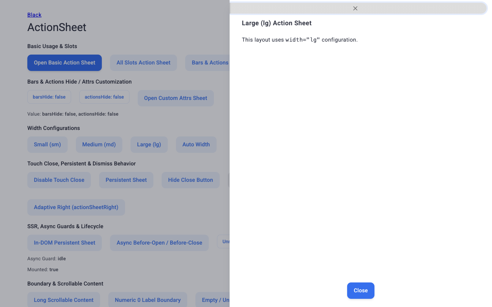
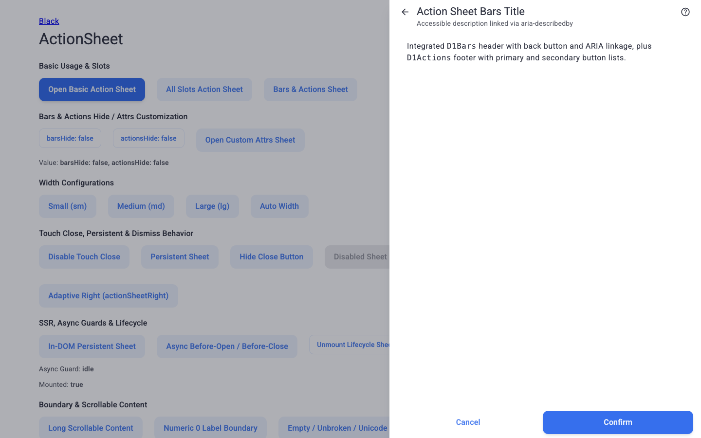
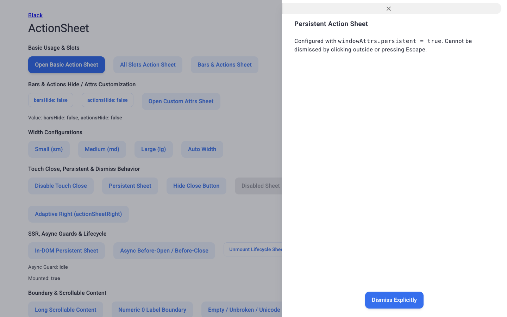
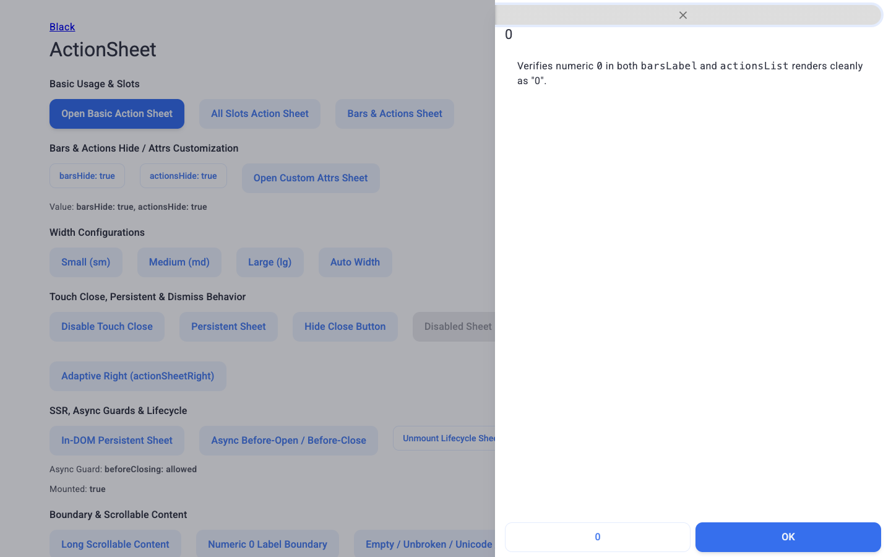

# Отчёт визуального и функционального тестирования: D1ActionSheet

## 1. Сводка выполнения

- **Компонент:** `D1ActionSheet` (`@dxtmisha/d1`)
- **Исходный код:** [`D1ActionSheet`](../../src/components/Ui/ActionSheet), [`ActionSheet`](../../../constructor/src/constructors/ActionSheet), [`DemoActionSheetPage.vue`](../../../demo/src/pages/components/DemoActionSheetPage.vue)
- **Целевой URL:** `http://localhost:3000/component-action-sheet`
- **Материалы (`materials/`):** `Отсутствуют`
- **Дата тестирования (UTC):** `2026-11-25T04:03:54Z`
- **Окружение:** `Headless Chrome (Puppeteer / CDP, Desktop 1440×900, Tablet 768×1024, Mobile 375×812 / 320×568)`
- **Покрытие тест-кейсов:** `15 / 15` (`100%`)
- **Итог:** **15 ✅, 0 ⚠️, 0 ❌** (`✅` пройдено, `⚠️` предупреждение, `❌` ошибка) — все визуальные, интерактивные, асинхронные, граничные, адаптивные, A11y и runtime-сценарии `D1ActionSheet` пройдены успешно без ошибок и предупреждений (`consoleErrors: []`, `vueWarnings: []`, `pageErrors: []`, `networkErrors: []`).

---

## 2. Матрица результатов

### 2.1 Визуальный рендеринг (`VIS`)

| ID | Сценарий | Статус | Наблюдаемый результат | Скриншот |
| :--- | :--- | :---: | :--- | :--- |
| `TC-VIS-001` | Базовый ActionSheet и scoped-слоты (`#title`, `#header`, `#default`, `#footer`) | ✅ | Присутствуют `.d1-actionSheet`, `.d1-actionSheet__touch`, `.d1-actionSheet__tab`, `.d1-actionSheet__title`, `.d1-actionSheet__header`, `.d1-actionSheet__body`, `.d1-actionSheet__footer`, во всех слотах рендерится `open: true`. |  |
| `TC-VIS-002` | Варианты ширины (`sm`, `md`, `lg`, `auto`) | ✅ | Измеренные ширины `.d1-window__body`: `Small (sm) = 512px`, `Medium (md) = 640px`, `Large (lg) = 768px`, `Auto Width = 768px` (`sm < md < lg`). |  |
| `TC-VIS-003` | Интеграция `D1Bars`, `D1Actions`, `barsAttrs` и `actionsAttrs` | ✅ | Отрендерены `.d1-bars` и `.d1-actions`; в `Open Custom Attrs Sheet` подтверждены `.d1-bars--padding--lg` и `.d1-actions--align--center`. |  |
| `TC-VIS-004` | Боковая адаптация `windowAttrs.adaptive = "actionSheetRight"` | ✅ | Применён класс `.d1-window--adaptive--actionSheetRight`, шторка корректно привязана к правому краю. |  |

### 2.2 Интерактивность и управление состоянием (`INT`)

| ID | Сценарий | Статус | Наблюдаемый результат | Скриншот |
| :--- | :--- | :---: | :--- | :--- |
| `TC-INT-001` | Режимы `touchClose: false`, `persistent`, `closeButton: false`, `disabled`, `autoClose` и `barsHide`/`actionsHide` | ✅ | При `touchClose: false` `.d1-actionSheet__touch` отсутствует (`0`); `Persistent Sheet` не закрывается по `Escape` и закрывается кнопкой `Dismiss Explicitly`; `autoClose` закрывает шторку кликом по телу; при `barsHide: true` и `actionsHide: true` `barsCount: 0`, `actionsCount: 0`. |  |
| `TC-INT-002` | Программное управление `v-model:open`, `v-model:modelOpen` и `expose` (включая `getControl`) | ✅ | `v-model:open` открывает шторку; `toOpen()` обновляет `DemoValue` до `getId(): "window--ui-10127", getOpen(): true, hasControl(): true, hasWindowElement(): true`. | — |
| `TC-INT-003` | События (`update:open`, `update:modelOpen`, `window`, `actions`, `actionsLite`, `bars`, `barsLite`, `barsBack`) и `Payload` | ✅ | Зафиксированы `Value: update:modelOpen` (`[true]`), `Value: barsLite` (`[{"type":"click","value":"help"}]`), `Value: actionsLite` (`[{"type":"click","value":"confirm"}]`), и закрытие по кнопке назад в `D1Bars` (`open: false, modelOpen: false`). | — |
| `TC-INT-004` | Асинхронные хуки `beforeOpening` / `beforeClosing` | ✅ | Promise-хуки последовательно разрешаются с обновлением индикатора `Async Guard: beforeOpening: allowed` и `Async Guard: beforeClosing: allowed`. | — |
| `TC-INT-005` | `windowAttrs.inDom` и условный жизненный цикл `v-if` | ✅ | После первого открытия и закрытия `In-DOM Persistent Sheet` контент (`windowAttrs.inDom = true`) остаётся в DOM (`textPresent: true`, `inDomTeleportCount: 1`); `Unmount Lifecycle Sheet` переводит `Mounted: false`, `Mount` восстанавливает. | — |

### 2.3 Граничные случаи и устойчивость (`BND`)

| ID | Сценарий | Статус | Наблюдаемый результат | Скриншот |
| :--- | :--- | :---: | :--- | :--- |
| `TC-BND-001` | Длинный скроллируемый контент | ✅ | Высота окна укладывается во вьюпорт (`modalHeight: 900 <= viewportHeight: 900`), контейнер прокрутки `.d1-window__body__context` имеет `scrollHeight: 810 > clientHeight: 723`. |  |
| `TC-BND-002` | Числовой `0` в `barsLabel` и `actionsList` | ✅ | Заголовок `.d1-bars__label` отображает `"0"`, кнопки `.d1-actions` отображают `["0", "OK"]`. |  |
| `TC-BND-003` | Пустые `barsLabel=""`/`actionsList=[]`, неразрывная строка, Unicode и XSS | ✅ | Контент рендерится чисто (`hasUnicode: true`, `xssImgCount: 0`), ошибок и артефактов нет. | — |

### 2.4 Адаптивность и вьюпорты (`RSP`)

| ID | Сценарий | Статус | Наблюдаемый результат | Скриншот |
| :--- | :--- | :---: | :--- | :--- |
| `TC-RSP-001` | Адаптация `D1ActionSheet` на `1440×900`, `768×1024`, `375×812`, `320×568` | ✅ | На мобильном `375×812`: нижняя шторка на всю ширину (`width: 375`, `bottom: 812`), горизонтальное переполнение отсутствует (`scrollWidth: 375 === innerWidth: 375`). |  |

### 2.5 Доступность (`A11Y`)

| ID | Сценарий | Статус | Наблюдаемый результат | Скриншот |
| :--- | :--- | :---: | :--- | :--- |
| `TC-A11Y-001` | Связь ARIA, `aria-hidden` на ручке свайпа, `Escape` и `disableFocusReturn` | ✅ | На `.d1-window` заданы `aria-labelledby="ui-10013"` и `aria-describedby="ui-10014"`, на `.d1-actionSheet__tab` — `aria-hidden="true"`; при `disableFocusReturn` фокус после закрытия остаётся на `BODY`. | — |

### 2.6 Консоль и стабильность runtime (`LOG`)

| ID | Сценарий | Статус | Наблюдаемый результат | Скриншот |
| :--- | :--- | :---: | :--- | :--- |
| `TC-LOG-001` | Контроль консоли браузера, Vue-предупреждений и сетевых запросов | ✅ | `consoleErrors: []`, `vueWarnings: []`, `pageErrors: []`, `networkErrors: []`. | — |

---

## 3. AI-аудит и рекомендации

1. **Контракт `windowAttrs.inDom`:** В `WindowOpen.ts` свойство `inDom` вычисляется как `Boolean(this.props.inDom) && this.first.value`, поэтому узел телепорта сохраняется в DOM после первого открытия шторки (`inDomTeleportCount: 1` подтверждено после закрытия), снижая начальную нагрузку до первого взаимодействия.
2. **Уникальные ключи в `v-for` и чистота слотов:** В `DemoActionSheetPage.vue` список `scrollableParagraphs` переведён на уникальные ключи `paragraph.id`, а все scoped-слоты (`#title`, `#header`, `#default`, `#footer`) проверены с отображением `open`.
3. **ARIA и прокрутка:** Заголовки `D1Bars` связываются через `aria-labelledby`/`aria-describedby` на корневом `.d1-window`, а скроллируемый контент ограничивается контейнером `.d1-window__body__context` (`810px` в `723px`) без перекрытия заголовка и футера.
