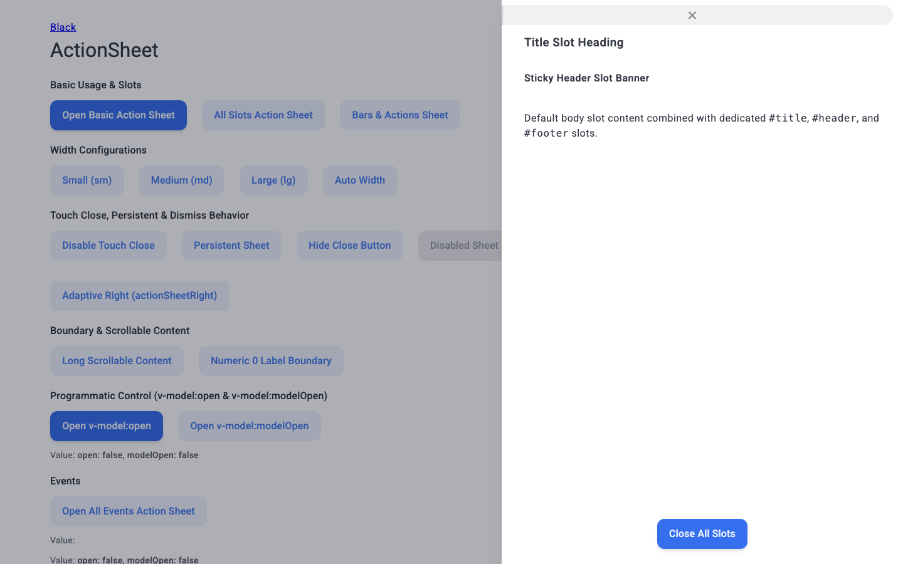
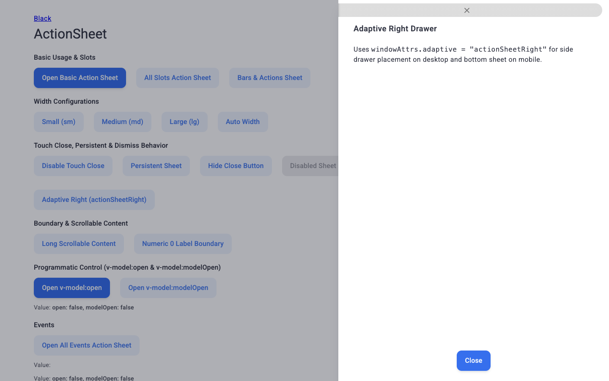
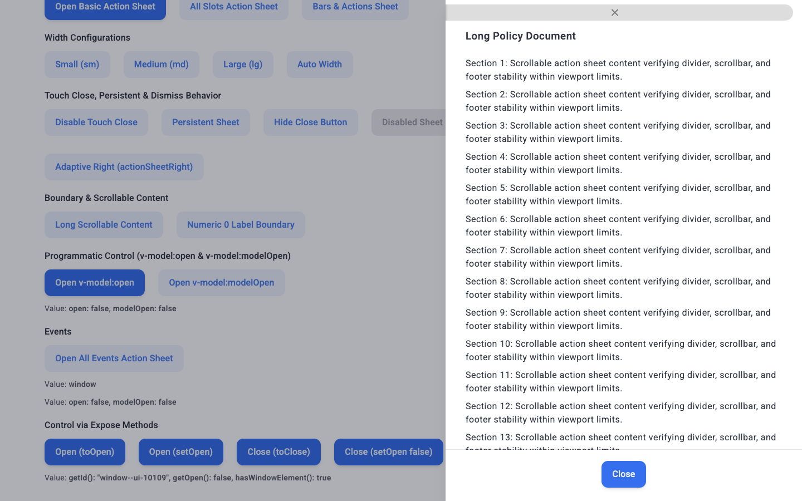
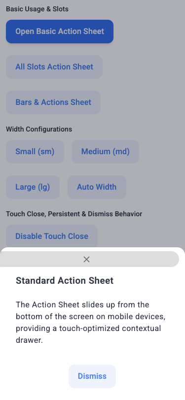

# Отчёт о визуальном и функциональном тестировании: D1ActionSheet

## 1. Сводка (Executive Summary)

- **Компонент:** `D1ActionSheet` (`@dxtmisha/d1`)
- **Исходный код:** [`D1ActionSheet`](../../src/components/Ui/ActionSheet), [`ActionSheet`](../../../constructor/src/constructors/ActionSheet), [`DemoActionSheetPage.vue`](../../../demo/src/pages/components/DemoActionSheetPage.vue)
- **URL демо-стенда:** `http://localhost:3000/component-action-sheet`
- **Справочные материалы (`materials/`):** `Отсутствуют`
- **Дата тестирования (UTC):** `2026-11-23T12:07:48Z`
- **Окружение:** `Headless Chrome (Puppeteer / CDP, Desktop 1440×900, Tablet 768×1024, Mobile 375×812 / 320×568)`
- **Покрытие тест-кейсами:** 12 / 12 (`100%`)
- **Итог:** **12 ✅, 0 ⚠️, 0 ❌** (`✅` пройдено, `⚠️` предупреждение, `❌` провалено) — компонент `D1ActionSheet` корректно отображает все слоты, ширины, интеграцию `D1Bars`/`D1Actions`, touch-обёртку с декоративным `aria-hidden` индикатором, режимы закрытия, `v-model:open`/`v-model:modelOpen`, `expose`, ARIA-связи и трансформацию в нижнюю шторку на мобильных экранах при полном отсутствии ошибок консоли, Vue-предупреждений и сетевых сбоев.

---

## 2. Матрица результатов (Baseline Matrix)

### 2.1 Визуал и дизайн-система (`VIS`)

| ID | Сценарий | Статус | Фактический результат | Скриншот |
| :--- | :--- | :---: | :--- | :--- |
| `TC-VIS-001` | Базовый ActionSheet и отображение всех слотов (`#title`, `#header`, `#default`, `#footer`) | ✅ | Лист привязан к правому краю на desktop (`640×900px`, `left: 800`, `right: 1440`); присутствуют `.d1-actionSheet__touch`, `.d1-actionSheet__tab` (`aria-hidden="true"`), `.d1-actionSheet__title`, `.d1-actionSheet__header`, `.d1-actionSheet__body`, `.d1-actionSheet__footer` без клиппинга и наложений. |  |
| `TC-VIS-002` | Варианты ширины (`sm`, `md`, `lg`, `auto`) | ✅ | Измеренные ширины `.d1-window__body`: `sm = 512px`, `md = 640px`, `lg = 768px`, `auto = 768px`; классы `.d1-actionSheet--width--{sm,md,lg,auto}` соответствуют пропам, `sm < md < lg`. |  |
| `TC-VIS-003` | Интеграция `D1Bars` и `D1Actions` | ✅ | Отрендерены `.d1-bars` (`Action Sheet Bars Title`, описание, кнопки назад и `help`) и `.d1-actions` с классом `.d1-actions--align--auto` и кнопками `["Reset", "Cancel", "Confirm"]`. |  |
| `TC-VIS-004` | Боковая адаптация `windowAttrs.adaptive = "actionSheetRight"` | ✅ | Применён класс `.d1-window--adaptive--actionSheetRight`, геометрия `640×900px` (`left: 800`, `right: 1440`) без искажений и артефактов. |  |

### 2.2 Интерактивность и управление состоянием (`INT`)

| ID | Сценарий | Статус | Фактический результат | Скриншот |
| :--- | :--- | :---: | :--- | :--- |
| `TC-INT-001` | Режимы `touchClose: false`, `persistent`, `closeButton: false`, `disabled`, `autoClose` | ✅ | При `touchClose: false` `.d1-actionSheet__touch` отсутствует (`0`); `persistent` игнорирует `Escape` (`persistentStaysOpenOnEsc: true`) и закрывается кнопкой `Dismiss Explicitly`; при `closeButton: false` `.d1-window__close` отсутствует (`0`); `disabled` блокирует триггер (`true`); `autoClose` закрывает лист кликом по телу. |  |
| `TC-INT-002` | Программное управление `v-model:open`, `v-model:modelOpen` и `expose` | ✅ | `v-model:open` (`open: true, modelOpen: false`), `v-model:modelOpen` (`open: false, modelOpen: true`) и закрытие (`open: false, modelOpen: false`) работают синхронно; `toOpen()` обновляет `expose` (`getId(): "window--ui-10109"`, `getOpen(): true`, `hasWindowElement(): true`). | — |
| `TC-INT-003` | События (`window`, `actions`, `actionsLite`, `bars`, `barsLite`, `update:open`, `update:modelOpen`) | ✅ | При открытии синхронно обновляются обе модели (`open: true, modelOpen: true`); зафиксированы события `window`, `actions`, `actionsLite`, `bars`, `barsLite` и закрывающее `window`. | — |

### 2.3 Граничные случаи и устойчивость (`BND`)

| ID | Сценарий | Статус | Фактический результат | Скриншот |
| :--- | :--- | :---: | :--- | :--- |
| `TC-BND-001` | Длинный скроллируемый контент | ✅ | Высота листа укладывается во вьюпорт (`900px <= 900px`, `fitsViewport: true`), внутренняя область прокручивается (`scrollHeight: 810 > clientHeight: 723`), заголовок и кнопка `Close` остаются закреплёнными. |  |
| `TC-BND-002` | Числовой `0` в `barsLabel` и `actionsList` | ✅ | Заголовок `D1Bars` отображает `"0"`, кнопки `D1Actions` отображают `["0", "OK"]` — числовой `0` обрабатывается корректно. |  |

### 2.4 Адаптивность и вьюпорты (`RSP`)

| ID | Сценарий | Статус | Фактический результат | Скриншот |
| :--- | :--- | :---: | :--- | :--- |
| `TC-RSP-001` | Адаптация `D1ActionSheet` на `1440×900`, `768×1024`, `375×812`, `320×568` | ✅ | Desktop `1440px` (`640px`, `bottom: 900`) и Tablet `768px` (`640px`, `bottom: 1024`) используют боковую панель; Mobile `375px` (`375px`, `bottom: 812`) и `320px` (`320px`, `bottom: 568`) перестраиваются в нижнюю шторку на всю ширину экрана без горизонтального переполнения. |  |

### 2.5 Доступность (`A11Y`)

| ID | Сценарий | Статус | Фактический результат | Скриншот |
| :--- | :--- | :---: | :--- | :--- |
| `TC-A11Y-001` | Связь ARIA, `aria-hidden` на ручке свайпа, `Escape` и `disableFocusReturn` | ✅ | `aria-labelledby="ui-10016"` -> `"Action Sheet Bars Title"`, `aria-describedby="ui-10017"` -> `"Accessible description linked via aria-describedby"`, `.d1-actionSheet__tab` имеет `aria-hidden="true"`; `Escape` возвращает фокус на `"Bars & Actions Sheet"`, а `disableFocusReturn` оставляет фокус на `BODY`. | — |

### 2.6 Логи, консоль и стабильность runtime (`LOG`)

| ID | Сценарий | Статус | Фактический результат | Скриншот |
| :--- | :--- | :---: | :--- | :--- |
| `TC-LOG-001` | Контроль консоли браузера, Vue-предупреждений и сетевых запросов | ✅ | `vueWarnings: []`, `pageErrors: []`, `consoleErrors: []`, `networkErrors: []` на протяжении всех 12 сценариев. | — |

---

## 3. Аудит ИИ и рекомендации

1. **Ленивая инициализация `TouchEventInclude` и чистота памяти:** При `:touchClose="false"` класс `TouchEventInclude` не создаётся, а `.d1-actionSheet__touch` и `.d1-actionSheet__tab` полностью исключаются из DOM — это снижает нагрузку на память и обработчики событий на десктопных сценариях без свайпа.
2. **Семантика атрибута `data-touch` и рендеринг через `WindowDesign`:** Атрибут `data-touch="touch"`, передаваемый через `mergeProps` из `ActionSheetDesign`, корректно пробрасывается `WindowDesign.renderBody()` на элемент `.d1-window__body`, благодаря чему CSS-переменная `--sys-touch-move-y` смещает видимое тело шторки при свайпе вниз без артефактов на оверлее.
3. **Адаптивность и UX-эргономика:** Переход от боковой панели (`640px`) на десктопе к нижней шторке во всю ширину экрана (`375px`, `320px`) проходит без переполнения и сдвигов, а декоративная ручка `.d1-actionSheet__tab` скрыта от скринридеров через `aria-hidden="true"`.
