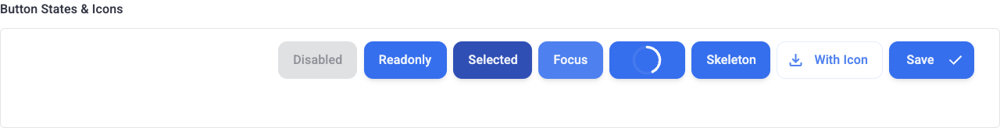
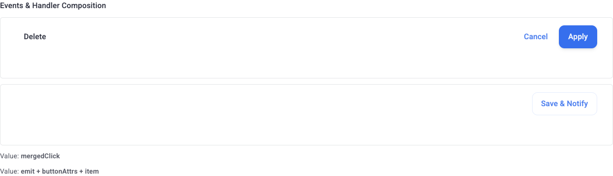
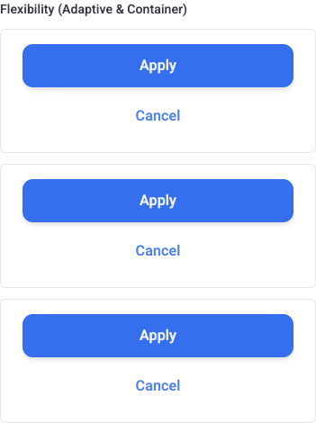

# Отчёт визуального и функционального тестирования: D1Actions

## 1. Сводка выполнения

- **Компонент:** `D1Actions` (`@dxtmisha/d1`)
- **Исходный код:** [`D1Actions`](../../src/components/Ui/Actions), [`Actions`](../../../constructor/src/constructors/Actions)
- **Целевой URL:** `http://localhost:3000/component-actions`
- **Материалы (`materials/`):** `Отсутствуют`
- **Дата тестирования (UTC):** `2026-11-15T11:07:37Z`
- **Окружение:** `Headless Chrome (Puppeteer / CDP, Desktop 1440×900, Tablet 768×1024, Mobile 375×812 / 320×568)`
- **Покрытие тест-кейсов:** `14 / 14` (`100%`)
- **Итог:** **13 ✅, 1 ⚠️, 0 ❌** (`✅` пройдено, `⚠️` предупреждение, `❌` ошибка) — все визуальные, интерактивные, граничные, адаптивные и A11y-сценарии `D1Actions` пройдены успешно; двойная инверсия в `align="right"` устранена, приоритет `paddingByIndent` над `padding` явно подтверждён и покрыт демо; единственное предупреждение в `TC-LOG-001` относится к отсутствующему `/favicon.ico` (`404`) на демо-стенде при `vueWarnings: []` и `pageErrors: []`.

---

## 2. Матрица результатов

### 2.1 Визуальный рендеринг (`VIS`)

| ID | Сценарий | Статус | Наблюдаемый результат | Скриншот |
| :--- | :--- | :---: | :--- | :--- |
| `TC-VIS-001` | Базовый рендеринг списков (`list`, `list + listSecondary`, `listSecondary`) и спейсера | ✅ | Отрендерено `39` экземпляров `.d1-actions` на странице, в группе `Basic Lists` — `3` блока (`1246×64px`, `gap: 8px`), `.d1-actions__spacer` разделяет группы (`Cancel`/`Apply` справа по умолчанию, `Delete` слева), `scrollWidth: 1440 === innerWidth: 1440`. |  |
| `TC-VIS-002` | Варианты выравнивания (`right`, `left`, `center`, `block`, `auto`, `none`) | ✅ | CSS `order` убран, порядок полностью корректен: `align="right"` -> `Delete` слева (`113px`), `Cancel`/`Apply` справа (`1159px`); `align="left"` и `align="none"` -> primary слева (`113px`), secondary справа (`1247px`); `center` (`justifyContent: center`), `block` (`column-reverse`), `auto` (`flexGrow: 1`). |  |
| `TC-VIS-003` | Варианты отступов (`padding`, `paddingByIndent`) и `buttonAttrs` / `buttonSecondaryAttrs` | ✅ | При `:paddingByIndent="false"` варианты `padding` корректно применяются (`sm`: `8/12px`, `md`: `12/16px`, `lg`: `16/20px`, `ySm`: `8/0px`, `yMd`: `12/0px`, `yLg`: `16/0px`, `none`: `0/0px`); при дефолтном `paddingByIndent: true` (`padding="lg"`) подтверждён ожидаемый приоритет `.d1-actions--paddingByIndent` (`8/16px`). `buttonAttrs`/`buttonSecondaryAttrs` применены ко всем `3` блокам. |  |
| `TC-VIS-004` | Состояния кнопок, иконки и слоты (`#default`, `#secondary`) | ✅ | В группе `Slots` отрендерены `[2, 1, 2, 5]` кнопок (в смешанном блоке: `Delete`, `Extra Secondary`, `Cancel`, `Apply`, `Extra Primary`); в группе `Button States & Icons` все `8` состояний (`disabled`, `readonly`, `selected`, `focus`, `loading`, `skeleton`, `icon`, `iconTrailing`) отображены корректно (`disabledCount: 1`, `hasSkeleton: true`). |  |

### 2.2 Интерактивность и управление состоянием (`INT`)

| ID | Сценарий | Статус | Наблюдаемый результат | Скриншот |
| :--- | :--- | :---: | :--- | :--- |
| `TC-INT-001` | Перенос (`wrap` vs `:wrap="false"`) и динамическое переключение выравнивания | ✅ | В `Wrap & Multi-Item Layout` первый блок имеет `.d1-actions--wrap`, второй не имеет. При кликах по `Align Left`, `Align Center`, `Align Block`, `Align Right` целевой блок сменил классы и обновил `DemoValue` (`Value: right (2 items)`). |  |
| `TC-INT-002` | Динамическое добавление, очистка и сброс элементов списка | ✅ | Стартово `3` кнопки (`2` items + `1` secondary) -> после `2` кликов `Add Item`: `4`, затем `5` кнопок (`Value: right (4 items)`) -> после `Clear`: `1` кнопка (осталась `secondary`, `Value: right (0 items)`) -> после `Reset`: `3` кнопки (`Value: right (2 items)`). |  |
| `TC-INT-003` | События `@click`, `@click-lite` и композиция обработчиков (`mergeProps`) | ✅ | Клики по `Apply` и `Delete` зафиксировали консольные логи `Event: click` и `Event: clickLite` (`Value: clickLite`); клик по `Save & Notify` вызвал все 3 обработчика без затирания (`Value: mergedClick` и `Value: emit + buttonAttrs + item`). |  |

### 2.3 Граничные случаи и устойчивость (`BND`)

| ID | Сценарий | Статус | Наблюдаемый результат | Скриншот |
| :--- | :--- | :---: | :--- | :--- |
| `TC-BND-001` | Пустые массивы `[]`, пустой компонент и длинный текст кнопки | ✅ | `<D1Actions />` и `:list="[]" :listSecondary="[]"` отрендерили по `0` кнопок и `1` `.d1-actions__spacer`; длинный текст кнопки поместился без переполнения (`width: 1246px, scrollWidth: 1246px`). |  |
| `TC-BND-002` | Устойчивость при серии из 5 быстрых повторных кликов | ✅ | Выполнено `5` быстрых кликов по `Apply`, зафиксировано `10` событий (`click` + `clickLite` на каждый клик), ошибок и деградации DOM нет. | — |

### 2.4 Адаптивность и вьюпорты (`RSP`)

| ID | Сценарий | Статус | Наблюдаемый результат | Скриншот |
| :--- | :--- | :---: | :--- | :--- |
| `TC-RSP-001` | Адаптивное поведение `flexible="adaptiveMd"` (`1440`, `768`, `375`, `320`) | ✅ | На `1440×900` и `768×1024`: `flexDirection: row`, `secondaryDisplay: flex`, `spacerDisplay: block`. На `375×812` (`boxWidth: 325, scrollWidth: 325`) и `320×568` (`boxWidth: 270, scrollWidth: 270`): перестроение в `column-reverse`, `secondaryDisplay: none`, `spacerDisplay: none`. |  |
| `TC-RSP-002` | Контейнерное поведение `flexible="containerMd"` с `DemoBox container` (`1440`, `768`, `375`, `320`) | ✅ | Обе обёртки имеют `parentContainerType: inline-size`. На `1440×900`: широкий `containerMd` (`1246px`) в `row` (`secondaryDisplay: flex`), узкий `480px` (`boxWidth: 446 === scrollWidth: 446`) переключился в `column-reverse` (`secondaryDisplay: none`, `spacerDisplay: none`). На `768×1024`: `adaptiveMd` остался в `row`, а `containerMd` (`702px < 768px`) уже перешёл в `column-reverse`. На `375×812` (`325 === 325`) и `320×568` (`270 === 270`) все блоки в `column-reverse` без переполнения. |  |

### 2.5 Доступность (`A11Y`)

| ID | Сценарий | Статус | Наблюдаемый результат | Скриншот |
| :--- | :--- | :---: | :--- | :--- |
| `TC-A11Y-001` | Проверка `role`, `ariaLabel`, `textActions` и значения по умолчанию | ✅ | Первый блок `Accessibility & Semantics`: `role="toolbar"`, `aria-label="Document Editing Actions"`; второй блок: `aria-label="Custom Actions Landmark"`; базовый блок: `aria-label="Actions"`. | — |
| `TC-A11Y-002` | Клавиатурная навигация `Tab` и активация `Enter` | ✅ | Переход клавишей `Tab` с `Delete` перевёл фокус на кнопку `Cancel` (`tagName: BUTTON`), нажатие `Enter` вызвало оба события (`Event: click`, `Event: clickLite`). | — |

### 2.6 Логи и консоль (`LOG`)

| ID | Сценарий | Статус | Наблюдаемый результат | Скриншот |
| :--- | :--- | :---: | :--- | :--- |
| `TC-LOG-001` | Чистота консоли, Vue-предупреждений и сетевых запросов | ⚠️ | `vueWarnings: []`, `pageErrors: []`; единственная запись `consoleErrors` / `networkErrors` — отсутствующий на демо-стенде `404 http://localhost:3000/favicon.ico`. | — |

---

## 3. AI-аудит и рекомендации

1. **Приоритет `paddingByIndent` над `padding`:** В текущей архитектуре `D1Actions` свойство `paddingByIndent` по умолчанию включено (`true`) и объявлено после `.d1-actions--padding--*`, поэтому перебивает `padding` стандартными отступами контейнера (`--d1-layout-paddingX/Y`). Это ожидаемое поведение (явно отражено в демо-примерах и D1-тестах); чтобы применить `padding="sm" | "md" | "lg" | ...`, необходимо передавать `:paddingByIndent="false"`.
2. **Контейнерные запросы (`@container` / `flexible="container*"`):** Модификаторы `containerSm`..`container2xl` требуют наличия `container-type: inline-size` у родительского контейнера: в `DemoBox.vue` добавлен проп `container` (`.demo-box--container`), а в Storybook для `ActionsFlexible` используется класс `.wiki-storybook-container`.
3. **Порядок обработчиков в `mergeProps`:** `this.item.i('event').onClick` передаётся первым аргументом в `mergeProps`, поэтому `@click`/`@click-lite` эмит компонента срабатывает перед `buttonAttrs.onClick` и `item.onClick` (`emit + buttonAttrs + item`) без перезатирания.
