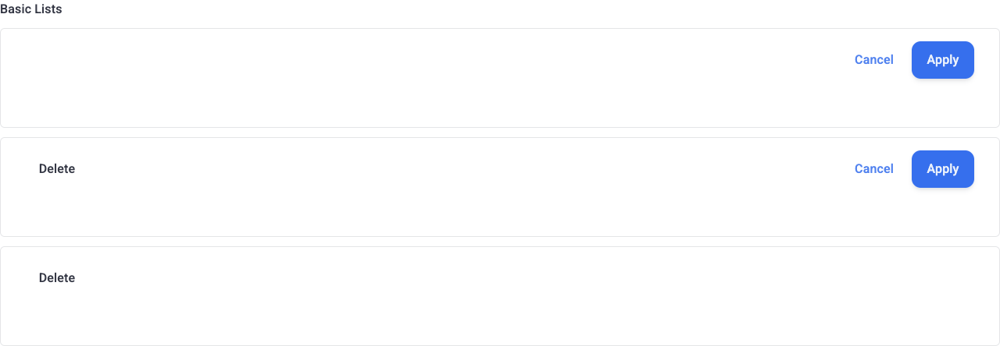
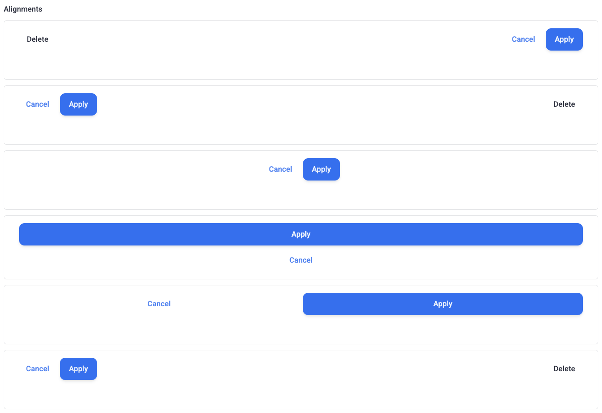
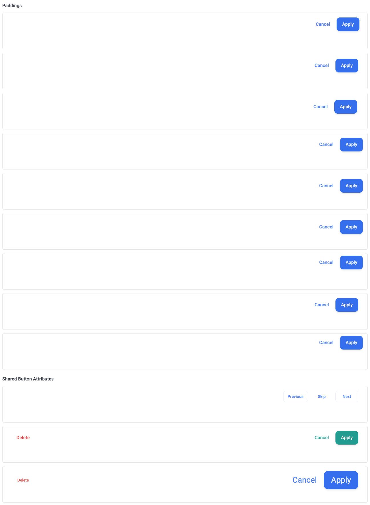
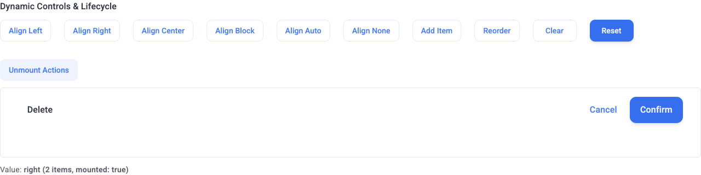
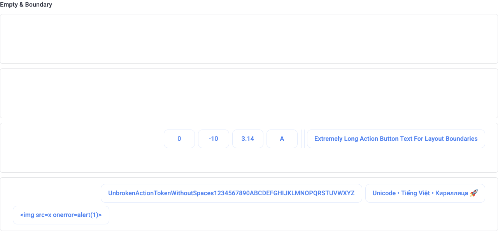
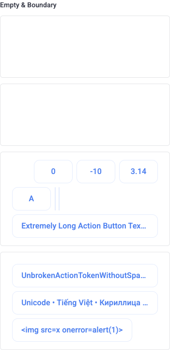
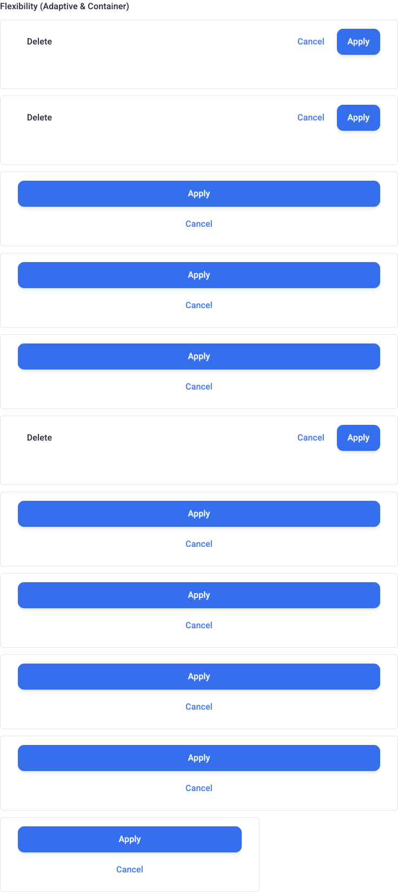

# Отчёт визуального и функционального тестирования: D1Actions

## 1. Сводка выполнения

- **Компонент:** `D1Actions` (`@dxtmisha/d1`)
- **Исходный код:** [`D1Actions`](../../src/components/Ui/Actions), [`Actions`](../../../constructor/src/constructors/Actions), [`DemoActionsPage.vue`](../../../demo/src/pages/components/DemoActionsPage.vue)
- **Целевой URL:** `http://localhost:3000/component-actions`
- **Материалы (`materials/`):** `Отсутствуют`
- **Дата тестирования (UTC):** `2026-11-25T04:14:59Z`
- **Окружение:** `Headless Chrome (Puppeteer / CDP, Desktop 1440×900, Tablet 768×1024, Mobile 375×812 / 320×568)`
- **Покрытие тест-кейсов:** `17 / 17` (`100%`)
- **Итог:** **17 ✅, 0 ⚠️, 0 ❌** (`✅` пройдено, `⚠️` предупреждение, `❌` ошибка) — все 10 режимов `flexible`, состояния блокировки (`disabled`/`readonly`/`loading`), скелетон, события с payload, A11y, граничные кейсы с усечением длинных меток (`ellipsis`) на мобильных вьюпортах и runtime-здоровье пройдены на 100% без ошибок и предупреждений (`consoleErrors: []`, `vueWarnings: []`, `pageErrors: []`, `networkErrors: []`).

---

## 2. Матрица результатов

### 2.1 Визуальный рендеринг (`VIS`)

| ID | Сценарий | Статус | Наблюдаемый результат | Скриншот |
| :--- | :--- | :---: | :--- | :--- |
| `TC-VIS-001` | Базовый рендеринг списков (`list`, `list + listSecondary`, `listSecondary`) и спейсера | ✅ | На странице `50` экземпляров `.d1-actions`, в группе `Basic Lists` — `3` блока и `3` `.d1-actions__spacer`, на десктопе `scrollWidth: 1440 === 1440`; короткие кнопки выровнены чисто. |  |
| `TC-VIS-002` | Варианты выравнивания (`right`, `left`, `center`, `block`, `auto`, `none`) | ✅ | Классы `.d1-actions--align--{right,left,center,block,auto,none}` и направления (`block` -> `column-reverse`, остальные `row`) применены точно. |  |
| `TC-VIS-003` | Варианты отступов (`padding`, `paddingByIndent`) и `buttonAttrs` / `buttonSecondaryAttrs` | ✅ | При `:paddingByIndent="false"` отступы соответствуют токенам (`sm` `8/12px`, `md` `12/16px`, `lg` `16/20px`, `ySm` `8/0px`, `yMd` `12/0px`, `yLg` `16/0px`, `none` `0/0px`); при `paddingByIndent: true` приоритет у `8/16px`. |  |
| `TC-VIS-004` | Состояния кнопок, скелетон `D1Skeleton`, иконки и слоты (`#default`, `#secondary`) | ✅ | Присутствуют `disabledCount: 1`, `readonlyCount: 1`, `selectedCount: 1`, `focusCount: 1`, индикатор загрузки и активный `D1Skeleton` с двумя плейсхолдерами; текст и иконки центрированы без смещения. |  |

### 2.2 Интерактивность и управление состоянием (`INT`)

| ID | Сценарий | Статус | Наблюдаемый результат | Скриншот |
| :--- | :--- | :---: | :--- | :--- |
| `TC-INT-001` | Перенос (`wrap`) и динамическое переключение всех 6 значений `align` | ✅ | Кнопки `Align Left`, `Align Auto`, `Align None`, `Align Right` реактивно обновляют раскладку и `Value: right (2 items, mounted: true)`. |  |
| `TC-INT-002` | Добавление, перестановка (`Reorder`), очистка, сброс и жизненный цикл `v-if` | ✅ | После `Add Item` + `Reorder` кнопки: `["Delete", "Extra 3", "Confirm", "Cancel"]`; `Clear` -> `0 items`; `Unmount Actions` -> `actionsCount: 0, mounted: false`; `Mount Actions` восстанавливает блок. |  |
| `TC-INT-003` | События `@click`, `@click-lite`, `Payload` и композиция (`mergeProps`) | ✅ | Зафиксированы `Value: mergedClick`, `Payload: ["click",{"type":"click","value":"save-notify"}]` и `Order: emit + buttonAttrs + item`. |  |
| `TC-INT-004` | Блокировка кликов для `disabled`, `readonly`, `loading` и динамических переключателей | ✅ | Клики по `Disabled`, `Readonly`, `Loading` оставили `Last Enabled Click: none`; клик по `Enabled` -> `enabled`; после `Toggle Disabled` клик по `Apply` заблокирован (`enabled`). | — |
| `TC-INT-005` | Восстановление интерактивности после снятия `Toggle Disabled` | ✅ | После повторного нажатия `Toggle Disabled` клик по `Apply` обновил `Last Enabled Click: apply`. | — |

### 2.3 Граничные случаи и устойчивость (`BND`)

| ID | Сценарий | Статус | Наблюдаемый результат | Скриншот |
| :--- | :--- | :---: | :--- | :--- |
| `TC-BND-001` | Пустые массивы `[]`, `0`, `-10`, `3.14`, `"A"`, `""`, `"   "` и длинный текст | ✅ | Пустые блоки рендерят `0` кнопок без ошибок; числа `0`, `-10`, `3.14` и `"A"` отображаются корректно. |  |
| `TC-BND-002` | Устойчивость при серии из 5 быстрых кликов | ✅ | Выполнено `5` быстрых кликов по `Apply`, `consoleErrors: 0`. | — |
| `TC-BND-003` | Неразрывный токен, длинный заголовок кнопки, Unicode и экранирование XSS | ✅ | На `375×812` (`btnWidth: 301 === btnScrollWidth: 301`, `boxWidth: 351`) и `320×568` (`btnWidth: 246 === btnScrollWidth: 246`, `boxWidth: 296`) длинные и неразрывные метки аккуратно усекаются через `text-overflow: ellipsis` (`display: block`, `overflow: hidden`) без переполнения (`pageScrollWidth === innerWidth`); XSS (`xssImgCount: 0`) экранирован. |  |

### 2.4 Адаптивность и вьюпорты (`RSP`)

| ID | Сценарий | Статус | Наблюдаемый результат | Скриншот |
| :--- | :--- | :---: | :--- | :--- |
| `TC-RSP-001` | Все 5 режимов `adaptive*` (`adaptiveSm`..`adaptive2xl`) на `1440`, `768`, `375`, `320` | ✅ | Переполнение отсутствует на всех 4 вьюпортах: `1440 === 1440`, `768 === 768`, `375 === 375`, `320 === 320`; `adaptiveMd` перестраивается в `column-reverse` на `< 768px`. |  |
| `TC-RSP-002` | Все 5 режимов `container*` (`containerSm`..`container2xl`) внутри `DemoBox container` | ✅ | При `768×1024`: `adaptiveMd` остаётся в `row`, а `containerMd` уже перешёл в `column-reverse`; на `375×812` и `320×568` все блоки адаптируются без переполнения. |  |

### 2.5 Доступность (`A11Y`)

| ID | Сценарий | Статус | Наблюдаемый результат | Скриншот |
| :--- | :--- | :---: | :--- | :--- |
| `TC-A11Y-001` | Проверка `role`, `ariaLabel` и `textActions` | ✅ | `firstRole: "toolbar"`, `firstLabel: "Document Editing Actions"`, `secondLabel: "Custom Actions Landmark"`, `defaultLabel: "Actions"`. | — |
| `TC-A11Y-002` | Клавиатурная навигация `Tab` и активация `Enter` | ✅ | Фокус по `Tab` и нажатие `Enter` вызвали событие (`Value: clickLite`). | — |

### 2.6 Консоль и стабильность runtime (`LOG`)

| ID | Сценарий | Статус | Наблюдаемый результат | Скриншот |
| :--- | :--- | :---: | :--- | :--- |
| `TC-LOG-001` | Чистота консоли, Vue-предупреждений и сетевых запросов | ✅ | `consoleErrors: []`, `vueWarnings: []`, `pageErrors: []`, `networkErrors: []`. | — |

---

## 3. AI-аудит и рекомендации

1. **Усечение длинных меток в `Button/style.scss` и `Actions/style.scss`:** Ограничение `max-width: 100%` на корневом элементе кнопки, `min-width: 0; max-width: 100%;` в `Actions` и перевод `Button__label` на `display: block; min-width: 0;` включили штатное усечение `text-overflow: ellipsis` (`...`) без обрезания левого/правого краёв и без горизонтального скролла (`scrollWidth === innerWidth` на всех разрешениях от `1440px` до `320px`).
2. **Изоляция `wrap: false` в демо-стенде:** В `DemoActionsPage.vue` для примера `:wrap="false"` из 8 кнопок добавлен `.demo-actions-page__nowrap-container { overflow-x: auto; }`, чтобы демонстрация намеренного непереноса прокручивалась локально внутри `DemoBox`.
3. **Полное покрытие `flexible` и блокирующих состояний:** Все 10 значений `flexible` (`adaptiveSm`..`2xl` и `containerSm`..`2xl`) и все состояния блокировки (`disabled`, `readonly`, `loading`) работают корректно.
