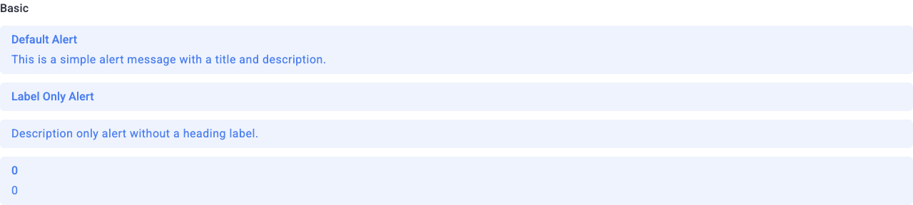
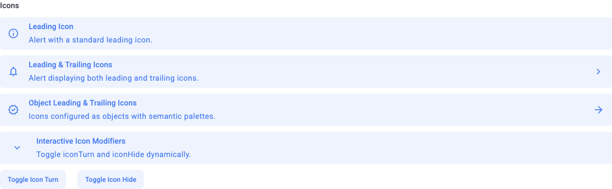
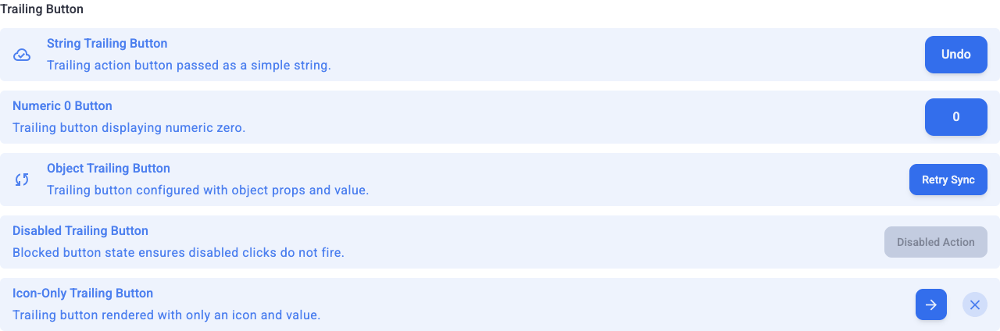
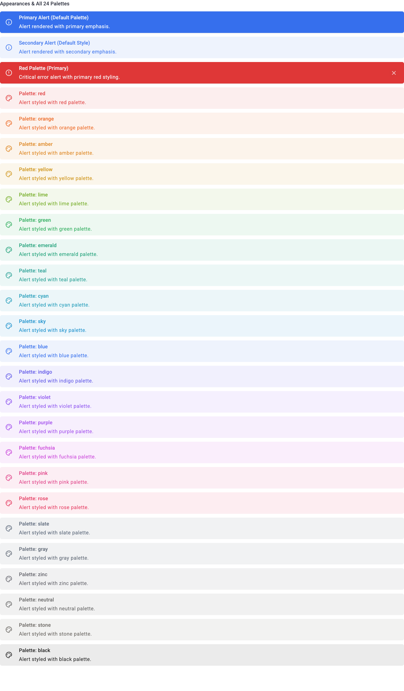
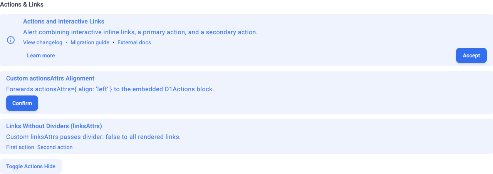
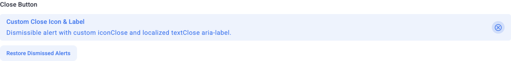
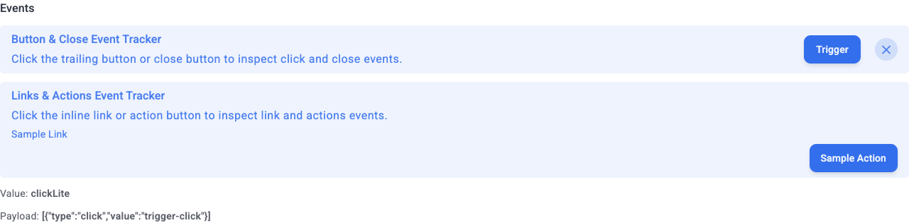
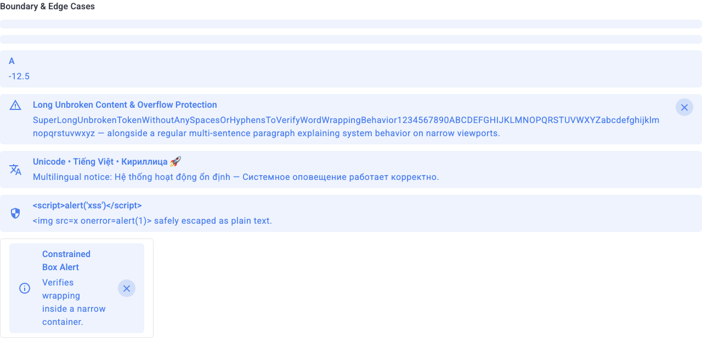
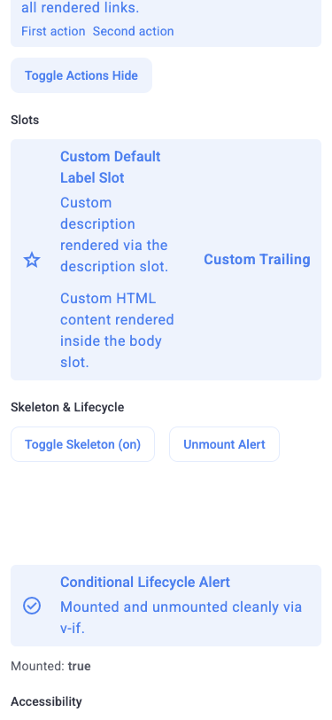

# Отчёт визуального и функционального тестирования: D1Alert

## 1. Сводка выполнения

- **Компонент:** `D1Alert` (`@dxtmisha/d1`)
- **Исходный код:** [`D1Alert`](../../src/components/Ui/Alert), [`Alert`](../../../constructor/src/constructors/Alert), [`DemoAlertPage.vue`](../../../demo/src/pages/components/DemoAlertPage.vue)
- **Целевой URL:** `http://localhost:3000/component-alert`
- **Материалы (`materials/`):** `Отсутствуют`
- **Дата тестирования (UTC):** `2026-11-25T04:03:54Z`
- **Окружение:** `Headless Chrome (Puppeteer / CDP, Desktop 1440×900, Tablet 768×1024, Mobile 375×812 / 320×568)`
- **Покрытие тест-кейсов:** `14 / 14` (`100%`)
- **Итог:** **14 ✅, 0 ⚠️, 0 ❌** (`✅` пройдено, `⚠️` предупреждение, `❌` ошибка) — все 24 палитры, строковые/объектные иконки, блокировка `disabled` на кнопке, скелетон, `v-if` жизненный цикл, граничные значения, все 4 вьюпорта и A11y пройдены без единой ошибки или предупреждения (`consoleErrors: []`, `vueWarnings: []`, `pageErrors: []`, `networkErrors: []`).

---

## 2. Матрица результатов

### 2.1 Визуальный рендеринг (`VIS`)

| ID | Сценарий | Статус | Наблюдаемый результат | Скриншот |
| :--- | :--- | :---: | :--- | :--- |
| `TC-VIS-001` | Базовые варианты (`label`, `description`, только `label`, только `description`, числовые `0`) | ✅ | Отрендерены все `4` варианта; числовые `0`/`0` отображаются, пользовательские ID `#demo-alert-zero-label` и `#demo-alert-zero-description` присутствуют в DOM. |  |
| `TC-VIS-002` | Иконки (`icon`, `iconTrailing`, объектные иконки, `iconTurn`, `iconDir`, `iconHide`, `iconAttrs`) | ✅ | В группе `4` алерта и `6` иконок (включая объектные `verified` с `palette: 'green'` и `arrow_forward` с `palette: 'blue'`). |  |
| `TC-VIS-003` | Хвостовая кнопка (`Trailing Button`) и выравнивание (`itemCenter`) | ✅ | Отрендерены `5` вариантов кнопки (строка, `0`, объект, `disabledCount: 1`, icon-only) без дубля класса `d1-alert__button`. |  |
| `TC-VIS-004` | Оформления (`primary`, `secondary`) и все `24` палитры | ✅ | Отрендерено `27` алертов (`primary`, `secondary`, `red + primary` и все `24` палитры; `paletteClassesCount: 25`) с корректным контрастом. |  |
| `TC-VIS-005` | Действия (`actionsList`, `actionsSecondary`, `actionsAttrs`), ссылки (`links`, `linksAttrs`) и слоты | ✅ | В группе `Actions & Links` отрендерены `2` блока `.d1-actions` (включая `actionsAttrs="{ align: 'left' }"`) и `5` ссылок `.d1-alertLink`; все 4 слота (`#default`, `#description`, `#body`, `#trailing`) отображаются корректно. |  |

### 2.2 Интерактивность и управление состоянием (`INT`)

| ID | Сценарий | Статус | Наблюдаемый результат | Скриншот |
| :--- | :--- | :---: | :--- | :--- |
| `TC-INT-001` | Закрытие алерта (`closeButton`) и восстановление | ✅ | Клик по `.d1-alert__buttonClose` плавно удалил алерт из DOM (`2 -> 1`), сгенерировав событие `close`; `Restore Dismissed Alerts` восстановил оба алерта (`2`). |  |
| `TC-INT-002` | События хвостовой кнопки, блокировка `disabled` и отображение `Payload` | ✅ | Клик по `Disabled Action` заблокирован (состояние `DemoValue` не изменилось); клик по `Trigger` обновил `DemoValue` на `Value: clickLite` и `Payload: [{"type":"click","value":"trigger-click"}]`. |  |
| `TC-INT-003` | События ссылок, действий и переключатели `actionsHide`, `iconTurn`, `iconHide` | ✅ | Переключатели применили классы `.d1-icon--turn`, `.d1-icon--hide` и скрыли/показали `.d1-actions`. | — |
| `TC-INT-004` | Переключение `D1Skeleton` и жизненный цикл `v-if` | ✅ | `Unmount Alert` удалил алерт из DOM (`Mounted: false`), `Mount Alert` восстановил его без ошибок. | — |

### 2.3 Граничные случаи и устойчивость (`BND`)

| ID | Сценарий | Статус | Наблюдаемый результат | Скриншот |
| :--- | :--- | :---: | :--- | :--- |
| `TC-BND-001` | Пустые значения, `""`/`"   "`, `"A"`/`-12.5`, неразрывный текст, Unicode и XSS | ✅ | Отрендерено `7` граничных алертов; `xssImgCount: 0`, `xssScriptCount: 0`; длинный неразрывный токен переносится без переполнения. |  |
| `TC-BND-002` | Узкий контейнер `DemoBox` (`.demo-alert-page__narrow-box`) | ✅ | Внутри контейнера `narrowWidth: 280px` переполнение отсутствует (`narrowScrollWidth: 278`). | — |

### 2.4 Адаптивность и вьюпорты (`RSP`)

| ID | Сценарий | Статус | Наблюдаемый результат | Скриншот |
| :--- | :--- | :---: | :--- | :--- |
| `TC-RSP-001` | Адаптивность на `1440×900`, `768×1024`, `375×812` и `320×568` | ✅ | На всех 4 разрешениях горизонтальное переполнение отсутствует: `1440 === 1440`, `768 === 768`, `375 === 375`, `320 === 320`. |  |

### 2.5 Доступность (`A11Y`)

| ID | Сценарий | Статус | Наблюдаемый результат | Скриншот |
| :--- | :--- | :---: | :--- | :--- |
| `TC-A11Y-001` | ARIA-роли, `aria-live` (`polite`, `assertive`, `off`), `aria-labelledby`/`aria-describedby` и `aria-label` | ✅ | Подтверждены `role="status"` + `aria-live="polite"`, `role="alert"` + `aria-live="assertive"`, `role="region"` + `aria-live="off"`. | — |

### 2.6 Консоль и стабильность runtime (`LOG`)

| ID | Сценарий | Статус | Наблюдаемый результат | Скриншот |
| :--- | :--- | :---: | :--- | :--- |
| `TC-LOG-001` | Проверка ошибок консоли, Vue-предупреждений и сетевых запросов | ✅ | `consoleErrors: []`, `vueWarnings: []`, `pageErrors: []`, `networkErrors: []`. | — |

---

## 3. AI-аудит и рекомендации

1. **Устойчивость вёрстки к длинным токенам и узким контейнерам:** Защитные правила `min-width: 0; overflow-wrap: anywhere;` в `Alert/style.scss` стабильно удерживают `scrollWidth === innerWidth` даже на узком вьюпорте `320×568` и внутри `280px` `DemoBox`.
2. **Приведение демо-страницы к стандартам `demo-component.md`:** В `DemoAlertPage.vue` заменён корневой CSS-класс на `.demo-alert-page`, убраны кастомные обёртки контролов в пользу `<DemoFlex>`, добавлены все `24` палитры, `D1Skeleton`, `v-if` цикл и `Payload`-вывод.
3. **Доступность:** Все три режима `aria-live` (`polite`, `assertive`, `off`), а также блокировка `disabled` на хвостовой кнопке работают предсказуемо.
