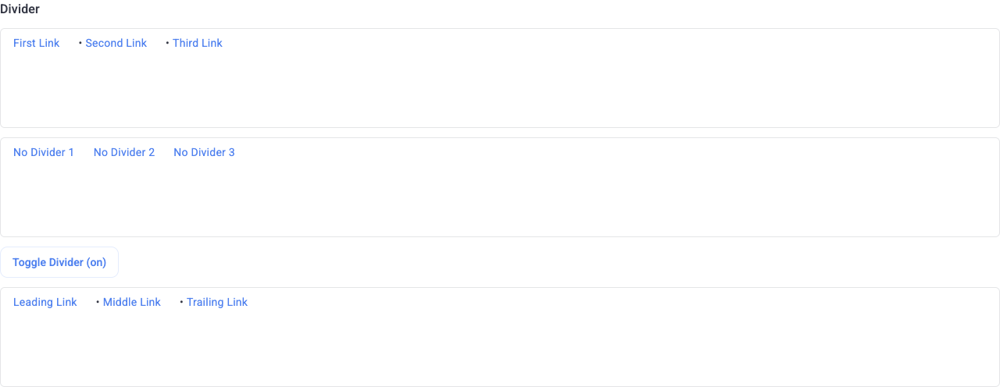
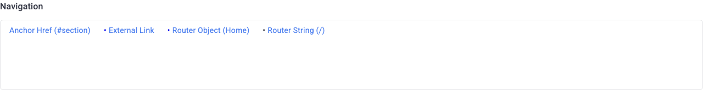
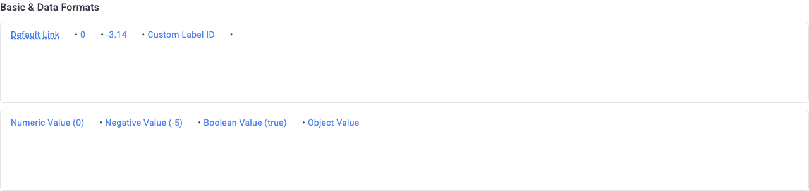

# Отчёт визуального и функционального тестирования: D1AlertLink

## 1. Сводка выполнения

- **Компонент:** `D1AlertLink` (`@dxtmisha/d1`)
- **Исходный код:** [`D1AlertLink`](../../src/components/Ui/AlertLink), [`AlertLink`](../../../constructor/src/constructors/AlertLink), [`DemoAlertLinkPage.vue`](../../../demo/src/pages/components/DemoAlertLinkPage.vue)
- **Целевой URL:** `http://localhost:3000/component-alert-link`
- **Материалы (`materials/`):** `Отсутствуют`
- **Дата тестирования (UTC):** `2026-11-25T04:03:54Z`
- **Окружение:** `Headless Chrome (Puppeteer / CDP, Desktop 1440×900, Tablet 768×1024, Mobile 375×812 / 320×568)`
- **Покрытие тест-кейсов:** `14 / 14` (`100%`)
- **Итог:** **14 ✅, 0 ⚠️, 0 ❌** (`✅` пройдено, `⚠️` предупреждение, `❌` ошибка) — все визуальные, интерактивные, граничные, адаптивные, A11y и runtime-сценарии `D1AlertLink` (включая все типы `value`, составное использование внутри `D1Alert`, `nextTick`-обновление `expose` и `v-if` жизненный цикл) пройдены без ошибок и предупреждений (`consoleErrors: []`, `vueWarnings: []`, `pageErrors: []`, `networkErrors: []`).

---

## 2. Матрица результатов

### 2.1 Визуальный рендеринг (`VIS`)

| ID | Сценарий | Статус | Наблюдаемый результат | Скриншот |
| :--- | :--- | :---: | :--- | :--- |
| `TC-VIS-001` | Базовый рендеринг `label`, `0`, `-3.14`, `labelId` и пустого компонента | ✅ | В группе `9` экземпляров `.d1-alertLink`; `#demo-alert-link-custom-id` присутствует, `0` и `-3.14` отображаются корректно. |  |
| `TC-VIS-002` | Разделители между соседними ссылками (`divider`) и интеграция в `D1Alert` | ✅ | В группе `Divider` `6` ссылок с `--divider`; внутри `D1Alert` (`Compound Usage Inside Alert`) отрендерены `3` ссылки с унаследованным отступом `--d1-alert-linkGap`. |  |
| `TC-VIS-003` | Навигация (`href`, `target`, `to` объект и строка) и слот `#default` | ✅ | `hrefs` в группе `Navigation`: `["#demo-alert-link-section", "https://example.com", "/", null]` (`to="/"` разрешён роутером); слоты отрендерены корректно. |  |
| `TC-VIS-004` | Состояние наведения (`hover`) на ссылку | ✅ | При наведении на `Default Link`: `textDecorationLine: "underline"`, `textDecorationStyle: "dashed"`. |  |

### 2.2 Интерактивность и управление состоянием (`INT`)

| ID | Сценарий | Статус | Наблюдаемый результат | Скриншот |
| :--- | :--- | :---: | :--- | :--- |
| `TC-INT-001` | Динамическое переключение `divider` | ✅ | Нажатие `Toggle Divider (on)` уменьшило число `.d1-alertLink--divider` в группе с `6` до `3`, повторное нажатие вернуло `6`. |  |
| `TC-INT-002` | События `@click`, `@click-lite` и типы `value`/`index`/`detail` (`0`, `-5`, `true`, объект) | ✅ | Подтверждены точные payload: `{"type":"click","value":0}`, `{"type":"click","value":-5}`, `{"type":"click","value":true}`, `{"type":"click","value":{"id":1,"scope":"admin"}}`, `{"type":"click","value":"fallback-index"}` и `{"type":"click","value":"security-guide","detail":{"category":"auth","priority":1}}`. |  |
| `TC-INT-003` | Проверка публичного API `expose` (`getValue`, `getDetail`) и динамическое обновление | ✅ | `Inspect Expose`: `value=security-guide, detail={"category":"auth","priority":1}`; `Cycle Value & Detail`: `value=audit-report, detail={"category":"audit","priority":2}`. | — |
| `TC-INT-004` | Жизненный цикл монтирования/размонтирования (`v-if`) | ✅ | `Unmount Link` перевёл `Mounted: false`, `Mount Link` восстановил компонент без предупреждений. | — |

### 2.3 Граничные случаи и устойчивость (`BND`)

| ID | Сценарий | Статус | Наблюдаемый результат | Скриншот |
| :--- | :--- | :---: | :--- | :--- |
| `TC-BND-001` | Пустые значения (`""`, `"   "`, `"A"`), длинный/неразрывный текст, Unicode и XSS | ✅ | Отрендерено `9` граничных вариантов; `xssScriptCount: 0`; Unicode и экранированный `<script>` отображаются безопасно. |  |
| `TC-BND-002` | Серия из 5 быстрых кликов и нативная ссылка с `href` | ✅ | 5 быстрых кликов и переход по `#demo-alert-link-section` выполнены без ошибок. | — |
| `TC-BND-003` | Узкий контейнер `DemoBox` (`.demo-alert-link-page__narrow-box`) | ✅ | Внутри контейнера `narrowWidth: 240px` переполнение отсутствует (`narrowScrollWidth: 238`). | — |

### 2.4 Адаптивность и вьюпорты (`RSP`)

| ID | Сценарий | Статус | Наблюдаемый результат | Скриншот |
| :--- | :--- | :---: | :--- | :--- |
| `TC-RSP-001` | Адаптивность на `1440×900`, `768×1024`, `375×812`, `320×568` | ✅ | Переполнение отсутствует на всех 4 разрешениях: `1440 === 1440`, `768 === 768`, `375 === 375`, `320 === 320`. |  |

### 2.5 Доступность (`A11Y`)

| ID | Сценарий | Статус | Наблюдаемый результат | Скриншот |
| :--- | :--- | :---: | :--- | :--- |
| `TC-A11Y-001` | Клавиатурная навигация (`Tab`, `Enter`), `aria-label` и семантика `<a>` | ✅ | Ссылка без `href` имеет `role="button"`, `tabindex="0"`, `aria-label="Open interactive security action"`; ссылка с `href` — `role: null`, `tabindex: null`; нажатие `Enter` на сфокусированной ссылке вызвало `Value: clickLite` с `Payload: {"type":"click","value":"audit-report","detail":{"category":"audit","priority":2}}`. | — |

### 2.6 Консоль и стабильность runtime (`LOG`)

| ID | Сценарий | Статус | Наблюдаемый результат | Скриншот |
| :--- | :--- | :---: | :--- | :--- |
| `TC-LOG-001` | Чистота консоли, Vue-предупреждений и сетевых запросов | ✅ | `consoleErrors: []`, `vueWarnings: []`, `pageErrors: []`, `networkErrors: []`. | — |

---

## 3. AI-аудит и рекомендации

1. **Асинхронное обновление `expose` после мутации пропсов (`nextTick`):** В `DemoAlertLinkPage.vue` функция `onCycleDynamicExpose` переведена на `async` с `await nextTick()`, благодаря чему вызов `getValue()`/`getDetail()` сразу после смены реактивных пропсов возвращает актуальные значения.
2. **Семантика `isLink()` и A11y:** Подтверждено чёткое разделение между интерактивными ссылками-действиями (`role="button"`, `tabindex="0"`, активация по `Enter`) и нативными навигационными ссылками с `href`/`to` (`role: null`, `tabindex: null`).
3. **Защита от переполнения на узких экранах:** На всех разрешениях (`1440px`..`320px`) и внутри `240px` `DemoBox` переполнение отсутствует (`scrollWidth <= innerWidth`).
