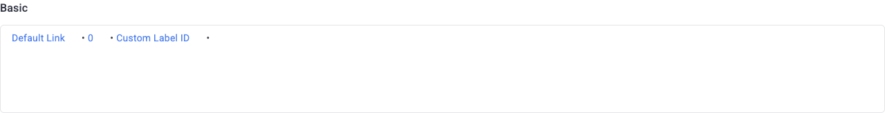
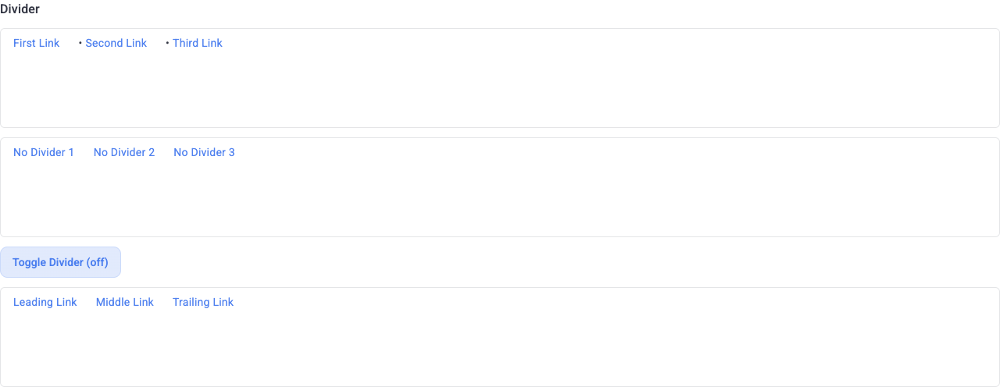
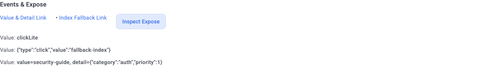
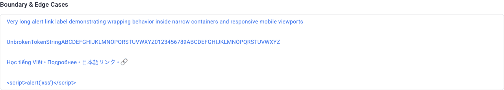
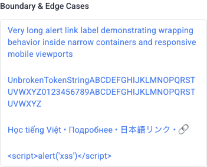

# Отчёт визуального и функционального тестирования: D1AlertLink

## 1. Сводка выполнения

- **Компонент:** `D1AlertLink` (`@dxtmisha/d1`)
- **Исходный код:** [`D1AlertLink`](../../src/components/Ui/AlertLink), [`AlertLink`](../../../constructor/src/constructors/AlertLink)
- **Целевой URL:** `http://localhost:3000/component-alert-link`
- **Материалы (`materials/`):** `Отсутствуют`
- **Дата тестирования (UTC):** `2026-11-24T05:44:05Z`
- **Окружение:** `Headless Chrome (Chrome/157.0.8103.79, Puppeteer / CDP, Desktop 1440×900, Tablet 768×1024, Mobile 375×812 / 320×568)`
- **Покрытие тест-кейсов:** `12 / 12` (`100%`)
- **Итог:** **12 ✅, 0 ⚠️, 0 ❌** (`✅` пройдено, `⚠️` предупреждение, `❌` ошибка) — все визуальные, интерактивные, граничные, адаптивные, A11y и runtime-сценарии `D1AlertLink` пройдены без ошибок и предупреждений (`vueWarnings: []`, `pageErrors: []`, `consoleErrors: []`, `networkErrors: []`).

---

## 2. Матрица результатов

### 2.1 Визуальный рендеринг (`VIS`)

| ID | Сценарий | Статус | Наблюдаемый результат | Скриншот |
| :--- | :--- | :---: | :--- | :--- |
| `TC-VIS-001` | Базовый рендеринг `label`, `label: 0`, `labelId` и пустого компонента | ✅ | На странице отрендерено `24` элемента `.d1-alertLink`; в группе `Basic` — `4` элемента `<a>` с классами `d1-a--static d1-alertLink d1-alertLink--divider`, `tabindex="0"`, `role="button"`; отображены `"Default Link"`, `"0"`, `"Custom Label ID"` (`id="demo-alert-link-custom-id"`), пустой компонент не создал ``. |  |
| `TC-VIS-002` | Разделители между соседними ссылками (`divider`) | ✅ | Псевдоэлемент `::before` (`content: "•"`) появляется между соседними ссылками с `--divider` (у 2-й и 3-й ссылки) с `beforeMarginInlineEnd: "4px"` (`var(--d1-alert-linkGap, var(--d1-alertLink-linkGap, 0))`); при `:divider="false"` псевдоэлемент отсутствует. |  |
| `TC-VIS-003` | Навигация (`href`, `target`, `to`) и слот `#default` | ✅ | В группе `Navigation`: `#demo-alert-link-section`, `https://example.com` (`target="_blank"`, `rel="noopener noreferrer"`), роутерный `href="/"` (у всех `tabindex: null`, `role: null` — чистые нативные ссылки); в группе `Slots`: корректно отрендерены `<strong>Slotted Content Only</strong>` и `Label With Appended Slot`. |  |
| `TC-VIS-004` | Состояние наведения (`hover`) на ссылку | ✅ | При наведении на `Default Link` зафиксированы `cursor: pointer`, `textDecorationLine: underline`, `textDecorationStyle: dashed`, `color: rgba(37, 99, 235, 0.84)`. |  |

### 2.2 Интерактивность и управление состоянием (`INT`)

| ID | Сценарий | Статус | Наблюдаемый результат | Скриншот |
| :--- | :--- | :---: | :--- | :--- |
| `TC-INT-001` | Динамическое переключение `divider` | ✅ | Клик по `Toggle Divider (on)` переключил текст кнопки на `Toggle Divider (off)` и снял `d1-alertLink--divider` со всех 3 ссылок; повторный клик вернул класс у всех 3 ссылок. |  |
| `TC-INT-002` | События `@click`, `@click-lite` и проброс `value`, `index`, `detail` | ✅ | После клика по `Value & Detail Link` зафиксированы `Value: clickLite` и `Value: {"type":"click","value":"security-guide","detail":{"category":"auth","priority":1}}`; после клика по `Index Fallback Link` — `Value: {"type":"click","value":"fallback-index"}`. |  |
| `TC-INT-003` | Проверка публичного API `expose` (`getValue`, `getDetail`) | ✅ | Клик по `Inspect Expose` обновил `DemoValue` на `Value: value=security-guide, detail={"category":"auth","priority":1}`. | — |

### 2.3 Граничные случаи и устойчивость (`BND`)

| ID | Сценарий | Статус | Наблюдаемый результат | Скриншот |
| :--- | :--- | :---: | :--- | :--- |
| `TC-BND-001` | Длинный/неразрывный текст, Unicode и защита от XSS | ✅ | `scriptCount: 0`, `anyDividerClass: false`, `overflowWrap: "anywhere"`; Unicode (`Học tiếng Việt • Подробнее • 日本語リンク • 🔗`) и экранированный `` отрендерены корректно без вертикальных разделителей и переполнения. |  |
| `TC-BND-002` | Серия из 5 быстрых кликов и нативная ссылка с `href` | ✅ | Выполнено 5 быстрых кликов по `Value & Detail Link` (`consoleLogsCount: 16`), клик по `Anchor Href (#section)` обновил `window.location.hash` до `#demo-alert-link-section` без ошибок. | — |

### 2.4 Адаптивность и вьюпорты (`RSP`)

| ID | Сценарий | Статус | Наблюдаемый результат | Скриншот |
| :--- | :--- | :---: | :--- | :--- |
| `TC-RSP-001` | Адаптивность на `1440×900`, `768×1024`, `375×812`, `320×568` | ✅ | Переполнение отсутствует на всех разрешениях: `1440×900` (`scrollWidth: 1440`), `768×1024` (`scrollWidth: 768`), `375×812` (`scrollWidth: 375`, неразрывная строка перенесена в 3 строки `325×60px`), `320×568` (`scrollWidth: 320`, `270×60px`). |  |

### 2.5 Доступность (`A11Y`)

| ID | Сценарий | Статус | Наблюдаемый результат | Скриншот |
| :--- | :--- | :---: | :--- | :--- |
| `TC-A11Y-001` | Клавиатурная навигация (`Tab` и `Enter`) и фокус ссылки без `href` | ✅ | У `Value & Detail Link` (без `href`/`to`) выставлены `tabindex="0"` и `role="button"`; вызов `.focus()` перевёл `activeElement` на ссылку, нажатие `Enter` вызвало `@click`/`@click-lite` и обновило `DemoValue` на `security-guide`. У навигационных ссылок с `href`/`to` сохранена нативная семантика `<a>` без `role="button"`. | — |

### 2.6 Логи и консоль (`LOG`)

| ID | Сценарий | Статус | Наблюдаемый результат | Скриншот |
| :--- | :--- | :---: | :--- | :--- |
| `TC-LOG-001` | Чистота консоли, Vue-предупреждений и сетевых запросов | ✅ | За весь прогон зафиксировано `consoleErrors: []`, `vueWarnings: []`, `pageErrors: []`, `networkErrors: []`. | — |

---

## 3. AI-аудит и рекомендации

1. **Иерархия CSS-токена отступа разделителя:** Использование `ui.v('?alert.linkGap', ui.v('??linkGap', 0))` позволяет компоненту автоматически подстраиваться под `--d1-alert-linkGap` внутри `D1Alert` и сохранять собственный отступ `--d1-alertLink-linkGap` (`4px`) при автономном рендере.
2. **Семантика и доступность ссылок-действий:** Разделение по `isLink()` (`href || to`) сохраняет нативную семантику `<a>` для навигации и обеспечивает полную клавиатурную доступность (`tabindex="0"`, `role="button"`, `Enter`) для интерактивных ссылок-действий без `href`.
3. **Защита мобильной вёрстки:** Правила `max-width: 100%` и `overflow-wrap: anywhere` в `mixinAlertLink` полностью устраняют горизонтальный скролл при длинных URL и неразрывных токенах в узких контейнерах (`320px`, `375px`).
