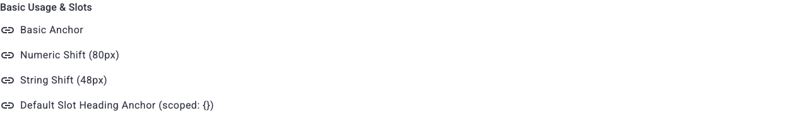
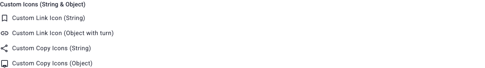
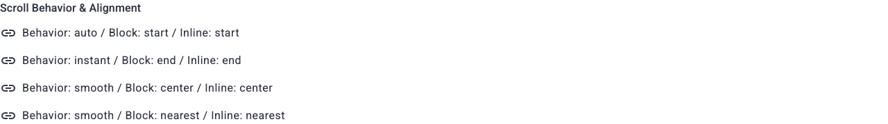
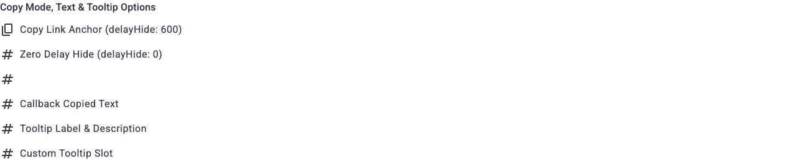
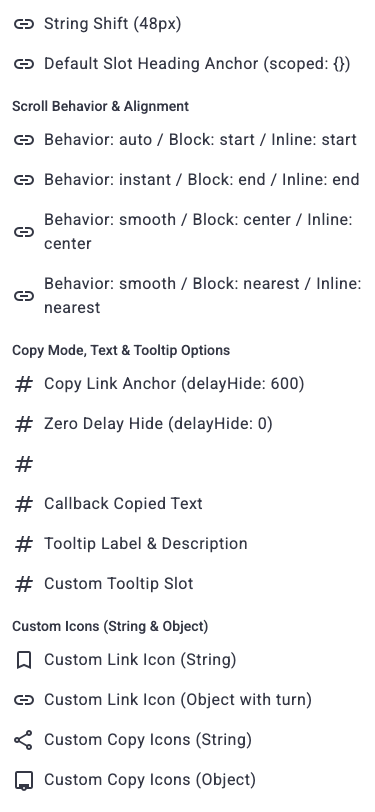

# Отчёт визуального и функционального тестирования: D1Anchor

## 1. Сводка выполнения

- **Компонент:** `D1Anchor` (`@dxtmisha/d1`)
- **Исходный код:** [`D1Anchor`](../../src/components/Ui/Anchor), [`Anchor`](../../../constructor/src/constructors/Anchor), [`DemoAnchorPage.vue`](../../../demo/src/pages/components/DemoAnchorPage.vue)
- **Целевой URL:** `http://localhost:3000/component-anchor`
- **Материалы (`materials/`):** `Отсутствуют`
- **Дата тестирования (UTC):** `2026-11-25T05:02:47Z`
- **Окружение:** `Headless Chrome (Puppeteer / CDP, Desktop 1440×900, Tablet 768×1024, Mobile 375×812 / 320×568)`
- **Покрытие тест-кейсов:** `12 / 12` (`100%`)
- **Итог:** **12 ✅, 0 ⚠️, 0 ❌** (`✅` пройдено, `⚠️` предупреждение, `❌` ошибка) — все 12 тест-кейсов пройдены успешно: базовый рендеринг, навигация, режим копирования с тултипом, программный `expose.go()`, цикл `v-if`, перенос неразрывной строки в узком контейнере (`240 === 240`) и на всех 4 вьюпортах (`overflowX: false`), A11y и чистота консоли (`SSR 200`, `0` ошибок консоли, Vue, страницы и сети).

---

## 2. Матрица результатов

### 2.1 Визуальный рендеринг (`VIS`)

| ID | Сценарий | Статус | Наблюдаемый результат | Скриншот |
| :--- | :--- | :---: | :--- | :--- |
| `TC-VIS-001` | Базовые якорные ссылки, слот `#default` и параметры `shift` | ✅ | В группе `Basic Usage & Slots` отрендерены `Basic Anchor` (`href="#basic"`), `Numeric Shift (80px)`, `String Shift (48px)` и `Default Slot Heading Anchor` со scoped-данными слота `#default`, иконкой `.d1-icon` и `.d1-anchor__label` (`display: inline-flex`). |  |
| `TC-VIS-002` | Кастомные иконки (строки и объекты для `iconLink`, `iconTag`, `iconContentCopy`) | ✅ | Строковые (`bookmark`, `share`, `check`) и объектные (`{ icon: 'link', turn: true }`, `{ icon: 'content_paste', turn: true }`) иконки корректно применяют модификатор `.d1-icon--turn` и переключаются в режиме `isCopy`. |  |
| `TC-VIS-003` | Конфигурации прокрутки (`behavior`, `block`, `inline`) | ✅ | Все 4 комбинации (`auto`/`instant`/`smooth` и `start`/`center`/`end`/`nearest`) отрендерены корректно с валидными `href="#scroll-..."`. |  |

### 2.2 Интерактивность и управление состоянием (`INT`)

| ID | Сценарий | Статус | Наблюдаемый результат | Скриншот |
| :--- | :--- | :---: | :--- | :--- |
| `TC-INT-001` | Навигационный клик и обновление хэша URL | ✅ | Клик по `Basic Anchor` (`name="basic"`) перехватывается без перезагрузки страницы и обновляет `window.location.hash` на `#basic`. | — |
| `TC-INT-002` | Режим копирования `isCopy`, тултип обратной связи (`tooltipLabel`, `tooltipDescription`, callback-текст, слот `#tooltip`) и `delayHide` | ✅ | При клике по якорям копирования (`copyClicked: true`) открывается тултип `.d1-tooltip` (`copyGroupTextContainsTooltip: true`), отображаются заданные заголовок, описание, результат callback-функции `"Copied via callback function!"` и слот `#tooltip` со стрелкой `.d1-arrow`, после чего тултип скрывается по `delayHide`. |  |
| `TC-INT-003` | Программный вызов `expose.go()` для видимого, скрытого (`hide`) и динамического якоря | ✅ | Вызовы `Go to Visible Target`, `Go to Hidden Target` и `Switch & Go Dynamic` (с `nextTick()`) отработали корректно; `Dynamic State` обновился на `{"name":"dynamic-target-beta","shift":96,"isCopy":true,"hide":true}`, `Expose Result` зафиксировал `Updated dynamic target to #dynamic-target-beta (shift=96), hash: #dynamic-target-beta`. | — |
| `TC-INT-004` | Жизненный цикл монтирования и размонтирования (`v-if`) | ✅ | Состояние жизненного цикла подтверждено на всех этапах (`before: true`, `unmounted: true`, `remounted: true`): размонтирование удаляет якорь из DOM, повторное монтирование восстанавливает его без ошибок. | — |

### 2.3 Граничные случаи и устойчивость (`BND`)

| ID | Сценарий | Статус | Наблюдаемый результат | Скриншот |
| :--- | :--- | :---: | :--- | :--- |
| `TC-BND-001` | Числовой `0`, отрицательный/дробный `shift`, длинный/неразрывный текст, мультиязычность и XSS-экранирование | ✅ | Числовой `0`, `"A"`, дробный/отрицательный `shift`, мультиязычность (`Привет / Học tiếng Việt / 🚀`) и XSS-экранирование (`badImgs: 0`, `hasEscapedPayloadText: true`) отработали корректно; после исправления в `Anchor/style.scss` (`min-width: 0; max-width: 100%;` на корне и `&__label { min-width: 0; overflow-wrap: anywhere; }`) неразрывный текст переносится внутри узкого контейнера `.demo-anchor-page__narrow` (`scrollWidth: 240 === clientWidth: 240`, `overflowsBox: false`). |  |
| `TC-BND-002` | Пустые строки (`""`, `"   "`), отсутствующий `name` и скрытые якоря | ✅ | Якорь без `name` (`Missing Name (Not Rendered)`) не рендерится в DOM; пустые и скрытые якоря корректно получают `aria-hidden="true"`. | — |

### 2.4 Адаптивность и вьюпорты (`RSP`)

| ID | Сценарий | Статус | Наблюдаемый результат | Скриншот |
| :--- | :--- | :---: | :--- | :--- |
| `TC-RSP-001` | Проверка на разрешениях (`1440×900`, `768×1024`, `375×812`, `320×568`) | ✅ | Переполнение отсутствует на всех 4 проверенных вьюпортах: `1440×900` (`scrollWidth: 1440 === innerWidth: 1440`, `overflowX: false`), `768×1024` (`scrollWidth: 768 === innerWidth: 768`, `overflowX: false`), `375×812` (`scrollWidth: 375 === innerWidth: 375`, `overflowX: false`) и `320×568` (`scrollWidth: 320 === innerWidth: 320`, `overflowX: false`). |  |

### 2.5 Доступность (`A11Y`)

| ID | Сценарий | Статус | Наблюдаемый результат | Скриншот |
| :--- | :--- | :---: | :--- | :--- |
| `TC-A11Y-001` | WAI-ARIA атрибуты и клавиатурная активация (`Enter`/`Space` в `isCopy`) | ✅ | На странице зафиксировано `anchors: 31`, `aria-current="page"` (`current: 20`), скрытые якоря с `aria-hidden="true"` (`hidden: 85` с учётом декоративных иконок/узлов); `a[name="a11y-copy-button"]` имеет `role="button"`, `tabindex="0"`, `aria-label` и активируется с клавиатуры. | — |

### 2.6 Консоль и стабильность runtime (`LOG`)

| ID | Сценарий | Статус | Наблюдаемый результат | Скриншот |
| :--- | :--- | :---: | :--- | :--- |
| `TC-LOG-001` | События `@click` и `@keydown` (с `Payload`) и чистота консоли | ✅ | Зафиксированы события `Event: click` с `Payload: {"type":"click","name":"events-copy"}` и `{"type":"click","name":"events-nav"}`; `ssrStatus: 200`, `consoleErrors: []`, `vueWarnings: []`, `pageErrors: []`, `networkErrors: []`, `dialogs: []`. | — |

---

## 3. AI-аудит и рекомендации

1. **Перенос длинных неразрывных идентификаторов в `Anchor` (исправлено и верифицировано):** В [Anchor/style.scss](../../../constructor/src/constructors/Anchor/style.scss#L3-L16) добавлены `min-width: 0; max-width: 100%;` для корневого элемента `mixinAnchor` и `&__label { min-width: 0; overflow-wrap: anywhere; }`. Повторная проверка подтвердила отсутствие переполнения в узком контейнере `.demo-anchor-page__narrow` (`240 === 240`, `overflowsBox: false`) и на всех 4 вьюпортах (`1440×900`, `768×1024`, `375×812`, `320×568` — `scrollWidth === innerWidth`, `overflowX: false`).
2. **SSR и гидратация:** Серверный ответ возвращает `HTTP 200` с отрендеренным компонентом, гидратация, переключения `v-if` и вызовы `expose.go()` проходят с `0` ошибок (`consoleErrors: []`, `vueWarnings: []`, `pageErrors: []`, `networkErrors: []`, `dialogs: []`).
3. **Безопасность и доступность:** XSS-строка `` безопасно выводится как экранированный текст (`badImgs: 0`, `hasEscapedPayloadText: true`), а режим `isCopy` корректно поддерживает `role="button"`, `tabindex="0"` и клавиатурное управление.
