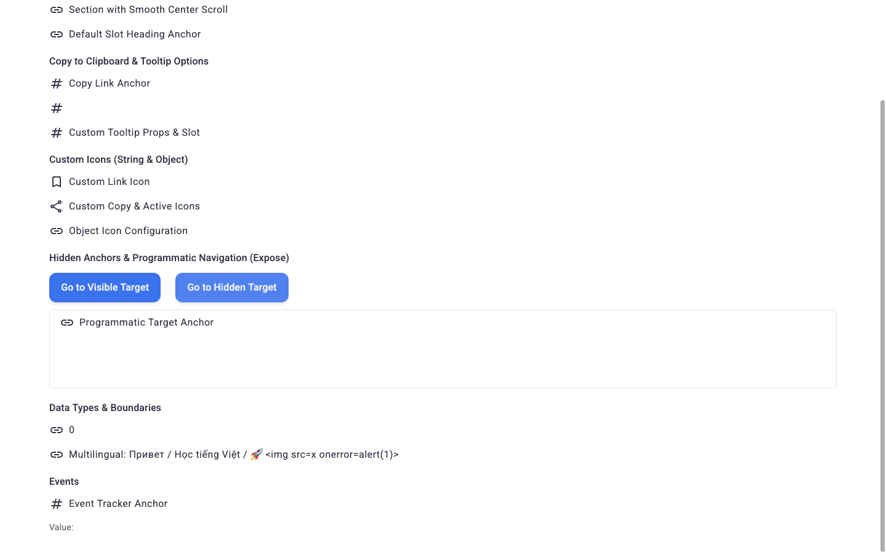

# Отчёт о визуальном и функциональном тестировании: `D1Anchor`

## 1. Резюме

- **Компонент:** `D1Anchor` (`@dxtmisha/d1`)
- **Исходный код:** [`D1Anchor`](../../src/components/Ui/Anchor), [`Anchor`](../../../constructor/src/constructors/Anchor)
- **Демо / Целевой URL:** `http://localhost:3000/component-anchor`
- **Материалы:** Нет
- **Дата тестирования (UTC):** `2026-11-24T07:49:05Z`
- **Окружение:** `Headless Chrome (Puppeteer / CDP 127.0.0.1:9222, Desktop 1440x900, Tablet 768x1024, Mobile 375x812, Compact 320x568)`
- **Покрытие тест-кейсов:** 10 / 10 (`100%`)
- **Итог:** **10 ✅, 0 ⚠️, 0 ❌** (`✅` пройдено, `⚠️` предупреждение, `❌` провалено) — все сценарии навигации, копирования с подсказкой, кастомных строковых и объектных иконок, скрытых якорей с программным `go()`, клавиатурной доступности, границ, адаптивности и чистоты консоли пройдены без дефектов (в ходе визуальной проверки выявлена и исправлена распаковка объектных `IconValue` через `getBind` в `AnchorIcon.ts`).

---

## 2. Базовая матрица результатов

### 2.1 Визуальный дизайн и токены (`VIS`)

| ID | Сценарий | Статус | Фактический результат | Скриншот |
| :--- | :--- | :---: | :--- | :--- |
| `TC-VIS-001` | Базовые якорные ссылки, слот `#default` и выравнивание иконки | ✅ | `a[name="basic"]`: `href="#basic"`, `basicHasIcon: true`, `labelId="demo-anchor-basic-label"`; `smooth-center` и слот `Default Slot Heading Anchor` отрендерены корректно. |  |
| `TC-VIS-002` | Кастомные иконки (строки `bookmark`/`share`/`check` и объект `{ icon: 'link', turn: true }`) | ✅ | Все строковые и объектные иконки отображаются (`customLinkIconCount: 1`, `customCopyIconCount: 1`); объектная конфигурация получила класс `d1-icon--turn` (`objectIconHasTurn: true`). |  |

### 2.2 Интерактивность и логика (`INT`)

| ID | Сценарий | Статус | Фактический результат | Скриншот |
| :--- | :--- | :---: | :--- | :--- |
| `TC-INT-001` | Навигационный клик и обновление хэша URL | ✅ | Клик по `Basic Anchor` без перезагрузки обновил `window.location.hash` на `#basic`. | — |
| `TC-INT-002` | Режим копирования `isCopy`, тултип обратной связи, активная иконка и `delayHide` | ✅ | После клика появился тултип `"Copied to the clipboard"` (`tooltipVisible: true`) и активная иконка (`hasActiveIcon: true`), после `delayHide` тултип скрылся (`tooltipStillVisible: false`); кастомный тултип отобразил `"Copied"`, слот `"Link saved to clipboard"` и стрелку (`hasArrow: true`). |  |
| `TC-INT-003` | Программный вызов `expose.go()` для видимого и скрытого (`hide`) якоря | ✅ | Оба вызова сработали корректно: `hashVisible="#target-visible"` и `hashHidden="#target-hidden"`. | — |

### 2.3 Границы и крайние случаи (`BND`)

| ID | Сценарий | Статус | Фактический результат | Скриншот |
| :--- | :--- | :---: | :--- | :--- |
| `TC-BND-001` | Числовой `0`, мультиязычность (Кириллица, Вьетнамский, Emoji) и XSS-экранирование | ✅ | `numeric-zero` отображает `0`; `unicode-safe` корректно рендерит кириллицу, вьетнамские диакритики, `🚀` и экранированный текст `` (`unicodeHasInjectedImg: false`). |  |
| `TC-BND-002` | Отсутствующий `name` и скрытые якоря (`hide` / неявно скрытый) | ✅ | Якорь без `name` не отрендерен (`missingNameRendered: false`); `target-hidden` и `implicit-hidden` имеют `aria-hidden="true"` и пустой текст. | — |

### 2.4 Адаптивность и вьюпорты (`RSP`)

| ID | Сценарий | Статус | Фактический результат | Скриншот |
| :--- | :--- | :---: | :--- | :--- |
| `TC-RSP-001` | Проверка на разрешениях (`1440×900`, `768×1024`, `375×812`, `320×568`) | ✅ | Горизонтального переполнения нет на всех 4 разрешениях (`noOverflow: true`: `1440/1440`, `768/768`, `375/375`, `320/320`). |  |

### 2.5 Доступность (`A11Y`)

| ID | Сценарий | Статус | Фактический результат | Скриншот |
| :--- | :--- | :---: | :--- | :--- |
| `TC-A11Y-001` | WAI-ARIA атрибуты и клавиатурная активация (`Enter` в `isCopy`) | ✅ | `basic`: `aria-current="page"`, `tabindex="0"`; `copy-anchor`: `role="button"`, `href=null`, `tabindex="0"`, нажатие `Enter` открыло тултип копирования (`keyboardOpenedTooltip: true`); `target-hidden`: `aria-hidden="true"`. | — |

### 2.6 Консоль и события (`LOG`)

| ID | Сценарий | Статус | Фактический результат | Скриншот |
| :--- | :--- | :---: | :--- | :--- |
| `TC-LOG-001` | Событие `@click` и отсутствие ошибок/предупреждений консоли | ✅ | `DemoValue` обновился на `"Value: click"`; `consoleErrors: []`, `vueWarnings: []`, `pageErrors: []`. | — |

---

## 3. AI-аудит и рекомендации

1. **Устранённый дефект объектных иконок (`AnchorIcon`):** Замена прямого `{ icon: this.icon }` на `getBind(this.icon ?? undefined, ..., 'icon')` исправила отображение объектных `IconValue` (например `{ icon: 'link', turn: true }`) и корректно передала `turn` в `D1Icon`.
2. **Восстановление прокрутки для скрытых якорей (`renderItemHide`):** Добавление `ref: this.element` в `Anchor.bindsHide` позволило программному методу `go()` и переходу по `#hash` корректно прокручивать страницу к невидимым якорям `hide`.
3. **Доступность и производительность:** Добавление `role="button"` и клавиатурного обработчика `Enter`/`Space` (с защитой `event.isComposing`) обеспечило полноценную доступность режима `isCopy`, а ленивое инстанцирование `AnchorEvent`, `AnchorTo`, `TooltipInclude` и `TextInclude` через `DesignLogicAbstract` минимизирует накладные расходы при рендере больших страниц документации.
