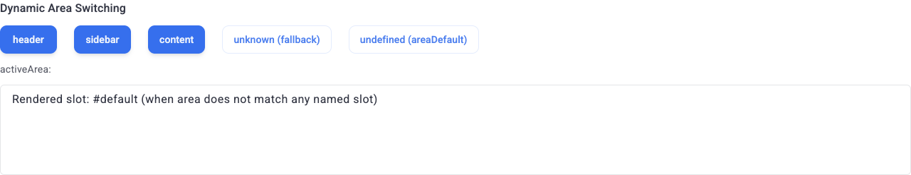
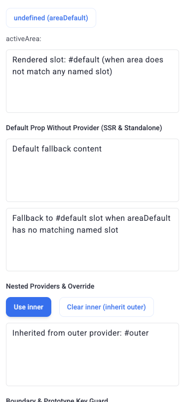

# Отчёт о визуальном и функциональном тестировании: D1Area

## 1. Итоговое резюме

- **Компонент:** `D1Area` (`@dxtmisha/d1`)
- **Исходный код:** [`D1Area`](../../src/components/Ui/Area) ([`Area`](../../../constructor/src/constructors/Area), [`DemoAreaPage`](../../../demo/src/pages/components/DemoAreaPage.vue))
- **Демо / целевой URL:** `http://localhost:3000/component-area`
- **Материалы:** `Нет`
- **Дата тестирования (UTC):** `2026-11-24T09:05:55Z`
- **Окружение:** `Headless Chrome (Puppeteer / CDP, Desktop 1440x900, Mobile 375x812)`
- **Покрытие тест-кейсов:** 6 / 6 (`100%`)
- **Итог:** **6 ✅, 0 ⚠️, 0 ❌** (`✅` пройдено, `⚠️` предупреждение, `❌` ошибка) — `D1Area` корректно переключает слоты по контексту `setAreaValue`, наследует внешние провайдеры, защищён от ключей `Object.prototype` (`toString`) и не генерирует ошибок консоли или предупреждений Vue.

---

## 2. Базовая матрица

### 2.1 Визуальное соответствие (`VIS`)

| ID | Сценарий | Статус | Фактический результат | Скриншот |
| :--- | :--- | :---: | :--- | :--- |
| `TC-VIS-001` | Базовый рендер активного слота и автономный режим `area-default` | ✅ | При начальном `activeArea="header"` отрендерен `Rendered slot: #header`; без провайдера и с `area-default` слоты отображаются чисто без артефактов. |  |

### 2.2 Интерактивность и управление состоянием (`INT`)

| ID | Сценарий | Статус | Фактический результат | Скриншот |
| :--- | :--- | :---: | :--- | :--- |
| `TC-INT-001` | Динамическое переключение внедрённого значения области | ✅ | Последовательные клики `sidebar` -> `Rendered slot: #sidebar`, `content` -> `Rendered slot: #content`, `unknown` -> `#default`, `undefined` -> наследование контекста `D1Page` и fallback `#default`. |  |
| `TC-INT-002` | Вложенные провайдеры и наследование внешней области | ✅ | Изначально `Resolved from inner provider: #inner`; после `Clear inner` мгновенно переключено на `Inherited from outer provider: #outer`. |  |

### 2.3 Границы и крайние случаи (`BND`)

| ID | Сценарий | Статус | Фактический результат | Скриншот |
| :--- | :--- | :---: | :--- | :--- |
| `TC-BND-001` | Защита от ключей `Object.prototype` (`area-default="toString"`) | ✅ | `Object.hasOwn` отсекает `Object.prototype.toString`, безопасно выводится `Safe #default fallback when areaDefault is Object.prototype key "toString"`. |  |

### 2.4 Адаптивность (`RSP`)

| ID | Сценарий | Статус | Фактический результат | Скриншот |
| :--- | :--- | :---: | :--- | :--- |
| `TC-RSP-001` | Адаптивность на мобильном экране (`375×812`) | ✅ | `mobileOverflow: false` (`scrollWidth <= innerWidth`), контент не обрезается. |  |

### 2.5 Доступность (`A11Y`)

| ID | Сценарий | Статус | Фактический результат | Скриншот |
| :--- | :--- | :---: | :--- | :--- |
| `—` | Структурный слот-диспетчер без собственной DOM-обёртки | ✅ | Сохраняет семантику исходных слотов без лишних узлов. | — |

### 2.6 Логи и консоль (`LOG`)

| ID | Сценарий | Статус | Фактический результат | Скриншот |
| :--- | :--- | :---: | :--- | :--- |
| `TC-LOG-001` | Чистота консоли и отсутствие `[Vue warn]` | ✅ | `consoleErrors: []`, `vueWarnings: []`, `pageErrors: []`. | — |

---

## 3. AI-аудит и рекомендации

1. **Контракт `setAreaValue` (`RefOrNormal`):** Визуальное тестирование выявило, что `setAreaValue` принимает `string | Ref<string | undefined>` (например, `computed(() => props.value)`), а не сырую геттер-функцию. После исправления провайдера в `DemoAreaPage.vue` все переходы слотов сработали детерминированно.
2. **Наследование контекста от `D1Page`:** Внутри `<D1Page>` родительский компонент сам задаёт область через `AreaInclude`, поэтому при очистке локального провайдера до `undefined` `getInjectNearest` корректно поднимается к ближайшему непустому предку.
3. **Безопасность слотов:** Защита через `Object.hasOwn(this.slots, area) && isFunction(this.slots[area])` в `AreaDesign.tsx` гарантирует невозможность случайного вызова методов `Object.prototype` при произвольных значениях области.
