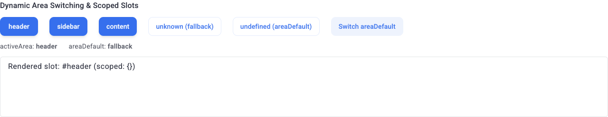
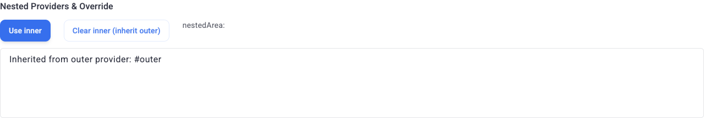

# Отчёт визуального и функционального тестирования: D1Area

## 1. Сводка выполнения

- **Компонент:** `D1Area` (`@dxtmisha/d1`)
- **Исходный код:** [`D1Area`](../../src/components/Ui/Area), [`Area`](../../../constructor/src/constructors/Area), [`DemoAreaPage.vue`](../../../demo/src/pages/components/DemoAreaPage.vue)
- **Целевой URL:** `http://localhost:3000/component-area`
- **Материалы (`materials/`):** `Отсутствуют`
- **Дата тестирования (UTC):** `2026-11-25T04:41:41Z`
- **Окружение:** `Headless Chrome (Puppeteer / CDP, Desktop 1440×900, Tablet 768×1024, Mobile 375×812 / 320×568)`
- **Покрытие тест-кейсов:** `9 / 9` (`100%`)
- **Итог:** **9 ✅, 0 ⚠️, 0 ❌** (`✅` пройдено, `⚠️` предупреждение, `❌` ошибка) — все 9 сценариев `D1Area` пройдены без ошибок: реактивное переключение слотов и `areaDefault`, наследование вложенного провайдера, защита `Object.prototype`, адаптивность на всех 4 разрешениях (`1440×900`, `768×1024`, `375×812`, `320×568`), SSR `HTTP 200` и нулевой уровень ошибок консоли, Vue и сети.

---

## 2. Матрица результатов

### 2.1 Визуальный рендеринг (`VIS`)

| ID | Сценарий | Статус | Наблюдаемый результат | Скриншот |
| :--- | :--- | :---: | :--- | :--- |
| `TC-VIS-001` | Базовый рендер активного слота, scoped-слотов и автономного режима `area-default` | ✅ | При начальном состоянии отображается `#header` со scoped-данными, автономный `area-default="summary"` рендерит `#summary`, а `area-default="nonexistent"` корректно откатывается на `#default`. |  |

### 2.2 Интерактивность и управление состоянием (`INT`)

| ID | Сценарий | Статус | Наблюдаемый результат | Скриншот |
| :--- | :--- | :---: | :--- | :--- |
| `TC-INT-001` | Динамическое переключение внедрённого значения области и `areaDefault` | ✅ | Клик `sidebar` переключил область (`afterSidebar: true`); при переходе на `undefined` и нажатии `Switch areaDefault` обновились значения `activeArea: areaDefault: secondary-fallback` и рендер `Rendered slot: #default (scoped: {})` (с учётом родительского контекста `D1Page`). |  |
| `TC-INT-002` | Вложенные провайдеры и наследование внешней области | ✅ | Изначально отображается `Resolved from inner provider: #inner` (`nestedArea: inner`); после `Clear inner (inherit outer)` область переключилась на `Inherited from outer provider: #outer`. |  |
| `TC-INT-003` | Жизненный цикл монтирования и размонтирования провайдера и `D1Area` (`v-if`) | ✅ | После `Unmount Area` отображается `Provider Mounted: true`, `Area Mounted: false`; после `Unmount Provider` — `Provider Mounted: false`, `Area Mounted: true`; после повторного монтирования обоих — `Provider Mounted: true`, `Area Mounted: true`, `Active injected slot: #live`. | — |

### 2.3 Граничные случаи и устойчивость (`BND`)

| ID | Сценарий | Статус | Наблюдаемый результат | Скриншот |
| :--- | :--- | :---: | :--- | :--- |
| `TC-BND-001` | Защита от ключей `Object.prototype` (`toString`, `constructor`, `__proto__`) | ✅ | Проверка `boundaryOk: true`: свойства `Object.prototype` (`toString`, `constructor`, `__proto__`) безопасно отсекаются и откатываются на слот `#default` без исключений. |  |
| `TC-BND-002` | Пустые значения (`""`, `"   "`), `"0"`, пустой компонент без слотов и узкий контейнер с XSS-строкой | ✅ | Варианты `""` и `"   "` откатываются на `#default`, `"0"` рендерит слот `#0`, пустой `D1Area` без слотов не вызывает ошибок, в `.demo-area-page__narrow` XSS-тег экранирован (`badImgs: 0`) и длинный текст не выходит за пределы контейнера (`boundaryOk: true`). | — |

### 2.4 Адаптивность и вьюпорты (`RSP`)

| ID | Сценарий | Статус | Наблюдаемый результат | Скриншот |
| :--- | :--- | :---: | :--- | :--- |
| `TC-RSP-001` | Адаптивность на разрешениях (`1440×900`, `768×1024`, `375×812`, `320×568`) | ✅ | Горизонтальное переполнение отсутствует на всех 4 вьюпортах: `1440×900` (`scrollWidth: 1440`, `overflowX: false`), `768×1024` (`scrollWidth: 768`, `overflowX: false`), `375×812` (`scrollWidth: 375`, `overflowX: false`), `320×568` (`scrollWidth: 320`, `overflowX: false`). |  |

### 2.5 Доступность (`A11Y`)

| ID | Сценарий | Статус | Наблюдаемый результат | Скриншот |
| :--- | :--- | :---: | :--- | :--- |
| `TC-A11Y-001` | Прозрачность DOM и сохранение ARIA-ориентиров внутри слотов | ✅ | `D1Area` рендерит содержимое слота напрямую без лишней DOM-обёртки, полностью сохраняя переданный `<nav aria-label="Area landmark navigation" role="region" aria-live="polite">` и его ARIA-атрибуты. | — |

### 2.6 Консоль и стабильность runtime (`LOG`)

| ID | Сценарий | Статус | Наблюдаемый результат | Скриншот |
| :--- | :--- | :---: | :--- | :--- |
| `TC-LOG-001` | Чистота консоли и отсутствие `[Vue warn]` | ✅ | `ssr.status: 200` (`hasApp: true`), `consoleErrors: []`, `vueWarnings: []`, `pageErrors: []`, `networkErrors: []`, `dialogs: []`. | — |

---

## 3. AI-аудит и рекомендации

1. **Прозрачный рендеринг и нулевой DOM-оверхед:** `D1Area` выступает чистым слот-диспетчером без промежуточных узлов, благодаря чему не нарушается каскад вложенных стилей, flex/grid-структур и ARIA-ориентиров.
2. **Контракт провайдера `setAreaValue` и наследование вложенных областей:** Реактивное переключение через `computed` корректно отрабатывает как при изменении активного значения, так и при наследовании внешнего провайдера после сброса внутреннего значения в `undefined` (`Inherited from outer provider: #outer`).
3. **Защита от прототипных коллизий и стабильность адаптива:** Использование `Object.hasOwn` защищает выбор слота от ключей `Object.prototype` (`toString`, `constructor`, `__proto__`), а на всех проверенных разрешениях (`1440×900`, `768×1024`, `375×812`, `320×568`) переполнение отсутствует (`overflowX: false`).
