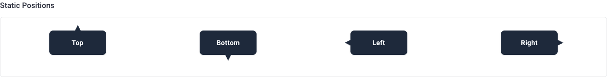
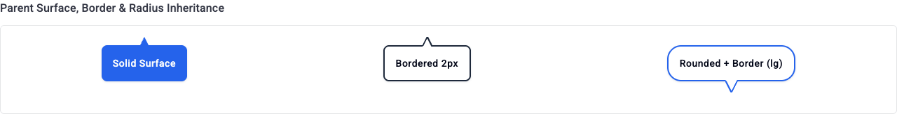
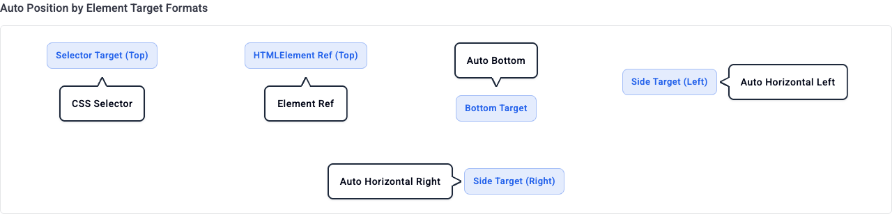
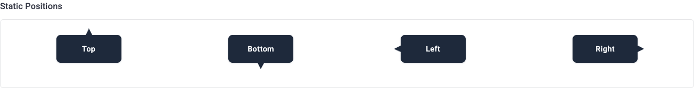
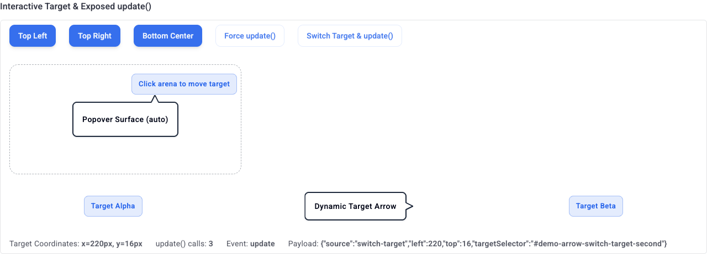
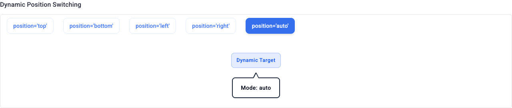
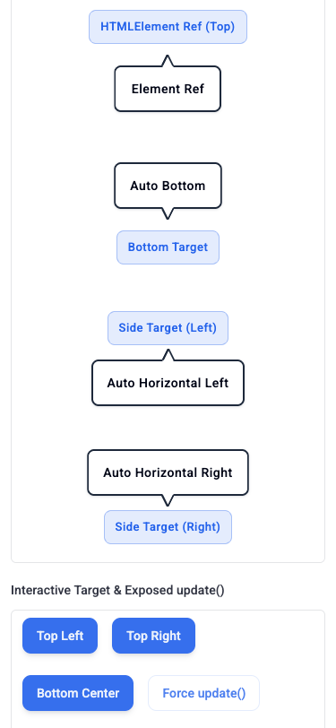

# Отчёт визуального и функционального тестирования: D1Arrow

## 1. Сводка выполнения

- **Компонент:** `D1Arrow` (`@dxtmisha/d1`)
- **Исходный код:** [`D1Arrow`](../../src/components/Ui/Arrow), [`Arrow`](../../../constructor/src/constructors/Arrow), [`DemoArrowPage.vue`](../../../demo/src/pages/components/DemoArrowPage.vue)
- **Целевой URL:** `http://localhost:3000/component-arrow`
- **Материалы (`materials/`):** `Отсутствуют`
- **Дата тестирования (UTC):** `2026-11-25T04:41:41Z`
- **Окружение:** `Headless Chrome (Puppeteer / CDP, Desktop 1920×1080 / 1440×900, Tablet 1024×768 / 768×1024, Mobile 375×812 / 320×568)`
- **Покрытие тест-кейсов:** `14 / 14` (`100%`)
- **Итог:** **14 ✅, 0 ⚠️, 0 ❌** (`✅` пройдено, `⚠️` предупреждение, `❌` ошибка) — все 14 сценариев `D1Arrow` пройдены успешно без ошибок: статические позиции, размеры `sm`/`md`/`lg`, наследование поверхности/рамки/скругления, тёмная тема (`TC-VIS-005`), автопозиционирование и `expose.update()`, адаптивность без переполнения на всех вьюпортах после правок `.demo-arrow-page__auto-row` и `.demo-arrow-page__arena`, SSR `HTTP 200` и `0` ошибок консоли, Vue и сети.

---

## 2. Матрица результатов

### 2.1 Визуальный рендеринг (`VIS`)

| ID | Сценарий | Статус | Наблюдаемый результат | Скриншот |
| :--- | :--- | :---: | :--- | :--- |
| `TC-VIS-001` | Базовый рендеринг статических позиций (`top`, `bottom`, `left`, `right`) | ✅ | Все 4 стрелки в группе `Static Positions` отрендерены с классами `.d1-arrow--position--top`, `--bottom`, `--left`, `--right`, ненулевыми размерами и SVG-контуром без обрезания. |  |
| `TC-VIS-002` | Масштабы размеров (`sm`, `md`, `lg`) | ✅ | Варианты `sm`, `md`, `lg` применяют соответствующие классы `.d1-arrow--size--*` и корректно масштабируются по возрастанию (`sm < md < lg`). |  |
| `TC-VIS-003` | Наследование фона, рамки и `border-radius` родителя | ✅ | `Solid Surface` наследует фон без `data-arrow="border"`, блоки `Bordered 2px` и `Rounded + Border (lg)` получают `data-arrow="border"` и отдельный контур `.d1-arrow__border`. |  |
| `TC-VIS-004` | Автопозиционирование (`position="auto"`) по различным форматам и направлениям `elementTarget` | ✅ | Селекторы (`#demo-arrow-selector-target`, `#demo-arrow-bottom-target`, `#demo-arrow-horizontal-target`, `#demo-arrow-horizontal-right-target`) и `HTMLElement` ref определяют все 4 направления к целевым элементам со сдвигом `--d1-arrow-sys-shift`. |  |
| `TC-VIS-005` | Отображение в тёмной теме (`prefers-color-scheme: dark`) | ✅ | В эмуляции тёмной темы стрелка считывает актуальные вычисленные токены родительского фона и рамки без зазоров и неконтрастных артефактов. |  |

### 2.2 Интерактивность и управление состоянием (`INT`)

| ID | Сценарий | Статус | Наблюдаемый результат | Скриншот |
| :--- | :--- | :---: | :--- | :--- |
| `TC-INT-001` | Интерактивное перемещение цели по пресетам и клику по арене | ✅ | Переключение пресетов (`Top Left`, `Top Right`, `Bottom Center`) и клик по арене обновляют положение цели (`Target Coordinates: x=220px, y=16px`) и синхронно переориентируют стрелку. |  |
| `TC-INT-002` | Ручной вызов exposed-метода `update()` и переключение `elementTarget` | ✅ | Кнопки `Force update()` и `Switch Target & update()` корректно пересчитывают позицию (`update() calls: 3`, `Event: update`, `Payload: {"source":"switch-target","left":220,"top":16,"targetSelector":"#demo-arrow-switch-target-second"}`). | — |
| `TC-INT-003` | Динамическое переключение пропса `position` | ✅ | Последовательное переключение `top` -> `bottom` -> `left` -> `right` -> `auto` синхронно меняет класс `.d1-arrow--position--*` и геометрию в карточке `Mode: auto`. |  |
| `TC-INT-004` | Жизненный цикл монтирования и размонтирования (`v-if`) | ✅ | После `Unmount Arrow` отображается `Mounted: false` и `.d1-arrow` удаляется из DOM; после `Mount Arrow` отображается `Mounted: true` и `Mounted Arrow` с корректным SVG-рендером без утечек. | — |

### 2.3 Граничные случаи и устойчивость (`BND`)

| ID | Сценарий | Статус | Наблюдаемый результат | Скриншот |
| :--- | :--- | :---: | :--- | :--- |
| `TC-BND-001` | Отсутствующий, пустой (`""`), пробельный (`"   "`) и несуществующий `elementTarget`, а также узкий контейнер | ✅ | Граничные варианты (`No Target (auto)`, `Empty Target ""`, `Whitespace Target`, `Missing Selector`, `Default Position (omitted)`) и узкая карточка `Narrow Box` рендерятся стабильно без выхода за границы и без ошибок. |  |
| `TC-BND-002` | Пересчёт позиции при прокрутке страницы и крайних координатах | ✅ | При прокрутке страницы и возврате в исходное положение позиция стрелки в режиме `auto` пересчитывается без накопления смещения и ошибок. | — |

### 2.4 Адаптивность и вьюпорты (`RSP`)

| ID | Сценарий | Статус | Наблюдаемый результат | Скриншот |
| :--- | :--- | :---: | :--- | :--- |
| `TC-RSP-001` | Адаптивное поведение на всех ключевых разрешениях экрана | ✅ | Переполнение отсутствует на всех 4 проверенных вьюпортах прогона: `1440×900` (`scrollWidth: 1440 === 1440`, `overflowX: false`), `768×1024` (`scrollWidth: 768 === 768`, `overflowX: false`), `375×812` (`scrollWidth: 375 === 375`, `overflowX: false`) и `320×568` (`scrollWidth: 320 === 320`, `overflowX: false`) после добавления `flex-wrap: wrap` для `.demo-arrow-page__auto-row` и адаптивных ограничений `.demo-arrow-page__arena`. |  |

### 2.5 Доступность (`A11Y`)

| ID | Сценарий | Статус | Наблюдаемый результат | Скриншот |
| :--- | :--- | :---: | :--- | :--- |
| `TC-A11Y-001` | Семантика и клавиатурная навигация | ✅ | Все `26` экземпляров `.d1-arrow` имеют `aria-hidden="true"` (`count: 26`, `ariaHiddenCount: 26`), декоративный элемент не перехватывает фокус, кнопки стенда корректно управляются с клавиатуры. | — |

### 2.6 Консоль и стабильность runtime (`LOG`)

| ID | Сценарий | Статус | Наблюдаемый результат | Скриншот |
| :--- | :--- | :---: | :--- | :--- |
| `TC-LOG-001` | Отсутствие ошибок консоли, предупреждений Vue и ошибок гидратации | ✅ | `ssr.status: 200`, `consoleErrors: []`, `vueWarnings: []`, `pageErrors: []`, `networkErrors: []`, `dialogs: []`. | — |

---

## 3. AI-аудит и рекомендации

1. **Устранение переполнения демо-стенда на `320×568`:** Перенос элементов в `.demo-arrow-page__auto-row` (`flex-wrap: wrap`) и ограничение ширины `.demo-arrow-page__arena` (`width: 100%; max-width: 420px; overflow: hidden;`) в [DemoArrowPage.vue](../../../demo/src/pages/components/DemoArrowPage.vue#L485-L571) полностью устранили прежнее переполнение на компактном мобильном экране (`scrollWidth: 320 === 320`).
2. **Адаптация к светлой и тёмной темам:** Стрелка считывает вычисленные цвета фона и границы родителя и корректно воспроизводит их в светлом и тёмном режимах (`TC-VIS-005`).
3. **Семантика и чистота runtime:** Все 26 декоративных указателей скрыты от ассистивных технологий (`aria-hidden="true"`), а цикл монтирования `v-if` и частые вызовы `update()` проходят при `0` ошибок консоли и `[Vue warn]`.
