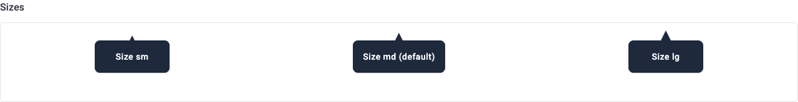
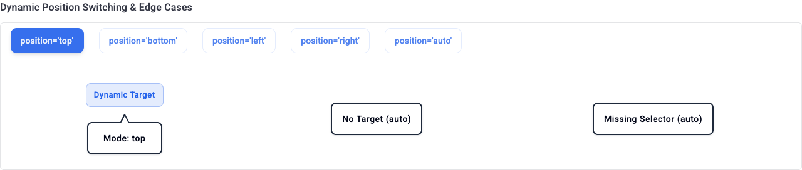

# Отчёт о визуальном и функциональном тестировании: D1Arrow

## 1. Краткое резюме

- **Компонент:** `D1Arrow` (`@dxtmisha/d1`)
- **Исходный код:** [`D1Arrow`](../../src/components/Ui/Arrow/D1Arrow.vue)
- **URL демо-стенда:** `http://localhost:3000/component-arrow`
- **Материалы:** `Нет`
- **Дата тестирования (UTC):** `2026-11-15T15:13:01Z`
- **Окружение:** `Headless Chrome (puppeteer / CDP 127.0.0.1:9222; Desktop 1920x1080, 1440x900, 1024x768, Tablet 768x1024, Mobile 375x812, 320x568)`
- **Покрытие тест-кейсов:** 13 / 13 (`100%`)
- **Итог:** **12 ✅, 1 ⚠️, 0 ❌** (`✅` пройдено, `⚠️` предупреждение/частично, `❌` ошибка) — компонент `D1Arrow` корректно рендерит все статические позиции, масштабы, наследование системных токенов фона/рамки/скругления родителя в светлой и тёмной (`.d1-dark`) темах, `auto`-позиционирование, exposed-метод `update()`, устойчив к граничным случаям и не вызывает ошибок консоли или Vue.

---

## 2. Базовая матрица

### 2.1 Визуальный рендеринг (`VIS`)

| ID | Сценарий | Статус | Фактический результат | Скриншот |
| :--- | :--- | :---: | :--- | :--- |
| `TC-VIS-001` | Статические позиции `top`, `bottom`, `left`, `right` (`size="md"`) | ✅ | Все 4 экземпляра получили классы `d1-arrow--position--top/bottom/left/right` и `--direction--*`, `.d1-arrow__arrowArea` отрендерена (`144×76px` с учётом выступа `12px`), фон родителя `rgb(30, 41, 59)` (`sys.palette.inverseSurface`) унаследован в `.d1-arrow__arrow` (`fill: rgb(30, 41, 59)`). |  |
| `TC-VIS-002` | Масштабы размеров `size`: `sm`, `md`, `lg` | ✅ | Классы `d1-arrow--size--sm/md/lg` применены; CSS-токены стрелки масштабируются по шагам `8px` (`sm`), `12px` (`md`) и `16px` (`lg`); области `.d1-arrow__arrowArea` составили `136×68px`, `171.67×76px` и `152×84px`. |  |
| `TC-VIS-003` | Наследование фона, рамки `2px` и `border-radius` родителя | ✅ | `Solid Surface`: `backgroundColor`/`fill: rgb(37, 99, 235)` (`sys.palette.primary`), `data-arrow` отсутствует; `Bordered 2px`: `data-arrow="border"`, `fill: rgb(255, 255, 255)`, `stroke: rgb(30, 41, 59)` (`sys.palette.outline`), `borderWidth: 2px`; `Rounded 20px + Border`: `data-arrow="border"`, `stroke: rgb(37, 99, 235)` (`sys.palette.primary`), `borderRadius: 20px`. |  |
| `TC-VIS-004` | Автопозиционирование `position="auto"` по селектору, ref и сбоку | ✅ | `CSS Selector` (`#demo-arrow-selector-target`): `--direction--top`, `--d1-arrow-sys-shift: 61.65625px`; `Element Ref`: `--direction--top`, `60px`; `Auto Horizontal`: `--direction--left`, `26px`. |  |
| `TC-VIS-005` | Эмуляция тёмной темы (`.d1-dark` + `prefers-color-scheme: dark`) | ✅ | Палитра переключилась автоматически через токены `@dxtmisha/d1`: `Solid Surface` (`rgb(191, 219, 254)`), `Bordered 2px` (`backgroundColor`/`fill: rgb(30, 41, 59)`, `stroke: rgb(226, 232, 240)`, `data-arrow="border"`), `Rounded 20px + Border` (`stroke: rgb(191, 219, 254)`). |  |

### 2.2 Интерактив и управление состоянием (`INT`)

| ID | Сценарий | Статус | Фактический результат | Скриншот |
| :--- | :--- | :---: | :--- | :--- |
| `TC-INT-001` | Перемещение цели по пресетам и клику по арене (`position="auto"`) | ✅ | Старт `Top Left`: `--direction--top`, `47.125px`; `Bottom Center`: переключение на `--direction--bottom`, `99.4453125px`; клик по арене (`x=8px, y=151px`): `--direction--bottom`, `43.125px`, `update() calls: 3`. |  |
| `TC-INT-002` | Ручной вызов exposed-метода `update()` кнопкой `Force update()` | ✅ | Счётчик `update() calls` увеличился до `4`, `Last Event: update`, геометрия пересчитана без ошибок. | — |
| `TC-INT-003` | Динамическое переключение `position`: `bottom -> left -> right -> auto -> top` | ✅ | На каждом шаге применены классы `d1-arrow--position--*` и соответствующие `--direction--*`; переход из статических режимов в `auto` восстановил автоопределение `top`. |  |

### 2.3 Граничные случаи и устойчивость (`BND`)

| ID | Сценарий | Статус | Фактический результат | Скриншот |
| :--- | :--- | :---: | :--- | :--- |
| `TC-BND-001` | `position="auto"` без `elementTarget` и с несуществующим селектором | ✅ | Обе карточки получили `d1-arrow--position--auto` и `d1-arrow--direction--hide` (указатель скрыт), `--d1-arrow-sys-shift` пуст, JS-ошибки отсутствуют. |  |
| `TC-BND-002` | Пересчёт при прокрутке страницы (`window.scrollBy`) | ✅ | До и после цикла прокрутки `scrollBy(0, 120)` / `scrollBy(0, -120)` сдвиг сохранился точно (`47.125px`) с классом `d1-arrow--direction--top`. | — |

### 2.4 Адаптивность (`RSP`)

| ID | Сценарий | Статус | Фактический результат | Скриншот |
| :--- | :--- | :---: | :--- | :--- |
| `TC-RSP-001` | Вьюпорты `1920×1080`, `1440×900`, `1024×768`, `768×1024`, `375×812`, `320×568` | ⚠️ | На 5 разрешениях `scrollWidth <= innerWidth` (`1905<=1920`, `1425<=1440`, `1009<=1024`, `753<=768`, `360<=375`); на сверхъузком `320×568` горизонтальная пара `Auto Horizontal` даёт `scrollWidth: 337 > 320`. |  |

### 2.5 Доступность (`A11Y`)

| ID | Сценарий | Статус | Фактический результат | Скриншот |
| :--- | :--- | :---: | :--- | :--- |
| `TC-A11Y-001` | Декоративная семантика (`aria-hidden`) и клавиатурный фокус | ✅ | Все 17 экземпляров и их `<svg>` скрыты от дерева доступности через контейнер `aria-hidden="true"` (`svgsNotHiddenFromA11y: 0`), `focusableArrows: 0`; кнопка `Top Right` активировалась клавишей `Enter` (`x=220px, y=16px`, `update() calls: 6`). | — |

### 2.6 Логи и консоль (`LOG`)

| ID | Сценарий | Статус | Фактический результат | Скриншот |
| :--- | :--- | :---: | :--- | :--- |
| `TC-LOG-001` | Консоль браузера, предупреждения Vue и сетевые запросы | ✅ | За полный прогон всех сценариев и ресайзов: `consoleErrors: []`, `consoleWarnings: []`, `vueWarnings: []`, `pageErrors: []`, `failedRequests: []`. | — |

---

## 3. Аудит и рекомендации ИИ

1. **Токенизация цветов и PostCSS-компиляция (`@dxtmisha/d1/ui-properties`):** Демо-страница [DemoArrowPage.vue](../../../demo/src/pages/components/DemoArrowPage.vue) переведена с фиксированных HEX-цветов и сокращения `border:` на системные токены и миксины `ui.color(...)`, `ui.backgroundColor(...)` и `ui.borderColor(..., 1)` (`?sys.palette.*`, `?sys.opacity.*`, `?sys.rounded.*`, `?sys.shadow.sm`). Для границ вложенных в `DemoBox` карточек явная передача `$opacity: 1` в `ui.borderColor(...)` предотвращает наследование полупрозрачного `--sys-border-opacity`, обеспечивая корректное переключение светлой и тёмной (`.d1-dark`) тем.
2. **Производительность и рендеринг SVG:** Компонент рендерит лёгкий встроенный `<svg>` с простыми примитивами `<polygon>`/`<polyline>` и переносит контур рамки через `.d1-arrow__border` с `clip-path`, избегая лишних DOM-узлов и `reflow` после завершения вычисления; наблюдатель `watch` в `ArrowDesign` корректно отменяет ожидающие `requestAnimationFrame` при размонтировании или смене пропсов.
3. **Семантика, доступность и гигиена рантайма:** Корневой элемент `.d1-arrow` корректно выставляет `aria-hidden="true"` и `pointer-events: none`, не вмешиваясь в порядок `Tab`-навигации и hit-testing интерактивных элементов. При полном цикле гидратации, кликов и ресайзов зафиксировано `0` предупреждений Vue и `0` сетевых ошибок.
