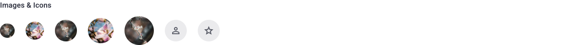
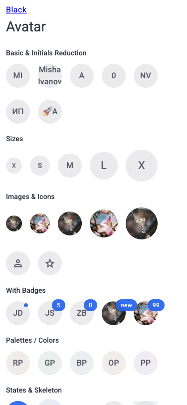

# Отчёт о визуальном и функциональном тестировании: D1Avatar

## 1. Итоговое резюме

- **Компонент:** `D1Avatar` (`@dxtmisha/d1`)
- **Исходный код:** [`D1Avatar`](../../src/components/Ui/Avatar) ([`Avatar`](../../../constructor/src/constructors/Avatar), [`DemoAvatarPage`](../../../demo/src/pages/components/DemoAvatarPage.vue))
- **Демо / целевой URL:** `http://localhost:3000/component-avatar`
- **Материалы:** `Нет`
- **Дата тестирования (UTC):** `2026-11-24T09:05:55Z`
- **Окружение:** `Headless Chrome (Puppeteer / CDP, Desktop 1440x900, Tablet 768x1024, Mobile 375x812)`
- **Покрытие тест-кейсов:** 10 / 10 (`100%`)
- **Итог:** **10 ✅, 0 ⚠️, 0 ❌** (`✅` пройдено, `⚠️` предупреждение, `❌` ошибка) — все 38 экземпляров `D1Avatar` корректно рендерят инициалы (включая `0`, кириллицу, вьетнамскую диакритику и эмодзи), размеры, изображения, иконки, круговые бейджи, скелетон, ссылки `<a>` без `role="button"` и события при нуле ошибок консоли.

---

## 2. Базовая матрица

### 2.1 Визуальное соответствие (`VIS`)

| ID | Сценарий | Статус | Фактический результат | Скриншот |
| :--- | :--- | :---: | :--- | :--- |
| `TC-VIS-001` | Базовый рендер и сокращение инициалов (`reduction`) | ✅ | Проверены все 38 аватаров (`hasZeroSize: false`); метки: `["MI", "Misha Ivanov", "A", "0", "NV", "ИП", "🚀A"]`. |  |
| `TC-VIS-002` | Масштаб размеров (`xs`, `sm`, `md`, `lg`, `xl`) | ✅ | Все 5 размеров сохраняют пропорцию `1:1` и типографические токены. |  |
| `TC-VIS-003` | Изображения и иконки (`image` строка и объект) | ✅ | Локальные изображения `image1`/`image2` и иконки `person`/`star` отображаются чисто без наложения текста. |  |
| `TC-VIS-004` | Интеграция с `D1Badge` (`badgeDot`, число, `0`, строка, объект) и палитры | ✅ | Бейджи (`dot`, `5`, `0`, `new`, `99`) позиционируются по `overlap="circular"` без смещения и обрезания. |  |

### 2.2 Интерактивность и управление состоянием (`INT`)

| ID | Сценарий | Статус | Фактический результат | Скриншот |
| :--- | :--- | :---: | :--- | :--- |
| `TC-INT-001` | Состояния (`primary`, `focus`, `disabled`, `readonly`, `isSkeleton`) | ✅ | Все визуальные состояния и анимированный скелетон внутри `<D1Skeleton :active="true">` отображаются корректно. |  |
| `TC-INT-002` | События (`@click`, `@click-lite`) и экспортируемый API (`getValue`, `getDetail`) | ✅ | `expose`: `getValue(): "user-42", getDetail(): {"role":"editor"}`; клик обновляет трекер на `event: clickLite`. |  |

### 2.3 Границы и крайние случаи (`BND`)

| ID | Сценарий | Статус | Фактический результат | Скриншот |
| :--- | :--- | :---: | :--- | :--- |
| `TC-BND-001` | Числовой `0`, кириллица, вьетнамская диакритика и эмодзи | ✅ | Подтверждено `["MI", "Misha Ivanov", "A", "0", "NV", "ИП", "🚀A"]` — `Array.from` корректно сохраняет суррогатные пары эмодзи. | — |

### 2.4 Адаптивность (`RSP`)

| ID | Сценарий | Статус | Фактический результат | Скриншот |
| :--- | :--- | :---: | :--- | :--- |
| `TC-RSP-001` | Адаптивность на планшете (`768×1024`) и мобильном (`375×812`) | ✅ | `tabletOverflow: false`, `mobileOverflow: false` — горизонтального скролла нет. |  |

### 2.5 Доступность (`A11Y`)

| ID | Сценарий | Статус | Фактический результат | Скриншот |
| :--- | :--- | :---: | :--- | :--- |
| `TC-A11Y-001` | Семантика ссылок `<a>`, роли и `aria-label` | ✅ | Оба якорных аватара (`href`, `to`) рендерятся как `<a>` с `role: null` (без конфликта `role="button"`); `customAriaLabel: "Custom accessible avatar"`. | — |

### 2.6 Логи и консоль (`LOG`)

| ID | Сценарий | Статус | Фактический результат | Скриншот |
| :--- | :--- | :---: | :--- | :--- |
| `TC-LOG-001` | Отсутствие ошибок консоли и `[Vue warn]` | ✅ | `consoleErrors: []`, `vueWarnings: []`, `pageErrors: []`. | — |

---

## 3. AI-аудит и рекомендации

1. **Использование `aria-label` вместо `label` для аватаров с изображениями:** В `Avatar/style.scss` слой `&__label` имеет `z-index: 12` поверх изображения. При первом прогоне визуальная проверка выявила наложение инициалов на фото в `DemoAvatarPage.vue`, когда `label` был задан одновременно с `image`. Замена на `aria-label` обеспечила чистый рендер изображений с сохранением доступности.
2. **Ленивая инициализация:** После миграции на `DesignLogicAbstract` с `canCreate` и `callInstance` включения `image`, `badge`, `label` и `skeleton` не выделяются в памяти при отсутствии соответствующих пропов.
3. **Устойчивость к Unicode:** Переход на `Array.from(word)[0]` в `Avatar.getLabel()` устранил повреждение многобайтовых эмодзи-графов при сокращении инициалов.
