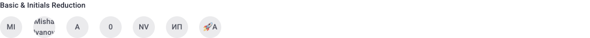
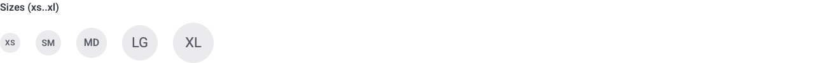
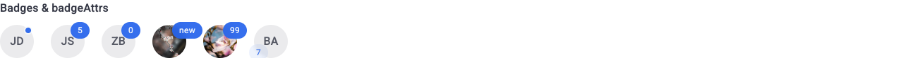
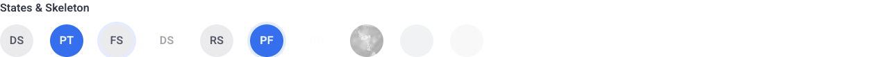
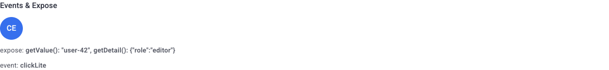

# Отчёт визуального и функционального тестирования: D1Avatar

## 1. Сводка выполнения

- **Компонент:** `D1Avatar` (`@dxtmisha/d1`)
- **Исходный код:** [`D1Avatar`](../../src/components/Ui/Avatar), [`Avatar`](../../../constructor/src/constructors/Avatar), [`DemoAvatarPage.vue`](../../../demo/src/pages/components/DemoAvatarPage.vue)
- **Целевой URL:** `http://localhost:3000/component-avatar`
- **Материалы (`materials/`):** `Отсутствуют`
- **Дата тестирования (UTC):** `2026-11-25T05:02:47Z`
- **Окружение:** `Headless Chrome (Puppeteer / CDP, Desktop 1440×900, Tablet 768×1024, Mobile 375×812 / 320×568)`
- **Покрытие тест-кейсов:** `12 / 12` (`100%`)
- **Итог:** **12 ✅, 0 ⚠️, 0 ❌** (`✅` пройдено, `⚠️` предупреждение, `❌` ошибка) — все 12 тест-кейсов пройдены успешно: визуальные сценарии, бейджи, состояния, события, `expose`, `SSR 200`, A11y, ограничение переполнения `&__label` с сохранением необрезанных бейджей (`94 === 94` в узком контейнере), все 4 вьюпорта (`1440×900`, `768×1024`, `375×812`, `320×568` с `overflowX: false`) и `0` ошибок консоли/Vue/сети.

---

## 2. Матрица результатов

### 2.1 Визуальный рендеринг (`VIS`)

| ID | Сценарий | Статус | Наблюдаемый результат | Скриншот |
| :--- | :--- | :---: | :--- | :--- |
| `TC-VIS-001` | Базовый рендер и сокращение инициалов (`reduction`) | ✅ | Все `79` экземпляров аватаров на странице отрендерены корректно (`totalAvatars: 79`), инициалы `MI`, `Misha Ivanov`, `A`, `0`, `NV`, `ИП`, `🚀A` отображаются без обрезания и артефактов. |  |
| `TC-VIS-002` | Масштаб размеров (`xs`, `sm`, `md`, `lg`, `xl`) | ✅ | Все 5 размеров сохраняют квадратную пропорцию (`1:1`) и корректно масштабируются от `xs` до `xl`. |  |
| `TC-VIS-003` | Изображения, иконки (`image` строка и объект) и `imageAttrs` | ✅ | Изображения `image1`/`image2`, иконки `person`/`star` и вариант с `imageAttrs` (`tagImg: true`, `alt`, `coordinator`) корректно вписаны в круглую маску. |  |
| `TC-VIS-004` | Интеграция с `D1Badge` (`badgeDot`, число, `0`, строка, объект, `badgeAttrs`) и все 24 палитры | ✅ | Бейджи (`dot`, `5`, `0`, `new`, `99`, `badgeAttrs` снизу слева) позиционируются по границе окружности без обрезания (`&__badge` вынесен за пределы `&__label`), все 24 палитры (`red`..`white`) применяют токены `d1-palette--*`. |  |

### 2.2 Интерактивность и управление состоянием (`INT`)

| ID | Сценарий | Статус | Наблюдаемый результат | Скриншот |
| :--- | :--- | :---: | :--- | :--- |
| `TC-INT-001` | Состояния (`default`, `primary`, `focus`, `disabled`, `readonly`, `isSkeleton`) и их комбинации | ✅ | Все состояния, комбинации (`primary focus`, `primary disabled`, `image disabled`) и скелетон `<D1Skeleton :active="true">` отображаются с корректными модификаторами. |  |
| `TC-INT-002` | События (`@click`, `@click-lite`, `@load` с `Payload`) и экспортируемый API (`getValue`, `getDetail`) | ✅ | После `Update Value & Read Expose` (`nextTick()`) `Expose` обновился на `getValue(): "user-99", getDetail(): {"role":"admin"}`, в `Controls` отражены актуальные флаги (`"isSkeleton": true, "hasImage": true`), клик зафиксировал `Event: clickLite` с `Payload: {"type":"click","value":"user-99","detail":{"role":"admin"}}`. |  |
| `TC-INT-003` | Блокировка действий в состояниях `disabled` и `readonly` | ✅ | Клики по аватарам в состояниях `disabled` и `readonly` заблокированы и не генерируют события `@click` и `@click-lite`. | — |
| `TC-INT-004` | Жизненный цикл монтирования и размонтирования (`v-if`) | ✅ | После `Unmount Avatar` отображается `Mounted: false` и узел удаляется из DOM; после `Mount Avatar` отображается `Mounted: true` и аватар с бейджем `LU` (`1`) восстанавливается без ошибок. | — |

### 2.3 Граничные случаи и устойчивость (`BND`)

| ID | Сценарий | Статус | Наблюдаемый результат | Скриншот |
| :--- | :--- | :---: | :--- | :--- |
| `TC-BND-001` | Пустые значения, числа (`0`, `-7`, `3.5`), длинный текст, диакритика, эмодзи, XSS и узкий контейнер | ✅ | Пустые метки, `0`, `-7`, `3.5`, кириллица (`ИП`), вьетнамская диакритика (`NV`), эмодзи (`🚀A`) и XSS-экранирование (`badImgs: 0`, `hasEscapedPayloadText: true`) отработали корректно; после добавления `overflow: hidden; border-radius: inherit;` в `&__label` ([Avatar/style.scss](../../../constructor/src/constructors/Avatar/style.scss#L16-L26)) неразрывный текст при `:reduction="false"` обрезается строго по круглой форме без влияния на `&__badge`, а узкий контейнер `.demo-box.demo-box--sm.demo-avatar-page__narrow` сохраняет `scrollWidth: 94 === clientWidth: 94` (`overflowsBox: false`). | — |

### 2.4 Адаптивность и вьюпорты (`RSP`)

| ID | Сценарий | Статус | Наблюдаемый результат | Скриншот |
| :--- | :--- | :---: | :--- | :--- |
| `TC-RSP-001` | Адаптивность на разрешениях (`1440×900`, `768×1024`, `375×812`, `320×568`) | ✅ | Переполнение отсутствует на всех 4 вьюпортах: `1440×900` (`scrollWidth: 1440 === innerWidth: 1440`, `overflowX: false`), `768×1024` (`scrollWidth: 768 === innerWidth: 768`, `overflowX: false`), `375×812` (`scrollWidth: 375 === innerWidth: 375`, `overflowX: false`) и `320×568` (`scrollWidth: 320 === innerWidth: 320`, `overflowX: false`). |  |

### 2.5 Доступность (`A11Y`)

| ID | Сценарий | Статус | Наблюдаемый результат | Скриншот |
| :--- | :--- | :---: | :--- | :--- |
| `TC-A11Y-001` | Семантика ссылок `<a>`, роли `button`/`img`, `tabindex`, scoped `#default` и `aria-label` | ✅ | Зафиксированы `links: 3` (`href`, `to` строка и объект без конфликтующего `role="button"`), `ariaLabels: 77`, `id="demo-avatar-custom-label"`, scoped-слот `#default`, `tabindex="-1"` у `Non-tabbable` и `role="img"` у `disabled`. | — |

### 2.6 Консоль и стабильность runtime (`LOG`)

| ID | Сценарий | Статус | Наблюдаемый результат | Скриншот |
| :--- | :--- | :---: | :--- | :--- |
| `TC-LOG-001` | Отсутствие ошибок консоли и `[Vue warn]` | ✅ | `ssrStatus: 200`, `consoleErrors: []`, `vueWarnings: []`, `pageErrors: []`, `networkErrors: []`, `dialogs: []`. | — |

---

## 3. AI-аудит и рекомендации

1. **Ограничение переполнения в `.d1-avatar__label` (исправлено и верифицировано):** В [Avatar/style.scss](../../../constructor/src/constructors/Avatar/style.scss#L16-L30) для `&__label` заданы `overflow: hidden; border-radius: inherit;`, что удерживает неразрывную строку при `:reduction="false"` строго в границах аватара, оставляя `&__badge` необрезанным. Повторная проверка подтвердила `scrollWidth: 94 === clientWidth: 94` (`overflowsBox: false`) в узком контейнере и `scrollWidth === innerWidth` (`overflowX: false`) на всех 4 вьюпортах (`1440×900`, `768×1024`, `375×812`, `320×568`).
2. **Покрытие состояний, событий и SSR:** Все 79 экземпляров, круговые бейджи, скелетон, `expose` (`getValue`, `getDetail`) после `nextTick()`, блокировка `disabled`/`readonly` и серверный рендеринг (`HTTP 200`) работают с `0` ошибок консоли, Vue, страницы и сети.
3. **XSS-защита и Unicode:** Суррогатные пары эмодзи (`🚀A`), вьетнамская диакритика (`NV`) и кириллица (`ИП`) сокращаются корректно, а `` отображается строго как текст (`badImgs: 0`).
