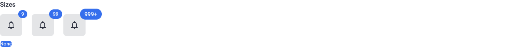
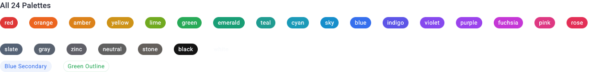
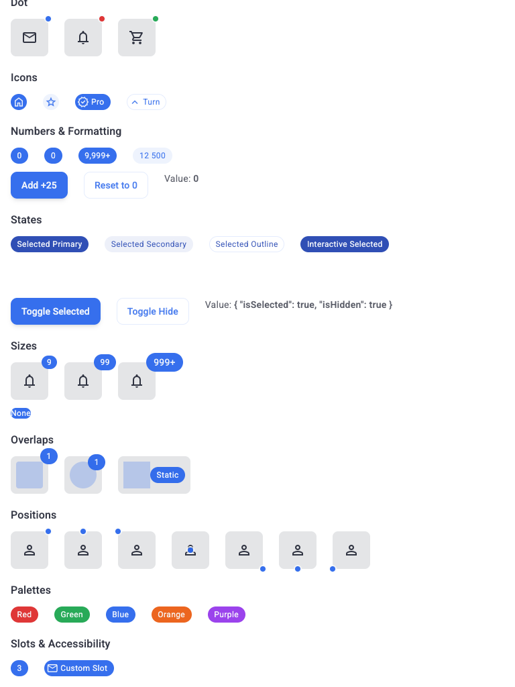
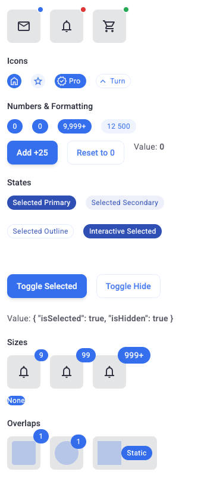

# Отчёт о визуальном и функциональном тестировании: `D1Badge`

## 1. Итоговое резюме

- **Компонент:** `D1Badge` (`@dxtmisha/d1`)
- **Исходный код:** [`D1Badge`](../../src/components/Ui/Badge) ([`Badge`](../../../constructor/src/constructors/Badge))
- **Демо / Целевой URL:** `http://localhost:3000/component-badge`
- **Материалы:** `Нет`
- **Дата тестирования (UTC):** `2026-11-24T08:43:00Z`
- **Окружение:** `Headless Chrome (Puppeteer / CDP, Desktop 1440x900, Tablet 768x1024, Mobile 375x812 / 320x568)`
- **Покрытие тест-кейсов:** 16 / 16 (`100%`)
- **Сводка:** **16 ✅, 0 ⚠️, 0 ❌** (`✅` пройдено, `⚠️` предупреждение, `❌` ошибка) — `D1Badge` корректно отображает все визуальные варианты, позиционирование, числовое форматирование, ноль, авто-скрытие, интерактивные состояния и ARIA-атрибуты при нулевом количестве ошибок и предупреждений консоли.

---

## 2. Базовая матрица

### 2.1 Визуальный рендеринг (`VIS`)

| ID | Сценарий | Статус | Фактический результат | Скриншот |
| :--- | :--- | :---: | :--- | :--- |
| `TC-VIS-001` | Варианты оформления (`primary`, `secondary`, `outline`) и точечный режим (`dot`) | ✅ | `primary` (`rgba(37, 99, 235, 0.92)`), `secondary` (`rgba(37, 99, 235, 0.08)`), `outline` (прозрачный фон с рамкой), `dot` (`8×8px`, `border-radius: 128px`, без метки). |  |
| `TC-VIS-002` | Размеры (`sm`, `md`, `lg`, `none`) и перекрытия (`rectangular`, `circular`, `static`) | ✅ | Высоты: `sm` `20px`, `md` `24px`, `lg` `28px`, `none` `16px`; `rectangular`/`circular` имеют `position: absolute`, `static` — `position: static`. |  |
| `TC-VIS-003` | Позиционирование по вертикали и горизонтали (`vertical`, `horizontal`) | ✅ | Все 7 позиций (`top/center/bottom` × `left/center/right`) имеют корректные вычисленные смещения и классы `--vertical--*`/`--horizontal--*`. |  |
| `TC-VIS-004` | Палитры (`red`, `green`, `blue`, `orange`, `purple`) | ✅ | Применены классы `d1-palette--*`, цвета фона соответствуют токенам палитры с контрастным светлым текстом. |  |
| `TC-VIS-005` | Иконки и комбинированный контент (`icon`, объект `icon`, `iconTurn`, `label`) | ✅ | Бейджи с иконкой `home`, объектом `{ icon: 'star' }`, `verified + Pro` (`53×24px`) и `iconTurn` (`.d1-icon--turn`) отображаются без наложений. |  |

### 2.2 Интерактивность и управление состоянием (`INT`)

| ID | Сценарий | Статус | Фактический результат | Скриншот |
| :--- | :--- | :---: | :--- | :--- |
| `TC-INT-001` | Динамический счётчик с нулём и ограничением `label-max="99"` | ✅ | Начальное значение `0` отображается; после 5 кликов `Add +25` показывает `99+` (при `Value: 125`); после `Reset to 0` возвращается к `0`. |  |
| `TC-INT-002` | Переключение состояний `selected` и `hide` | ✅ | После клика на `Toggle Selected` и `Toggle Hide` добавляются `.d1-badge--selected` (`rgba(30, 64, 175, 0.92)`) и `.d1-badge--hide` (`opacity: 0`), при повторном клике возвращаются в норму. |  |
| `TC-INT-003` | Локализованное форматирование чисел (`formatting`, `language`) и слот `default` | ✅ | `en-US` выводит `9,999+`, `ru-RU` выводит `12 500`; слот `#default` корректно рендерит `Custom Slot` рядом с иконкой `mail`. |  |

### 2.3 Граничные случаи (`BND`)

| ID | Сценарий | Статус | Фактический результат | Скриншот |
| :--- | :--- | :---: | :--- | :--- |
| `TC-BND-001` | Обработка числового нуля (`:label="0"`) | ✅ | Статичный бейдж `:label="0"` отображает `"0"`, `hasHideAuto: false`, `opacity: "1"`. | — |
| `TC-BND-002` | Автоматическое скрытие пустого бейджа (`--hideAuto`) | ✅ | Пустой бейдж с `label=""` получил класс `.d1-badge--hideAuto` и `opacity: "0"`. | — |
| `TC-BND-003` | Проверка переполнения текста по всем экземплярам бейджа | ✅ | Проверены все `41` компонент `D1Badge` на странице: `overflowItems: []` (`scrollWidth <= clientWidth + 1`). | — |

### 2.4 Адаптивность (`RSP`)

| ID | Сценарий | Статус | Фактический результат | Скриншот |
| :--- | :--- | :---: | :--- | :--- |
| `TC-RSP-001` | Отображение на планшете (`768×1024`) | ✅ | `scrollWidth: 768`, `innerWidth: 768`, горизонтальный скролл отсутствует (`hasOverflow: false`). |  |
| `TC-RSP-002` | Отображение на мобильном экране (`375×812` и `320×568`) | ✅ | `375×812`: `scrollWidth: 375`, `hasOverflow: false`; `320×568`: `scrollWidth: 320`, `hasOverflow: false`. |  |

### 2.5 Доступность (`A11Y`)

| ID | Сценарий | Статус | Фактический результат | Скриншот |
| :--- | :--- | :---: | :--- | :--- |
| `TC-A11Y-001` | Атрибуты `aria-label`, `aria-hidden` и `label-id` | ✅ | Корневой `` имеет `aria-label="3 unread notifications"`, дочерний `.d1-badge__label` имеет `id="demo-badge-custom-id"` и `aria-hidden="true"`. | — |
| `TC-A11Y-002` | Скрытие декоративных иконок внутри бейджа | ✅ | Все `4` иконки `.d1-badge__icon` в группе `Icons` имеют `aria-hidden="true"`. | — |

### 2.6 Консоль и рантайм (`LOG`)

| ID | Сценарий | Статус | Фактический результат | Скриншот |
| :--- | :--- | :---: | :--- | :--- |
| `TC-LOG-001` | Проверка ошибок консоли, исключений страницы и предупреждений Vue | ✅ | `consoleErrors: []`, `vueWarnings: []`, `pageErrors: []`. | — |

---

## 3. Аудит и рекомендации ИИ

1. **Изоляция демо-стенда и выравнивание `size="none"`**: При первом прогоне на `DemoBadgePage.vue` бейдж `size="none"` внутри `DemoFlex` (без `align="center"`) растягивался по высоте соседних обёрток иконок (`56px`) и соприкасался с абсолютным бейджем `999+`, а классы обёрток использовали несуществующую переменную `--d1-sys-palette-surfaceVariant`. Демо-страница обновлена (`DemoFlex align="center"`, отдельный ряд для `size="none"` и миксины `@dxtmisha/d1/ui-properties`).
2. **Производительность и ленивая инициализация**: `Badge` теперь использует `DesignLogicAbstract` с `canCreate` для `icon` и `label`, поэтому в режиме `dot` (3 экземпляра на странице) и для пустых бейджей вложенные `IconInclude` и `LabelNumberInclude` не инстанцируются.
3. **Доступность (A11y)**: Подтверждена корректная связка `aria-label` на корневом `` и `aria-hidden="true"` на внутреннем `.d1-badge__label`, а также отображение числового `0` без ложного скрытия.
