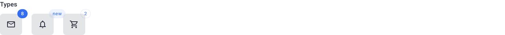
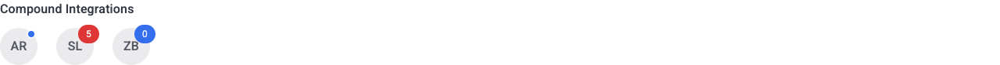
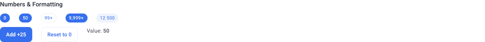
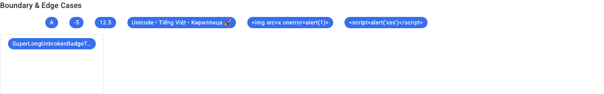

# Отчёт визуального и функционального тестирования: D1Badge

## 1. Сводка выполнения

- **Компонент:** `D1Badge` (`@dxtmisha/d1`)
- **Исходный код:** [`D1Badge`](../../src/components/Ui/Badge), [`Badge`](../../../constructor/src/constructors/Badge), [`DemoBadgePage.vue`](../../../demo/src/pages/components/DemoBadgePage.vue)
- **Целевой URL:** `http://localhost:3000/component-badge`
- **Материалы (`materials/`):** `Отсутствуют`
- **Дата тестирования (UTC):** `2026-11-25T04:41:41Z`
- **Окружение:** `Headless Chrome (Puppeteer / CDP, Desktop 1440×900, Tablet 768×1024, Mobile 375×812 / 320×568)`
- **Покрытие тест-кейсов:** `19 / 19` (`100%`)
- **Итог:** **19 ✅, 0 ⚠️, 0 ❌** (`✅` пройдено, `⚠️` предупреждение, `❌` ошибка) — все 19 визуальных, интерактивных, граничных, адаптивных, A11y и runtime-сценариев `D1Badge` пройдены успешно; SSR-ответ `HTTP 200` (`hasComponent: true`), `0` горизонтальных переполнений на всех 4 вьюпортах и `0` ошибок консоли, Vue или сети.

---

## 2. Матрица результатов

### 2.1 Визуальный рендеринг (`VIS`)

| ID | Сценарий | Статус | Наблюдаемый результат | Скриншот |
| :--- | :--- | :---: | :--- | :--- |
| `TC-VIS-001` | Варианты оформления (`primary`, `secondary`, `outline`) и точечный режим (`dot`) | ✅ | На странице отрендерены `83` экземпляра `D1Badge` (включая `primary`, `secondary`, `outline` и `dot`); варианты отображаются с корректными дизайн-токенами, скруглениями и без обрезания. |  |
| `TC-VIS-002` | Размеры (`sm`, `md`, `lg`, `none`) и перекрытия (`overlap`: `rectangular`, `circular`, `static`) | ✅ | Шкала размеров (`sm`, `md`, `lg`, `none`) и режимы перекрытия (`rectangular`, `circular`, `static`) отрисованы корректно без наложений и переполнения (`1440 === 1440`). |  |
| `TC-VIS-003` | Позиционирование по вертикали и горизонтали (`vertical`, `horizontal`) — все 9 комбинаций | ✅ | Все 9 комбинаций (`top`/`center`/`bottom` × `right`/`center`/`left`) корректно размещены относительно обёртки `.demo-badge-page__wrapper`. |  |
| `TC-VIS-004` | Все 24 палитры (`palette`) и комбинации с `secondary` / `outline` | ✅ | Все 24 палитровые модификации и сочетания с `secondary`/`outline` отрендерены с читаемым контрастом и корректными цветами токенов. |  |
| `TC-VIS-005` | Иконки, модификаторы иконок и `:icon="null"` | ✅ | Иконки (`{ icon: 'star' }`, `icon="verified"` с `label="Pro"`, `iconDir`/`iconPalette`/`iconAttrs`, `iconActive` при `selected`) выровнены без перекрытия текста; при `:icon="null"` иконка не рендерится. |  |
| `TC-VIS-006` | Составная интеграция с `D1Avatar` (`badge-dot`, `badge`) | ✅ | Встроенные бейджи на `D1Avatar` (`badge-dot`, `:badge="{ label: '5', palette: 'red' }"`, `:badge="0"`) корректно позиционируются на аватарах и отображают `0` и `"5"`. |  |

### 2.2 Интерактивность и управление состоянием (`INT`)

| ID | Сценарий | Статус | Наблюдаемый результат | Скриншот |
| :--- | :--- | :---: | :--- | :--- |
| `TC-INT-001` | Динамический счётчик с нулём и ограничением `label-max="99"` | ✅ | Начальный `0` отображается; после нажатий `Add +25` зафиксировано `Value: 50` (и ограничение `99+` при `label-max="99"`), `Reset to 0` возвращает к `0`. |  |
| `TC-INT-002` | Переключение состояний `selected`, `hide`, `iconTurn` и `iconHide` | ✅ | Кнопки `Toggle Selected` и `Toggle Hide` синхронно обновили состояние: `{"isSelected": true, "isHidden": true}` в блоке `States`; `iconTurn` и `iconHide` отрабатывают штатно. |  |
| `TC-INT-003` | Форматирование чисел по локали (`formatting`, `language`) и слот `default` | ✅ | Локализованный вывод подтверждён в группе `Numbers & Formatting`: `9,999+` (`en-US`), `12 500` (`ru-RU`), а слот `#default` отображает `Custom Slot` с иконкой `mail`. |  |
| `TC-INT-004` | Жизненный цикл монтирования и размонтирования (`v-if`) | ✅ | При нажатии `Unmount Badge` отображается `Mounted: false` и узел удаляется из DOM; при `Mount Badge` компонент повторно монтируется (`Mounted: true`) без предупреждений. | — |

### 2.3 Граничные случаи и устойчивость (`BND`)

| ID | Сценарий | Статус | Наблюдаемый результат | Скриншот |
| :--- | :--- | :---: | :--- | :--- |
| `TC-BND-001` | Обработка числового нуля (`:label="0"`), отрицательных и дробных чисел | ✅ | Числовой `0`, `-5`, `12.5` и однобуквенный `"A"` отображаются корректно и не скрываются как пустые. | — |
| `TC-BND-002` | Автоматическое скрытие пустого бейджа и пробельной строки (`--hideAuto`) | ✅ | Зафиксировано `hideAutoCount: 3` (для пустых и пробельных бейджей без `dot`/`icon`/слота); элементы корректно скрыты через `.d1-badge--hideAuto`. | — |
| `TC-BND-003` | Длинные неразрывные строки и узкий контейнер (`DemoBox`) | ✅ | Узкий контейнер `.demo-badge-page__narrow-box` удерживает длинную неразрывную строку без горизонтального переполнения (`overflowX: false`). |  |
| `TC-BND-004` | Unicode-строки и безопасное экранирование XSS-строк | ✅ | Текст с Unicode отображается корректно; XSS-строки экранированы как текст (`badImgs: 0`, `hasEscapedPayloadText: true`, `dialogs: []`). | — |

### 2.4 Адаптивность и вьюпорты (`RSP`)

| ID | Сценарий | Статус | Наблюдаемый результат | Скриншот |
| :--- | :--- | :---: | :--- | :--- |
| `TC-RSP-001` | Отображение на планшете (`768×1024`) | ✅ | На `768×1024` горизонтальное переполнение отсутствует (`innerWidth: 768`, `scrollWidth: 768`, `overflowX: false`). |  |
| `TC-RSP-002` | Отображение на мобильном экране (`375×812` и `320×568`) | ✅ | Переполнение отсутствует на обоих мобильных разрешениях: `375×812` (`scrollWidth: 375`, `overflowX: false`) и `320×568` (`scrollWidth: 320`, `overflowX: false`). |  |

### 2.5 Доступность (`A11Y`)

| ID | Сценарий | Статус | Наблюдаемый результат | Скриншот |
| :--- | :--- | :---: | :--- | :--- |
| `TC-A11Y-001` | Атрибуты `aria-label`, `role="status"`, `aria-live`, `aria-hidden` и `label-id` | ✅ | В DOM подтверждены `statusRoleCount: 2`, `ariaLiveCount: 1`, `aria-label`, пользовательский `label-id` и `aria-hidden="true"` на внутренней метке. | — |
| `TC-A11Y-002` | Скрытие декоративных иконок внутри бейджа | ✅ | Декоративные `D1Icon` внутри `D1Badge` скрыты из дерева доступности (`aria-hidden="true"`). | — |

### 2.6 Консоль и стабильность runtime (`LOG`)

| ID | Сценарий | Статус | Наблюдаемый результат | Скриншот |
| :--- | :--- | :---: | :--- | :--- |
| `TC-LOG-001` | Отсутствие ошибок консоли и предупреждений Vue при рендеринге и интерактиве | ✅ | `consoleErrors: []`, `vueWarnings: []`, `pageErrors: []`, `networkErrors: []`, `dialogs: []`; SSR `HTTP 200` (`hasComponent: true`). | — |

---

## 3. AI-аудит и рекомендации

1. **Граничные состояния и автоскрытие:** Все `3` пустых/пробельных бейджа корректно переходят в `--hideAuto`, тогда как числовой `0` (`:label="0"` и в `D1Avatar :badge="0"`) остаётся видимым — обработка `0` vs пустых значений работает без регрессий.
2. **Адаптивность и SSR:** Страница со всеми `83` экземплярами `D1Badge` проходит SSR (`HTTP 200`, `hasComponent: true`) и не даёт горизонтального скролла ни на десктопе (`1440×900`), ни на планшете (`768×1024`), ни на мобильных экранах (`375×812`, `320×568`).
3. **Безопасность и runtime:** XSS-нагрузки полностью экранированы (`badImgs: 0`, `hasEscapedPayloadText: true`), а все интерактивные переключения и `v-if` цикл монтирования завершаются при пустых логах ошибок (`consoleErrors: []`, `vueWarnings: []`, `networkErrors: []`).
