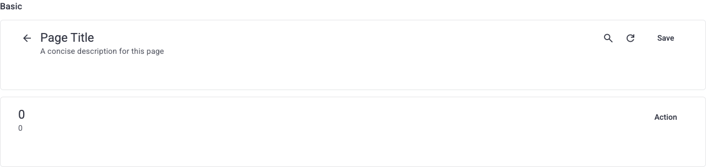
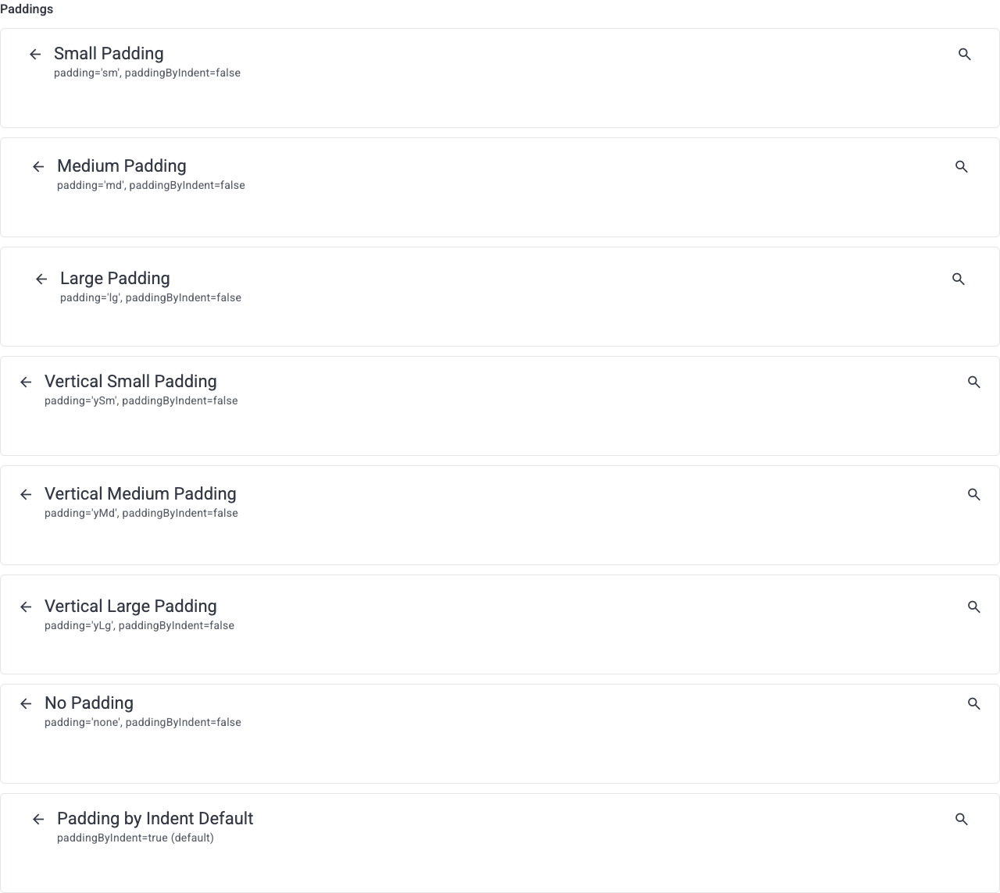
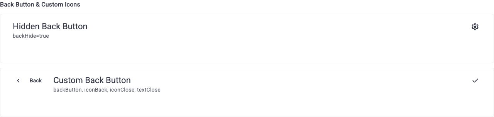
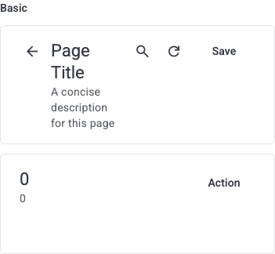

# Отчёт о визуальном и функциональном тестировании: D1Bars

## 1. Краткое резюме

- **Компонент:** `D1Bars` (`@dxtmisha/d1`)
- **Исходный код:** [`D1Bars`](../../src/components/Ui/Bars/D1Bars.vue) ([`Bars`](../../../constructor/src/constructors/Bars/Bars.ts), [`DemoBarsPage`](../../../demo/src/pages/components/DemoBarsPage.vue))
- **Целевой URL:** `http://localhost:3000/component-bars`
- **Материалы:** `None`
- **Дата тестирования (UTC):** `2026-11-16T09:06:09Z`
- **Окружение:** `Headless Chrome 157.0.8103.51 (Puppeteer / CDP 127.0.0.1:9222, Desktop 1440x900, Tablet 768x1024, Mobile 375x812 / 320x568)`
- **Покрытие тест-кейсов:** 10 / 10 (`100%`)
- **Итог:** **10 ✅, 0 ⚠️, 0 ❌** (`✅` пройдено, `⚠️` предупреждение, `❌` ошибка) — `D1Bars` корректно рендерит иерархию текста, все токены отступов, режим скелетона, переключение `action`/`modelAction`, слоты и ARIA-атрибуты при нуле ошибок и предупреждений в консоли.

---

## 2. Матрица базового тестирования

### 2.1 Визуальный рендеринг (`VIS`)

| ID | Сценарий | Статус | Фактический результат | Скриншот |
| :--- | :--- | :---: | :--- | :--- |
| `TC-VIS-001` | Базовый рендеринг заголовка, описания и кнопок | ✅ | Корневой блок `1246×66px`, заголовок `"Page Title"`, описание `"A concise description for this page"`, кнопки выровнены без перекрытий. |  |
| `TC-VIS-002` | Варианты отступов (`padding` и `paddingByIndent`) | ✅ | При отключённом `paddingByIndent` все 7 токенов `padding` применяют точные отступы: `sm` (`8px/12px`), `md` (`12px/16px`), `lg` (`16px/20px`), `ySm` (`8px/0px`), `yMd` (`12px/0px`), `yLg` (`16px/0px`), `none` (`0px`); по умолчанию `paddingByIndent` даёт `8px/16px`. |  |
| `TC-VIS-003` | Режим скелетона (`isSkeleton` внутри `D1Skeleton`) | ✅ | Классы `.d1-skeleton__textVariant` применены к `.d1-bars__label` и `.d1-bars__description`, кнопки переведены в скелетон без дублирования DOM. |  |

### 2.2 Интерактивность и управление состоянием (`INT`)

| ID | Сценарий | Статус | Фактический результат | Скриншот |
| :--- | :--- | :---: | :--- | :--- |
| `TC-INT-001` | Переключение `v-model:action` и выход кнопкой «Назад» | ✅ | При клике `Enter Action Mode` появляется `.d1-bars--action`, заголовок сменяется на `"Selected Item State"`, кнопки на `['back', 'share', 'edit', 'delete']`; клик по `button[data-value="back"]` сбрасывает `action: false`. |  |
| `TC-INT-002` | Двусторонняя модель `v-model:model-action`, `backHide`, `backActionHide` и кастомная кнопка возврата | ✅ | `modelAction` переключает второй `D1Bars` в `.d1-bars--action`, `backActionHide` скрывает кнопку возврата в action-режиме (`secondHasBackBtn: false`), `backHide` скрывает её в обычном режиме, кастомный `backButton` рендерит текст `"Back"` и `aria-label="Close bar"`. |  |
| `TC-INT-003` | Проекция слотов (`default`, `description`, `bars`, `actionBars`) | ✅ | Слоты `#default` (`"Custom Label Slot"`) и `#description` (`"Custom Description Slot text content"`) отрендерены, кнопки `#bars` (`Search`, `Refresh`) заменяются на `#actionBars` (`Delete`) при активации `action`. |  |

### 2.3 Граничные случаи (`BND`)

| ID | Сценарий | Статус | Фактический результат | Скриншот |
| :--- | :--- | :---: | :--- | :--- |
| `TC-BND-001` | Числовые нулевые значения `label`/`description` (`0`) и текстовые кнопки без фантомной иконки | ✅ | Числовые нулевые значения отображаются корректно (`secondLabel: "0"`, `secondDesc: "0"`); текстовая кнопка `Save` без свойства `icon` не имеет класса `.d1-button--icon` (`saveHasIconClass: false`, `hasSaveIconEl: false`). |  |

### 2.4 Адаптивность (`RSP`)

| ID | Сценарий | Статус | Фактический результат | Скриншот |
| :--- | :--- | :---: | :--- | :--- |
| `TC-RSP-001` | Проверка адаптивности (`1440×900`, `768×1024`, `375×812`, `320×568`) | ✅ | `docOverflow: false` и `overflowingCount: 0` на всех четырёх разрешениях, включая `320×568` (после добавления `min-width: 0` и `overflow-wrap: anywhere` на `&__context`). |  |

### 2.5 Доступность (`A11Y`)

| ID | Сценарий | Статус | Фактический результат | Скриншот |
| :--- | :--- | :---: | :--- | :--- |
| `TC-A11Y-001` | ARIA-атрибуты, пользовательские ID и клавиатурный фокус | ✅ | На панели с action-режимом присутствует `aria-live="polite"`, на статичной — `null`; кнопка «Назад» имеет `aria-label="Close"` / `"Close bar"`; `demo-bars-title` и `demo-bars-desc` присутствуют в DOM; `Tab` переводит фокус с кнопки возврата на кнопку `like`. | — |

### 2.6 Логи и консоль (`LOG`)

| ID | Сценарий | Статус | Фактический результат | Скриншот |
| :--- | :--- | :---: | :--- | :--- |
| `TC-LOG-001` | События `click` / `clickLite` и чистота консоли браузера | ✅ | Клик по `like` обновляет `DemoValue` до `"Value: clickLite: like"`; `vueWarnings: []`, `pageErrors: []` (один 404 для `/favicon.ico` на стенде dev-сервера, не связан с компонентом). | — |

---

## 3. ИИ-аудит и рекомендации

1. **Приоритет токенов `paddingByIndent` и `padding` (`D1Bars/styleToken.scss`):** По умолчанию `paddingByIndent` равен `true`, а правило `&--paddingByIndent` расположено после `&--padding--*`, из-за чего передача `padding="lg"` или `padding="none"` без явного `:padding-by-indent="false"` не меняет отступы компонента. Рекомендуется задокументировать необходимость `:padding-by-indent="false"` при использовании `padding` или переупорядочить приоритет модификаторов.
2. **Адаптивность на сверхмалых экранах (`Bars/style.scss`):** Добавленные `min-width: 0` и `overflow-wrap: anywhere` для `&__context` устранили горизонтальное переполнение при `320×568` (`overflowingCount: 0` для всех 17 экземпляров на странице).
