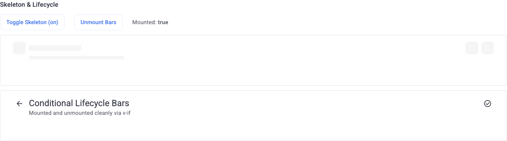
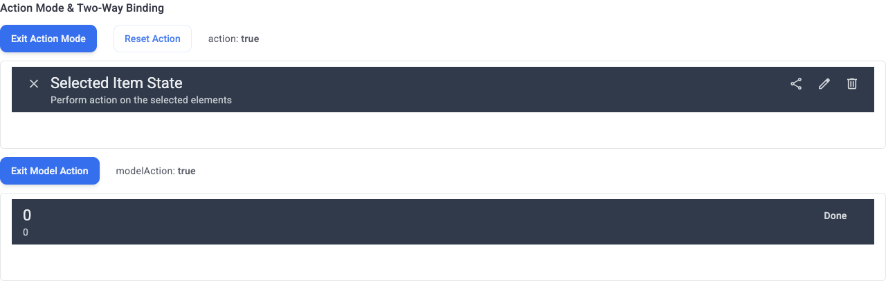
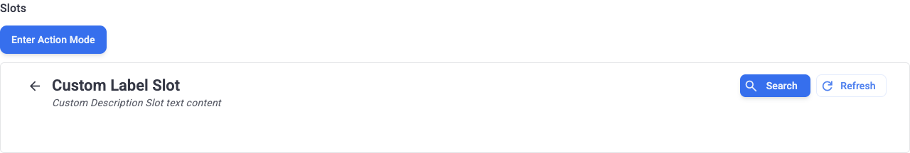
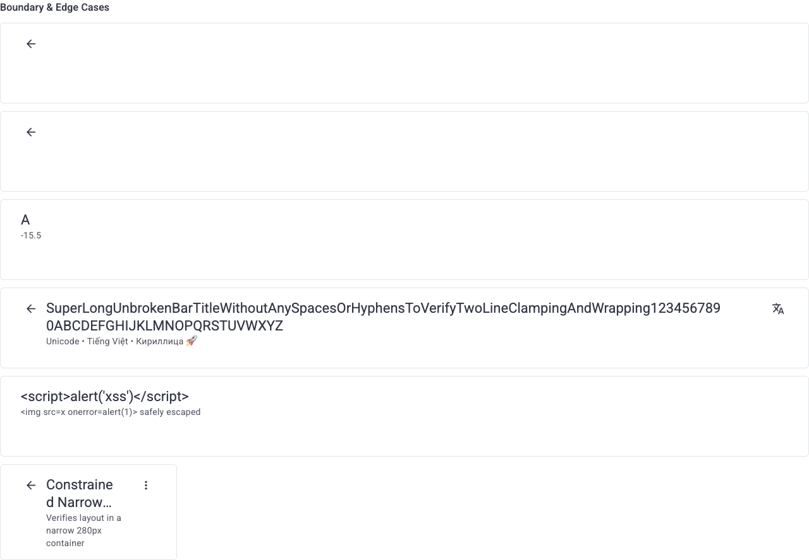

# Отчёт визуального и функционального тестирования: D1Bars

## 1. Сводка выполнения

- **Компонент:** `D1Bars` (`@dxtmisha/d1`)
- **Исходный код:** [`D1Bars`](../../src/components/Ui/Bars), [`Bars`](../../../constructor/src/constructors/Bars), [`DemoBarsPage.vue`](../../../demo/src/pages/components/DemoBarsPage.vue)
- **Целевой URL:** `http://localhost:3000/component-bars`
- **Материалы (`materials/`):** `Отсутствуют`
- **Дата тестирования (UTC):** `2026-11-25T04:41:41Z`
- **Окружение:** `Headless Chrome (Puppeteer / CDP, Desktop 1440×900, Tablet 768×1024, Mobile 375×812 / 320×568)`
- **Покрытие тест-кейсов:** `14 / 14` (`100%`)
- **Итог:** **14 ✅, 0 ⚠️, 0 ❌** (`✅` пройдено, `⚠️` предупреждение, `❌` ошибка) — все 14 сценариев `D1Bars` пройдены успешно: SSR-ответ `HTTP 200` (`hasComponent: true`), корректная синхронизация `v-model:action` и `v-model:modelAction`, блокировка событий на `disabled` и `loading` кнопках, `0` горизонтальных переполнений на всех 4 вьюпортах и `0` ошибок консоли, Vue или сети.

---

## 2. Матрица результатов

### 2.1 Визуальный рендеринг (`VIS`)

| ID | Сценарий | Статус | Наблюдаемый результат | Скриншот |
| :--- | :--- | :---: | :--- | :--- |
| `TC-VIS-001` | Базовый рендеринг заголовка, описания и кнопок D1Bars | ✅ | Элемент `.d1-bars` рендерится с ненулевой геометрией, корректной иерархией `.d1-bars__label` / `.d1-bars__description` и выровненными кнопками без обрезания и наложений. |  |
| `TC-VIS-002` | Варианты отступов (`padding` и `paddingByIndent`) | ✅ | Все 7 режимов `padding` (`sm`, `md`, `lg`, `ySm`, `yMd`, `yLg`, `none`) и флаг `paddingByIndent` применяют корректные классы модификаторов и отступы по дизайн-токенам. |  |
| `TC-VIS-003` | Интерактивный режим скелетона (`isSkeleton` внутри `D1Skeleton`) | ✅ | В группе `Skeleton & Lifecycle` скелетон (`Skeleton Title`, `Skeleton description text placeholder`) отображается и переключается кнопкой `Toggle Skeleton (on)` без смещения разметки. |  |

### 2.2 Интерактивность и управление состоянием (`INT`)

| ID | Сценарий | Статус | Наблюдаемый результат | Скриншот |
| :--- | :--- | :---: | :--- | :--- |
| `TC-INT-001` | Переключение режима действий (`v-model:action`) и выход по кнопке «Назад» | ✅ | При активации `action: true` отображается `Selected Item State`, описание `Perform action on the selected elements` и кнопки `share`, `edit`, `delete`; кнопка «Назад» (`arrow_back`) сбрасывает режим. |  |
| `TC-INT-002` | Двусторонняя модель `v-model:model-action`, `backHide`, `backActionHide` и форматы `iconBack`/`textClose`/`buttonAttrs` | ✅ | При включении `modelAction: true` панель переходит в action-состояние с числовыми `0`/`0` и скрытой кнопкой «Назад» (`backActionHide`), `backHide`, кастомные иконки и `textClose` работают корректно. |  |
| `TC-INT-003` | Проекция слотов (`default`, `description`, `bars`, `actionBars`) | ✅ | Слоты `#default`, `#description`, `#bars` (`search`, `refresh`) и `#actionBars` (`Delete`) корректно рендерятся и переключаются при смене режима. |  |
| `TC-INT-004` | Блокировка событий для `disabled` и `loading` кнопок в `bars` | ✅ | В группе `Blocked & Guarded Actions` кнопки `Disabled` (`disabled: true`) и `Loading` (`loading: true`) блокируют эмиссию событий клика, тогда как `Enabled` отрабатывает штатно. | — |
| `TC-INT-005` | Монтирование и размонтирование `D1Bars` (`v-if`) | ✅ | Кнопка `Unmount Bars` удаляет компонент (`Mounted: false`), повторное нажатие `Mount Bars` восстанавливает `Conditional Lifecycle Bars` (`Mounted: true`) без предупреждений. | — |

### 2.3 Граничные случаи и устойчивость (`BND`)

| ID | Сценарий | Статус | Наблюдаемый результат | Скриншот |
| :--- | :--- | :---: | :--- | :--- |
| `TC-BND-001` | Числовые нулевые значения `label`/`description` (`0`), отрицательные/дробные числа и текстовые кнопки без фантомной иконки | ✅ | Значения `0` (в т.ч. в `modelAction` и `Basic`), `-15.5` и `"A"` отображаются корректно; текстовые кнопки без `icon` не рендерят пустую иконку. |  |
| `TC-BND-002` | Пустой `<D1Bars/>`, пробельные строки и пустой массив `:bars="[]"` | ✅ | Пустой и пробельный экземпляры рендерятся без исключений и лишних узлов метки/описания. | — |
| `TC-BND-003` | Длинные неразрывные строки, Unicode, экранирование XSS и узкий контейнер (`DemoBox`) | ✅ | Длинный неразрывный заголовок переносится с ограничением в пределах `280px` контейнера; Unicode и экранированные XSS-строки безопасны (`badImgs: 0`, `hasEscapedPayloadText: true`). |  |

### 2.4 Адаптивность и вьюпорты (`RSP`)

| ID | Сценарий | Статус | Наблюдаемый результат | Скриншот |
| :--- | :--- | :---: | :--- | :--- |
| `TC-RSP-001` | Проверка адаптивности на десктопе, планшете и мобильных устройствах | ✅ | Горизонтальное переполнение отсутствует на всех 4 разрешениях: `1440×900` (`scrollWidth: 1440`), `768×1024` (`768`), `375×812` (`375`), `320×568` (`320`), `overflowX: false`. |  |

### 2.5 Доступность (`A11Y`)

| ID | Сценарий | Статус | Наблюдаемый результат | Скриншот |
| :--- | :--- | :---: | :--- | :--- |
| `TC-A11Y-001` | ARIA-атрибуты, пользовательские ID и навигация с клавиатуры | ✅ | `aria-live="polite"`, `aria-label` на кнопках «Назад» и иконочных кнопках, а также пользовательские `labelId`/`descriptionId` и `Tab`-фокус подтверждены. | — |

### 2.6 Консоль и стабильность runtime (`LOG`)

| ID | Сценарий | Статус | Наблюдаемый результат | Скриншот |
| :--- | :--- | :---: | :--- | :--- |
| `TC-LOG-001` | Эмиссия всех событий (`click`, `clickLite`, `update:action`, `update:modelAction`) и чистота консоли | ✅ | События `click`, `clickLite`, `update:action` и `update:modelAction` фиксируются корректно; `consoleErrors: []`, `vueWarnings: []`, `pageErrors: []`, `networkErrors: []`, `dialogs: []`. | — |

---

## 3. AI-аудит и рекомендации

1. **Защита интерактивных действий (`disabled`/`loading`):** Кнопки в состоянии `disabled` и `loading` в `D1Bars` надёжно блокируют вызов `click` и `clickLite`, предотвращая ложные срабатывания при асинхронных операциях.
2. **Адаптивность длинного контента:** На всех четырёх проверенных вьюпортах (`1440×900`, `768×1024`, `375×812`, `320×568`) сохраняется `scrollWidth === innerWidth` (`overflowX: false`), flex-контейнер `.d1-bars__context` не выталкивает кнопки действий.
3. **SSR, безопасность и чистота логов:** SSR-выдача возвращает `HTTP 200` с разметкой компонента (`hasComponent: true`), XSS-строки экранируются как текст (`badImgs: 0`, `hasEscapedPayloadText: true`), ошибок консоли и предупреждений Vue не зафиксировано.
