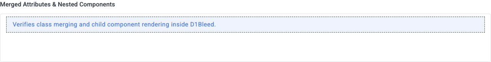
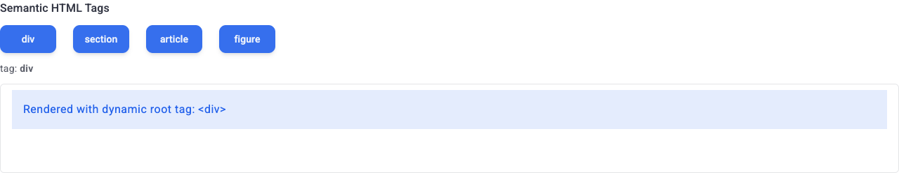
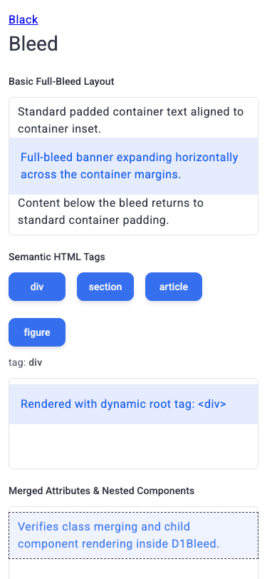

# Отчёт о визуальном и функциональном тестировании: D1Bleed

## 1. Итоговое резюме

- **Компонент:** `D1Bleed` (`@dxtmisha/d1`)
- **Исходный код:** [`D1Bleed`](../../src/components/Ui/Bleed) ([`Bleed`](../../../constructor/src/constructors/Bleed), [`DemoBleedPage`](../../../demo/src/pages/components/DemoBleedPage.vue))
- **Демо / целевой URL:** `http://localhost:3000/component-bleed`
- **Материалы:** `Нет`
- **Дата тестирования (UTC):** `2026-11-24T09:03:12Z`
- **Окружение:** `Headless Chrome (Puppeteer / CDP, Desktop 1440x900, Mobile 375x812)`
- **Покрытие тест-кейсов:** 6 / 6 (`100%`)
- **Итог:** **6 ✅, 0 ⚠️, 0 ❌** (`✅` пройдено, `⚠️` предупреждение, `❌` ошибка) — `D1Bleed` корректно расширяет контент за поля родителя, реактивно переключает полиморфные теги (`div`, `section`, `article`, `figure`), объединяет внешние атрибуты через `mergeProps` и не вызывает переполнения или ошибок консоли.

---

## 2. Базовая матрица

### 2.1 Визуальное соответствие (`VIS`)

| ID | Сценарий | Статус | Фактический результат | Скриншот |
| :--- | :--- | :---: | :--- | :--- |
| `TC-VIS-001` | Базовая разметка full-bleed внутри контейнера | ✅ | Баннер внутри `D1Bleed` симметрично расширяется по горизонтали и сохраняет вертикальный поток документа. |  |
| `TC-VIS-002` | Слияние внешних классов и вложенный компонент `D1Alert` | ✅ | Узел `[data-testid="demo-bleed-merged"]`: `mergedTag: "SECTION"`, `mergedHasBleedClass: true`, `mergedHasCustomClass: true`. |  |

### 2.2 Интерактивность и управление состоянием (`INT`)

| ID | Сценарий | Статус | Фактический результат | Скриншот |
| :--- | :--- | :---: | :--- | :--- |
| `TC-INT-001` | Реактивное переключение HTML-тега (`tag`) | ✅ | Переключения подтверждены точно: `section -> SECTION`, `article -> ARTICLE`, `figure -> FIGURE`, `div -> DIV`. |  |

### 2.3 Границы и крайние случаи (`BND`)

| ID | Сценарий | Статус | Фактический результат | Скриншот |
| :--- | :--- | :---: | :--- | :--- |
| `TC-BND-001` | Проверка геометрии всех экземпляров `D1Bleed` | ✅ | Проверены все `3` экземпляра `.d1-bleed`: `hasZeroSize: false`. | — |

### 2.4 Адаптивность (`RSP`)

| ID | Сценарий | Статус | Фактический результат | Скриншот |
| :--- | :--- | :---: | :--- | :--- |
| `TC-RSP-001` | Проверка на мобильном экране (`375×812`) | ✅ | `mobileOverflow: false` (`scrollWidth <= innerWidth`), вёрстка стабильна. |  |

### 2.5 Доступность (`A11Y`)

| ID | Сценарий | Статус | Фактический результат | Скриншот |
| :--- | :--- | :---: | :--- | :--- |
| `—` | Полиморфные семантические теги (`section`, `article`, `figure`) | ✅ | Корневой элемент принимает семантический тег без потери классов и атрибутов. | — |

### 2.6 Логи и консоль (`LOG`)

| ID | Сценарий | Статус | Фактический результат | Скриншот |
| :--- | :--- | :---: | :--- | :--- |
| `TC-LOG-001` | Отсутствие ошибок консоли и `[Vue warn]` | ✅ | `consoleErrors: []`, `vueWarnings: []`, `pageErrors: []`. | — |

---

## 3. AI-аудит и рекомендации

1. **Слияние атрибутов (`mergeProps`):** Перевод `BleedDesign.tsx` на `mergeProps(...)` гарантировал безопасное объединение пользовательских классов (`demo-bleed-page__custom`) и стилей с системным классом `.d1-bleed`.
2. **Производительность:** Минималистичная реализация на `DesignLogicAbstract` с пустым `constructorItems` обеспечивает нулевой оверхед на инициализацию и полную SSR-изоморфность.
