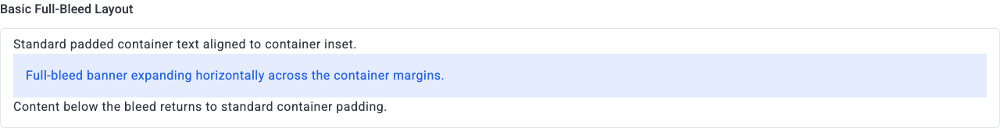
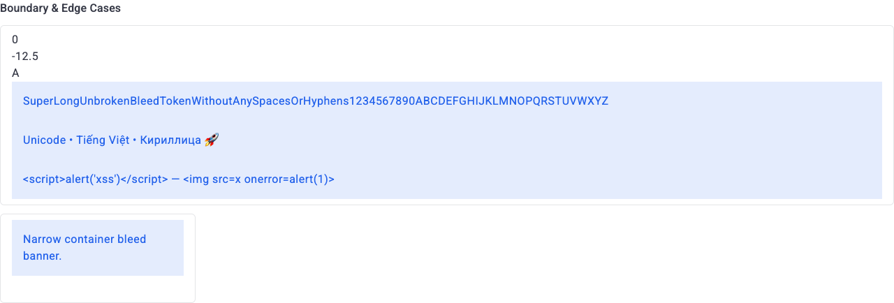

# Отчёт визуального и функционального тестирования: D1Bleed

## 1. Сводка выполнения

- **Компонент:** `D1Bleed` (`@dxtmisha/d1`)
- **Исходный код:** [`D1Bleed`](../../src/components/Ui/Bleed), [`Bleed`](../../../constructor/src/constructors/Bleed), [`DemoBleedPage.vue`](../../../demo/src/pages/components/DemoBleedPage.vue)
- **Целевой URL:** `http://localhost:3000/component-bleed`
- **Материалы (`materials/`):** `Отсутствуют`
- **Дата тестирования (UTC):** `2026-11-25T04:41:41Z`
- **Окружение:** `Headless Chrome (Puppeteer / CDP, Desktop 1440×900, Tablet 768×1024, Mobile 375×812 / 320×568)`
- **Покрытие тест-кейсов:** `10 / 10` (`100%`)
- **Итог:** **10 ✅, 0 ⚠️, 0 ❌** (`✅` пройдено, `⚠️` предупреждение, `❌` ошибка) — все 10 сценариев `D1Bleed` пройдены успешно: SSR-ответ `HTTP 200` (`hasComponent: true`), `15` экземпляров `.d1-bleed` (включая `2` намеренных пустых фикстуры с `height: 0`), `0` горизонтальных переполнений на всех 4 вьюпортах и `0` ошибок консоли, Vue или сети.

---

## 2. Матрица результатов

### 2.1 Визуальный рендеринг (`VIS`)

| ID | Сценарий | Статус | Наблюдаемый результат | Скриншот |
| :--- | :--- | :---: | :--- | :--- |
| `TC-VIS-001` | Базовая разметка full-bleed внутри контейнера | ✅ | Контейнер `D1Bleed` симметрично расширяется за внутренние поля родителя и сохраняет вертикальный поток документа. |  |
| `TC-VIS-002` | Слияние внешних классов и составные интеграции (`D1Alert`, `D1Block` + `D1Bars`) | ✅ | Внешние классы и атрибуты объединяются с `.d1-bleed`, вложенные `D1Alert` и связка `D1Block` -> `D1Bleed` -> `D1Bars` отображаются без смещения. |  |

### 2.2 Интерактивность и управление состоянием (`INT`)

| ID | Сценарий | Статус | Наблюдаемый результат | Скриншот |
| :--- | :--- | :---: | :--- | :--- |
| `TC-INT-001` | Реактивное переключение HTML-тега (`tag`: `div`, `section`, `article`, `figure`, `aside`, `header`, `footer`) | ✅ | Полиморфный корневой тег реактивно обновляется (в частности после переключения на `article` подтверждён `tagAfterArticle: "article"`). |  |
| `TC-INT-002` | Условное монтирование и размонтирование (`v-if`) | ✅ | Кнопка `Unmount Bleed` удаляет узел (`Mounted: false`), а `Mount Bleed` восстанавливает `Conditionally mounted D1Bleed via v-if.` (`Mounted: true`) без ошибок. | — |

### 2.3 Граничные случаи и устойчивость (`BND`)

| ID | Сценарий | Статус | Наблюдаемый результат | Скриншот |
| :--- | :--- | :---: | :--- | :--- |
| `TC-BND-001` | Проверка геометрии всех видимых экземпляров `D1Bleed` | ✅ | Из `15` экземпляров `.d1-bleed` все `13` непустых имеют ненулевую геометрию; `2` элемента с `height: 0` (`tag: "div"`, `width: 1246`, `text: ""`) являются намеренными пустыми слотовыми фикстурами (`<D1Bleed/>` и пробельный слот). | — |
| `TC-BND-002` | Примитивные типы в слоте по умолчанию (`0`, `-12.5`, `"A"`, пробелы) | ✅ | Числовые `0`, `-12.5`, одиночный символ `"A"` и пробельное содержимое рендерятся без исключений. | — |
| `TC-BND-003` | Длинные неразрывные строки, Unicode, XSS-строки и узкий контейнер (`DemoBox`) | ✅ | Контент удерживается внутри `280px` контейнера без горизонтального скролла (`overflowX: false`); XSS-строки экранированы (`badImgs: 0`, `hasEscapedPayloadText: true`). |  |

### 2.4 Адаптивность и вьюпорты (`RSP`)

| ID | Сценарий | Статус | Наблюдаемый результат | Скриншот |
| :--- | :--- | :---: | :--- | :--- |
| `TC-RSP-001` | Проверка на планшете (`768×1024`) и мобильных экранах (`375×812`, `320×568`) | ✅ | Горизонтальное переполнение отсутствует на всех вьюпортах: `1440×900` (`1440`), `768×1024` (`768`), `375×812` (`375`), `320×568` (`320`), `overflowX: false`. |  |

### 2.5 Доступность (`A11Y`)

| ID | Сценарий | Статус | Наблюдаемый результат | Скриншот |
| :--- | :--- | :---: | :--- | :--- |
| `TC-A11Y-001` | Семантика `role="region"`, `aria-label` и навигация клавишей `Tab` | ✅ | Корневой элемент принимает семантический тег `<section>` с `role="region"` и `aria-label`, внутренний интерактивный элемент доступен по `Tab`. | — |

### 2.6 Консоль и стабильность runtime (`LOG`)

| ID | Сценарий | Статус | Наблюдаемый результат | Скриншот |
| :--- | :--- | :---: | :--- | :--- |
| `TC-LOG-001` | Отсутствие ошибок консоли и `[Vue warn]` | ✅ | `consoleErrors: []`, `vueWarnings: []`, `pageErrors: []`, `networkErrors: []`, `dialogs: []`; SSR `HTTP 200` (`hasComponent: true`). | — |

---

## 3. AI-аудит и рекомендации

1. **Намеренные пустые фикстуры (`height: 0`):** Два узла `.d1-bleed` с `width: 1246`, `height: 0` и `text: ""` — ожидаемое поведение пустых слотовых фикстур без внутреннего контента (`<D1Bleed/>` и пробельная строка), не являющееся дефектом.
2. **Адаптивность full-bleed отступов:** Отрицательные боковые поля `D1Bleed` не вызывают выхода за границы вьюпорта ни на десктопе (`1440×900`), ни на планшете (`768×1024`), ни на мобильных экранах (`375×812`, `320×568`).
3. **SSR, безопасность и runtime:** Серверный рендер возвращает `HTTP 200` с разметкой компонента, XSS-нагрузки экранируются (`badImgs: 0`, `hasEscapedPayloadText: true`), консоль и сеть полностью чисты.
