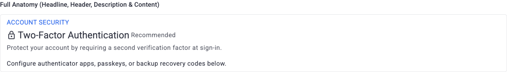
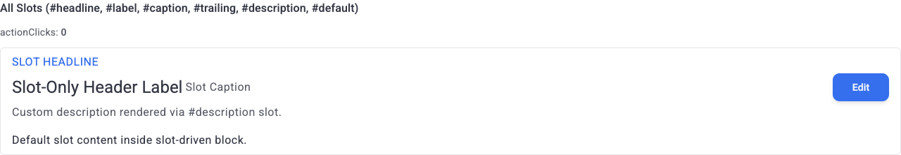
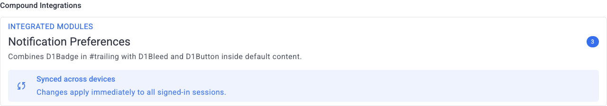
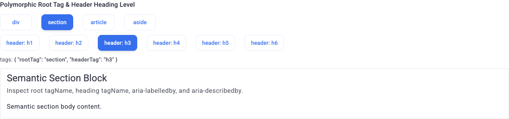
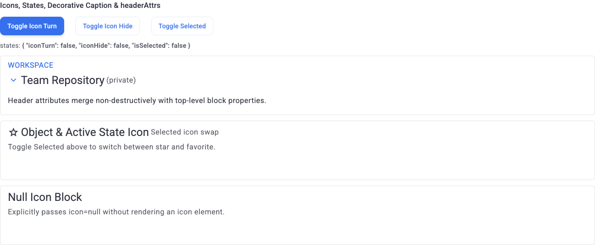
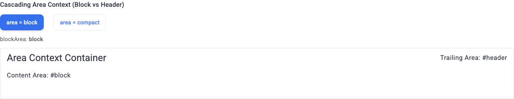
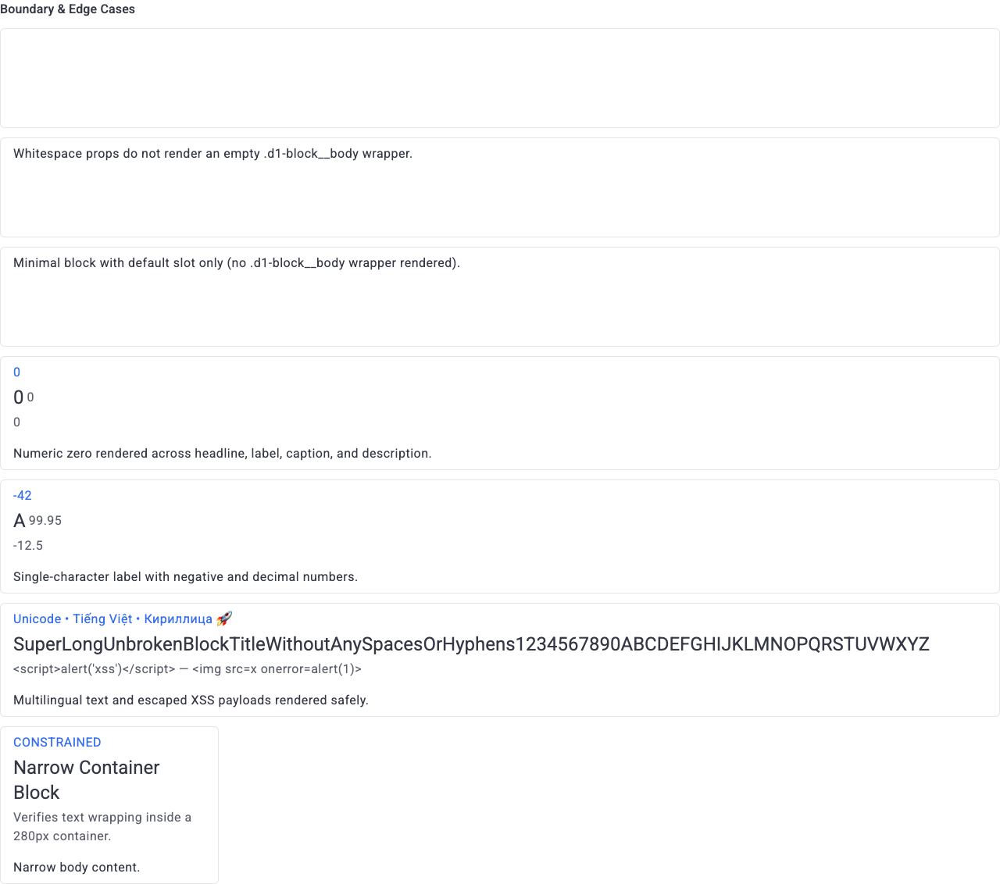

# Отчёт визуального и функционального тестирования: D1Block

## 1. Сводка выполнения

- **Компонент:** `D1Block` (`@dxtmisha/d1`)
- **Исходный код:** [`D1Block`](../../src/components/Ui/Block), [`Block`](../../../constructor/src/constructors/Block), [`Header`](../../../constructor/src/constructors/Header), [`DemoBlockPage.vue`](../../../demo/src/pages/components/DemoBlockPage.vue)
- **Целевой URL:** `http://localhost:3000/component-block`
- **Материалы (`materials/`):** `Отсутствуют`
- **Дата тестирования (UTC):** `2026-11-25T05:02:47Z`
- **Окружение:** `Headless Chrome (Puppeteer / CDP, Desktop 1440×900, Tablet 768×1024, Mobile 375×812 / 320×568)`
- **Покрытие тест-кейсов:** `14 / 14` (`100%`)
- **Итог:** **14 ✅, 0 ⚠️, 0 ❌** (`✅` пройдено, `⚠️` предупреждение, `❌` ошибка) — все 14 тест-кейсов пройдены успешно: базовый рендеринг, слоты, каскадный `area`, жизненный цикл, перенос длинных неразрывных заголовков в узком контейнере (`278 === 278`) и на всех 4 вьюпортах (`1440×900`, `768×1024`, `375×812`, `320×568` с `overflowX: false`), ARIA (`regions: 1`, `labelledBy: 14`, `describedBy: 12`), SSR (`HTTP 200`) и `0` ошибок консоли/Vue/сети.

---

## 2. Матрица результатов

### 2.1 Визуальный рендеринг (`VIS`)

| ID | Сценарий | Статус | Наблюдаемый результат | Скриншот |
| :--- | :--- | :---: | :--- | :--- |
| `TC-VIS-001` | Полная анатомия блока (`headline`, `header`, `description`, `default`) | ✅ | Все зоны `.d1-block__headline`, `.d1-block__header`, `.d1-block__description` и основной слот рендерятся корректно с системными отступами и типографикой. |  |
| `TC-VIS-002` | Рендеринг слотового блока без пропсов (`#headline`, `#label`, `#caption`, `#trailing`, `#description`, `#default`) | ✅ | Все 6 слотов корректно отрисованы в `[data-testid="demo-block-slots"]`, кнопка `Edit` в `#trailing` реагирует на клик. |  |
| `TC-VIS-003` | Составная интеграция с `D1Badge`, `D1Bleed` и `D1Alert` | ✅ | Вложенные `D1Badge` в `#trailing` и `D1Alert` внутри `D1Bleed` отображаются корректно и без наложений. |  |

### 2.2 Интерактивность и управление состоянием (`INT`)

| ID | Сценарий | Статус | Наблюдаемый результат | Скриншот |
| :--- | :--- | :---: | :--- | :--- |
| `TC-INT-001` | Реактивное переключение корневого `tag` и тега заголовка `tagHeader` | ✅ | Теги синхронно переключаются (в группе `Polymorphic Root Tag & Header Heading Level` зафиксировано `{"rootTag": "section", "headerTag": "h3"}`, `"Semantic Section Block"`). |  |
| `TC-INT-002` | Модификаторы иконки (`iconTurn`, `iconHide`, `selected`), объект/`null` и слияние `headerAttrs` | ✅ | Состояния иконки переключаются реактивно, при `:icon="null"` иконка отсутствует, `headerAttrs` неразрушающе объединяется с `.d1-block__header`. |  |
| `TC-INT-003` | Каскадный контекст `area` (`#header` в шапке и `#block`/`#compact` в теле) | ✅ | В `#trailing` сохраняется область `#header`, в основном слоте переключается `#compact` / `#block`. |  |
| `TC-INT-004` | Условное монтирование и размонтирование (`v-if`) | ✅ | При нажатии `Unmount Block` отображается `Mounted: false`, при `Mount Block` блок `Conditional Lifecycle Block` восстанавливается (`Mounted: true`) без предупреждений. | — |

### 2.3 Граничные случаи и устойчивость (`BND`)

| ID | Сценарий | Статус | Наблюдаемый результат | Скриншот |
| :--- | :--- | :---: | :--- | :--- |
| `TC-BND-001` | Отсутствие `.d1-block__body` при пустой/пробельной шапке и пустом `<D1Block/>` | ✅ | Подтверждено `emptyBlockHasBody: 0` — для пустой/пробельной шапки и body-only варианта обёртка `.d1-block__body` не создаётся; пустой `<D1Block/>` рендерится без ошибок. |  |
| `TC-BND-002` | Поддержка числового `0`, отрицательных/дробных чисел и одиночных символов | ✅ | Числовой `0` отображается во всех 4 зонах; `-42`, `"A"`, `99.95`, `-12.5` рендерятся корректно без скрытия. | — |
| `TC-BND-003` | Длинные неразрывные строки, Unicode, экранирование XSS и узкий контейнер (`DemoBox`) | ✅ | XSS экранирован (`badImgs: 0`, `hasEscapedPayloadText: true`), Unicode корректен; после исправлений в `Header/style.scss` и `Block/style.scss` (`min-width: 0; max-width: 100%; overflow-wrap: anywhere;`) длинный неразрывный заголовок переносится в пределах узкого контейнера `.demo-box.demo-box--md.demo-block-page__narrow-box` (`scrollWidth: 278 === clientWidth: 278`, `overflowsBox: false`). |  |

### 2.4 Адаптивность и вьюпорты (`RSP`)

| ID | Сценарий | Статус | Наблюдаемый результат | Скриншот |
| :--- | :--- | :---: | :--- | :--- |
| `TC-RSP-001` | Планшетный вьюпорт (`768×1024`) без переполнения | ✅ | На `768×1024` (`scrollWidth: 768 === innerWidth: 768`, `overflowX: false`) и `1440×900` (`scrollWidth: 1440 === innerWidth: 1440`, `overflowX: false`) горизонтальное переполнение отсутствует. |  |
| `TC-RSP-002` | Мобильный экран (`375×812` и `320×568`) без горизонтального переполнения | ✅ | Переполнение устранено на обоих мобильных разрешениях: `375×812` (`scrollWidth: 375 === innerWidth: 375`, `overflowX: false`) и `320×568` (`scrollWidth: 320 === innerWidth: 320`, `overflowX: false`). |  |

### 2.5 Доступность (`A11Y`)

| ID | Сценарий | Статус | Наблюдаемый результат | Скриншот |
| :--- | :--- | :---: | :--- | :--- |
| `TC-A11Y-001` | Сквозная проверка `role="region"`, `aria-labelledby`, `aria-describedby`, `captionDecorative` и фокуса | ✅ | В DOM подтверждены `regions: 1`, `labelledBy: 14`, `describedBy: 12` (связь с реальными узлами и `headerAttrs.labelId`) и последовательный фокус `Tab`. | — |

### 2.6 Консоль и стабильность runtime (`LOG`)

| ID | Сценарий | Статус | Наблюдаемый результат | Скриншот |
| :--- | :--- | :---: | :--- | :--- |
| `TC-LOG-001` | Чистота консоли браузера и отсутствие `[Vue warn]` | ✅ | `ssrStatus: 200`, `consoleErrors: []`, `vueWarnings: []`, `pageErrors: []`, `networkErrors: []`, `dialogs: []`. | — |

---

## 3. AI-аудит и рекомендации

1. **Перенос заголовков и контента в `Header` / `Block` (исправлено и верифицировано):** В [Header/style.scss](../../../constructor/src/constructors/Header/style.scss#L3-L25) добавлены `min-width: 0; max-width: 100%;` на корне и `&__label, &__caption { min-width: 0; max-width: 100%; overflow-wrap: anywhere; }`, а в [Block/style.scss](../../../constructor/src/constructors/Block/style.scss#L3-L20) — `min-width: 0; max-width: 100%;` на корне и `&__header` и `min-width: 0; max-width: 100%; overflow-wrap: anywhere;` на `&__body, &__headline, &__description`. Повторная проверка подтвердила `scrollWidth: 278 === clientWidth: 278` (`overflowsBox: false`) в узком контейнере и `scrollWidth === innerWidth` (`overflowX: false`) на всех 4 вьюпортах (`1440×900`, `768×1024`, `375×812`, `320×568`).
2. **Согласованность с архитектурой конструкторов:** Механизм flex-сжатия и переноса длинных неразрывных слов в `Header` и `Block` теперь соответствует паттерну, применённому в других компонентах системы (`Anchor`, `Cell`).
3. **Функциональность, ARIA и runtime:** Все слоты, полиморфные теги, контекст `area`, `emptyBlockHasBody: 0`, SSR (`HTTP 200`), `14` `aria-labelledby`, `12` `aria-describedby` и экранирование XSS (`badImgs: 0`) работают стабильно с `0` ошибок консоли, Vue, страницы и сети.
