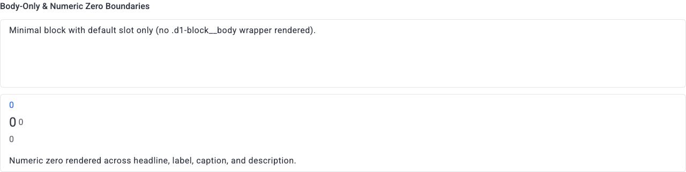
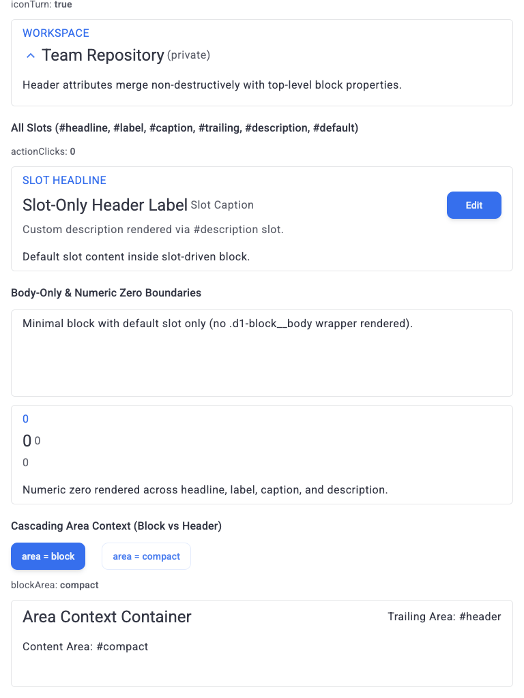
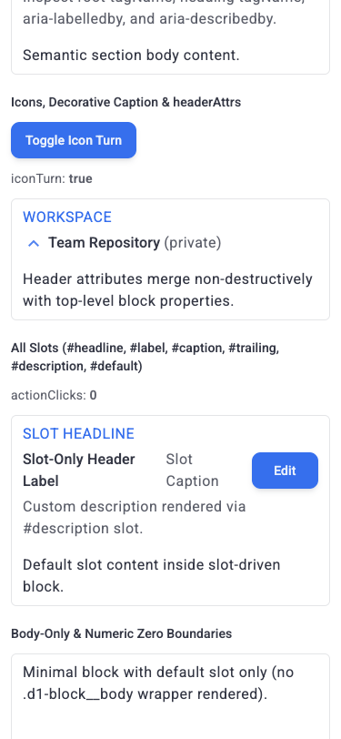

# Отчёт о визуальном и функциональном тестировании: D1Block

## 1. Итоговое резюме

- **Компонент:** `D1Block` (`@dxtmisha/d1`)
- **Исходный код:** [`D1Block`](../../src/components/Ui/Block) ([`Block`](../../../constructor/src/constructors/Block), [`DemoBlockPage`](../../../demo/src/pages/components/DemoBlockPage.vue))
- **Демо / целевой URL:** `http://localhost:3000/component-block`
- **Материалы:** `Нет`
- **Дата тестирования (UTC):** `2026-11-24T10:36:32Z`
- **Окружение:** `Headless Chrome (Puppeteer / CDP, Desktop 1440x900, Tablet 768x1024, Mobile 375x812 / 320x568)`
- **Покрытие тест-кейсов:** 10 / 10 (`100%`)
- **Итог:** **10 ✅, 0 ⚠️, 0 ❌** (`✅` пройдено, `⚠️` предупреждение, `❌` ошибка) — `D1Block` корректно объединяет хедлайн, шапку `D1Header`, описание и основной слот, связывает `aria-labelledby` и `aria-describedby` с DOM-узлами, поддерживает слотовый рендер без пропсов и каскадную передачу `area`.

---

## 2. Базовая матрица

### 2.1 Визуальное соответствие (`VIS`)

| ID | Сценарий | Статус | Фактический результат | Скриншот |
| :--- | :--- | :---: | :--- | :--- |
| `TC-VIS-001` | Полная анатомия блока (`headline`, `header`, `description`, `default`) | ✅ | Отображаются `ACCOUNT SECURITY`, `Two-Factor Authentication`, `Recommended` и описание с системными отступами токенов. |  |
| `TC-VIS-002` | Рендеринг слотового блока без пропсов (`#headline`, `#label`, `#caption`, `#trailing`, `#description`, `#default`) | ✅ | Все 6 слотов отрисованы (`SLOT HEADLINE`, `Slot-Only Header Label`, `Slot Caption`), `hasAriaLabelledby: true`. |  |

### 2.2 Интерактивность и управление состоянием (`INT`)

| ID | Сценарий | Статус | Фактический результат | Скриншот |
| :--- | :--- | :---: | :--- | :--- |
| `TC-INT-001` | Реактивное переключение корневого `tag` и тега заголовка `tagHeader` | ✅ | Переходы подтверждены: `article->ARTICLE`, `aside->ASIDE`, `div->DIV`, `section->SECTION`, `hdr:h1->H1`, `hdr:h4->H4`, `hdr:h2->H2`. |  |
| `TC-INT-002` | Поворот иконки (`iconTurn`) и неразрушающее слияние `headerAttrs` | ✅ | `.d1-block__header` сохраняет `.demo-block-header-extra`, иконка получает `.d1-icon--turn`, декоративная подпись имеет `aria-hidden="true"`. |  |
| `TC-INT-003` | Каскадный контекст `area` (`#header` в шапке и `#block`/`#compact` в теле) | ✅ | В `#trailing` разрешается `Trailing Area: #header`, а в основном слоте — `Content Area: #compact`. |  |

### 2.3 Границы и крайние случаи (`BND`)

| ID | Сценарий | Статус | Фактический результат | Скриншот |
| :--- | :--- | :---: | :--- | :--- |
| `TC-BND-001` | Отсутствие `.d1-block__body` при пустой шапке и поддержка числового `0` | ✅ | Все `7` блоков `hasZeroSize: false`; `bodyOnlyHasBodyWrapper: false`, `bodyOnlyHasCustomClass: true`; числовой `"0"` отрисован во всех 4 зонах. |  |

### 2.4 Адаптивность (`RSP`)

| ID | Сценарий | Статус | Фактический результат | Скриншот |
| :--- | :--- | :---: | :--- | :--- |
| `TC-RSP-001` | Планшетный вьюпорт (`768×1024`) без переполнения | ✅ | `overflow768: false`, иерархия отступов и шрифтов стабильна. |  |
| `TC-RSP-002` | Мобильный экран (`375×812` и `320×568`) без горизонтального переполнения | ✅ | `overflow375: false`, `overflow320: false`. |  |

### 2.5 Доступность (`A11Y`)

| ID | Сценарий | Статус | Фактический результат | Скриншот |
| :--- | :--- | :---: | :--- | :--- |
| `TC-A11Y-001` | Сквозная проверка `aria-labelledby`, `aria-describedby` и `captionDecorative` | ✅ | `lblId: "demo-block-custom-label-id"` (`lblTargetExists: true`), `descId: "demo-block-custom-desc-id"` (`descTargetExists: true`), `bodyOnlyHasAria: false`. | — |

### 2.6 Логи и консоль (`LOG`)

| ID | Сценарий | Статус | Фактический результат | Скриншот |
| :--- | :--- | :---: | :--- | :--- |
| `TC-LOG-001` | Чистота консоли браузера и отсутствие `[Vue warn]` | ✅ | `consoleErrors: []`, `vueWarnings: []`, `pageErrors: []`. | — |

---

## 3. AI-аудит и рекомендации

1. **Точность ARIA-привязок:** Исправлена генерация `aria-labelledby` для числового `0`, слота `#label` и пользовательских `labelId` / `headerAttrs.labelId`, при этом пустые блоки без шапки больше не получают висячих ARIA-ссылок.
2. **Оптимизация DOM:** При передаче только слота `#default` обёртка `.d1-block__body` не рендерится и подклассы `HeaderInclude` / `DescriptionInclude` не создаются.
3. **Каскад областей (`AreaInclude`):** Проверено независимое разрешение `area="header"` внутри вложенного `D1Header` и `area="block"` в теле `D1Block`.
