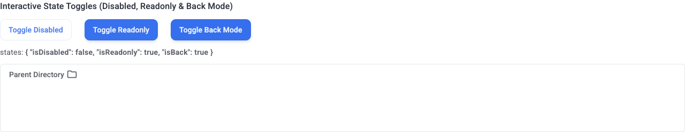
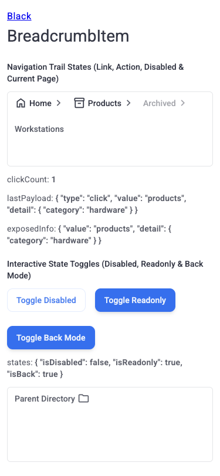

# Отчёт о визуальном и функциональном тестировании: D1BreadcrumbItem

## 1. Итоговое резюме

- **Компонент:** `D1BreadcrumbItem` (`@dxtmisha/d1`)
- **Исходный код:** [`D1BreadcrumbItem`](../../src/components/Ui/BreadcrumbItem) ([`BreadcrumbItem`](../../../constructor/src/constructors/BreadcrumbItem), [`DemoBreadcrumbItemPage`](../../../demo/src/pages/components/DemoBreadcrumbItemPage.vue))
- **Демо / целевой URL:** `http://localhost:3000/component-breadcrumb-item`
- **Материалы:** `Нет`
- **Дата тестирования (UTC):** `2026-11-24T11:01:33Z`
- **Окружение:** `Headless Chrome (Puppeteer / CDP, Desktop 1440x900, Tablet 768x1024, Mobile 375x812 / 320x568)`
- **Покрытие тест-кейсов:** 10 / 10 (`100%`)
- **Итог:** **10 ✅, 0 ⚠️, 0 ❌** (`✅` пройдено, `⚠️` предупреждение, `❌` ошибка) — `D1BreadcrumbItem` корректно рендерит интерактивные ссылки `<a>`, действия с `role="link"` + `tabindex="0"`, заблокированные элементы с `aria-disabled="true"` и текущую страницу ``, синхронизирует скелетон иконки и текста, поддерживает режим `back` и проксирует `getValue()`/`getDetail()`.

---

## 2. Базовая матрица

### 2.1 Визуальное соответствие (`VIS`)

| ID | Сценарий | Статус | Фактический результат | Скриншот |
| :--- | :--- | :---: | :--- | :--- |
| `TC-VIS-001` | Состояния навигационной крошки (`href`, интерактивное действие, `disabled`, `readonly`) | ✅ | `Home`, `Products` и `Archived` рендерятся как `<a>` со стрелкой `chevron_right`, `Workstations` (`readonly`) — как `` без стрелки. |  |
| `TC-VIS-002` | Состояние загрузки скелетона (`isSkeleton` внутри `D1Skeleton`) | ✅ | `labelHasSkeleton: true` (`.d1-skeleton__textVariant`), `iconHasSkeleton: true` (`.d1-skeleton__backgroundVariant`), стрелка-разделитель прозрачна во время загрузки. |  |

### 2.2 Интерактивность и управление состоянием (`INT`)

| ID | Сценарий | Статус | Фактический результат | Скриншот |
| :--- | :--- | :---: | :--- | :--- |
| `TC-INT-001` | Обработка клика, передача `value`/`detail` и чтение `expose` (`getValue`, `getDetail`) | ✅ | Клик по `Products` увеличивает `clickCount` до `1`, `lastPayload` и `exposedInfo` возвращают `value: "products"`, `detail: { category: "hardware" }`; клик по `Archived` (`disabled`) блокируется. |  |
| `TC-INT-002` | Режим обратной навигации (`back`) и порядок CSS Flexbox (`order`) | ✅ | `hasBackClass: true`, `arrowOrder: "2"` (левая стрелка перед меткой), `iconOrder: "6"` (ведущая иконка после метки). |  |
| `TC-INT-003` | Динамическое переключение `disabled` и `readonly` (`<a>` -> ``) | ✅ | При включении `Toggle Readonly` `tagName: "SPAN"`, `ariaCurrent: "page"`, `hasArrow: false`. |  |

### 2.3 Границы и крайние случаи (`BND`)

| ID | Сценарий | Статус | Фактический результат | Скриншот |
| :--- | :--- | :---: | :--- | :--- |
| `TC-BND-001` | Пользовательские стрелки, слот `#default`, числовой `0` и геометрия | ✅ | Все `10` элементов `hasZeroSize: false`; слот рендерит `Release Notes (v2.4)`, числовой `0` отображается (`zeroText: "0"`). |  |

### 2.4 Адаптивность (`RSP`)

| ID | Сценарий | Статус | Фактический результат | Скриншот |
| :--- | :--- | :---: | :--- | :--- |
| `TC-RSP-001` | Планшетный вьюпорт (`768×1024`) без переполнения | ✅ | `overflow768: false`. |  |
| `TC-RSP-002` | Мобильный экран (`375×812` и `320×568`) без горизонтального переполнения | ✅ | `overflow375: false`, `overflow320: false`. |  |

### 2.5 Доступность (`A11Y`)

| ID | Сценарий | Статус | Фактический результат | Скриншот |
| :--- | :--- | :---: | :--- | :--- |
| `TC-A11Y-001` | Проверка WAI-ARIA контрактов (`aria-current`, `aria-disabled`, `role="link"`, `aria-hidden`) | ✅ | `hrefRole: null`, `actionRole: "link"`, `actionTabindex: "0"`, `disabledAria: "true"`, `readonlyTag: "SPAN"`, `readonlyAriaCurrent: "page"`, `allArrowsAriaHidden: true`. | — |

### 2.6 Логи и консоль (`LOG`)

| ID | Сценарий | Статус | Фактический результат | Скриншот |
| :--- | :--- | :---: | :--- | :--- |
| `TC-LOG-001` | Чистота консоли браузера и отсутствие `[Vue warn]` | ✅ | `consoleErrors: []`, `vueWarnings: []`, `pageErrors: []`. | — |

---

## 3. AI-аудит и рекомендации

1. **Скелетон ведущей иконки:** Синхронизирован проброс `isSkeleton: true` в `IconLiteInclude`, благодаря чему ведущая иконка крошки отображает аккуратную скелетон-плашку рядом с текстовым плейсхолдером.
2. **Семантика WAI-ARIA:** Текущая страница (`readonly`) рендерится как `` без декоративного разделителя, а интерактивные крошки без нативного `href` получают `role="link"` и `tabindex="0"`.
