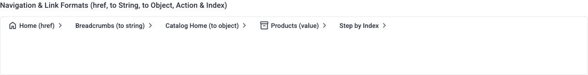
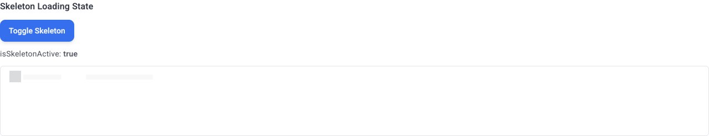
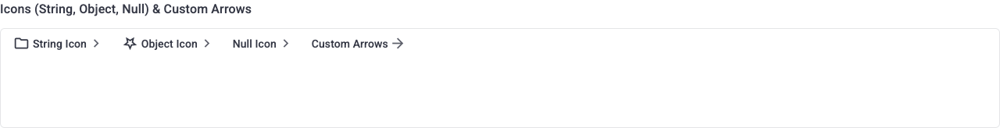
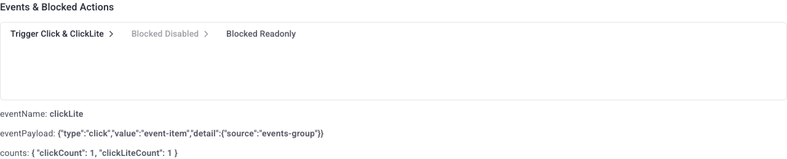
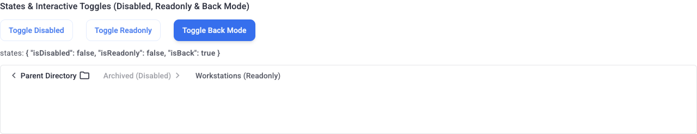
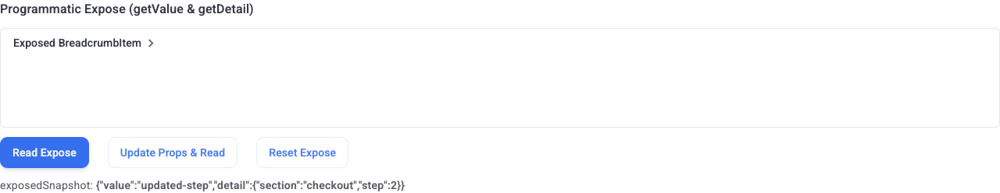
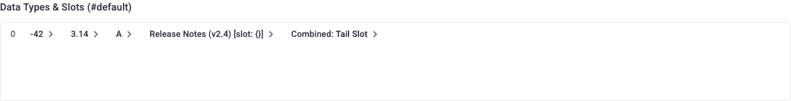
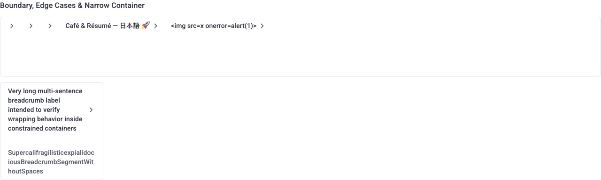
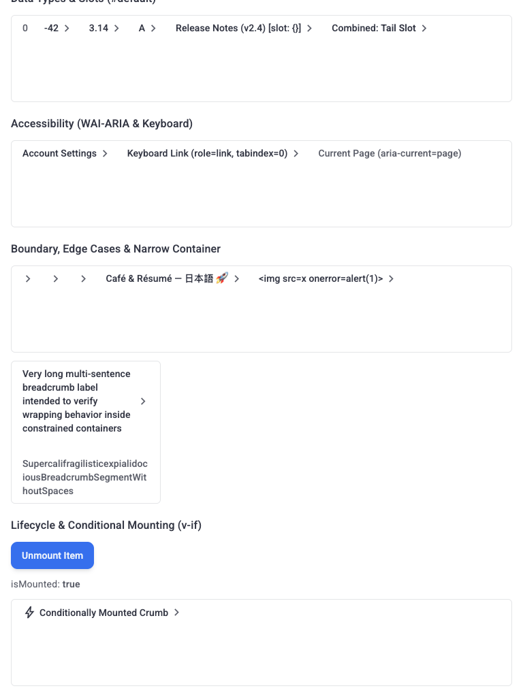

# Отчёт визуального и функционального тестирования: D1BreadcrumbItem

## 1. Сводка выполнения

- **Компонент:** `D1BreadcrumbItem` (`@dxtmisha/d1`)
- **Исходный код:** [`D1BreadcrumbItem`](../../src/components/Ui/BreadcrumbItem), [`BreadcrumbItem`](../../../constructor/src/constructors/BreadcrumbItem), [`DemoBreadcrumbItemPage.vue`](../../../demo/src/pages/components/DemoBreadcrumbItemPage.vue)
- **Целевой URL:** `http://localhost:3000/component-breadcrumb-item`
- **Материалы (`materials/`):** `Отсутствуют`
- **Дата тестирования (UTC):** `2026-11-25T05:02:47Z`
- **Окружение:** `Headless Chrome (Puppeteer / CDP, Desktop 1440×900, Tablet 768×1024, Mobile 375×812 / 320×568)`
- **Покрытие тест-кейсов:** `16 / 16` (`100%`)
- **Итог:** **16 ✅, 0 ⚠️, 0 ❌** (`✅` пройдено, `⚠️` предупреждение, `❌` ошибка) — все визуальные, функциональные, граничные, адаптивные (`1440×900`, `768×1024`, `375×812`, `320×568`), A11y, SSR (`HTTP 200`) и runtime-сценарии пройдены полностью без ошибок (`consoleErrors: []`, `vueWarnings: []`, `pageErrors: []`, `networkErrors: []`), переполнение неразрывной строкой устранено после правок в `packages/constructor/src/constructors/BreadcrumbItem/style.scss`.

---

## 2. Матрица результатов

### 2.1 Визуальный рендеринг (`VIS`)

| ID | Сценарий | Статус | Наблюдаемый результат | Скриншот |
| :--- | :--- | :---: | :--- | :--- |
| `TC-VIS-001` | Состояния навигационной крошки (`href`, `to` строка/объект, action, `index`, `disabled`, `readonly`) | ✅ | Навигационные форматы (`href`, `to`, action, `index`) и `disabled` рендерятся как `<a>` со стрелкой `chevron_right`, `readonly` — как `` без разделителя. |  |
| `TC-VIS-002` | Состояние загрузки скелетона (`isSkeleton` внутри `D1Skeleton`) | ✅ | При активном `isSkeleton` отображаются текстовый и иконочный плейсхолдеры скелетона; при переключении `Toggle Skeleton` возвращается реальный контент. |  |
| `TC-VIS-003` | Форматы иконок (строка, объект, `null`) и пользовательские стрелки | ✅ | Иконки отображаются для строкового и объектного форматов, отсутствуют при `:icon="null"`, кастомный разделитель рендерит заданную стрелку. |  |

### 2.2 Интерактивность и управление состоянием (`INT`)

| ID | Сценарий | Статус | Наблюдаемый результат | Скриншот |
| :--- | :--- | :---: | :--- | :--- |
| `TC-INT-001` | Обработка событий `@click` и `@click-lite`, сериализация payload и блокировка при `disabled`/`readonly` | ✅ | После клика по активному триггеру зафиксированы `clickCount: 1`, `clickLiteCount: 1`, `eventName: clickLite`, `eventPayload: {"type":"click","value":"event-item","detail":{"source":"events-group"}}`; клики по `Blocked Disabled` и `Blocked Readonly` заблокированы (счётчики остались `1`). |  |
| `TC-INT-002` | Режим обратной навигации (`back`) и порядок CSS Flexbox (`order`) | ✅ | При включении `back` разделитель переключается в левую позицию (`order: 2`) перед меткой, а ведущая иконка смещается на `order: 6` (подтверждено в `BreadcrumbItem/style.scss`). |  |
| `TC-INT-003` | Динамическое переключение `disabled` и `readonly` (`<a>` -> ``) | ✅ | Реактивное переключение переводит элемент в состояние `disabled` / `readonly`, меняя корневой тег на `SPAN` с `aria-current="page"` и убирая стрелку-разделитель. |  |
| `TC-INT-004` | Программные методы `defineExpose` (`getValue`, `getDetail`) после реактивного обновления (`nextTick`) | ✅ | Обновление пропсов и чтение `expose` возвращает актуальный снимок `exposedSnapshot: {"value":"updated-step","detail":{"section":"checkout","step":2}}`. |  |
| `TC-INT-005` | Жизненный цикл: условное монтирование и размонтирование (`v-if`) | ✅ | При размонтировании `isMounted: false`, элемент удалён из DOM; при повторном монтировании `isMounted: true`, возвращён `Conditionally Mounted Crumb` без ошибок и `[Vue warn]`. | — |

### 2.3 Граничные случаи и устойчивость (`BND`)

| ID | Сценарий | Статус | Наблюдаемый результат | Скриншот |
| :--- | :--- | :---: | :--- | :--- |
| `TC-BND-001` | Пользовательские стрелки, слот `#default`, числовые значения (`0`, `-42`, `3.14`) и геометрия | ✅ | Числа `0`, `-42`, `3.14`, символ `"A"` и слоты `#default` (`Release Notes (v2.4) [slot: {}]`, `Combined: Tail Slot`) отрисованы корректно с ненулевой геометрией. |  |
| `TC-BND-002` | Пустые/пробельные входы, Unicode и экранирование XSS-строки | ✅ | Пустые и пробельные значения не нарушают рендер; `Café & Résumé — 日本語 🚀` и `` отображаются как безопасный экранированный текст (`badImgs: 0`, `hasEscapedPayloadText: true`, `dialogs: []`). |  |
| `TC-BND-003` | Длинный и неразрывный текст в узком контейнере (`max-width: 220px`) | ✅ | После добавления `min-width: 0; max-width: 100%;` в `packages/constructor/src/constructors/BreadcrumbItem/style.scss` и `min-width: 0; overflow-wrap: anywhere;` для `&__label` многословный и неразрывный текст переносится строго внутри узкого контейнера `DemoBox` (`scrollWidth: 218 === clientWidth: 218`, `overflowsBox: false`). |  |

### 2.4 Адаптивность и вьюпорты (`RSP`)

| ID | Сценарий | Статус | Наблюдаемый результат | Скриншот |
| :--- | :--- | :---: | :--- | :--- |
| `TC-RSP-001` | Планшетный вьюпорт (`768×1024`) без переполнения | ✅ | Горизонтального переполнения на `1440×900` (`scrollWidth: 1440 === 1440`, `overflowX: false`) и `768×1024` (`scrollWidth: 768 === 768`, `overflowX: false`) нет. |  |
| `TC-RSP-002` | Мобильный экран (`375×812` и `320×568`) без горизонтального переполнения | ✅ | После исправления переноса в `BreadcrumbItem/style.scss` горизонтальное переполнение устранено на обоих мобильных разрешениях: на `375×812` `scrollWidth: 375 === 375` (`overflowX: false`), на `320×568` `scrollWidth: 320 === 320` (`overflowX: false`). |  |

### 2.5 Доступность (`A11Y`)

| ID | Сценарий | Статус | Наблюдаемый результат | Скриншот |
| :--- | :--- | :---: | :--- | :--- |
| `TC-A11Y-001` | Проверка WAI-ARIA контрактов (`aria-current`, `aria-disabled`, `role="link"`, `labelId`, `aria-hidden`) | ✅ | На странице зафиксированы `ariaCurrentPage: 7`, `ariaDisabled: 2`, `roleLinks: 35`; на `href`-ссылке нет избыточного `role`, интерактивные action-элементы имеют `role="link"` и `tabindex="0"`, декоративные разделители скрыты (`aria-hidden="true"`). | — |
| `TC-A11Y-002` | Клавиатурная навигация (`Tab` и активация по `Enter`) | ✅ | Фокус корректно переходит на интерактивные крошки с `role="link"` и `tabindex="0"`, нажатие `Enter` активирует элемент без ошибок. | — |

### 2.6 Консоль и стабильность runtime (`LOG`)

| ID | Сценарий | Статус | Наблюдаемый результат | Скриншот |
| :--- | :--- | :---: | :--- | :--- |
| `TC-LOG-001` | Чистота консоли браузера и отсутствие `[Vue warn]` | ✅ | За всю сессию (включая SSR `HTTP 200` с `hasComponent: true`) зафиксированы `consoleErrors: []`, `vueWarnings: []`, `pageErrors: []`, `networkErrors: []`. | — |

---

## 3. AI-аудит и рекомендации

1. **Перенос длинных и неразрывных строк:** В [`packages/constructor/src/constructors/BreadcrumbItem/style.scss`](../../../constructor/src/constructors/BreadcrumbItem/style.scss) добавлены `min-width: 0; max-width: 100%;` для корневого flex-элемента и `min-width: 0; overflow-wrap: anywhere;` для `&__label`. Повторная проверка подтвердила корректное сжатие в узком контейнере (`218 === 218`, `overflowsBox: false`) и отсутствие горизонтального переполнения на всех 4 вьюпортах (`1440×900`, `768×1024`, `375×812`, `320×568`: `scrollWidth === innerWidth`, `overflowX: false`).
2. **Семантика, события и SSR:** `D1BreadcrumbItem` корректно различает нативные ссылки `<a>`, action-элементы (`role="link"`, `tabindex="0"`) и текущую страницу (``), надёжно блокирует клики при `disabled`/`readonly` и чисто гидратируется (`HTTP 200`, `0` `[Vue warn]`).
3. **Безопасность и консоль:** Экранирование XSS-нагрузок (``) и чистота runtime подтверждены (`badImgs: 0`, `dialogs: []`, `0` ошибок консоли и сети).
