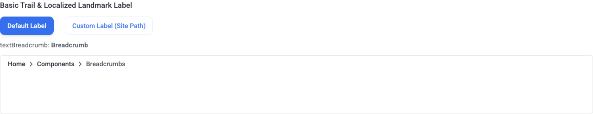
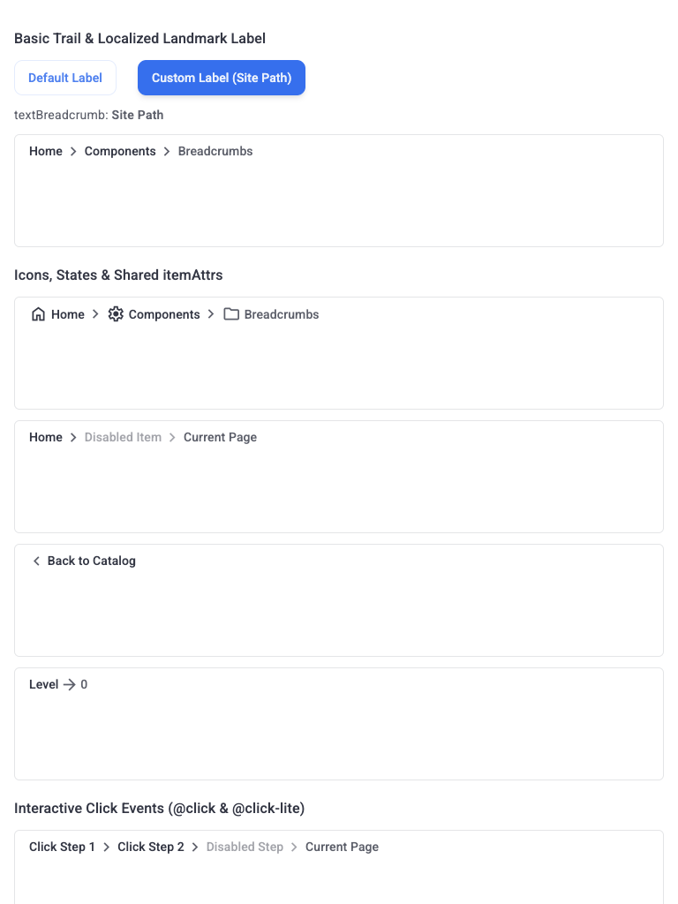
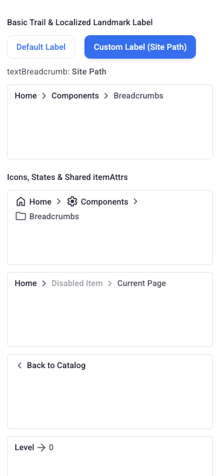

# Отчёт о визуальном и функциональном тестировании: D1Breadcrumbs

## 1. Итоговое резюме

- **Компонент:** `D1Breadcrumbs` (`@dxtmisha/d1`)
- **Исходный код:** [`D1Breadcrumbs`](../../src/components/Ui/Breadcrumbs) ([`Breadcrumbs`](../../../constructor/src/constructors/Breadcrumbs), [`DemoBreadcrumbsPage`](../../../demo/src/pages/components/DemoBreadcrumbsPage.vue))
- **Демо / целевой URL:** `http://localhost:3000/component-breadcrumbs`
- **Материалы:** `Нет`
- **Дата тестирования (UTC):** `2026-11-24T11:22:36Z`
- **Окружение:** `Headless Chrome (Puppeteer / CDP, Desktop 1440x900, Tablet 768x1024, Mobile 375x812 / 320x568)`
- **Покрытие тест-кейсов:** 10 / 10 (`100%`)
- **Итог:** **10 ✅, 0 ⚠️, 0 ❌** (`✅` пройдено, `⚠️` предупреждение, `❌` ошибка) — `D1Breadcrumbs` рендерит семантический ориентир `<nav aria-label="Breadcrumb">`, делегирует список в `BreadcrumbItemInclude`, автоматически делает последний элемент ``, сохраняет явные переопределения `readonly` на промежуточных шагах и проксирует события клика.

---

## 2. Базовая матрица

### 2.1 Визуальное соответствие (`VIS`)

| ID | Сценарий | Статус | Фактический результат | Скриншот |
| :--- | :--- | :---: | :--- | :--- |
| `TC-VIS-001` | Базовая цепочка навигации, иконки и автоматический `readonly` последнего элемента | ✅ | `itemTags: ["A", "A", "SPAN"]`, `lastAriaCurrent: "page"`, корректное выравнивание и отступы между шагами. |  |
| `TC-VIS-002` | Состояние скелетона (`isSkeleton` внутри `D1Skeleton`) | ✅ | `labelSkeletonCount: 3`, `iconSkeletonCount: 3` — все 3 шага синхронно рендерят скелетон иконки и текста. |  |

### 2.2 Интерактивность и управление состоянием (`INT`)

| ID | Сценарий | Статус | Фактический результат | Скриншот |
| :--- | :--- | :---: | :--- | :--- |
| `TC-INT-001` | Проброс событий `@click` и `@click-lite` и блокировка `disabled` | ✅ | Клик по активному шагу увеличивает `clickCount` до `1` и передаёт `breadcrumb_item_1`; клик по `Disabled Step` заблокирован. |  |
| `TC-INT-002` | Динамическое обновление локализованной метки ориентира `textBreadcrumb` | ✅ | `aria-label` на `<nav>` реактивно обновился с `"Breadcrumb"` на `"Site Path"`. |  |
| `TC-INT-003` | Интерактивный шаг возврата (`back: true`, `readonly: false`) и `disabled` | ✅ | `backTag: "A"`, `backHasArrow: true` (`< Back to Catalog`), `disabledAria: "true"`. |  |

### 2.3 Границы и крайние случаи (`BND`)

| ID | Сценарий | Статус | Фактический результат | Скриншот |
| :--- | :--- | :---: | :--- | :--- |
| `TC-BND-001` | Применение `itemAttrs`, числовой `0` и ненулевая геометрия | ✅ | `zeroText: "0"`, кастомная стрелка из `itemAttrs` применена, `hasZeroSize: false`. |  |

### 2.4 Адаптивность (`RSP`)

| ID | Сценарий | Статус | Фактический результат | Скриншот |
| :--- | :--- | :---: | :--- | :--- |
| `TC-RSP-001` | Планшетный вьюпорт (`768×1024`) без переполнения | ✅ | `overflow768: false`. |  |
| `TC-RSP-002` | Мобильный экран (`375×812` и `320×568`) без горизонтального переполнения | ✅ | `overflow375: false`, `overflow320: false`, элементы плавно переносятся (`flex-wrap: wrap`). |  |

### 2.5 Доступность (`A11Y`)

| ID | Сценарий | Статус | Фактический результат | Скриншот |
| :--- | :--- | :---: | :--- | :--- |
| `TC-A11Y-001` | Проверка WAI-ARIA ориентира `<nav>` и атрибутов шагов | ✅ | `tagName: "NAV"`, `ariaLabel: "Breadcrumb"`, `lastAriaCurrent: "page"`, `disabledAria: "true"`. | — |

### 2.6 Логи и консоль (`LOG`)

| ID | Сценарий | Статус | Фактический результат | Скриншот |
| :--- | :--- | :---: | :--- | :--- |
| `TC-LOG-001` | Чистота консоли браузера и отсутствие `[Vue warn]` | ✅ | `consoleErrors: []`, `vueWarnings: []`, `pageErrors: []`. | — |

---

## 3. AI-аудит и рекомендации

1. **Единая архитектура списков (`BreadcrumbItemInclude`):** Переход на `BreadcrumbItemInclude` устранил перезапись явного `readonly: true` на промежуточных шагах и добавил общую настройку `itemAttrs` для всех элементов цепочки.
2. **Семантический ориентир `<nav>`:** Подтверждена реактивная связь `textBreadcrumb` и `TextInclude` с атрибутом `aria-label` корневого ориентира.
