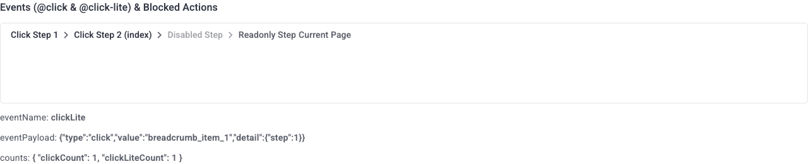
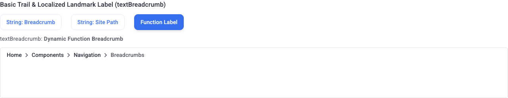
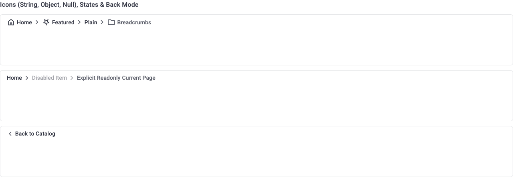
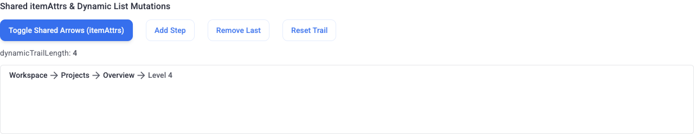
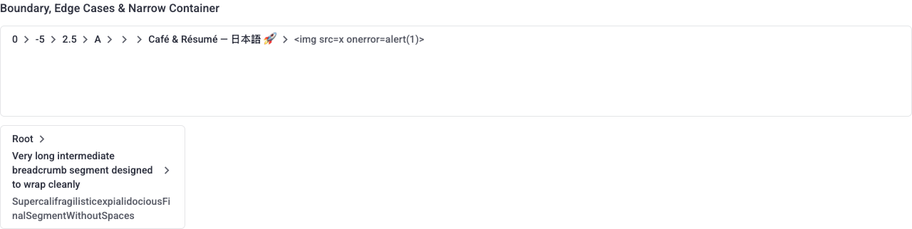

# Отчёт визуального и функционального тестирования: D1Breadcrumbs

## 1. Сводка выполнения

- **Компонент:** `D1Breadcrumbs` (`@dxtmisha/d1`)
- **Исходный код:** [`D1Breadcrumbs`](../../src/components/Ui/Breadcrumbs), [`Breadcrumbs`](../../../constructor/src/constructors/Breadcrumbs), [`DemoBreadcrumbsPage.vue`](../../../demo/src/pages/components/DemoBreadcrumbsPage.vue)
- **Целевой URL:** `http://localhost:3000/component-breadcrumbs`
- **Материалы (`materials/`):** `Отсутствуют`
- **Дата тестирования (UTC):** `2026-11-25T05:02:47Z`
- **Окружение:** `Headless Chrome (Puppeteer / CDP, Desktop 1440×900, Tablet 768×1024, Mobile 375×812 / 320×568)`
- **Покрытие тест-кейсов:** `14 / 14` (`100%`)
- **Итог:** **14 ✅, 0 ⚠️, 0 ❌** (`✅` пройдено, `⚠️` предупреждение, `❌` ошибка) — цепочка навигации, `@click`/`@click-lite`, `textBreadcrumb`, `itemAttrs`, `v-if`, граничные и адаптивные сценарии (`1440×900`, `768×1024`, `375×812`, `320×568`), SSR (`HTTP 200`), A11y и чистота консоли пройдены полностью без ошибок (`0` console/Vue/page/network errors) после CSS-исправлений в `Breadcrumbs/style.scss` и `BreadcrumbItem/style.scss`.

---

## 2. Матрица результатов

### 2.1 Визуальный рендеринг (`VIS`)

| ID | Сценарий | Статус | Наблюдаемый результат | Скриншот |
| :--- | :--- | :---: | :--- | :--- |
| `TC-VIS-001` | Базовая цепочка навигации, иконки и автоматический `readonly` последнего элемента | ✅ | Цепочка рендерится внутри `<nav class="d1-breadcrumbs">`, поддерживает `to` (объект/строка), `href`, строковые/объектные иконки и `:icon="null"`, а последний шаг автоматически становится ``. |  |
| `TC-VIS-002` | Состояние скелетона (`isSkeleton` внутри `D1Skeleton`) | ✅ | При активном `isSkeleton` все шаги цепочки отображают плейсхолдеры текста и иконок, а при выключении возвращают реальные подписи. |  |

### 2.2 Интерактивность и управление состоянием (`INT`)

| ID | Сценарий | Статус | Наблюдаемый результат | Скриншот |
| :--- | :--- | :---: | :--- | :--- |
| `TC-INT-001` | Проброс событий `@click` и `@click-lite`, сериализация payload и блокировка `disabled`/`readonly` | ✅ | Клик по активному шагу зафиксировал `clickCount: 1`, `clickLiteCount: 1`, `eventName: clickLite`, `eventPayload: {"type":"click","value":"breadcrumb_item_1","detail":{"step":1}}`; клики по `Disabled Step`, `Readonly Step` и `Current Page` заблокированы. |  |
| `TC-INT-002` | Динамическое обновление локализованной метки ориентира `textBreadcrumb` (строка и функция) | ✅ | При переключении пропса `textBreadcrumb` на функцию `aria-label` на `<nav>` реактивно обновился до `"Dynamic Function Breadcrumb"`. |  |
| `TC-INT-003` | Интерактивный шаг возврата (`back: true`, `readonly: false`) на одиночной цепочке | ✅ | Одиночный шаг с `back: true` и `readonly: false` сохраняет ссылку `A` и левую стрелку `chevron_left`, промежуточные `readonly` шаги имеют ``, а `disabled` — `aria-disabled="true"`. |  |
| `TC-INT-004` | Общие `itemAttrs` и динамическое добавление/удаление шагов `list` | ✅ | Через `itemAttrs` обновляются разделители всех шагов; при добавлении/удалении элементов последний шаг автоматически переходит в ``. |  |
| `TC-INT-005` | Жизненный цикл: условное монтирование и размонтирование (`v-if`) | ✅ | При снятии `v-if` отображается `isMounted: false`, `<nav>` удаляется из DOM; при повторном монтировании `isMounted: true`, цепочка `Home > Components > Navigation > Breadcrumbs` восстанавливается без ошибок. | — |

### 2.3 Граничные случаи и устойчивость (`BND`)

| ID | Сценарий | Статус | Наблюдаемый результат | Скриншот |
| :--- | :--- | :---: | :--- | :--- |
| `TC-BND-001` | Пустые входы (`[]`, без `list`), числовые значения (`0`, `-5`, `2.5`) и геометрия | ✅ | Пустые массивы и отсутствие `list` не вызывают сбоев; числовые сегменты `0`, `-5`, `2.5` и `"A"` явно отображаются в цепочке с валидной геометрией. |  |
| `TC-BND-002` | Unicode, эмодзи и безопасное экранирование XSS-строки | ✅ | Строка `Café & Résumé — 日本語 🚀` и строка `` выводятся как безопасный текст (`badImgs: 0`, `hasEscapedPayloadText: true`, `dialogs: []`). |  |
| `TC-BND-003` | Длинные и неразрывные сегменты в узком контейнере (`max-width: 260px`) | ✅ | После добавления `min-width: 0; max-width: 100%;` в `packages/constructor/src/constructors/Breadcrumbs/style.scss` и переноса в `BreadcrumbItem/style.scss` многословный и неразрывный сегменты корректно переносятся внутри узкого контейнера `DemoBox` (`scrollWidth: 258 === clientWidth: 258`, `overflowsBox: false`). |  |

### 2.4 Адаптивность и вьюпорты (`RSP`)

| ID | Сценарий | Статус | Наблюдаемый результат | Скриншот |
| :--- | :--- | :---: | :--- | :--- |
| `TC-RSP-001` | Планшетный вьюпорт (`768×1024`) без переполнения | ✅ | На `1440×900` (`scrollWidth: 1440 === 1440`, `overflowX: false`) и `768×1024` (`scrollWidth: 768 === 768`, `overflowX: false`) переполнение отсутствует. |  |
| `TC-RSP-002` | Мобильный экран (`375×812` и `320×568`) без горизонтального переполнения | ✅ | После CSS-исправлений в `Breadcrumbs/style.scss` и `BreadcrumbItem/style.scss` горизонтальное переполнение устранено на обоих мобильных вьюпортах: на `375×812` `scrollWidth: 375 === 375` (`overflowX: false`), на `320×568` `scrollWidth: 320 === 320` (`overflowX: false`). |  |

### 2.5 Доступность (`A11Y`)

| ID | Сценарий | Статус | Наблюдаемый результат | Скриншот |
| :--- | :--- | :---: | :--- | :--- |
| `TC-A11Y-001` | Проверка WAI-ARIA ориентира `<nav>` и атрибутов шагов | ✅ | Цепочка рендерится как `<nav>` с реактивным `aria-label` (`"Dynamic Function Breadcrumb"`), последний элемент имеет `aria-current="page"`, заблокированные — `aria-disabled="true"`, action-шаги — `role="link"` + `tabindex="0"`. | — |

### 2.6 Консоль и стабильность runtime (`LOG`)

| ID | Сценарий | Статус | Наблюдаемый результат | Скриншот |
| :--- | :--- | :---: | :--- | :--- |
| `TC-LOG-001` | Чистота консоли браузера и отсутствие `[Vue warn]` | ✅ | SSR возвращает `HTTP 200` (`hasComponent: true`); за всю сессию `consoleErrors: []`, `vueWarnings: []`, `pageErrors: []`, `networkErrors: []`. | — |

---

## 3. AI-аудит и рекомендации

1. **Перенос длинных сегментов и адаптивность:** В [`packages/constructor/src/constructors/Breadcrumbs/style.scss`](../../../constructor/src/constructors/Breadcrumbs/style.scss) добавлены `min-width: 0; max-width: 100%;` в связке с исправлением в [`packages/constructor/src/constructors/BreadcrumbItem/style.scss`](../../../constructor/src/constructors/BreadcrumbItem/style.scss) (`min-width: 0; max-width: 100%;`, `&__label { min-width: 0; overflow-wrap: anywhere; }`). Повторный прогон подтвердил отсутствие выхода за границы узкого контейнера (`258 === 258`, `overflowsBox: false`) и нулевое горизонтальное переполнение на всех 4 вьюпортах (`1440×900`, `768×1024`, `375×812`, `320×568`: `scrollWidth === innerWidth`, `overflowX: false`).
2. **Семантический ориентир и динамика списка:** Реактивная обработка `textBreadcrumb` (включая функцию-генератор), `itemAttrs`, `v-if` и переключение последнего шага в `` работают без отклонений.
3. **Runtime и безопасность:** Экранирование XSS-строк, SSR-гидратация (`HTTP 200`) и изоляция консоли подтверждены с нулевым количеством ошибок (`consoleErrors: []`, `vueWarnings: []`, `pageErrors: []`, `networkErrors: []`, `dialogs: []`).
