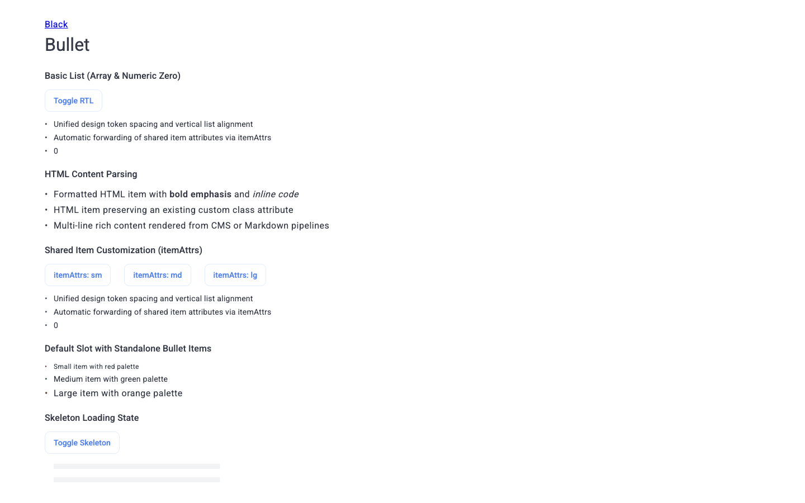
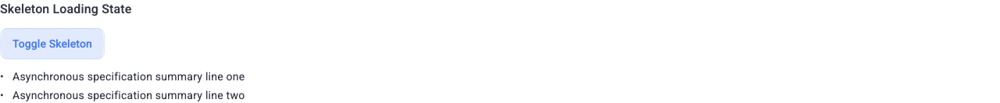
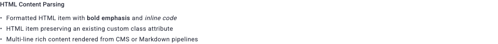
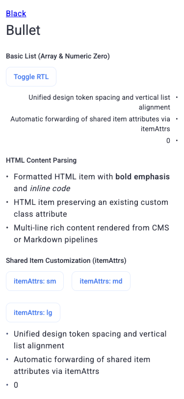

# Отчёт о визуальном и функциональном тестировании: D1Bullet

## 1. Итоговое резюме

- **Компонент:** `D1Bullet` (`@dxtmisha/d1`)
- **Исходный код:** [`D1Bullet`](../../src/components/Ui/Bullet) ([`Bullet`](../../../constructor/src/constructors/Bullet), [`DemoBulletPage`](../../../demo/src/pages/components/DemoBulletPage.vue))
- **Демо / целевой URL:** `http://localhost:3000/component-bullet`
- **Материалы:** `Нет`
- **Дата тестирования (UTC):** `2026-11-24T12:12:39Z`
- **Окружение:** `Headless Chrome (Puppeteer / CDP, Desktop 1440x900, Tablet 768x1024, Mobile 375x812 / 320x568)`
- **Покрытие тест-кейсов:** 10 / 10 (`100%`)
- **Итог:** **10 ✅, 0 ⚠️, 0 ❌** (`✅` пройдено, `⚠️` предупреждение, `❌` ошибка) — `D1Bullet` рендерит семантический контейнер `<ul>` со строгой иерархией `UL > LI` во всех режимах (`list`, `html`, `#default`), корректно передаёт `itemAttrs` и `isSkeleton`, сохраняет пользовательские классы на `<li class="...">` в HTML-режиме и выравнивает маркеры по правому краю в RTL (`inset-inline-start: 0`).

---

## 2. Базовая матрица

### 2.1 Визуальное соответствие (`VIS`)

| ID | Сценарий | Статус | Фактический результат | Скриншот |
| :--- | :--- | :---: | :--- | :--- |
| `TC-VIS-001` | Базовый список (`list`), HTML-разметка (`html`) и слот `#default` | ✅ | Все 5 списков рендерятся с чётким маркером `•`, системным `gap` и корректными размерами/палитрами. |  |
| `TC-VIS-002` | Состояние загрузки скелетона (`isSkeleton` внутри `D1Skeleton`) | ✅ | `skeletonCheck: true` — оба дочерних описания получают `.d1-skeleton__textVariant`. |  |

### 2.2 Интерактивность и управление состоянием (`INT`)

| ID | Сценарий | Статус | Фактический результат | Скриншот |
| :--- | :--- | :---: | :--- | :--- |
| `TC-INT-001` | Реактивная передача общих атрибутов через `itemAttrs` (`sm` -> `lg`) | ✅ | `itemAttrsCheck: true` — все дочерние `<li>` синхронно применяют `.d1-bulletItem--size--lg` и `.d1-palette--blue`. |  |
| `TC-INT-002` | Логическое выравнивание маркеров в режиме RTL (`dir="rtl"`) | ✅ | `insetInlineStart: "0px"` — маркеры `•` переносятся на правый край без наложения на текст. |  |
| `TC-INT-003` | Переключение скелетона загрузки (`Toggle Skeleton`) | ✅ | `skeletonOffCheck: true` — плейсхолдер снимается и отображается реальный текст. |  |

### 2.3 Границы и крайние случаи (`BND`)

| ID | Сценарий | Статус | Фактический результат | Скриншот |
| :--- | :--- | :---: | :--- | :--- |
| `TC-BND-001` | Числовой `0`, сохранение пользовательского класса на `<li>` в `html` и геометрия | ✅ | `hasZeroSize: false`, `zeroText: "0"`, `htmlCustomPreserved: true` (`d1-bulletItem d1-bullet__item demo-bullet-custom`). |  |

### 2.4 Адаптивность (`RSP`)

| ID | Сценарий | Статус | Фактический результат | Скриншот |
| :--- | :--- | :---: | :--- | :--- |
| `TC-RSP-001` | Планшетный вьюпорт (`768×1024`) без переполнения | ✅ | `overflow768: false`. |  |
| `TC-RSP-002` | Мобильный экран (`375×812` и `320×568`) без горизонтального переполнения | ✅ | `overflow375: false`, `overflow320: false`. |  |

### 2.5 Доступность (`A11Y`)

| ID | Сценарий | Статус | Фактический результат | Скриншот |
| :--- | :--- | :---: | :--- | :--- |
| `TC-A11Y-001` | Семантическая иерархия `<ul>` -> `<li>` | ✅ | `count: 5`, `allUl: true`, `allChildrenLi: true`. | — |

### 2.6 Логи и консоль (`LOG`)

| ID | Сценарий | Статус | Фактический результат | Скриншот |
| :--- | :--- | :---: | :--- | :--- |
| `TC-LOG-001` | Чистота консоли браузера и отсутствие `[Vue warn]` | ✅ | `consoleErrors: []`, `vueWarnings: []`, `pageErrors: []`. | — |

---

## 3. AI-аудит и рекомендации

1. **Санитизация и сохранение классов в `html`:** В `Bullet.getHtml()` внедрена очистка опасных тегов/атрибутов и неразрушающее слияние системных BEM-классов с существующим `class="..."` на `<li>`.
2. **Поддержка `isSkeleton` и типизация `D1Bullet`:** Добавлен проброс `isSkeleton` дочерним `BulletItem` и строгая generic-связь `BulletPropsBasic<BulletItemProps>`.
