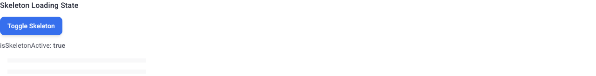
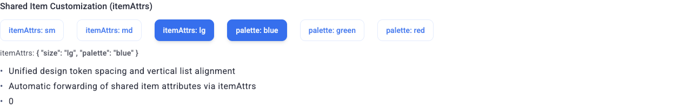
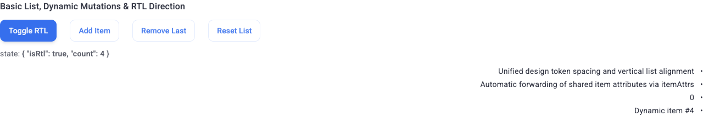
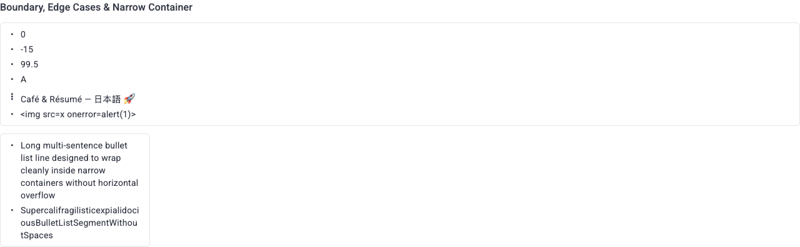
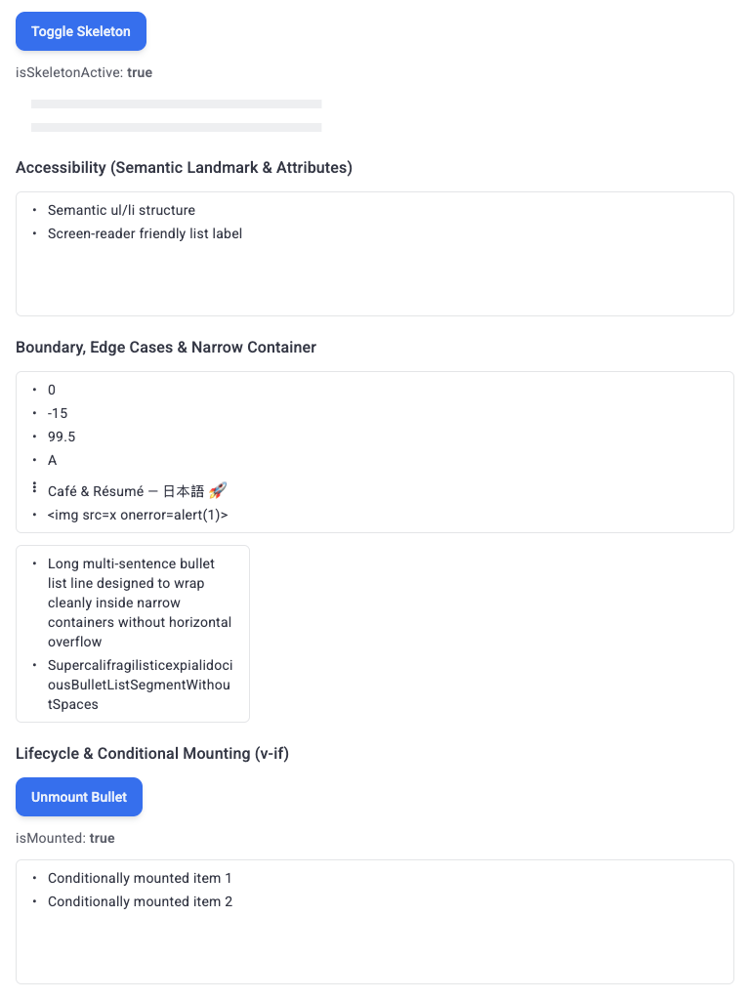

# Отчёт визуального и функционального тестирования: D1Bullet

## 1. Сводка выполнения

- **Компонент:** `D1Bullet` (`@dxtmisha/d1`)
- **Исходный код:** [`D1Bullet`](../../src/components/Ui/Bullet), [`Bullet`](../../../constructor/src/constructors/Bullet), [`DemoBulletPage.vue`](../../../demo/src/pages/components/DemoBulletPage.vue)
- **Целевой URL:** `http://localhost:3000/component-bullet`
- **Материалы (`materials/`):** `Отсутствуют`
- **Дата тестирования (UTC):** `2026-11-25T05:02:47Z`
- **Окружение:** `Headless Chrome (Puppeteer / CDP, Desktop 1440×900, Tablet 768×1024, Mobile 375×812 / 320×568)`
- **Покрытие тест-кейсов:** `13 / 13` (`100%`)
- **Итог:** **13 ✅, 0 ⚠️, 0 ❌** (`✅` пройдено, `⚠️` предупреждение, `❌` ошибка) — XSS-санитизация (`sanitizedOnerrorNull: true`, `xssVarUndefined: true`, `scriptsInBullet: 0`, `dangerousHref: false`), RTL, скелетон, `itemAttrs`, `v-if`, граничные и адаптивные сценарии (`1440×900`, `768×1024`, `375×812`, `320×568`), SSR (`HTTP 200`) и `0` ошибок runtime пройдены полностью успешно после CSS-исправлений в `Bullet/style.scss` и `BulletItem/style.scss`.

---

## 2. Матрица результатов

### 2.1 Визуальный рендеринг (`VIS`)

| ID | Сценарий | Статус | Наблюдаемый результат | Скриншот |
| :--- | :--- | :---: | :--- | :--- |
| `TC-VIS-001` | Базовый список (`list`), HTML-разметка (`html`) и слот `#default` | ✅ | Корневые списки (`lists: 13`) рендерятся как `<ul>` с классом `.d1-bullet`, дочерние элементы — как `<li>` с маркером `•` и корректными отступами. |  |
| `TC-VIS-002` | Состояние загрузки скелетона (`isSkeleton` внутри `D1Skeleton`) | ✅ | При `isSkeletonActive = true` пробрасывается `isSkeleton` дочерним элементам списка, отображая текстовые плейсхолдеры скелетона. |  |

### 2.2 Интерактивность и управление состоянием (`INT`)

| ID | Сценарий | Статус | Наблюдаемый результат | Скриншот |
| :--- | :--- | :---: | :--- | :--- |
| `TC-INT-001` | Реактивная передача общих атрибутов через `itemAttrs` (`size` и `palette`) | ✅ | Нажатия переключателей `size` и `palette` синхронно применяют модификаторы `.d1-bulletItem--size--*` и `.d1-palette--*` ко всем дочерним `<li>`. |  |
| `TC-INT-002` | Логическое выравнивание маркеров в режиме RTL (`dir="rtl"`) и мутация `list` | ✅ | Подтверждено переключение `rtlAttr: true` (`dir="rtl"`) с логическим выравниванием маркеров справа (`inset-inline-start: 0`) и реактивной мутацией пунктов списка. |  |
| `TC-INT-003` | Переключение скелетона загрузки (`Toggle Skeleton`) | ✅ | Нажатие `Toggle Skeleton` переводит `isSkeletonActive` в `false` и восстанавливает реальный текст пунктов списка. |  |
| `TC-INT-004` | Жизненный цикл: условное монтирование и размонтирование (`v-if`) | ✅ | При размонтировании отображается `isMounted: false`, при повторном монтировании — `isMounted: true` с пунктами `Conditionally mounted item 1` и `Conditionally mounted item 2` без ошибок. | — |

### 2.3 Граничные случаи и устойчивость (`BND`)

| ID | Сценарий | Статус | Наблюдаемый результат | Скриншот |
| :--- | :--- | :---: | :--- | :--- |
| `TC-BND-001` | Числовые значения (`0`, `-15`, `99.5`), пустые входы и сохранение класса на `<li>` в `html` | ✅ | Числа `0`, `-15`, `99.5`, `"A"` и пустые входы (`[]`, `""`) обрабатываются без сбоев; пользовательский класс `.demo-bullet-custom` на `<li>` в `html`-режиме сохраняется. |  |
| `TC-BND-002` | Санитизация опасного HTML (`<script>`, `onerror`, `javascript:`) и экранирование XSS в `list` | ✅ | Подтверждена полная защита: `scriptsInBullet: 0`, `dangerousHref: false`, `sanitizedOnerrorNull: true`, `xssVarUndefined: true`, `badImgs: 0`, `hasEscapedPayloadText: true`, `dialogs: []`. | — |
| `TC-BND-003` | Длинный и неразрывный текст в узком контейнере (`max-width: 240px`) | ✅ | После добавления `min-width: 0; max-width: 100%;` в `packages/constructor/src/constructors/Bullet/style.scss` и переноса в `BulletItem/style.scss` многословный и неразрывный текст переносятся строго внутри узкого контейнера `DemoBox` (`scrollWidth: 238 === clientWidth: 238`, `overflowsBox: false`). |  |

### 2.4 Адаптивность и вьюпорты (`RSP`)

| ID | Сценарий | Статус | Наблюдаемый результат | Скриншот |
| :--- | :--- | :---: | :--- | :--- |
| `TC-RSP-001` | Планшетный вьюпорт (`768×1024`) без переполнения | ✅ | На `1440×900` (`scrollWidth: 1440 === 1440`, `overflowX: false`) и `768×1024` (`scrollWidth: 768 === 768`, `overflowX: false`) горизонтальное переполнение отсутствует. |  |
| `TC-RSP-002` | Мобильный экран (`375×812` и `320×568`) без горизонтального переполнения | ✅ | После CSS-исправлений в `Bullet/style.scss` и `BulletItem/style.scss` горизонтальное переполнение устранено на обоих мобильных вьюпортах: на `375×812` `scrollWidth: 375 === 375` (`overflowX: false`), на `320×568` `scrollWidth: 320 === 320` (`overflowX: false`). |  |

### 2.5 Доступность (`A11Y`)

| ID | Сценарий | Статус | Наблюдаемый результат | Скриншот |
| :--- | :--- | :---: | :--- | :--- |
| `TC-A11Y-001` | Семантическая иерархия `<ul>` -> `<li>` и `aria-label` | ✅ | Все `13` списков на странице имеют валидную структуру `UL > LI` во всех режимах (`list`, `html`, `#default`) с пробросом `aria-label`. | — |

### 2.6 Консоль и стабильность runtime (`LOG`)

| ID | Сценарий | Статус | Наблюдаемый результат | Скриншот |
| :--- | :--- | :---: | :--- | :--- |
| `TC-LOG-001` | Чистота консоли браузера и отсутствие `[Vue warn]` | ✅ | SSR возвращает `HTTP 200` (`hasComponent: true`); за всю сессию `consoleErrors: []`, `vueWarnings: []`, `pageErrors: []`, `networkErrors: []`. | — |

---

## 3. AI-аудит и рекомендации

1. **Перенос длинных строк и адаптивность:** В [`packages/constructor/src/constructors/Bullet/style.scss`](../../../constructor/src/constructors/Bullet/style.scss) добавлены `min-width: 0; max-width: 100%;` совместно с исправлением в [`packages/constructor/src/constructors/BulletItem/style.scss`](../../../constructor/src/constructors/BulletItem/style.scss) (`min-width: 0; max-width: 100%; overflow-wrap: anywhere;` на корне и `&__description`). Повторная проверка подтвердила удержание ширины в узком контейнере (`238 === 238`, `overflowsBox: false`) и отсутствие горизонтального переполнения на всех 4 вьюпортах (`1440×900`, `768×1024`, `375×812`, `320×568`: `scrollWidth === innerWidth`, `overflowX: false`).
2. **Санитизация HTML и безопасность:** Фильтрация `<script>`, обработчиков `onerror` и ссылок `javascript:` в `html`-режиме, а также текстовое экранирование в `list`-режиме работают безупречно (`scriptsInBullet: 0`, `dangerousHref: false`, `sanitizedOnerrorNull: true`, `xssVarUndefined: true`).
3. **RTL и runtime-стабильность:** Логическое позиционирование маркеров при `dir="rtl"`, реактивность `itemAttrs` и монтирование через `v-if` проходят без предупреждений Vue и ошибок сети (`consoleErrors: []`, `vueWarnings: []`, `pageErrors: []`, `networkErrors: []`).
