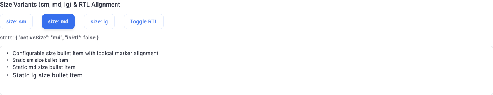
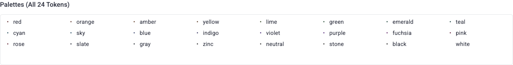
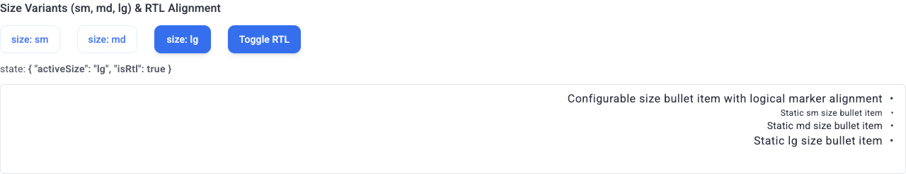
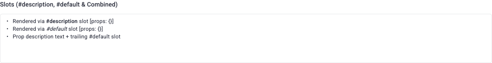
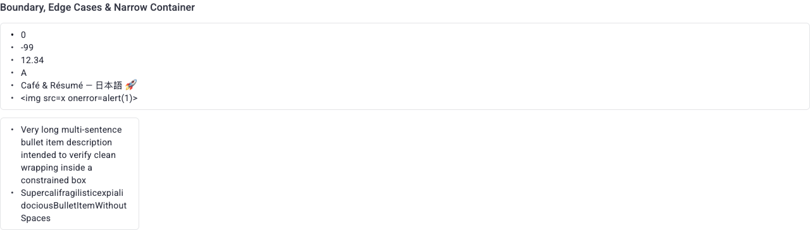
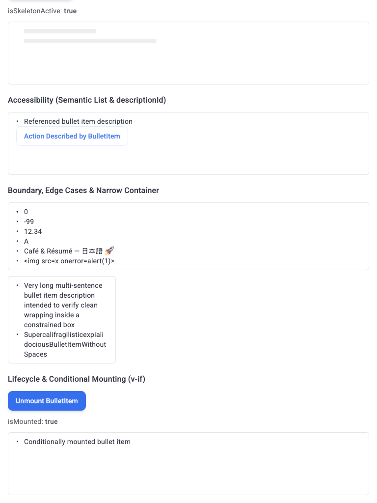
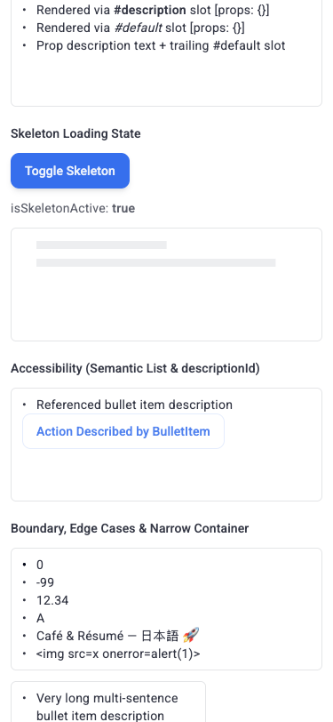

# Отчёт визуального и функционального тестирования: D1BulletItem

## 1. Сводка выполнения

- **Компонент:** `D1BulletItem` (`@dxtmisha/d1`)
- **Исходный код:** [`D1BulletItem`](../../src/components/Ui/BulletItem), [`BulletItem`](../../../constructor/src/constructors/BulletItem), [`DemoBulletItemPage.vue`](../../../demo/src/pages/components/DemoBulletItemPage.vue)
- **Целевой URL:** `http://localhost:3000/component-bullet-item`
- **Материалы (`materials/`):** `Отсутствуют`
- **Дата тестирования (UTC):** `2026-11-25T05:02:47Z`
- **Окружение:** `Headless Chrome (Puppeteer / CDP, Desktop 1440×900, Tablet 768×1024, Mobile 375×812 / 320×568)`
- **Покрытие тест-кейсов:** `13 / 13` (`100%`)
- **Итог:** **13 ✅, 0 ⚠️, 0 ❌** (`✅` пройдено, `⚠️` предупреждение, `❌` ошибка) — размеры `sm`/`md`/`lg`, все 24 палитры, RTL, скелетон, `aria-describedby`, `v-if`, граничные и адаптивные сценарии (`1440×900`, `768×1024`, `375×812`, `320×568`), SSR (`HTTP 200`) и `0` ошибок runtime пройдены полностью успешно после CSS-исправлений в `packages/constructor/src/constructors/BulletItem/style.scss`.

---

## 2. Матрица результатов

### 2.1 Визуальный рендеринг (`VIS`)

| ID | Сценарий | Статус | Наблюдаемый результат | Скриншот |
| :--- | :--- | :---: | :--- | :--- |
| `TC-VIS-001` | Варианты размеров (`sm`, `md`, `lg`) | ✅ | Пункты списка рендерятся как `<li>` с маркером `•`, корректными отступами и модификаторами размеров `.d1-bulletItem--size--sm`, `--md`, `--lg`. |  |
| `TC-VIS-002` | Состояние загрузки скелетона (`isSkeleton` внутри `D1Skeleton`) | ✅ | При `isSkeletonActive = true` описание внутри `D1BulletItem` отображает текстовый плейсхолдер скелетона. |  |
| `TC-VIS-003` | Полная матрица всех 24 цветовых палитр (`palette`) | ✅ | Все 24 палитры из `propsValues.palette` рендерятся с соответствующими токен-классами `d1-palette` и цветами маркера/текста. |  |

### 2.2 Интерактивность и управление состоянием (`INT`)

| ID | Сценарий | Статус | Наблюдаемый результат | Скриншот |
| :--- | :--- | :---: | :--- | :--- |
| `TC-INT-001` | Реактивное переключение размера (`sm` -> `lg` -> `md`) | ✅ | Нажатия кнопок переключения синхронно обновляют класс модификатора размера и типографику элемента. |  |
| `TC-INT-002` | Логическое позиционирование маркера в режиме RTL (`dir="rtl"`) | ✅ | Псевдоэлемент `::before` выравнивается по правому краю (`inset-inline-start: 0`) без наложения на текст. |  |
| `TC-INT-003` | Переключение скелетона загрузки (`Toggle Skeleton`) | ✅ | Нажатие `Toggle Skeleton` переводит `isSkeletonActive` в `false` и восстанавливает реальный текст пунктов. |  |
| `TC-INT-004` | Жизненный цикл: условное монтирование и размонтирование (`v-if`) | ✅ | При размонтировании отображается `isMounted: false`, при повторном монтировании — `isMounted: true` с пунктом `Conditionally mounted bullet item` без ошибок. | — |

### 2.3 Граничные случаи и устойчивость (`BND`)

| ID | Сценарий | Статус | Наблюдаемый результат | Скриншот |
| :--- | :--- | :---: | :--- | :--- |
| `TC-BND-001` | Слоты `#description`, `#default`, комбинация с пропом и числовые значения (`0`, `-99`, `12.34`) | ✅ | Слоты `#description`, `#default` (со scoped-привязками) и комбинация `description` + `#default`, а также числа `0`, `-99`, `12.34` и `"A"` отображаются с ненулевой геометрией. |  |
| `TC-BND-002` | Пустые значения, Unicode, XSS-экранирование и длинный текст в узком `DemoBox` | ✅ | Пустые значения, `Café & Résumé — 日本語 🚀` и экранированный XSS `` (`badImgs: 0`, `hasEscapedPayloadText: true`, `dialogs: []`) корректны; после добавления `min-width: 0; max-width: 100%; overflow-wrap: anywhere;` на корне и в `&__description` в `BulletItem/style.scss` многословный и неразрывный текст переносятся строго внутри `DemoBox` (`scrollWidth: 218 === clientWidth: 218`, `overflowsBox: false`). |  |

### 2.4 Адаптивность и вьюпорты (`RSP`)

| ID | Сценарий | Статус | Наблюдаемый результат | Скриншот |
| :--- | :--- | :---: | :--- | :--- |
| `TC-RSP-001` | Планшетный вьюпорт (`768×1024`) без переполнения | ✅ | На `1440×900` (`scrollWidth: 1440 === 1440`, `overflowX: false`) и `768×1024` (`scrollWidth: 768 === 768`, `overflowX: false`) горизонтальное переполнение отсутствует. |  |
| `TC-RSP-002` | Мобильный экран (`375×812` и `320×568`) без горизонтального переполнения | ✅ | После исправления переноса в `BulletItem/style.scss` горизонтальное переполнение устранено на обоих мобильных вьюпортах: на `375×812` `scrollWidth: 375 === 375` (`overflowX: false`), на `320×568` `scrollWidth: 320 === 320` (`overflowX: false`). |  |

### 2.5 Доступность (`A11Y`)

| ID | Сценарий | Статус | Наблюдаемый результат | Скриншот |
| :--- | :--- | :---: | :--- | :--- |
| `TC-A11Y-001` | Семантика `<li>`, пользовательский `descriptionId` и связь `aria-describedby` | ✅ | На странице зафиксированы `liCount: 46` элементов `LI` и `describedByMatches: 1` (точная привязка `aria-describedby` кнопки к `descriptionId` описания). | — |

### 2.6 Консоль и стабильность runtime (`LOG`)

| ID | Сценарий | Статус | Наблюдаемый результат | Скриншот |
| :--- | :--- | :---: | :--- | :--- |
| `TC-LOG-001` | Чистота консоли браузера и отсутствие `[Vue warn]` | ✅ | SSR возвращает `HTTP 200` (`hasComponent: true`); за всю сессию `consoleErrors: []`, `vueWarnings: []`, `pageErrors: []`, `networkErrors: []`. | — |

---

## 3. AI-аудит и рекомендации

1. **Переполнение неразрывного текста устранено:** В [`packages/constructor/src/constructors/BulletItem/style.scss`](../../../constructor/src/constructors/BulletItem/style.scss) добавлены `min-width: 0; max-width: 100%; overflow-wrap: anywhere;` для корневого элемента и `&__description`. Повторная проверка подтвердила корректное сжатие в узком контейнере (`218 === 218`, `overflowsBox: false`) и отсутствие горизонтального переполнения на всех 4 вьюпортах (`1440×900`, `768×1024`, `375×812`, `320×568`: `scrollWidth === innerWidth`, `overflowX: false`).
2. **Палитры, RTL и доступность:** Все 24 палитры, 3 размера, логический отступ `inset-inline-start: 0` при `dir="rtl"` и связь `aria-describedby` через `descriptionId` работают стабильно.
3. **Безопасность и runtime:** XSS-строка экранируется как текст (`badImgs: 0`, `dialogs: []`), `v-if` монтирование и SSR (`HTTP 200`) проходят без предупреждений Vue и ошибок сети (`consoleErrors: []`, `vueWarnings: []`, `pageErrors: []`, `networkErrors: []`).
