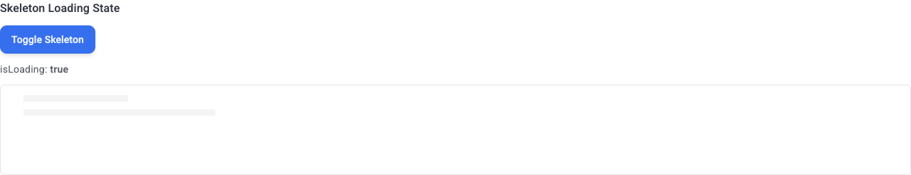
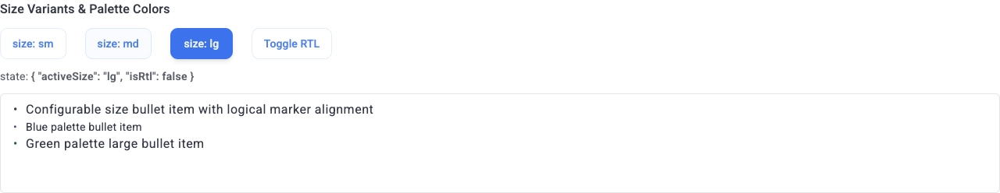
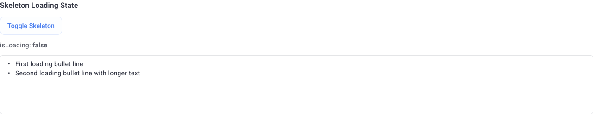

# Отчёт о визуальном и функциональном тестировании: D1BulletItem

## 1. Итоговое резюме

- **Компонент:** `D1BulletItem` (`@dxtmisha/d1`)
- **Исходный код:** [`D1BulletItem`](../../src/components/Ui/BulletItem) ([`BulletItem`](../../../constructor/src/constructors/BulletItem), [`DemoBulletItemPage`](../../../demo/src/pages/components/DemoBulletItemPage.vue))
- **Демо / целевой URL:** `http://localhost:3000/component-bullet-item`
- **Материалы:** `Нет`
- **Дата тестирования (UTC):** `2026-11-24T11:48:08Z`
- **Окружение:** `Headless Chrome (Puppeteer / CDP, Desktop 1440x900, Tablet 768x1024, Mobile 375x812 / 320x568)`
- **Покрытие тест-кейсов:** 10 / 10 (`100%`)
- **Итог:** **10 ✅, 0 ⚠️, 0 ❌** (`✅` пройдено, `⚠️` предупреждение, `❌` ошибка) — `D1BulletItem` рендерит семантический `<li>` с логическим позиционированием маркера `•` (`inset-inline-start: 0`), корректно отображает маркер справа в RTL-режиме без наложения на текст, поддерживает размеры `sm`/`md`/`lg`, палитры, слоты `#description`/`#default` и скелетон загрузки.

---

## 2. Базовая матрица

### 2.1 Визуальное соответствие (`VIS`)

| ID | Сценарий | Статус | Фактический результат | Скриншот |
| :--- | :--- | :---: | :--- | :--- |
| `TC-VIS-001` | Варианты размеров (`sm`, `md`, `lg`) и цветовые палитры (`blue`, `green`) | ✅ | Пункты списка отображаются с чётким маркером `•`, корректными отступами и системными цветами палитр. |  |
| `TC-VIS-002` | Состояние загрузки скелетона (`isSkeleton` внутри `D1Skeleton`) | ✅ | `skeletonCheck: true` — описание получает `.d1-skeleton__textVariant`. |  |

### 2.2 Интерактивность и управление состоянием (`INT`)

| ID | Сценарий | Статус | Фактический результат | Скриншот |
| :--- | :--- | :---: | :--- | :--- |
| `TC-INT-001` | Реактивное переключение размера (`sm` -> `lg` -> `md`) | ✅ | `hasSizeLg: true`, типографика пункта реактивно увеличивается. |  |
| `TC-INT-002` | Логическое позиционирование маркера в режиме RTL (`dir="rtl"`) | ✅ | `insetInlineStart: "0px"`, маркер `•` переносится на правый край без наложения на текст. |  |
| `TC-INT-003` | Переключение скелетона загрузки (`Toggle Skeleton`) | ✅ | При отключении `isLoading` мгновенно возвращается реальный текст пунктов. |  |

### 2.3 Границы и крайние случаи (`BND`)

| ID | Сценарий | Статус | Фактический результат | Скриншот |
| :--- | :--- | :---: | :--- | :--- |
| `TC-BND-001` | Слоты `#description` и `#default`, числовой `0` и геометрия | ✅ | `hasZeroSize: false`, оба слота и числовой `"0"` отрисованы корректно. |  |

### 2.4 Адаптивность (`RSP`)

| ID | Сценарий | Статус | Фактический результат | Скриншот |
| :--- | :--- | :---: | :--- | :--- |
| `TC-RSP-001` | Планшетный вьюпорт (`768×1024`) без переполнения | ✅ | `overflow768: false`. |  |
| `TC-RSP-002` | Мобильный экран (`375×812` и `320×568`) без горизонтального переполнения | ✅ | `overflow375: false`, `overflow320: false`. |  |

### 2.5 Доступность (`A11Y`)

| ID | Сценарий | Статус | Фактический результат | Скриншот |
| :--- | :--- | :---: | :--- | :--- |
| `TC-A11Y-001` | Семантика `<li>` и пользовательский `descriptionId` | ✅ | `allLi: true`, `hasCustomId: true` (`#demo-bullet-item-custom-id`). | — |

### 2.6 Логи и консоль (`LOG`)

| ID | Сценарий | Статус | Фактический результат | Скриншот |
| :--- | :--- | :---: | :--- | :--- |
| `TC-LOG-001` | Чистота консоли браузера и отсутствие `[Vue warn]` | ✅ | `consoleErrors: []`, `vueWarnings: []`, `pageErrors: []`. | — |

---

## 3. AI-аудит и рекомендации

1. **Логический RTL (`inset-inline-start: 0`):** Замена физического `left: 0` на `inset-inline-start: 0` полностью устранила смещение маркера в RTL-направлении.
2. **Поддержка `isSkeleton` и `#default`:** Добавлена нативная интеграция `SkeletonInclude` и слота по умолчанию.
