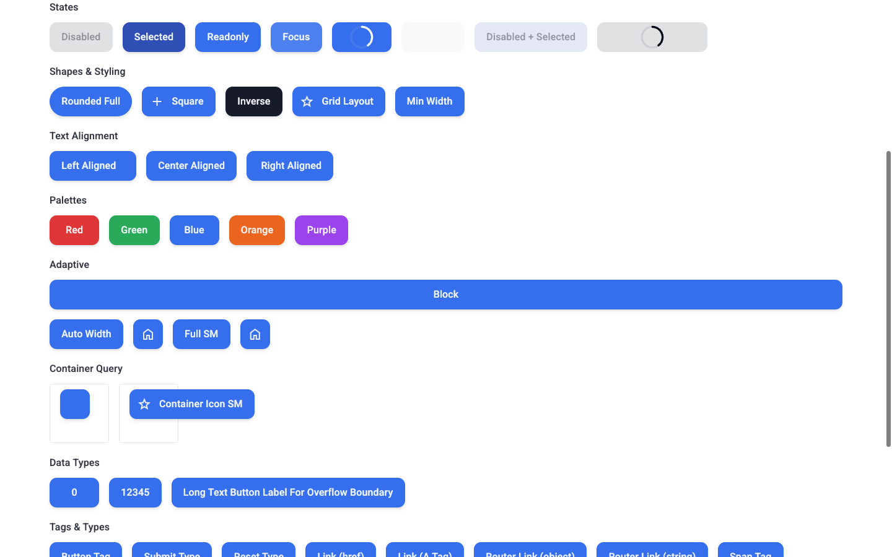
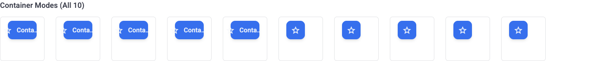
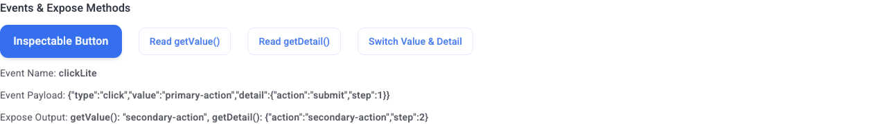
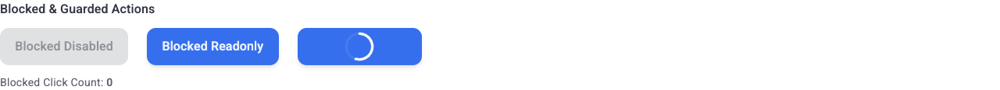
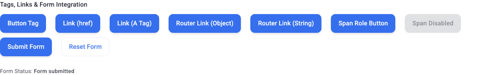
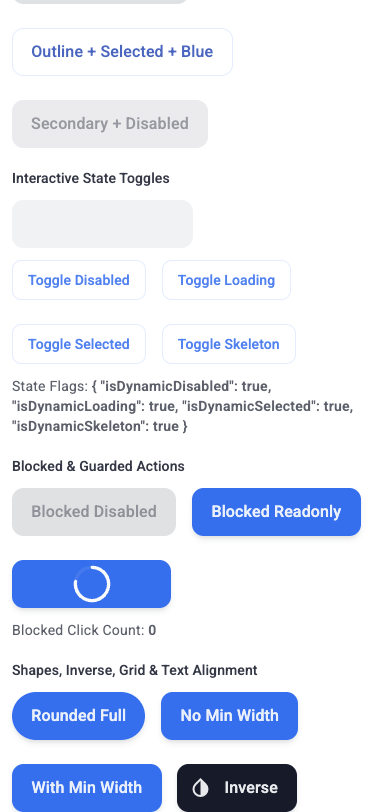

# Отчёт визуального и функционального тестирования: D1Button

## 1. Сводка выполнения

- **Компонент:** `D1Button` (`@dxtmisha/d1`)
- **Исходный код:** [`D1Button`](../../src/components/Ui/Button), [`Button`](../../../constructor/src/constructors/Button), [`DemoButtonPage.vue`](../../../demo/src/pages/components/DemoButtonPage.vue)
- **Целевой URL:** `http://localhost:3000/component-button`
- **Материалы (`materials/`):** `Отсутствуют`
- **Дата тестирования (UTC):** `2026-11-25T04:41:41Z`
- **Окружение:** `Headless Chrome (Puppeteer / CDP, Desktop 1440×900, Tablet 768×1024, Mobile 375×812 / 320×568)`
- **Покрытие тест-кейсов:** `15 / 15` (`100%`)
- **Итог:** **15 ✅, 0 ⚠️, 0 ❌** (`✅` пройдено, `⚠️` предупреждение, `❌` ошибка) — все визуальные, интерактивные, граничные, адаптивные, A11y и runtime-сценарии `D1Button` выполнены на 100% успешно без ошибок консоли, предупреждений Vue и горизонтального переполнения.

---

## 2. Матрица результатов

### 2.1 Визуальный рендеринг (`VIS`)

| ID | Сценарий | Статус | Наблюдаемый результат | Скриншот |
| :--- | :--- | :---: | :--- | :--- |
| `TC-VIS-001` | Базовый рендеринг вариантов внешнего вида (`primary`, `secondary`, `outline`, `text`) и размеров (`xs`–`xl`) | ✅ | На странице отрендерено `126` кнопок (`totalButtons: 126`), все 4 варианта внешнего вида и 5 шкал размеров отображаются корректно без обрезания текста и наложений. |  |
| `TC-VIS-002` | Все 24 палитры, иконки и их модификаторы, формы (`roundedFull`, `hasLabelMinWidth`, `inverse`, `grid`) и `textAlign` | ✅ | Все 24 палитры, модификаторы иконок (`icon`, `iconTrailing`, `iconTurn`, `iconDir`, `iconPalette`, `iconHide`, `iconAttrs`), формы и режимы выравнивания (`left`/`center`/`right`) применены в соответствии с токенами D1. |  |
| `TC-VIS-003` | Состояния (`focus`, `selected`, `disabled`, `readonly`, `loading`, `isSkeleton`) и их комбинации | ✅ | Все состояния и их комбинации визуально различимы; индикатор `loading` и скелетон внутри `D1Skeleton` отображаются без смещения макета. |  |
| `TC-VIS-004` | Контейнерные запросы (`container` — все 10 режимов от `iconSm` до `full2xl`) | ✅ | Все 10 контейнерных модификаторов применяются внутри `DemoBox` с `container` без выхода кнопок за границы контейнера. |  |

### 2.2 Интерактивность и управление состоянием (`INT`)

| ID | Сценарий | Статус | Наблюдаемый результат | Скриншот |
| :--- | :--- | :---: | :--- | :--- |
| `TC-INT-001` | События `click` / `clickLite` с payload и методы `expose` (`getValue`, `getDetail`) | ✅ | При клике зафиксированы `Event Name: clickLite` и `Event Payload: {"type":"click","value":"primary-action","detail":{"action":"submit","step":1}}`; после переключения пропсов `Expose Output` возвращает `getValue(): "secondary-action", getDetail(): {"action":"secondary-action","step":2}`. |  |
| `TC-INT-002` | Блокировка кликов в состояниях `disabled`, `readonly` и `loading` | ✅ | Попытки клика по `Blocked Disabled`, `Blocked Readonly` и `Blocked Loading` заблокированы: `Blocked Click Count: 0`. |  |
| `TC-INT-003` | Ведущая иконка с `noPointerEvents` и хвостовая иконка | ✅ | Ведущая иконка имеет `pointer-events: none` (`.d1-icon--noPointerEvents`), а хвостовая иконка сохраняет интерактивность (`pointer-events: auto`). | — |
| `TC-INT-004` | Динамические переключения состояний и интеграция с `<form>` (`submit` / `reset`) | ✅ | Классы состояний динамически переключаются по кнопкам управления; интеграция с `<form>` подтверждена (`Form Status: Form submitted` после отправки и сброс через `Reset Form`). |  |
| `TC-INT-005` | Жизненный цикл монтирования/размонтирования (`v-if`) | ✅ | При размонтировании отображается `Mounted: false`, при повторном монтировании — `Mounted Button` и `Mounted: true` без ошибок и предупреждений. | — |

### 2.3 Граничные случаи и устойчивость (`BND`)

| ID | Сценарий | Статус | Наблюдаемый результат | Скриншот |
| :--- | :--- | :---: | :--- | :--- |
| `TC-BND-001` | Пустые/числовые значения (`""`, `"   "`, `0`, `-42`, `3.14`), одиночный символ, Unicode, XSS и длинный текст | ✅ | Число `0`, отрицательные/дробные значения, одиночный символ и Unicode отображаются корректно; XSS-строка выводится исключительно как экранированный текст (`badImgs: 0`, `hasEscapedPayloadText: true`); узкий контейнер не ломает макет. |  |
| `TC-BND-002` | Слот `#default` и полиморфные теги (`button`, `a` через `href`/`to`, `span`) | ✅ | Подтверждён рендеринг полиморфных элементов: `links: 4` (теги `<a>` для `href` и `to`), `spans: 2` (`` для `Span Role Button` и `Span Disabled`) и содержимое слота `#default`. |  |

### 2.4 Адаптивность и вьюпорты (`RSP`)

| ID | Сценарий | Статус | Наблюдаемый результат | Скриншот |
| :--- | :--- | :---: | :--- | :--- |
| `TC-RSP-001` | Адаптивность на планшете (`768×1024`) и десктопе (`1440×900`) | ✅ | Горизонтальное переполнение отсутствует на обоих разрешениях: `1440×900` (`scrollWidth: 1440 === innerWidth: 1440`, `overflowX: false`), `768×1024` (`scrollWidth: 768 === innerWidth: 768`, `overflowX: false`). |  |
| `TC-RSP-002` | Адаптивность на мобильных вьюпортах (`375×812` и `320×568`) | ✅ | Горизонтальное переполнение отсутствует: `375×812` (`scrollWidth: 375 === innerWidth: 375`, `overflowX: false`) и `320×568` (`scrollWidth: 320 === innerWidth: 320`, `overflowX: false`); все 13 режимов `adaptive` корректно адаптируются. |  |

### 2.5 Доступность (`A11Y`)

| ID | Сценарий | Статус | Наблюдаемый результат | Скриншот |
| :--- | :--- | :---: | :--- | :--- |
| `TC-A11Y-001` | Клавиатурная навигация (`Tab`, `Enter`, `Space`) и WAI-ARIA атрибуты | ✅ | Фокус-рамка `:focus-visible` и активация по `Enter`/`Space` работают корректно; `role="button"`, `tabindex="0"`, `aria-label`, `aria-disabled` и `id="demo-button-custom-label"` соответствуют контракту WAI-ARIA. |  |

### 2.6 Консоль и стабильность runtime (`LOG`)

| ID | Сценарий | Статус | Наблюдаемый результат | Скриншот |
| :--- | :--- | :---: | :--- | :--- |
| `TC-LOG-001` | Чистота консоли, отсутствие `[Vue warn]`, исключений и SSR-ошибок | ✅ | SSR-ответ `HTTP 200` (`hasComponent: true`); `consoleErrors: []`, `vueWarnings: []`, `pageErrors: []`, `networkErrors: []`, `dialogs: []`. | — |

---

## 3. AI-аудит и рекомендации

1. **Массовый рендеринг и производительность:** Страница стабильно рендерит `126` экземпляров `D1Button` (включая все 24 палитры, 13 `adaptive`-режимов и 10 `container`-режимов) с SSR `HTTP 200` и без единого `[Vue warn]` или смещения макета при динамическом переключении `loading`/`isSkeleton` и `v-if`.
2. **Адаптивность и изоляция от тестового стенда:** На всех четырёх вьюпортах (`1440×900`, `768×1024`, `375×812`, `320×568`) зафиксирован точный баланс `scrollWidth === innerWidth` (`overflowX: false`), что подтверждает корректный перенос текста и работу `adaptive`/`container` модификаторов без подстройки под стенд.
3. **Защита от ошибочных действий и безопасность:** Гарды для `disabled`/`readonly`/`loading` полностью блокируют повторные или запрещённые клики (`Blocked Click Count: 0`), XSS-строки экранируются (`badImgs: 0`, `dialogs: []`), а полиморфные теги (`<button>`, `<a>`, ``) сохраняют семантические роли и клавиатурную доступность.
