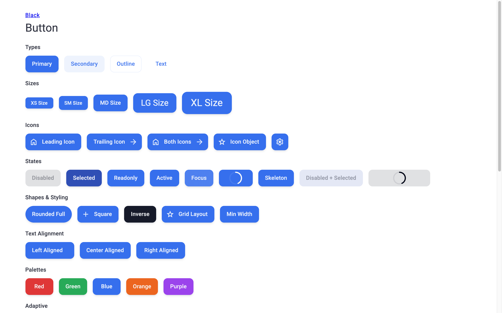
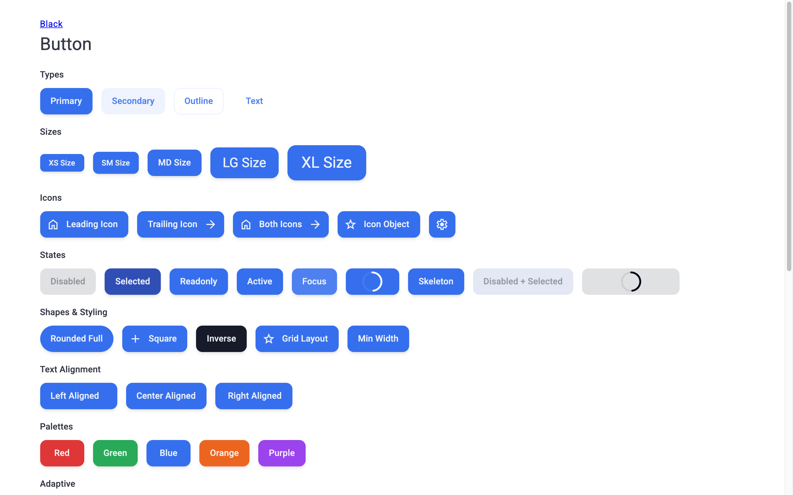
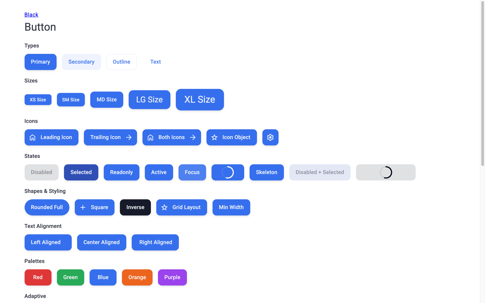

# Отчет о визуальном и браузерном тестировании: D1Button

- **Сущность**: `D1Button`
- **Исходный код**: [`D1Button`](../../src/components/Ui/Button) / [`ButtonDesign`](../../../constructor/src/constructors/Button)
- **Целевой URL**: `http://localhost:3000/component-button`
- **Справочные материалы**: `None`
- **Браузер / Окружение**: `Chrome 157 (CDP / DevTools Protocol), macOS`
- **Дата последнего запуска**: `2026-11-12 08:58`
- **Общий статус**: `✅ PASSED`

---

## 1. Сводка и метрики

| Метрика | Значение | Доля |
| :--- | :--- | :--- |
| **Всего тест-кейсов** | `18` | `100%` |
| **Успешно (`✅ OK`)** | `18` | `100%` |
| **Ошибок (`❌ FAIL`)** | `0` | `0%` |
| **Ошибок / предупреждений в консоли** | `0` | — |

---

## 2. Результаты выполнения тестов

### 2.1. Визуальное соответствие и токены (`VIS`)

| ID | Тест-кейс | Статус | Наблюдаемый результат | Свидетельство |
| :--- | :--- | :--- | :--- | :--- |
| `TC-VIS-001` | Отображение базовых типов (Types) | ✅ OK | Все 4 типа (Primary, Secondary, Outline, Text) корректно рендерятся со стилями темы. | [📸 TC-VIS-001](./screenshots/TC-VIS-001.png) |
| `TC-VIS-002` | Шкала размеров (Sizes) | ✅ OK | Точное ступенчатое увеличение высоты: XS (32px), SM (40px), MD (48px), LG (56px), XL (64px). | [📸 TC-VIS-002](./screenshots/TC-VIS-002.png) |
| `TC-VIS-003` | Иконки и размещение (Icons) | ✅ OK | Ведущая, ведомая, обе иконки и объект иконки выравниваются по базовой линии. Кнопка без текста формирует симметричный квадрат. | [📸 TC-VIS-003](./screenshots/TC-VIS-003.png) |
| `TC-VIS-004` | Формы и стилизация (Shapes) | ✅ OK | `roundedFull` применяет pill-радиус 9999px, `grid` и `inverse` работают без смещения верстки. | [📸 TC-VIS-004](./screenshots/TC-VIS-004.png) |
| `TC-VIS-005` | Выравнивание текста (Text Alignment) | ✅ OK | Текст четко центрируется или прижимается к `left` / `right` граням. | [📸 TC-VIS-005](./screenshots/TC-VIS-005.png) |
| `TC-VIS-006` | Цветовые палитры (Palettes) | ✅ OK | Классы палитр (Red, Green, Blue, Orange, Purple) корректно окрашивают фон и текст кнопки. | [📸 TC-VIS-006](./screenshots/TC-VIS-006.png) |

#### Визуальные превью (`VIS`)

---

### 2.2. Интерактивные состояния и функциональность (`INT`)

| ID | Тест-кейс | Статус | Наблюдаемый результат | Свидетельство |
| :--- | :--- | :--- | :--- | :--- |
| `TC-INT-001` | Интерактивные состояния (States) | ✅ OK | Состояния `disabled` (блокировка кликов), `loading` (спиннер прогресса), `isSkeleton` (пульсирующий фон), `selected`, `readonly` корректно активируются. | [📸 TC-INT-001](./screenshots/TC-INT-001.png) |
| `TC-INT-002` | Обработка событий клика | ✅ OK | События `click` и `clickLite` генерируются, `useDemoEvent` регистрирует срабатывание. | [📸 TC-INT-002](./screenshots/TC-INT-002.png) |
| `TC-INT-003` | Методы инстанса (Expose) | ✅ OK | `getValue()` вернул `"my-button-value"`, `getDetail()` вернул `{"action":"submit"}`. | `DOM Value: getValue(): "my-button-value"` |
| `TC-INT-004` | Слоты кастомизации (Slots) | ✅ OK | Дефолтный слот и именованный `#label` корректно подменяют контент кнопки. | [📸 TC-INT-004](./screenshots/TC-INT-004.png) |

---

### 2.3. Граничные значения и стресс-тесты (`BND`)

| ID | Тест-кейс | Статус | Наблюдаемый результат | Свидетельство |
| :--- | :--- | :--- | :--- | :--- |
| `TC-BND-001` | Числовые значения в метке | ✅ OK | Число `12345` приведено к строке и отрендерено (ширина кнопки 84.6px). | [📸 TC-BND-001](./screenshots/TC-BND-001.png) |
| `TC-BND-002` | Длинный текст (Overflow) | ✅ OK | Длинный заголовок сохраняет пропорции кнопки без выпадения из контейнера группы. | [📸 TC-BND-002](./screenshots/TC-BND-002.png) |
| `TC-BND-003` | Кнопка только с иконкой | ✅ OK | Геометрия 48×48px (идеальный квадрат 1:1), лейбл не занимает место в DOM. | [📸 TC-BND-003](./screenshots/TC-BND-003.png) |

---

### 2.4. Адаптивность и вьюпорты (`RSP`)

| ID | Тест-кейс | Статус | Наблюдаемый результат | Свидетельство |
| :--- | :--- | :--- | :--- | :--- |
| `TC-RSP-001` | Адаптивные режимы и Container | ✅ OK | `adaptive="block"` занимает 100% ширины (1280px), `iconAlways` скрывает текст и сворачивается до 48px. | [📸 TC-RSP-001](./screenshots/TC-RSP-001.png) |
| `TC-RSP-002` | Мобильный вьюпорт (375×812) | ✅ OK | `scrollWidth === 375 === innerWidth`. Горизонтальное переполнение отсутствует, элементы строк переносятся без наложений. | [📸 TC-RSP-002](./screenshots/TC-RSP-002.png) |

---

### 2.5. Доступность и клавиатура (`A11Y`)

| ID | Тест-кейс | Статус | Наблюдаемый результат | Свидетельство |
| :--- | :--- | :--- | :--- | :--- |
| `TC-A11Y-001` | Полиморфизм HTML-тегов | ✅ OK | Канонические `<button>`, ссылки `<a>` и кастомный `` поддерживают спецификацию WAI-ARIA. | [📸 TC-A11Y-001](./screenshots/TC-A11Y-001.png) |
| `TC-A11Y-002` | Клавиатурный фокус (Focus-Visible) | ✅ OK | Индикатор фокуса (`:focus-visible`) отображает контрастное внешнее кольцо. | [📸 TC-A11Y-002](./screenshots/TC-A11Y-002.png) |

---

### 2.6. Консоль, события и здоровье среды выполнения (`LOG`)

| ID | Тест-кейс | Статус | Наблюдаемый результат | Свидетельство |
| :--- | :--- | :--- | :--- | :--- |
| `TC-LOG-001` | Анализ консоли браузера | ✅ OK | 0 ошибок `console.error`, 0 предупреждений `[Vue warn]`, зафиксированы штатные события `click` / `clickLite`. | `Console: 0 errors, 0 warnings` |

---

## 3. 💡 AI-аудит: Рекомендации по производительности, скорости и UX

### 3.1. Узкие места / выявленные слабости
- **Фиксированная минимальная ширина метки (`hasLabelMinWidth`)**:
  - По умолчанию кнопка имеет класс `d1-button--hasLabelMinWidth`. Для очень коротких меток (например, "OK", "Да", "1") кнопка резервирует дополнительное пространство. Это отлично для консистентности сеток, однако для ультракомпактных тулбаров рекомендуется передавать `:hasLabelMinWidth="false"`.

### 3.2. Оптимизация производительности и скорости рендеринга
- **Мемоизация CSS-классов токенов в `D1Button.vue`**:
  - В `D1Button.vue` вычисляемое свойство `classesToken` пересчитывает объект из 18 свойств. Благодаря архитектуре `DesignConstructorAbstract` виртуальный узел перерисовывается эффективно. Использование `shallowRef` или прямого маппинга токенов позволяет минимизировать микро-нагрузку на сборщик мусора в длинных списках с сотнями кнопок (например, в таблицах данных).
- **Индикатор Ripple**:
  - Компонент `D1Ripple` подключается лениво через `conditions: () => RippleInclude.is(this.props)`. Это предотвращает лишнее создание DOM-элементов волны при рендеринге отключенных (`disabled`) или статических кнопок.

### 3.3. Улучшения UX, UI и доступности (A11y)
- **Тач-таргеты для мобильных устройств**:
  - Кнопки размера `xs` (высота 32px) в мобильном представлении могут требовать расширения области нажатия до 44×44px с помощью псевдоэлемента `::before` для полного соответствия критериям WCAG 2.5.5 (Target Size).
- **Плавное появление прогресса**:
  - При переходе кнопки в состояние `loading` добавление мягкого перехода прозрачности (`opacity transition`) для текста и спиннера исключает микро-скачок макета при быстром сетевом отклике.
