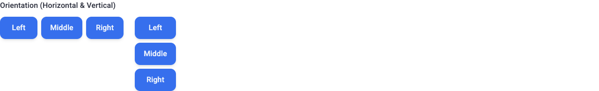
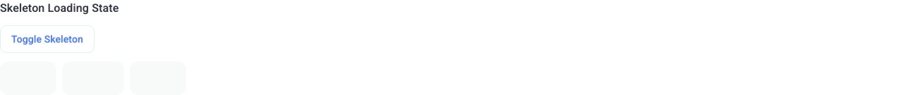
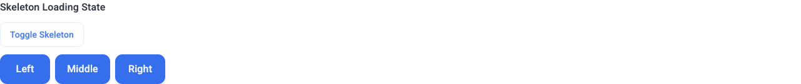
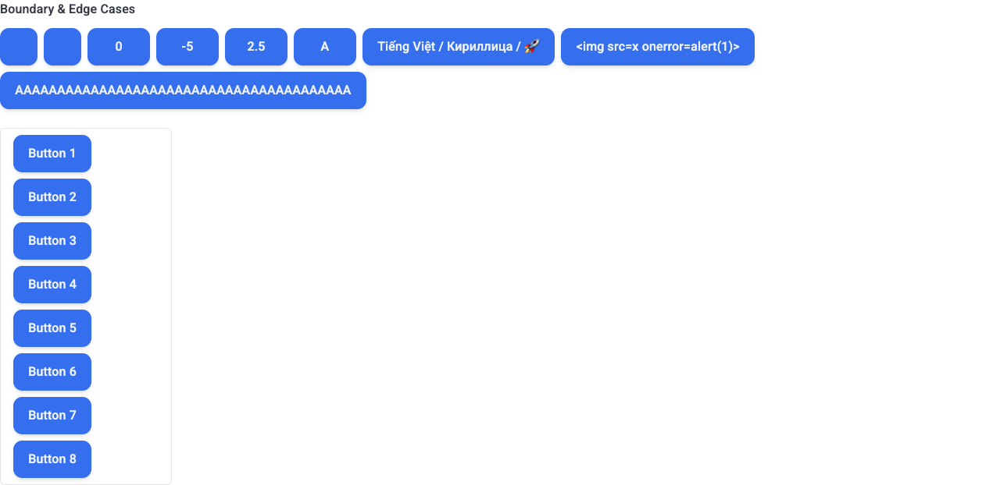
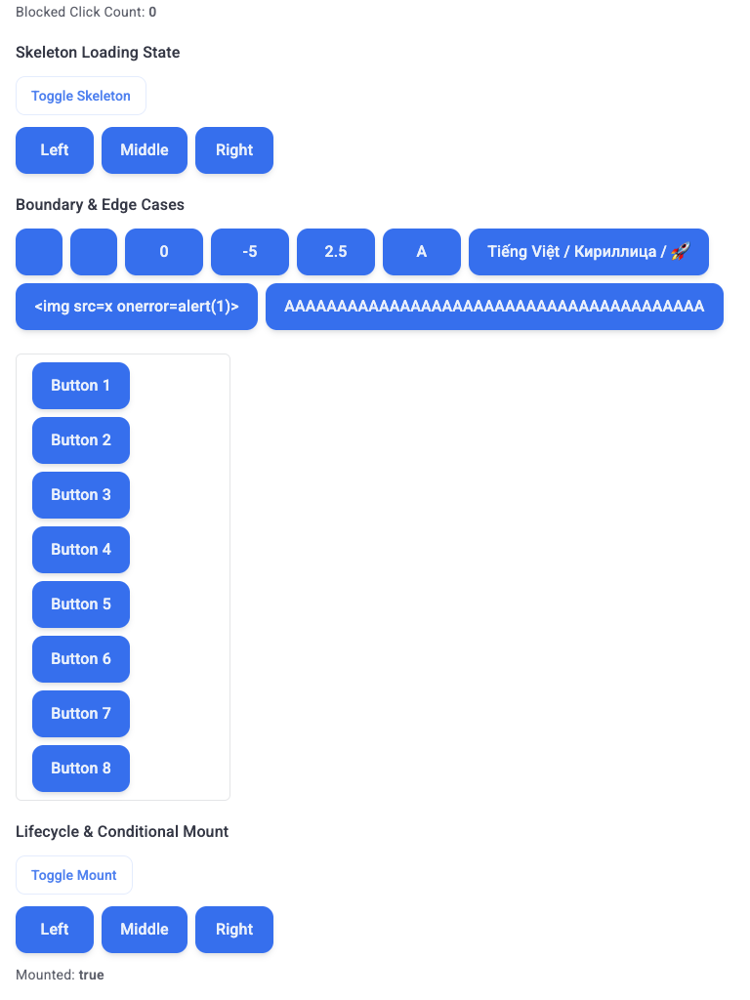
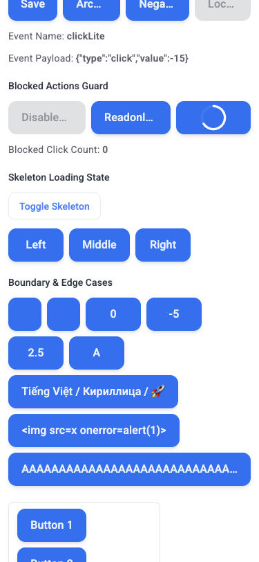

# Отчёт визуального и функционального тестирования: D1ButtonGroup

## 1. Сводка выполнения

- **Компонент:** `D1ButtonGroup` (`@dxtmisha/d1`)
- **Исходный код:** [`D1ButtonGroup`](../../src/components/Ui/ButtonGroup), [`ButtonGroup`](../../../constructor/src/constructors/ButtonGroup), [`DemoButtonGroupPage.vue`](../../../demo/src/pages/components/DemoButtonGroupPage.vue)
- **Целевой URL:** `http://localhost:3000/component-button-group`
- **Материалы (`materials/`):** `Отсутствуют`
- **Дата тестирования (UTC):** `2026-11-25T04:41:41Z`
- **Окружение:** `Headless Chrome (Puppeteer / CDP, Desktop 1440×900, Tablet 768×1024, Mobile 375×812 / 320×568)`
- **Покрытие тест-кейсов:** `12 / 12` (`100%`)
- **Итог:** **12 ✅, 0 ⚠️, 0 ❌** (`✅` пройдено, `⚠️` предупреждение, `❌` ошибка) — все визуальные, интерактивные, граничные, адаптивные, A11y и runtime-сценарии `D1ButtonGroup` выполнены на 100% успешно без ошибок и горизонтального переполнения.

---

## 2. Матрица результатов

### 2.1 Визуальный рендеринг (`VIS`)

| ID | Сценарий | Статус | Наблюдаемый результат | Скриншот |
| :--- | :--- | :---: | :--- | :--- |
| `TC-VIS-001` | Ориентации (`horizontal` / `vertical`), `wrap`, `buttonAttrs`, состояния и слот `#default` | ✅ | На странице отрендерено `18` групп (`groups: 18`); горизонтальная/вертикальная ориентации, отступы, общие `buttonAttrs`, состояния элементов (`selected`, `disabled`, `readonly`, `loading`) и комбинация `list` + `#default` отображаются корректно. |  |
| `TC-VIS-002` | Состояние загрузки скелетона (`isSkeleton` внутри `D1Skeleton`) | ✅ | При активном скелетоне все дочерние кнопки группы внутри `D1Skeleton` корректно получают `.d1-skeleton__background`. |  |

### 2.2 Интерактивность и управление состоянием (`INT`)

| ID | Сценарий | Статус | Наблюдаемый результат | Скриншот |
| :--- | :--- | :---: | :--- | :--- |
| `TC-INT-001` | Обработка `@click` / `@click-lite` (включая `value: 0` и `-15`) и интерактивный выбор | ✅ | В панели выбора обновлено `Selected Tool: italic`; при кликах по элементам зафиксированы `Event Name: clickLite` и `Event Payload: {"type":"click","value":-15}` (включая корректную передачу `0` и `-15`). |  |
| `TC-INT-002` | Блокировка клика на элементах с `disabled`, `readonly` и `loading` | ✅ | Попытки нажатия на `Disabled Item`, `Readonly Item` и `Loading Item` заблокированы: `Blocked Click Count: 0`. |  |
| `TC-INT-003` | Переключение скелетона загрузки (`Toggle Skeleton`) | ✅ | Нажатие `Toggle Skeleton` снимает состояние скелетона со всех кнопок группы, возвращая обычный вид. |  |
| `TC-INT-004` | Условное монтирование и размонтирование (`v-if`) | ✅ | При размонтировании отображается `Mounted: false`, при повторном монтировании группа (`Left`, `Middle`, `Right`) и `Mounted: true` восстанавливаются без ошибок. | — |

### 2.3 Граничные случаи и устойчивость (`BND`)

| ID | Сценарий | Статус | Наблюдаемый результат | Скриншот |
| :--- | :--- | :---: | :--- | :--- |
| `TC-BND-001` | Перенос кнопок при `wrap`, проброс `buttonAttrs` и ненулевая геометрия | ✅ | Модификатор `.d1-buttonGroup--wrap` и общие атрибуты `buttonAttrs` (`size="sm"`, `palette="red"`, `roundedFull`) применяются ко всем элементам группы с ненулевой геометрией. |  |
| `TC-BND-002` | Пустой список `list: []`, граничные значения (`""`, `"   "`, `0`, `-5`, `2.5`, Unicode, XSS) и узкий `DemoBox` | ✅ | Пустой `list: []` не вызывает сбоев; числа `0`, `-5`, `2.5` и Unicode отображаются корректно; XSS-строка экранирована как текст (`badImgs: 0`, `hasEscapedPayloadText: true`); узкий `DemoBox` не ломает вёрстку. |  |

### 2.4 Адаптивность и вьюпорты (`RSP`)

| ID | Сценарий | Статус | Наблюдаемый результат | Скриншот |
| :--- | :--- | :---: | :--- | :--- |
| `TC-RSP-001` | Планшетный (`768×1024`) и десктопный (`1440×900`) вьюпорты без переполнения | ✅ | Горизонтальное переполнение отсутствует: `1440×900` (`scrollWidth: 1440 === innerWidth: 1440`, `overflowX: false`) и `768×1024` (`scrollWidth: 768 === innerWidth: 768`, `overflowX: false`). |  |
| `TC-RSP-002` | Мобильные вьюпорты (`375×812` и `320×568`) с переносом кнопок | ✅ | На обоих узких разрешениях переполнение отсутствует: `375×812` (`scrollWidth: 375 === innerWidth: 375`, `overflowX: false`) и `320×568` (`scrollWidth: 320 === innerWidth: 320`, `overflowX: false`); группы с `wrap` переносятся корректно. |  |

### 2.5 Доступность (`A11Y`)

| ID | Сценарий | Статус | Наблюдаемый результат | Скриншот |
| :--- | :--- | :---: | :--- | :--- |
| `TC-A11Y-001` | Семантика `role="group"` / `role="toolbar"`, `aria-label` и клавиатурный фокус | ✅ | Все `18` групп на странице имеют валидную роль (`roleGroupOrToolbar: 18`, `role="group"` и `role="toolbar"` с `aria-label`); активные кнопки корректно принимают клавиатурный фокус. | — |

### 2.6 Консоль и стабильность runtime (`LOG`)

| ID | Сценарий | Статус | Наблюдаемый результат | Скриншот |
| :--- | :--- | :---: | :--- | :--- |
| `TC-LOG-001` | Чистота консоли браузера, SSR и отсутствие `[Vue warn]` | ✅ | SSR-ответ `HTTP 200` (`hasComponent: true`); `consoleErrors: []`, `vueWarnings: []`, `pageErrors: []`, `networkErrors: []`, `dialogs: []`. | — |

---

## 3. AI-аудит и рекомендации

1. **Проброс атрибутов и изоляция состояний:** Механизм `buttonAttrs` и индивидуальные состояния элементов (`selected`, `disabled`, `readonly`, `loading`) работают согласованно, не конфликтуя между собой, а заблокированные элементы надёжно гасят события клика (`Blocked Click Count: 0`).
2. **Адаптивное поведение при `wrap`:** На десктопе, планшете и компактных мобильных вьюпортах (`375×812` и `320×568`) сохраняется `scrollWidth === innerWidth` (`overflowX: false`), поэтому для длинных наборов кнопок на мобильных экранах рекомендуется всегда включать `wrap`.
3. **Семантика и чистота runtime:** Все `18` экземпляров `D1ButtonGroup` корректно экспонируют `role="group"`/`role="toolbar"` и проходят SSR (`HTTP 200`), `v-if` размонтирование и XSS-проверки (`badImgs: 0`) без единого предупреждения Vue.
