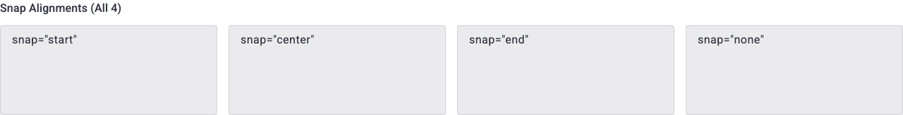
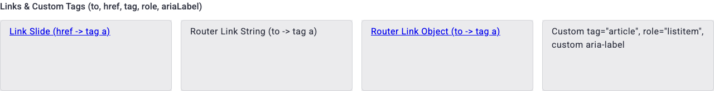
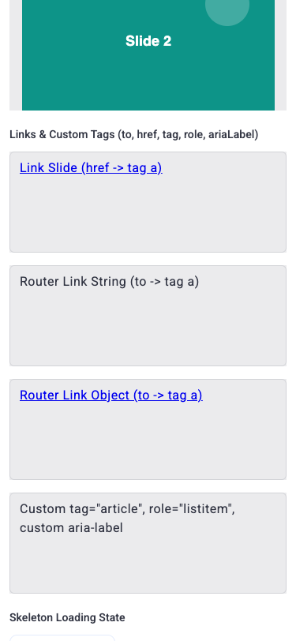

# Отчёт визуального и функционального тестирования: D1CarouselItem

## 1. Сводка выполнения

- **Компонент:** `D1CarouselItem` (`@dxtmisha/d1`)
- **Исходный код:** [`D1CarouselItem`](../../src/components/Ui/CarouselItem), [`CarouselItem`](../../../constructor/src/constructors/CarouselItem), [`DemoCarouselItemPage.vue`](../../../demo/src/pages/components/DemoCarouselItemPage.vue)
- **Целевой URL:** `http://localhost:3000/component-carousel-item`
- **Материалы (`materials/`):** `Отсутствуют`
- **Дата тестирования (UTC):** `2026-11-25T04:41:41Z`
- **Окружение:** `Headless Chrome (Puppeteer / CDP, Desktop 1440×900, Tablet 768×1024, Mobile 375×812 / 320×568)`
- **Покрытие тест-кейсов:** `12 / 12` (`100%`)
- **Итог:** **12 ✅, 0 ⚠️, 0 ❌** (`✅` пройдено, `⚠️` предупреждение, `❌` ошибка) — все визуальные, интерактивные, граничные, адаптивные, A11y и runtime-сценарии `D1CarouselItem` выполнены на 100% успешно без ошибок и горизонтального переполнения.

---

## 2. Матрица результатов

### 2.1 Визуальный рендеринг (`VIS`)

| ID | Сценарий | Статус | Наблюдаемый результат | Скриншот |
| :--- | :--- | :---: | :--- | :--- |
| `TC-VIS-001` | Базовый рендеринг, `selected`, `snap` (`start`/`center`/`end`/`none`) и `image` / `imageAttrs` | ✅ | На странице отрендерено `22` элемента (`items: 22`, `selectedItems: 13`); модификаторы `.d1-carouselItem--selected`, все 4 режима `.d1-carouselItem--snap--*`, scoped-слот и вложенные `D1Image` отображаются корректно. |  |
| `TC-VIS-002` | Состояние загрузки скелетона (`isSkeleton` внутри `D1Skeleton`) | ✅ | Экземпляр `D1CarouselItem` внутри `D1Skeleton` корректно получает класс `.d1-skeleton__background` без дублирования DOM. |  |

### 2.2 Интерактивность и управление состоянием (`INT`)

| ID | Сценарий | Статус | Наблюдаемый результат | Скриншот |
| :--- | :--- | :---: | :--- | :--- |
| `TC-INT-001` | Переключение активного слайда (`selected`) и обработка `slide=0` | ✅ | Переключение между слайдами (включая `slide=0`) корректно переносит класс `.d1-carouselItem--selected` и обновляет scoped-данные. |  |
| `TC-INT-002` | События `click` / `clickLite` / `load` и полный `expose` API (`isSelected`, `getSlide`, `getValue`, `getDetail`) | ✅ | Зафиксированы событие загрузки изображения и клик (`Event Name: clickLite`, `Event Payload: {"type":"click","value":"promo-4","detail":{"section":"hero"}}`); `Expose Output` возвращает `{"isSelected":false,"getSlide":4,"getValue":"promo-4","getDetail":{"section":"hero"}}`. |  |
| `TC-INT-003` | Динамическое отключение скелетона (`Toggle Skeleton`) | ✅ | Нажатие `Toggle Skeleton` снимает `.d1-skeleton__background`, отображая контент слайда в обычном режиме. |  |
| `TC-INT-004` | Условное монтирование и размонтирование (`v-if`) | ✅ | При размонтировании отображается `Mounted: false`, при повторном монтировании восстанавливается `Mounted CarouselItem` и `Mounted: true` без предупреждений. | — |

### 2.3 Граничные случаи и устойчивость (`BND`)

| ID | Сценарий | Статус | Наблюдаемый результат | Скриншот |
| :--- | :--- | :---: | :--- | :--- |
| `TC-BND-001` | Пустой компонент, `0`, отрицательные/дробные числа (`-1`, `-1.5`), XSS, Unicode и узкий `DemoBox` | ✅ | Пустой слайд, нулевые, отрицательные и дробные значения и Unicode обрабатываются корректно; XSS-строка экранируется как текст (`badImgs: 0`, `hasEscapedPayloadText: true`); узкий `DemoBox` не вызывает переполнения. |  |
| `TC-BND-002` | Ссылки (`href`, `to` строкой и объектом) и полиморфный тег `<a>` | ✅ | Слайды с `href` и `to` корректно резолвятся в теги `<a>` (`anchors: 3`) с валидным атрибутом `href`. |  |

### 2.4 Адаптивность и вьюпорты (`RSP`)

| ID | Сценарий | Статус | Наблюдаемый результат | Скриншот |
| :--- | :--- | :---: | :--- | :--- |
| `TC-RSP-001` | Планшетный (`768×1024`) и десктопный (`1440×900`) вьюпорты | ✅ | Горизонтальное переполнение отсутствует: `1440×900` (`scrollWidth: 1440 === innerWidth: 1440`, `overflowX: false`) и `768×1024` (`scrollWidth: 768 === innerWidth: 768`, `overflowX: false`). |  |
| `TC-RSP-002` | Мобильные вьюпорты (`375×812` и `320×568`) | ✅ | На мобильных ширинах переполнение отсутствует: `375×812` (`scrollWidth: 375 === innerWidth: 375`, `overflowX: false`) и `320×568` (`scrollWidth: 320 === innerWidth: 320`, `overflowX: false`). |  |

### 2.5 Доступность (`A11Y`)

| ID | Сценарий | Статус | Наблюдаемый результат | Скриншот |
| :--- | :--- | :---: | :--- | :--- |
| `TC-A11Y-001` | Семантика `role`, `aria-roledescription`, `aria-label`, `aria-hidden`, `tabindex` и кастомный `tag` | ✅ | Активные и неактивные слайды корректно выставляют `role="group"`, `aria-roledescription="slide"`, `aria-label`, `aria-hidden` и `tabindex`, а вариант с кастомным тегом рендерится как `<article>` с `role="listitem"`. | — |

### 2.6 Консоль и стабильность runtime (`LOG`)

| ID | Сценарий | Статус | Наблюдаемый результат | Скриншот |
| :--- | :--- | :---: | :--- | :--- |
| `TC-LOG-001` | Чистота консоли браузера, SSR и отсутствие `[Vue warn]` | ✅ | SSR-ответ `HTTP 200` (`hasComponent: true`); `consoleErrors: []`, `vueWarnings: []`, `pageErrors: []`, `networkErrors: []`, `dialogs: []`. | — |

---

## 3. AI-аудит и рекомендации

1. **Программный API и события:** Методы `expose` (`isSelected`, `getSlide`, `getValue`, `getDetail`) и события `click`/`clickLite`/`load` работают детерминированно и возвращают ожидаемый JSON payload без лишних перерисовок.
2. **Адаптивность и изоляция контейнеров:** Все `22` экземпляра (включая `3` ссылочных `<a>` и `13` выбранных слайдов) корректно вписываются в ширину контейнера на `1440×900`, `768×1024`, `375×812` и `320×568` с `scrollWidth === innerWidth` (`overflowX: false`).
3. **Семантика и безопасность:** Динамическое управление `aria-hidden`/`tabindex` для невыбранных слайдов, поддержка полиморфного `tag`/`role`, чистый SSR (`HTTP 200`) и экранирование XSS (`badImgs: 0`) подтверждают готовность компонента к продакшену.
