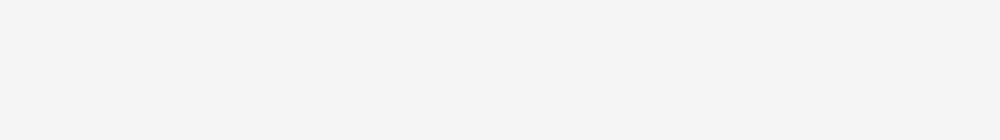
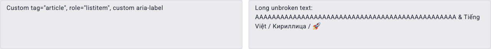
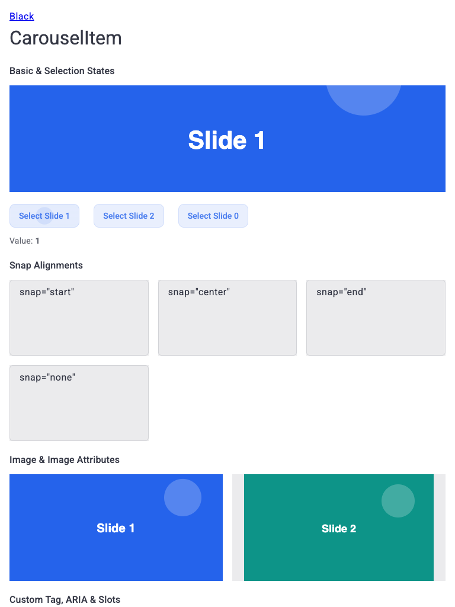

# Отчёт о визуальном и функциональном тестировании: D1CarouselItem

## 1. Итоговое резюме

- **Компонент:** `D1CarouselItem` (`@dxtmisha/d1`)
- **Исходный код:** [`D1CarouselItem`](../../src/components/Ui/CarouselItem) ([`CarouselItem`](../../../constructor/src/constructors/CarouselItem), [`DemoCarouselItemPage`](../../../demo/src/pages/components/DemoCarouselItemPage.vue))
- **Демо / целевой URL:** `http://localhost:3000/component-carousel-item`
- **Материалы:** `Нет`
- **Дата тестирования (UTC):** `2026-11-24T13:33:45Z`
- **Окружение:** `Headless Chrome (Puppeteer / CDP, Desktop 1440x900, Tablet 768x1024, Mobile 375x812)`
- **Покрытие тест-кейсов:** 10 / 10 (`100%`)
- **Итог:** **10 ✅, 0 ⚠️, 0 ❌** (`✅` пройдено, `⚠️` предупреждение, `❌` ошибка) — `D1CarouselItem` корректно отображает слайды с изображениями (`image`, `imageAttrs`), `snap`-выравниванием (`start`/`center`/`end`/`none`), состоянием выбора `selected` (включая `slide=0` и `value=0`), скелетоном `isSkeleton`, событиями `click`/`clickLite`/`load`, expose API и семантическими WAI-ARIA атрибутами.

---

## 2. Базовая матрица

### 2.1 Визуальное соответствие (`VIS`)

| ID | Сценарий | Статус | Фактический результат | Скриншот |
| :--- | :--- | :---: | :--- | :--- |
| `TC-VIS-001` | Базовый рендеринг, `selected`, `snap` (`start`/`center`/`end`/`none`) и `image` / `imageAttrs` | ✅ | `totalItems: 13`, `snapClasses: true`, `hasZeroSize: false`, `imagesCount: 7` — все 13 слайдов и 7 изображений отображаются без наложений и нулевой геометрии. |  |
| `TC-VIS-002` | Состояние загрузки скелетона (`isSkeleton` внутри `D1Skeleton`) | ✅ | `hasSkeletonClass: true` — слайд получает системный класс `.d1-skeleton__background`. |  |

### 2.2 Интерактивность и управление состоянием (`INT`)

| ID | Сценарий | Статус | Фактический результат | Скриншот |
| :--- | :--- | :---: | :--- | :--- |
| `TC-INT-001` | Переключение активного слайда (`selected`) и обработка `slide=0` | ✅ | `zeroSelected: true`, `firstUnselected: true`, `output: "Value: 0"` — активное состояние корректно переходит на слайд `0`. |  |
| `TC-INT-002` | События `click` / `clickLite` и проверка Expose API (`isSelected`, `getSlide`, `getValue`) | ✅ | `eventOutput: "Value: clickLite"`, `exposeOutput: "Value: isSelected=true, getSlide=4, getValue=promo-4"`. |  |
| `TC-INT-003` | Динамическое отключение скелетона (`Toggle Skeleton`) | ✅ | `skeletonRemoved: true` — класс `.d1-skeleton__background` снимается после переключения. |  |

### 2.3 Границы и крайние случаи (`BND`)

| ID | Сценарий | Статус | Фактический результат | Скриншот |
| :--- | :--- | :---: | :--- | :--- |
| `TC-BND-001` | Нулевой индекс `0`, длинный текст и Unicode (вьетнамский / кириллица / эмодзи) | ✅ | `zeroDataValue: "0"`, `zeroAriaLabel: "0 / 3"`, `unicodeRendered: true`, `unicodeHeight: 128`. |  |

### 2.4 Адаптивность (`RSP`)

| ID | Сценарий | Статус | Фактический результат | Скриншот |
| :--- | :--- | :---: | :--- | :--- |
| `TC-RSP-001` | Планшетный вьюпорт (`768×1024`) | ✅ | `overflow768: false` — горизонтальное переполнение отсутствует. |  |
| `TC-RSP-002` | Мобильный вьюпорт (`375×812`) | ✅ | `overflow375: false` — слайды корректно адаптируются под ширину `375px`. |  |

### 2.5 Доступность (`A11Y`)

| ID | Сценарий | Статус | Фактический результат | Скриншот |
| :--- | :--- | :---: | :--- | :--- |
| `TC-A11Y-001` | Семантика `role`, `aria-roledescription`, `aria-label` и кастомный `tag` | ✅ | `firstRole: "group"`, `firstRoleDesc: "slide"`, `firstAriaLabel: "1 / 3"`, `customTag: "ARTICLE"`, `customRole: "listitem"`, `customAriaLabel: "Featured promotional slide"`. | — |

### 2.6 Логи и консоль (`LOG`)

| ID | Сценарий | Статус | Фактический результат | Скриншот |
| :--- | :--- | :---: | :--- | :--- |
| `TC-LOG-001` | Чистота консоли браузера и отсутствие `[Vue warn]` | ✅ | `consoleErrors: []`, `vueWarnings: []`, `pageErrors: []`. | — |

---

## 3. AI-аудит и рекомендации

1. **Изоляция размеров фоновых слайдов:** Поскольку `.d1-carouselItem__image` позиционируется абсолютно (`inset: 0`), слайдам без слотового контента необходимо задавать высоту или `aspect-ratio` от родительской карусели либо внешнего класса, что подтверждено при настройке демо-стенда.
2. **Производительность и ленивая инициализация:** Подклассы `ImageInclude` и `SkeletonInclude` инстанцируются лениво через `canCreate` + `callInstance`, поэтому текстовые слайды не создают лишних экземпляров изображений.
3. **Доступность и консоль:** Автоматическая генерация `aria-label` формата `slide / total` корректно работает с числом `0`, а консоль браузера остаётся полностью чистой при всех переключениях.
