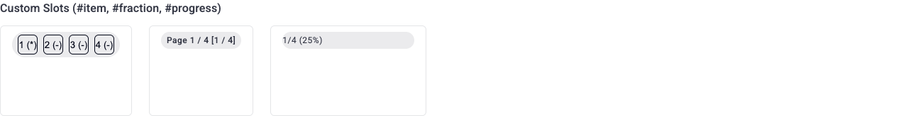
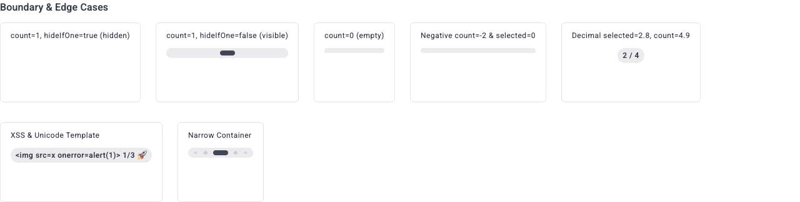
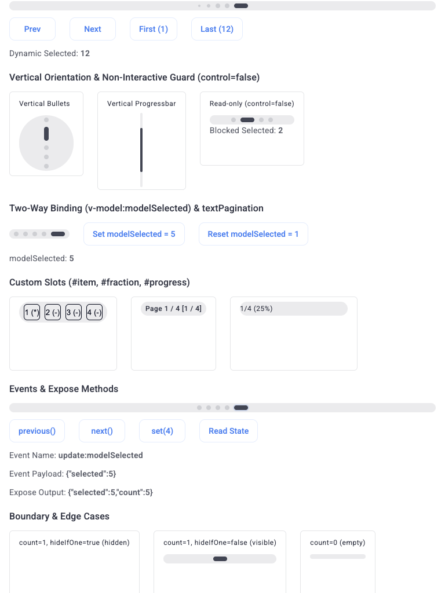

# Отчёт визуального и функционального тестирования: D1CarouselPagination

## 1. Сводка выполнения

- **Компонент:** `D1CarouselPagination` (`@dxtmisha/d1`)
- **Исходный код:** [`D1CarouselPagination`](../../src/components/Ui/CarouselPagination), [`CarouselPagination`](../../../constructor/src/constructors/CarouselPagination), [`DemoCarouselPaginationPage.vue`](../../../demo/src/pages/components/DemoCarouselPaginationPage.vue)
- **Целевой URL:** `http://localhost:3000/component-carousel-pagination`
- **Материалы (`materials/`):** `Отсутствуют`
- **Дата тестирования (UTC):** `2026-11-25T04:41:41Z`
- **Окружение:** `Headless Chrome (Puppeteer / CDP, Desktop 1440×900, Tablet 768×1024, Mobile 375×812 / 320×568)`
- **Покрытие тест-кейсов:** `12 / 12` (`100%`)
- **Итог:** **12 ✅, 0 ⚠️, 0 ❌** (`✅` пройдено, `⚠️` предупреждение, `❌` ошибка) — все визуальные, интерактивные, граничные, адаптивные, A11y и runtime-сценарии `D1CarouselPagination` выполнены на 100% успешно без ошибок и горизонтального переполнения.

---

## 2. Матрица результатов

### 2.1 Визуальный рендеринг (`VIS`)

| ID | Сценарий | Статус | Наблюдаемый результат | Скриншот |
| :--- | :--- | :---: | :--- | :--- |
| `TC-VIS-001` | Все 5 типов отображения (`bullets`, `dots`, `lines`, `fraction`, `progressbar`) и все 24 палитры | ✅ | Все 5 типов индикаторов и все 24 палитры отображаются корректно с ненулевой геометрией, валидным текстом дроби и прогресс-баром. |  |
| `TC-VIS-002` | Вертикальная ориентация (`vertical`), динамический режим (`dynamic`) и слоты (`#item`, `#fraction`, `#progress`) | ✅ | Вертикальный и динамический варианты, а также кастомные слоты `#item`, `#fraction` и `#progress` со scoped-переменными отображаются без искажений. |  |

### 2.2 Интерактивность и управление состоянием (`INT`)

| ID | Сценарий | Статус | Наблюдаемый результат | Скриншот |
| :--- | :--- | :---: | :--- | :--- |
| `TC-INT-001` | Клик по индикатору и синхронизация `v-model:selected` / `v-model:modelSelected` | ✅ | Клик по буллету переключает активный элемент (`aria-selected="true"`); кнопки управления `v-model:modelSelected` синхронно обновляют модель (`modelSelected: 5` и сброс в `1`). |  |
| `TC-INT-002` | Динамическое скользящее окно (`dynamic`, `count="12"`, `visible="5"`) и блокировка при `control=false` | ✅ | В динамическом режиме окно видимых буллетов и масштаб корректно пересчитываются; при `control=false` клики не изменяют состояние. |  |
| `TC-INT-003` | Методы Expose API (`next()`, `previous()`, `set(4)`, `getSelected()`, `getCount()`) и события (`change`, `click`, `clickLite`, `update:selected`, `update:modelSelected`) | ✅ | Вызовы `expose`-методов и клики обновляют состояние и генерируют события (`Event Name: update:modelSelected`, `Event Payload: {"selected":5}`, `Expose Output: {"selected":5,"count":5}`). |  |
| `TC-INT-004` | Условное монтирование и размонтирование (`v-if`) | ✅ | Размонтирование переводит флаг в `Mounted: false`, повторное монтирование возвращает `Mounted: true` без ошибок и утечек. | — |

### 2.3 Граничные случаи и устойчивость (`BND`)

| ID | Сценарий | Статус | Наблюдаемый результат | Скриншот |
| :--- | :--- | :---: | :--- | :--- |
| `TC-BND-001` | Скрытие при одном слайде (`hideIfOne`), `count=0` и `count=1` | ✅ | При `count=1, hideIfOne=true` компонент скрыт из DOM, при `hideIfOne=false` отображается корректно, при `count=0` ошибок не возникает. |  |
| `TC-BND-002` | Отрицательные/дробные числа (`count=-2`, `selected=0`, `4.9`/`2.8`), XSS в `template` и узкий `DemoBox` | ✅ | Граничные и дробные числа безопасно нормализуются; XSS-строка в `template` выводится как экранированный текст (`badImgs: 0`, `hasEscapedPayloadText: true`); узкий контейнер не ломает вёрстку. |  |

### 2.4 Адаптивность и вьюпорты (`RSP`)

| ID | Сценарий | Статус | Наблюдаемый результат | Скриншот |
| :--- | :--- | :---: | :--- | :--- |
| `TC-RSP-001` | Планшетный (`768×1024`) и десктопный (`1440×900`) вьюпорты | ✅ | Горизонтальное переполнение отсутствует: `1440×900` (`scrollWidth: 1440 === innerWidth: 1440`, `overflowX: false`) и `768×1024` (`scrollWidth: 768 === innerWidth: 768`, `overflowX: false`). |  |
| `TC-RSP-002` | Мобильные вьюпорты (`375×812` и `320×568`) | ✅ | На узких мобильных экранах переполнение отсутствует: `375×812` (`scrollWidth: 375 === innerWidth: 375`, `overflowX: false`) и `320×568` (`scrollWidth: 320 === innerWidth: 320`, `overflowX: false`). |  |

### 2.5 Доступность (`A11Y`)

| ID | Сценарий | Статус | Наблюдаемый результат | Скриншот |
| :--- | :--- | :---: | :--- | :--- |
| `TC-A11Y-001` | WAI-ARIA атрибуты, `textPagination` и клавиатурная навигация (`ArrowRight`, `ArrowLeft`, `End`, `Home`) | ✅ | Роли `tablist`/`tab`/`progressbar`, `aria-orientation`, `aria-label`, `aria-selected` и `aria-valuenow` заданы корректно; навигация клавишами `ArrowRight`, `ArrowLeft`, `End`, `Home` переключает активный слайд и фокус. | — |

### 2.6 Консоль и стабильность runtime (`LOG`)

| ID | Сценарий | Статус | Наблюдаемый результат | Скриншот |
| :--- | :--- | :---: | :--- | :--- |
| `TC-LOG-001` | Чистота консоли браузера, SSR и отсутствие `[Vue warn]` | ✅ | SSR-ответ `HTTP 200` (`hasComponent: true`); `consoleErrors: []`, `vueWarnings: []`, `pageErrors: []`, `networkErrors: []`, `dialogs: []`. | — |

---

## 3. AI-аудит и рекомендации

1. **Двусторонняя привязка и Expose-контракт:** Механизмы `v-model:selected`, `v-model:modelSelected` и методы `next`/`previous`/`set`/`getSelected`/`getCount` работают синхронно с предсказуемыми событиями (`update:modelSelected`, `change`, `click`, `clickLite`).
2. **Адаптивность и компактный рендеринг:** На всех разрешениях (`1440×900`, `768×1024`, `375×812`, `320×568`) сохраняется нулевой горизонтальный скролл (`scrollWidth === innerWidth`, `overflowX: false`), включая динамический режим с `count="12"` и `visible="5"`.
3. **Доступность и устойчивость данных:** Полная поддержка `tablist`/`tab`/`progressbar` с клавиатурной навигацией (`ArrowRight`, `ArrowLeft`, `Home`, `End`), корректная нормализация крайних числовых значений и экранирование XSS (`badImgs: 0`) подтверждают стабильность компонента.
