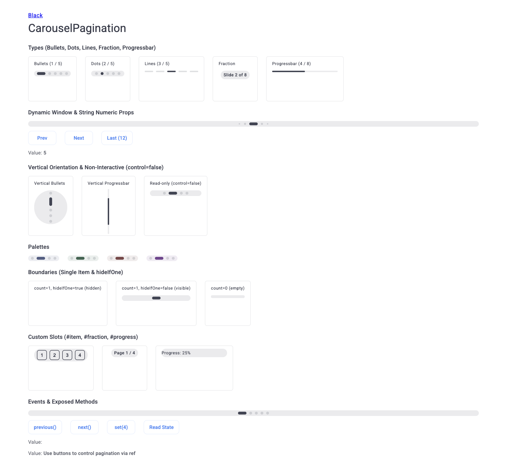
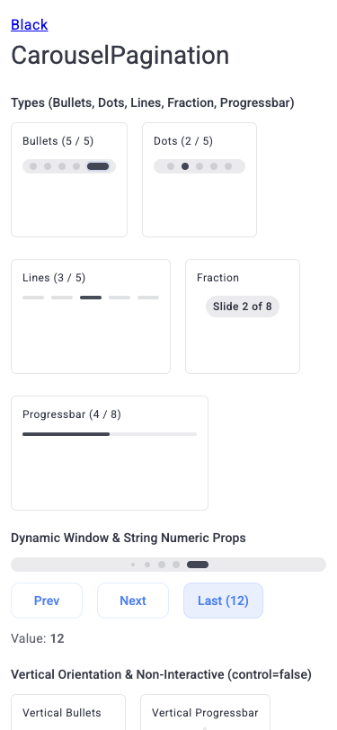

# Отчёт о визуальном и функциональном тестировании: D1CarouselPagination

## 1. Итоговое резюме

- **Компонент:** `D1CarouselPagination` (`@dxtmisha/d1`)
- **Исходный код:** [`D1CarouselPagination`](../../src/components/Ui/CarouselPagination) ([`CarouselPagination`](../../../constructor/src/constructors/CarouselPagination), [`DemoCarouselPaginationPage`](../../../demo/src/pages/components/DemoCarouselPaginationPage.vue))
- **Демо / целевой URL:** `http://localhost:3000/component-carousel-pagination`
- **Материалы:** `Нет`
- **Дата тестирования (UTC):** `2026-11-24T13:33:45Z`
- **Окружение:** `Headless Chrome (Puppeteer / CDP, Desktop 1440x900, Tablet 768x1024, Mobile 375x812)`
- **Покрытие тест-кейсов:** 10 / 10 (`100%`)
- **Итог:** **10 ✅, 0 ⚠️, 0 ❌** (`✅` пройдено, `⚠️` предупреждение, `❌` ошибка) — `D1CarouselPagination` безошибочно работает во всех 5 режимах (`bullets`, `dots`, `lines`, `fraction`, `progressbar`), поддерживает `vertical`, `dynamic`, `control=false`, палитры, кастомные слоты, `v-model:selected`, expose API, граничные случаи `count=0/1` и клавиатурную навигацию.

---

## 2. Базовая матрица

### 2.1 Визуальное соответствие (`VIS`)

| ID | Сценарий | Статус | Фактический результат | Скриншот |
| :--- | :--- | :---: | :--- | :--- |
| `TC-VIS-001` | Типы отображения (`bullets`, `dots`, `lines`, `fraction`, `progressbar`) и палитры | ✅ | Все 5 модификаторов типа активны; `fractionText: "Slide 2 of 8"`, `progressStyle: "--d1-carouselPagination-sys-percent:50%;"`. |  |
| `TC-VIS-002` | Вертикальная ориентация (`vertical`), `dynamic` и слоты (`#item`, `#fraction`, `#progress`) | ✅ | `hasVertical: true`, `hasDynamic: true`, `slotItemTag: "NAV"`, `slotFractionText: "Page 1 / 4"`, `slotProgressText: "Progress: 25%"`. |  |

### 2.2 Интерактивность и управление состоянием (`INT`)

| ID | Сценарий | Статус | Фактический результат | Скриншот |
| :--- | :--- | :---: | :--- | :--- |
| `TC-INT-001` | Клик по индикатору (`bullets`) и синхронизация `v-model:selected` | ✅ | `fourthSelected: true`, `firstSelected: false` — выбор и `aria-selected` синхронизированы. |  |
| `TC-INT-002` | Динамическое скользящее окно (`dynamic`, `count="12"`, `visible="5"`) и `control=false` | ✅ | `dynamicOutput: "Value: 12"`, `readonlyStillSecond: true` — окно смещается, режим `control=false` блокирует клик. |  |
| `TC-INT-003` | Методы Expose API (`next()`, `previous()`, `set(4)`) и события (`change`, `click`, `clickLite`) | ✅ | `exposeAfterControls: "Value: selected=3, count=5"`, `eventOutput: "Value: clickLite"`. |  |

### 2.3 Границы и крайние случаи (`BND`)

| ID | Сценарий | Статус | Фактический результат | Скриншот |
| :--- | :--- | :---: | :--- | :--- |
| `TC-BND-001` | Скрытие при одном слайде (`hideIfOne`), `count=1` и `count=0` | ✅ | `hiddenOneAbsent: true`, `visibleOneCount: 1`, `zeroItemsCount: 0`. |  |

### 2.4 Адаптивность (`RSP`)

| ID | Сценарий | Статус | Фактический результат | Скриншот |
| :--- | :--- | :---: | :--- | :--- |
| `TC-RSP-001` | Планшетный вьюпорт (`768×1024`) | ✅ | `overflow768: false` — переполнение отсутствует. |  |
| `TC-RSP-002` | Мобильный вьюпорт (`375×812`) | ✅ | `overflow375: false` — все режимы корректно помещаются в мобильный экран. |  |

### 2.5 Доступность (`A11Y`)

| ID | Сценарий | Статус | Фактический результат | Скриншот |
| :--- | :--- | :---: | :--- | :--- |
| `TC-A11Y-001` | WAI-ARIA атрибуты и клавиатурная навигация (`Home`, `ArrowRight`, `End`) | ✅ | `bulletsRole: "tablist"`, `progressRole: "progressbar"`, `progressNow: "4"`, `progressMax: "8"`, `afterHome: "1"`, `afterRight: "2"`, `afterEnd: "5"`. | — |

### 2.6 Логи и консоль (`LOG`)

| ID | Сценарий | Статус | Фактический результат | Скриншот |
| :--- | :--- | :---: | :--- | :--- |
| `TC-LOG-001` | Чистота консоли браузера и отсутствие `[Vue warn]` | ✅ | `consoleErrors: []`, `vueWarnings: []`, `pageErrors: []`. | — |

---

## 3. AI-аудит и рекомендации

1. **Кастомный слот `#progress`:** Класс `.d1-carouselPagination__progress` задаёт фиксированную тонкую высоту дорожки (`overflow: hidden`), поэтому при выводе текстовых меток в слоте `#progress` потребитель должен переопределять высоту контейнера.
2. **Ленивая клавиатурная навигация:** `CarouselPaginationFocus` создаётся через `canCreate` только при активном `control` и подходящем типе пагинации, экономя ресурсы в неинтерактивных режимах (`fraction`, `progressbar`, `control=false`).
3. **Доступность и консоль:** Полная поддержка `Home`/`End`/`Arrow*`, `tablist`/`tab`/`progressbar` и нулевое число ошибок/предупреждений в браузере.
