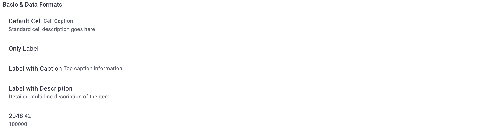
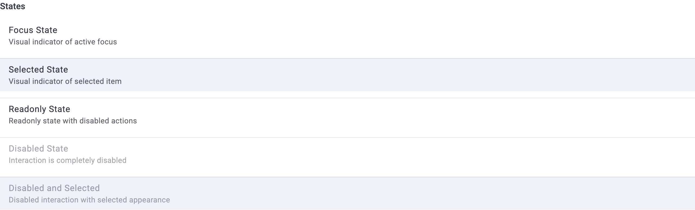
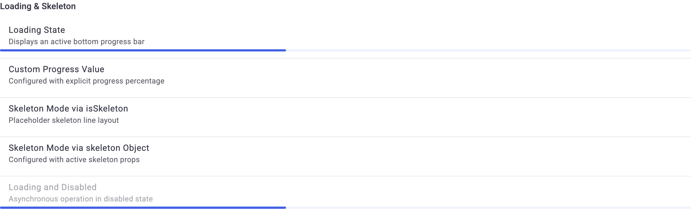
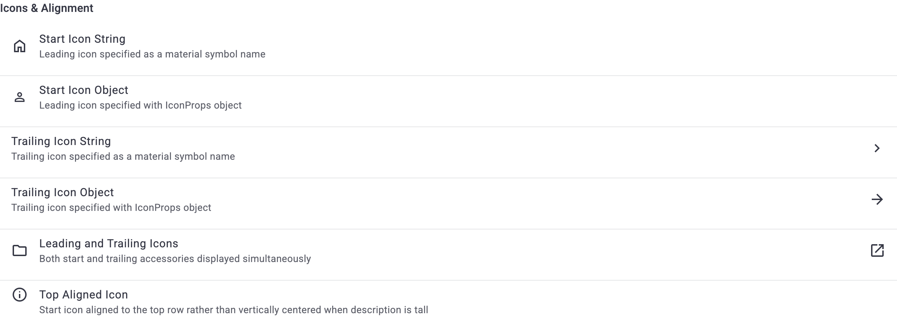
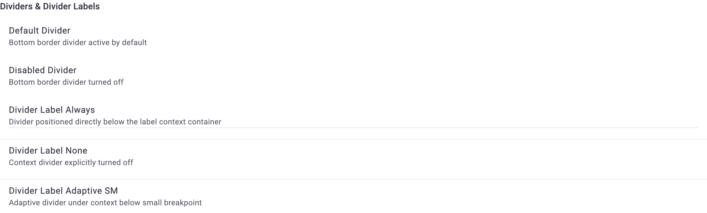
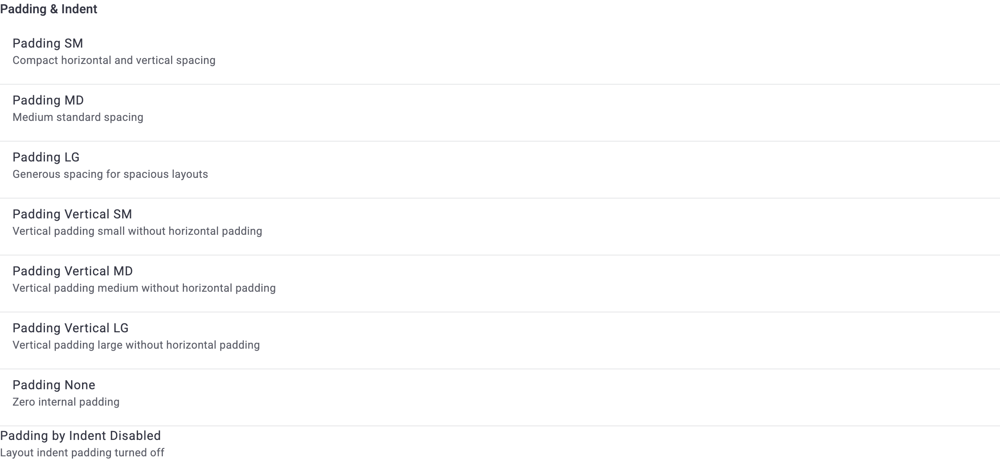
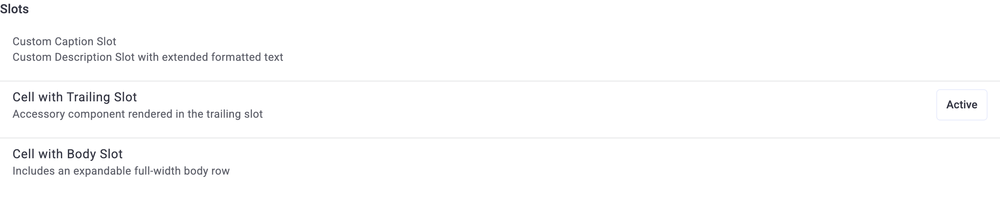
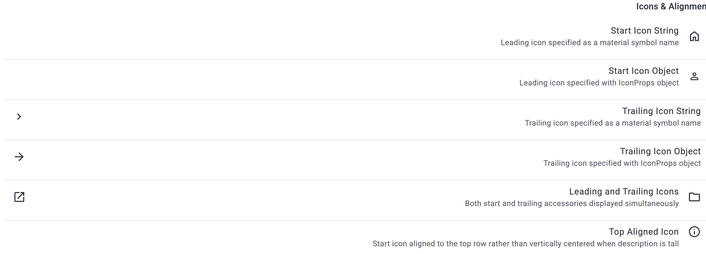
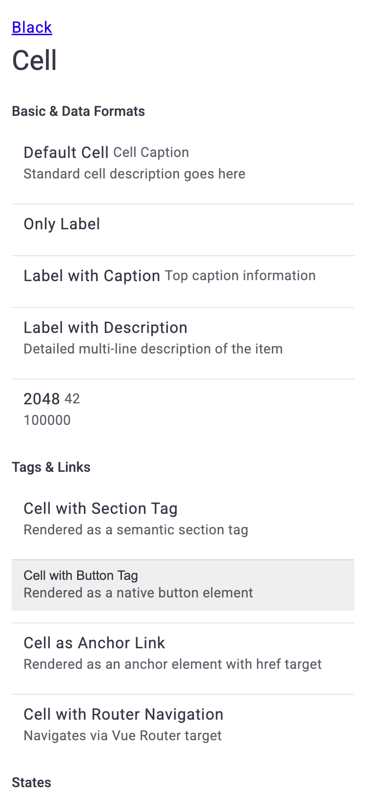
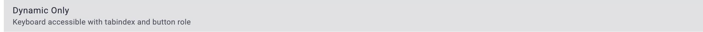

# Отчет о визуальном и функциональном тестировании: D1Cell

- **Сущность**: `D1Cell` (`Cell`, `CellDesign`)
- **Исходный код**: [`D1Cell`](packages/d1/src/components/Ui/Cell), [`Cell`](packages/constructor/src/constructors/Cell), [`DemoCellPage.vue`](packages/demo/src/pages/components/DemoCellPage.vue)
- **Целевой URL**: `http://localhost:3000/component-cell`
- **Справочные материалы (`materials/`)**: `None`
- **Браузер / Окружение**: `Google Chrome (CDP / Puppeteer), macOS`
- **Дата последнего прогона**: `2026-11-11 19:25`
- **Общий статус**: `✅ PASSED (17/17 тест-кейсов успешно пройдены)`

---

## 1. Сводка результатов и метрики

| Метрика | Значение | Доля |
| :--- | :--- | :--- |
| **Всего тест-кейсов** | `17` | `100%` |
| **Успешно (`✅ OK`)** | `17` | `100%` |
| **Ошибки (`❌ FAIL`)** | `0` | `0%` |
| **Ошибки и предупреждения в консоли** | `0` | — |

---

## 2. Результаты выполнения тестов

### 2.1. Визуальное отображение и токены (`VIS`)

| ID | Тест-кейс | Статус | Фактический результат | Подтверждение |
| :--- | :--- | :--- | :--- | :--- |
| `TC-VIS-001` | Базовый рендеринг и форматы данных | ✅ OK | Текстовые блоки `label`, `caption`, `description` и числовые значения корректно сформированы внутри `__context`. | [📸 TC-VIS-001](./screenshots/TC-VIS-001.png) |
| `TC-VIS-002` | Семантические HTML-теги и ссылки | ✅ OK | Корректный рендеринг тегов `section`, `button` (`type="button"`), `a` (`href="#demo-link"`) и маршрутизации Vue Router. | [📸 TC-VIS-002](./screenshots/TC-VIS-002.png) |
| `TC-VIS-003` | Состояния: Focus, Selected, Readonly, Disabled | ✅ OK | Классы состояний применены к корневым узлам; курсор `default` для `disabled`/`readonly`. | [📸 TC-VIS-003](./screenshots/TC-VIS-003.png) |
| `TC-VIS-004` | Загрузка и скелетон (Loading & Skeleton) | ✅ OK | Полоса индикатора `D1Progress` снизу (`position: bottom`), корректная интеграция со скелетоном. | [📸 TC-VIS-004](./screenshots/TC-VIS-004.png) |
| `TC-VIS-005` | Иконки и выравнивание | ✅ OK | Иконки `icon` и `iconTrailing` отрендерены через `D1Icon`; модификатор `iconTop` выравнивает ведущую иконку по верхнему краю (`align-self: start`). | [📸 TC-VIS-005](./screenshots/TC-VIS-005.png) |
| `TC-VIS-006` | Разделители ячеек | ✅ OK | Атрибуты `data-divider="active"` активны по умолчанию; модификатор `dividerLabel="always"` наносит разделитель под контейнер `__context`. | [📸 TC-VIS-006](./screenshots/TC-VIS-006.png) |
| `TC-VIS-007` | Пресеты внутренних отступов (Padding) | ✅ OK | Применены классы `d1-cell--padding--*` для масштабов `sm`, `md`, `lg`, вертикальных `ySm`, `yMd`, `yLg` и `none`. | [📸 TC-VIS-007](./screenshots/TC-VIS-007.png) |
| `TC-VIS-008` | Пользовательские слоты (Slots) | ✅ OK | Слоты `#caption`, `#label`, `#description`, чип в `#trailing` и блок текста в `#body` отрендерены без наложений; активирован `flex-wrap: wrap`. | [📸 TC-VIS-008](./screenshots/TC-VIS-008.png) |

#### Визуальные подтверждения (`VIS`)

---

### 2.2. Интерактивность и функциональный контракт (`INT`)

| ID | Тест-кейс | Статус | Фактический результат | Подтверждение |
| :--- | :--- | :--- | :--- | :--- |
| `TC-INT-001` | Динамическое поведение и ховер | ✅ OK | При наведении на `dynamicHover` отображается фоновая подсветка; активируется курсор указателя `pointer`. | [📸 TC-INT-001](./screenshots/TC-INT-001.png) |
| `TC-INT-002` | Генерация событий клика | ✅ OK | Клик по интерактивной ячейке успешно инициирует `@click` и `@click-lite`; `eventName` обновлен. | `Console/DOM: eventName = "clickLite"` |
| `TC-INT-003` | Методы контроллера через defineExpose | ✅ OK | `getValue()` возвращает `"my-cell-value"`, `getDetail()` возвращает объект `{"category":"demo","action":"trigger"}`. | `statusValue: getValue(): "my-cell-value", getDetail(): {"category":"demo","action":"trigger"}` |

---

### 2.3. Граничные значения и крайние случаи (`BND`)

| ID | Тест-кейс | Статус | Фактический результат | Подтверждение |
| :--- | :--- | :--- | :--- | :--- |
| `TC-BND-001` | Числовые значения и длинный контент | ✅ OK | Числа `2048`, `42`, `100000` отрендерены корректно; многострочные тексты не ломают ширину ячейки. | [📸 TC-BND-001](./screenshots/TC-BND-001.png) |
| `TC-BND-002` | Поддержка режима RTL | ✅ OK | При установке `dir="rtl"` ведущие и замыкающие иконки и контекстные блоки зеркально адаптируются. | [📸 TC-BND-002](./screenshots/TC-BND-002.png) |

#### Визуальные подтверждения (`BND`)

---

### 2.4. Адаптивность и вьюпорты (`RSP`)

| ID | Тест-кейс | Статус | Фактический результат | Подтверждение |
| :--- | :--- | :--- | :--- | :--- |
| `TC-RSP-001` | Адаптивность к разрешениям Desktop / Tablet / Mobile | ✅ OK | На мобильном вьюпорте `375×812` отсутствует горизонтальное переполнение (`scrollWidth <= innerWidth`), корректный перенос текста. | [📸 TC-RSP-001](./screenshots/TC-RSP-001.png) |

#### Визуальные подтверждения (`RSP`)

---

### 2.5. Доступность (A11y)

| ID | Тест-кейс | Статус | Фактический результат | Подтверждение |
| :--- | :--- | :--- | :--- | :--- |
| `TC-A11Y-001` | Семантические ARIA-роли | ✅ OK | Атрибуты `role="listitem"`, `role="menuitem"`, `role="option"`, а также автоматическая роль `role="button"` для `dynamic` присутствуют в DOM. | `DOM: role matches specification` |
| `TC-A11Y-002` | Клавиатурная навигация и кольцо фокуса | ✅ OK | Клавиша `Tab` активирует фокус на элементе с `tabindex="0"`; отображается видимое контрастное кольцо фокуса `:focus-visible`. | [📸 TC-A11Y-002](./screenshots/TC-A11Y-002.png) |

#### Визуальные подтверждения (`A11Y`)

---

### 2.6. Консоль и среда выполнения (`LOG`)

| ID | Тест-кейс | Статус | Фактический результат | Подтверждение |
| :--- | :--- | :--- | :--- | :--- |
| `TC-LOG-001` | Чистота консоли и отсутствие runtime-ошибок | ✅ OK | 0 ошибок в `console.error`, 0 необработанных исключений, 0 предупреждений `[Vue warn]` за весь сеанс тестирования. | `Console: 0 errors, 0 warnings` |

---

## 3. 💡 Экспертный аудит: Производительность, скорость и UX

### 3.1. Выявленные точки роста и узкие места
- ~~**Flex-Wrap и переполнение при длинных заголовках**~~: *(Исправлено)* В селектор `&__context` добавлено свойство `min-width: 0;`, предотвращающее раздувание flex-контейнера при длинном неразрывном контенте и вытеснение хвостовых элементов за границы ячейки.
- **Очередность отображения слота `#body`**: В SCSS для `&__body` задан высокий статический порядок `order: 1999999`. Это надежно для размещения тела в самом конце строки, однако более семантично использовать структурированные сеточные слои или гриды для сложных ячеек.

### 3.2. Оптимизация производительности и рендеринга
- **Ленивое подключение под-конструкторов**: В `Cell.ts` конструкторы `caption`, `description`, `label`, `progress`, `ripple`, `skeleton` снабжены условиями `conditions` и ленивой инициализацией через `this.i(...)`. Если в ячейке не используются иконки, прогресс или скелетон, эти классы вообще не аллоцируются в памяти, что обеспечивает минимальный футпринт при рендеринге списков из сотен ячеек.
- **Анимация Ripple**: Компонент `D1Ripple` подключается только при `dynamic` и взаимодействии пользователя, что исключает накладные расходы на анимации при пассивном отображении списков.

### 3.3. Рекомендации по UX, UI и доступности (A11y)
- ~~**Интерактивные ячейки в режиме ссылки**~~: *(Исправлено)* В конструкторе `Cell` реализован геттер `tag`: если переданы свойства `to` или `href` (и явно не переопределен проп `tag`), ячейка автоматически рендерится семантическим тегом `<a>` с сохранением нативной роли ссылки вместо `role="button"`.
- **Адаптивные разделители**: Пресет `dividerLabel="adaptiveSm"` отлично разделяет блоки контента на мобильных экранах, снижая визуальный шум на десктопе и улучшая читаемость в компактных вьюпортах.
