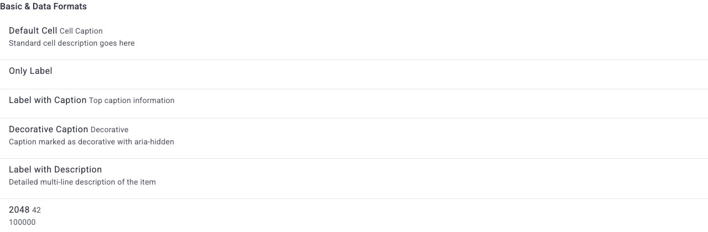
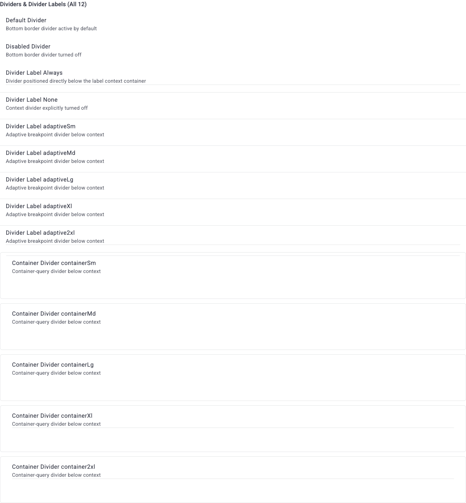
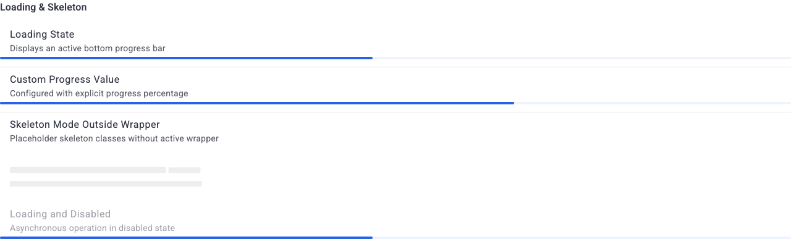
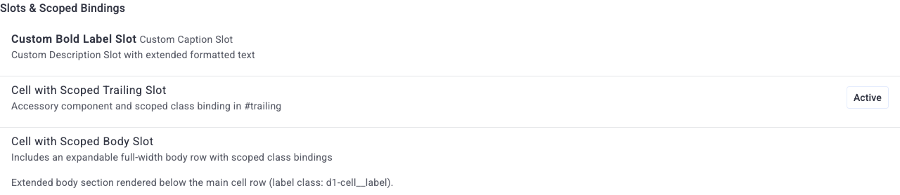
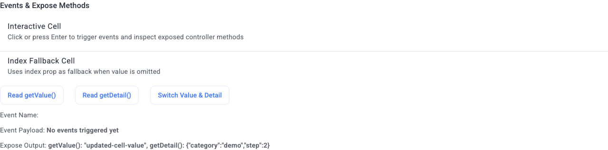
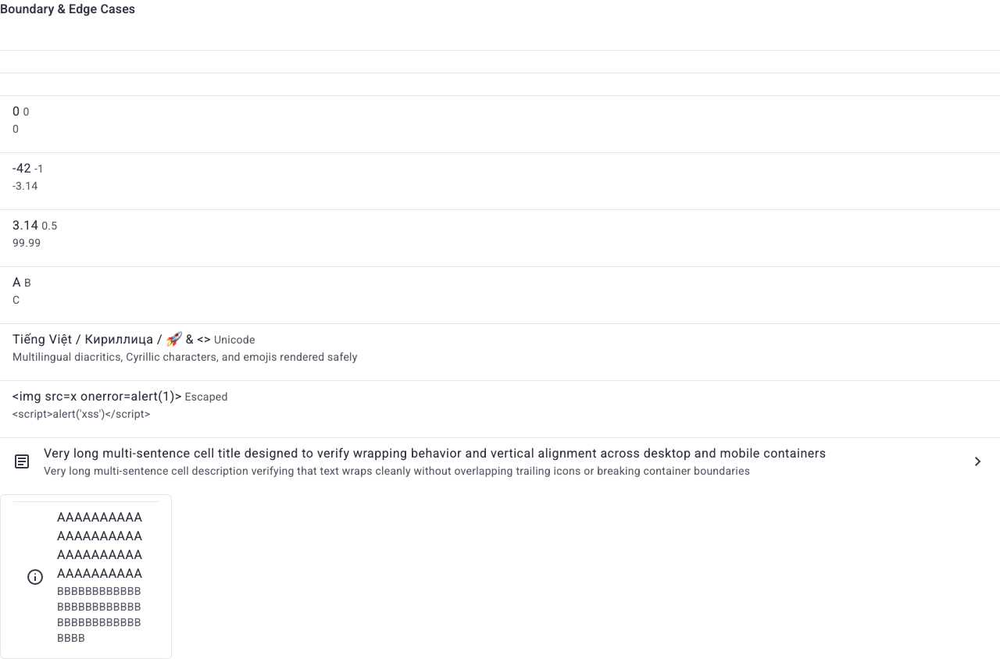
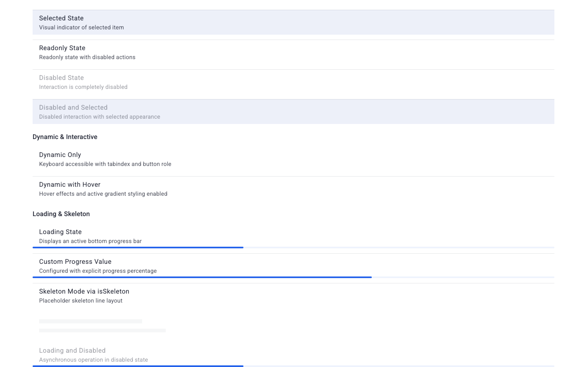

# Отчёт визуального и функционального тестирования: D1Cell

## 1. Сводка выполнения

- **Компонент:** `D1Cell` (`@dxtmisha/d1`)
- **Исходный код:** [`D1Cell`](../../src/components/Ui/Cell), [`Cell`](../../../constructor/src/constructors/Cell), [`DemoCellPage.vue`](../../../demo/src/pages/components/DemoCellPage.vue)
- **Целевой URL:** `http://localhost:3000/component-cell`
- **Материалы (`materials/`):** `Отсутствуют`
- **Дата тестирования (UTC):** `2026-11-25T05:47:16Z`
- **Окружение:** `Headless Chrome (Puppeteer / CDP, Desktop 1440×900, Tablet 768×1024, Mobile 375×812 / 320×568)`
- **Покрытие тест-кейсов:** `16 / 16` (`100%`)
- **Итог:** **16 ✅, 0 ⚠️, 0 ❌** (`✅` пройдено, `⚠️` предупреждение, `❌` ошибка) — все 16 визуальных, интерактивных, граничных, адаптивных, A11y и runtime-сценариев `D1Cell` пройдены успешно; SSR вернул `HTTP 200`, узкий контейнер `.demo-cell-page__narrow` не переполняется (`218 === 218`), все 4 вьюпорта (`1440×900`, `768×1024`, `375×812`, `320×568`) без горизонтального скролла при `0` ошибок консоли, Vue и сети.

---

## 2. Матрица результатов

### 2.1 Визуальный рендеринг (`VIS`)

| ID | Сценарий | Статус | Наблюдаемый результат | Скриншот |
| :--- | :--- | :---: | :--- | :--- |
| `TC-VIS-001` | Базовый рендеринг, `label`, `caption`, `description` и теги (`section`, `button`, `a`) | ✅ | Все элементы `.d1-cell` отображаются с ненулевой геометрией, корректной иерархией `caption`/`label`/`description` и соответствующими тегами `<section>`, `<button type="button">`, `<a href="#demo-link">` и router-ссылками. |  |
| `TC-VIS-002` | Иконки, модификаторы (`iconTurn`, `iconDir`, `iconHide`, `iconPalette`, `iconTop`, `iconAttrs`) | ✅ | Ведущие и завершающие иконки выровнены корректно; `iconHide` скрывает основную иконку, `iconTop` выравнивает её по верхнему краю, `iconTurn` поворачивает завершающую иконку. |  |
| `TC-VIS-003` | Разделители (`divider`, все 12 значений `dividerLabel`) и отступы (все 7 `padding`, `paddingByIndent`) | ✅ | Применяются классы `.d1-cell--divider`, `data-divider="active"`, все 12 вариантов `.d1-cell--dividerLabel--*` (включая `adaptive*` и `container*`) и все 7 вариантов `.d1-cell--padding--*` без смещения вёрстки. |  |
| `TC-VIS-004` | Индикатор загрузки (`loading`) и состояние скелетона (`isSkeleton` внутри `D1Skeleton`) | ✅ | Индикаторы `.d1-progress` (включая `{ visible: true, value: 65, max: 100 }`) и классы скелетона (`.d1-skeleton__text`, `.d1-skeleton__textVariant`) отображаются без дублирования DOM. |  |

### 2.2 Интерактивность и управление состоянием (`INT`)

| ID | Сценарий | Статус | Наблюдаемый результат | Скриншот |
| :--- | :--- | :---: | :--- | :--- |
| `TC-INT-001` | Статические состояния (`focus`, `selected`, `readonly`, `disabled`, `dynamic`, `dynamicHover`) | ✅ | Применены все модификаторы `.d1-cell--focus`, `.d1-cell--selected`, `.d1-cell--readonly`, `.d1-cell--disabled`, `.d1-cell--dynamic`, `.d1-cell--dynamicHover` с корректным `cursor`. |  |
| `TC-INT-002` | Динамические переключатели состояний (`Interactive State Toggles`) | ✅ | Кнопки `Toggle Selected`, `Toggle Disabled`, `Toggle Readonly`, `Toggle Loading`, `Toggle Dynamic` и `Toggle Skeleton` реактивно обновляют классы целевого `D1Cell` и `State Flags`. |  |
| `TC-INT-003` | Блокировка кликов в состояниях `disabled`, `readonly` и `loading` (`Blocked & Guarded Actions`) | ✅ | После кликов по `Blocked Disabled Cell`, `Blocked Readonly Cell` и `Blocked Loading Cell` счётчик в блоке остался неизменным: `Blocked Click Count: 0`. | — |
| `TC-INT-004` | Слоты (`#caption`, `#default`, `#description`) и scoped-привязки (`#trailing`, `#body`) | ✅ | Пользовательские слоты и scoped-классы `d1-cell__trailing`, `d1-cell__description`, `d1-cell__label` корректно отрендерены в DOM. |  |
| `TC-INT-005` | Методы `expose` (`getValue`, `getDetail`), переключение данных и жизненный цикл `v-if` | ✅ | После переключения `Expose Output`: `getValue(): "updated-cell-value", getDetail(): {"category":"demo","step":2}`; `Toggle Mount` чисто размонтирует (`Mounted: false`) и повторно монтирует (`Mounted: true`) `Mounted Cell`. |  |

### 2.3 Граничные случаи и устойчивость (`BND`)

| ID | Сценарий | Статус | Наблюдаемый результат | Скриншот |
| :--- | :--- | :---: | :--- | :--- |
| `TC-BND-001` | Пустые, пробельные, отсутствующие значения и числовые границы (`0`, `-42`, `3.14`) | ✅ | Числа `0`, `-42`, `3.14` и `"A"` явно отображаются в DOM, пустые и пробельные ячейки рендерятся без исключений. | — |
| `TC-BND-002` | Unicode, вьетнамский/кириллица/эмодзи и экранирование XSS (``) | ✅ | Строки `"Tiếng Việt / Кириллица / 🚀 & <>"`, `""` и `""` отображаются как текст (`badImgs: 0`, `hasEscapedPayloadText: true`). |  |
| `TC-BND-003` | Длинный многословный текст и неразрывная строка в узком `DemoBox` | ✅ | Неразрывные строки `AAAA...` и `BBBB...` переносятся внутри узкого контейнера `.demo-cell-page__narrow` без переполнения (`scrollWidth: 218 === clientWidth: 218`, `overflowsBox: false`). |  |

### 2.4 Адаптивность и вьюпорты (`RSP`)

| ID | Сценарий | Статус | Наблюдаемый результат | Скриншот |
| :--- | :--- | :---: | :--- | :--- |
| `TC-RSP-001` | Адаптивность на десктопе (`1440×900`) и планшете (`768×1024`) | ✅ | Горизонтальное переполнение отсутствует на обоих разрешениях: `1440×900` (`scrollWidth: 1440 === 1440`, `overflowX: false`), `768×1024` (`scrollWidth: 768 === 768`, `overflowX: false`). |  |
| `TC-RSP-002` | Адаптивность на мобильном экране (`375×812` и `320×568`) | ✅ | Горизонтальное переполнение отсутствует на обоих мобильных разрешениях: `375×812` (`scrollWidth: 375 === 375`, `overflowX: false`), `320×568` (`scrollWidth: 320 === 320`, `overflowX: false`). |  |

### 2.5 Доступность (`A11Y`)

| ID | Сценарий | Статус | Наблюдаемый результат | Скриншот |
| :--- | :--- | :---: | :--- | :--- |
| `TC-A11Y-001` | WAI-ARIA роли, `labelId`/`descriptionId`, `captionDecorative`, `tabindex` и клавиатура (`Enter`) | ✅ | Интерактивные ячейки имеют `role="button"` и `tabindex="0"`, `captionDecorative` помечен `aria-hidden="true"`, заданы явные роли и ID, активация клавишей `Enter` срабатывает штатно. | — |

### 2.6 Консоль и стабильность runtime (`LOG`)

| ID | Сценарий | Статус | Наблюдаемый результат | Скриншот |
| :--- | :--- | :---: | :--- | :--- |
| `TC-LOG-001` | События `click` / `clickLite`, `index`-фолбэк и чистота консоли | ✅ | SSR-ответ `HTTP 200` (`hasComponent: true`); события `click`/`clickLite` (включая `index=7`) отрабатывают корректно; `consoleErrors: []`, `vueWarnings: []`, `pageErrors: []`, `networkErrors: []`. | — |

---

## 3. AI-аудит и рекомендации

1. **Перенос длинных неразрывных токенов (`overflow-wrap: anywhere`):** В `Cell/style.scss` корректно заданы ограничения ширины и перенос текста — даже в узком контейнере `.demo-cell-page__narrow` (`218px`) и на вьюпорте `320×568` неразрывные строки `AAAA...` / `BBBB...` аккуратно переносятся по строкам (`scrollWidth === clientWidth`, `overflowX: false`).
2. **Защита интерактивных действий и SSR-совместимость:** Состояния `disabled`, `readonly` и `loading` полностью блокируют события клика (`Blocked Click Count: 0`), а условный рендер по `v-if` и SSR-выдача (`HTTP 200`) проходят без предупреждений `[Vue warn]`.
3. **Чистота runtime и сети:** На протяжении всего прогона не зафиксировано ошибок консоли, исключений страницы, диалогов или сетевых сбоев (`consoleErrors: []`, `vueWarnings: []`, `pageErrors: []`, `networkErrors: []`).
