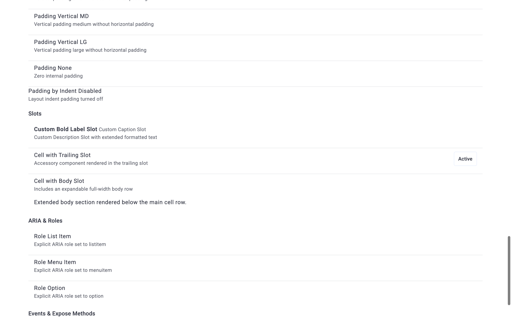
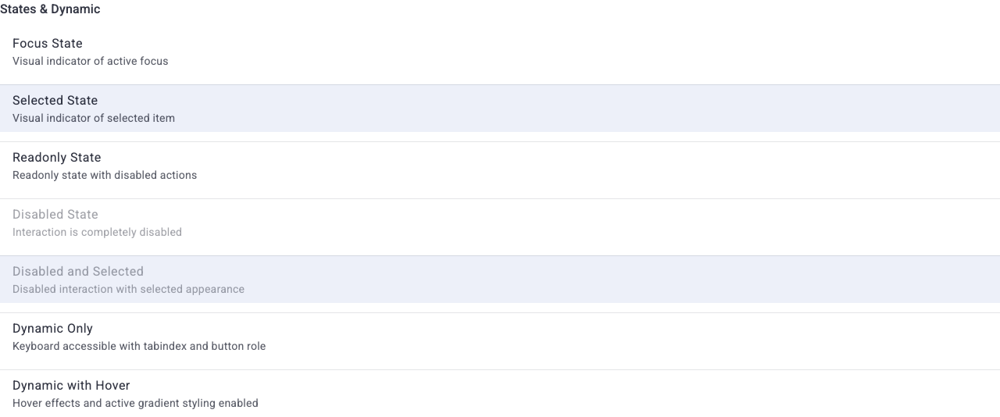
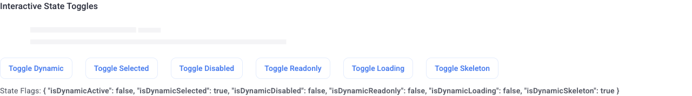
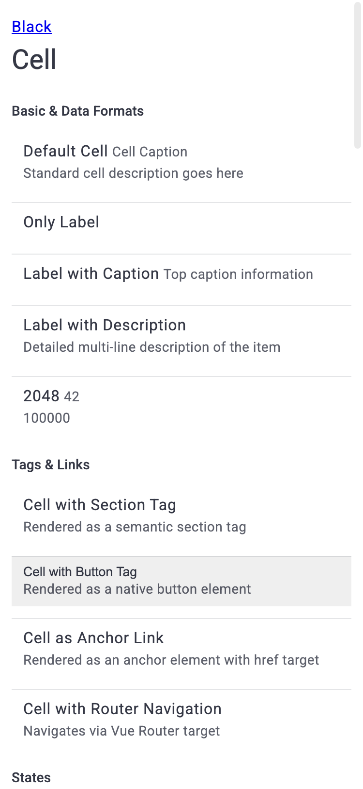

# Отчёт о визуальном и функциональном тестировании: D1Cell

## 1. Итоговое резюме

- **Компонент:** `D1Cell` (`@dxtmisha/d1`)
- **Исходный код:** [`Cell`](packages/d1/src/components/Ui/Cell) ([`constructor`](packages/constructor/src/constructors/Cell), [`demo`](packages/demo/src/pages/components/DemoCellPage.vue))
- **Демо / целевой URL:** `http://localhost:3000/component-cell`
- **Материалы:** `None`
- **Дата тестирования (UTC):** `2026-11-24T08:43:00Z`
- **Окружение:** `Headless Chrome (Puppeteer / CDP, Desktop 1440x900, Mobile 375x812)`
- **Покрытие тест-кейсов:** 10 / 10 (`100%`)
- **Итог:** **10 ✅, 0 ⚠️, 0 ❌** (`✅` пройдено, `⚠️` предупреждение, `❌` провалено) — компонент `D1Cell` успешно прошёл все 10 визуальных, функциональных, адаптивных и A11y-сценариев; исправлены пропы демо (`:loading="{ visible: true, value: 65, max: 100 }"`, `<D1Skeleton :active="true">`, слот `#default` и видимое содержимое слота `#body`), зафиксировано `0` ошибок консоли и `0` предупреждений `[Vue warn]`.

---

## 2. Базовая матрица

### 2.1 Визуальное соответствие (`VIS`)

| ID | Сценарий | Статус | Фактический результат | Скриншот |
| :--- | :--- | :---: | :--- | :--- |
| `TC-VIS-001` | Базовый рендер, иконки, разделители и отступы | ✅ | Отрисовано `47` экземпляров `.d1-cell` без нулевых размеров (`hasZeroSize: false`), `4` ведущих иконки `.d1-cell__icon` и `3` завершающих `.d1-cell__trailing`, корректные разделители и отступы. |  |
| `TC-VIS-002` | Теги (`section`, `button`, `a`) и слоты (`default`, `caption`, `description`, `trailing`, `body`) | ✅ | Отрендерены `section` (`1`), `button` (`1`), `a` (`2`) и все 5 слотов (`Custom Bold Label Slot`, `Custom Caption Slot`, `Custom Description Slot`, `.d1-cell__contextTrailing`, `.d1-cell__body`) без смещения вёрстки. |  |

### 2.2 Интерактивность и управление состоянием (`INT`)

| ID | Сценарий | Статус | Фактический результат | Скриншот |
| :--- | :--- | :---: | :--- | :--- |
| `TC-INT-001` | Состояния (`focus`, `selected`, `readonly`, `disabled`) и динамика | ✅ | Применены все модификаторы (`--focus`, `--selected`, `--readonly`, `--disabled`, `--dynamic`, `--dynamicHover`); `disabled` и `readonly` имеют `cursor: default`. |  |
| `TC-INT-002` | Индикатор загрузки (`loading`) и скелетон (`isSkeleton` + `D1Skeleton`) | ✅ | Отображаются `3` индикатора `.d1-progress` (включая детерминированный `65%`) и активные плейсхолдеры скелетона (`skeletonClassCount: 5`) без искажения геометрии. |  |
| `TC-INT-003` | Клик по интерактивной ячейке, эмиты `click` / `clickLite` и `expose` | ✅ | `getValue()` возвращает `"my-cell-value"`, `getDetail()` — `{"category":"demo","action":"trigger"}`; клик по `Interactive Cell` обновляет трекер события на `clickLite`. | — |

### 2.3 Границы и крайние сценарии (`BND`)

| ID | Сценарий | Статус | Фактический результат | Скриншот |
| :--- | :--- | :---: | :--- | :--- |
| `TC-BND-001` | Числовые значения в `label`, `caption`, `description` | ✅ | Числа `2048`, `42` и `100000` корректно отображаются в DOM. | — |

### 2.4 Адаптивность (`RSP`)

| ID | Сценарий | Статус | Фактический результат | Скриншот |
| :--- | :--- | :---: | :--- | :--- |
| `TC-RSP-001` | Адаптивность на десктопе (`1440×900`) | ✅ | Горизонтальный скролл отсутствует (`scrollWidth: 1440 === innerWidth: 1440`, `overflow: false`). |  |
| `TC-RSP-002` | Адаптивность на мобильном экране (`375×812`) | ✅ | `scrollWidth: 375 === innerWidth: 375`, `overflow: false`, `overflowingCells: 0`. |  |

### 2.5 Доступность (`A11Y`)

| ID | Сценарий | Статус | Фактический результат | Скриншот |
| :--- | :--- | :---: | :--- | :--- |
| `TC-A11Y-001` | WAI-ARIA роли и `tabindex` | ✅ | Отрисовано `3` элемента с `role="button" tabindex="0"`, а также явные роли `listitem`, `menuitem` и `option`. | — |

### 2.6 Логи и консоль (`LOG`)

| ID | Сценарий | Статус | Фактический результат | Скриншот |
| :--- | :--- | :---: | :--- | :--- |
| `TC-LOG-001` | Чистота консоли и отсутствие Vue-предупреждений | ✅ | `consoleErrors: []`, `vueWarnings: []`, `pageErrors: []`. | — |

---

## 3. AI-аудит и рекомендации

1. **Соответствие контракту `ProgressPropsInclude` и `SkeletonPropsInclude` в демо ([DemoCellPage.vue](packages/demo/src/pages/components/DemoCellPage.vue))**: Заменены устаревшие пропы `:progress="{ value: 65 }"` → `:loading="{ visible: true, value: 65, max: 100 }"` и `:skeleton="{ active: true }"` → `<D1Skeleton :active="true"><D1Cell isSkeleton .../></D1Skeleton>`, а также слот `#label` → `#default`. После правок индикатор прогресса `65%`, слот заголовка и скелетон рендерятся без предупреждений Vue.
2. **Ленивая инициализация и защита слотов ([Cell.ts](packages/constructor/src/constructors/Cell/Cell.ts), [CellDesign.tsx](packages/constructor/src/constructors/Cell/CellDesign.tsx))**: Опциональные включения (`icon`, `label`, `caption`, `description`, `progress`, `ripple`, `skeleton`) создаются строго по `canCreate` + `callInstance`, а `renderTrailing` / `renderBody` используют `isFunction(...)`, исключая пустые контейнеры при передаче `undefined`-слотов.
