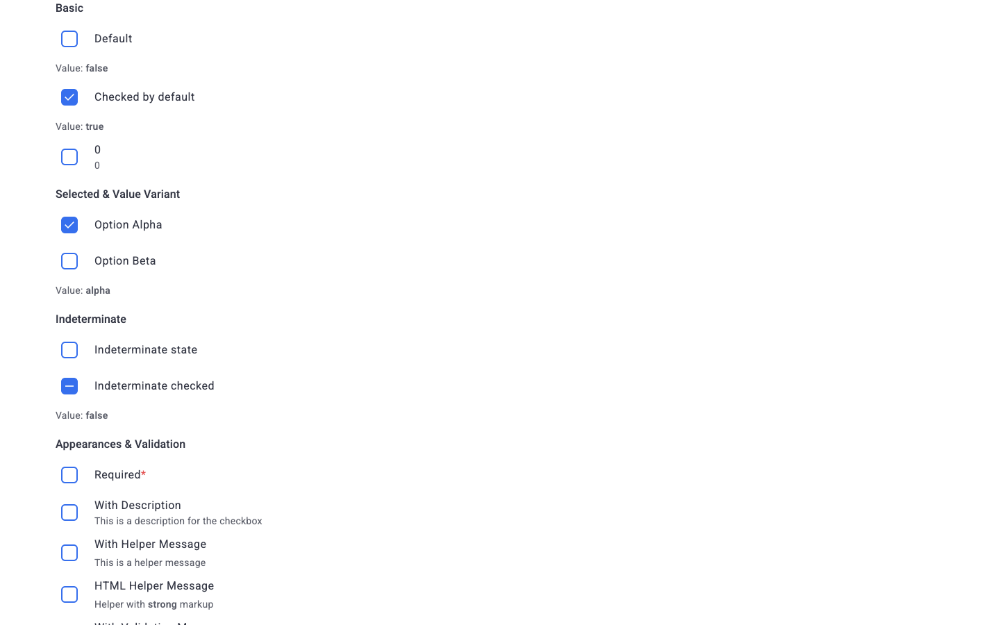
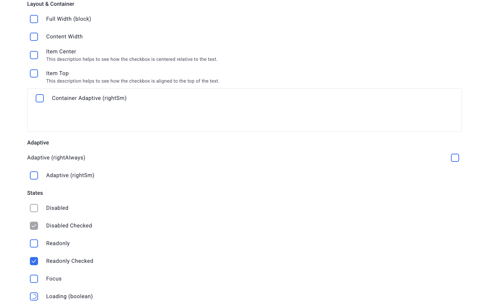
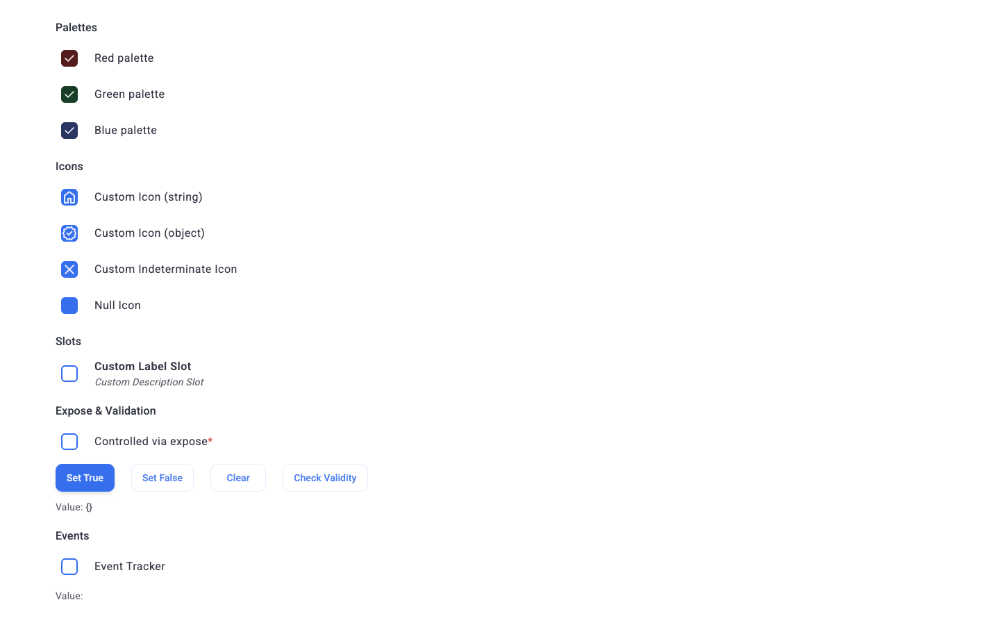
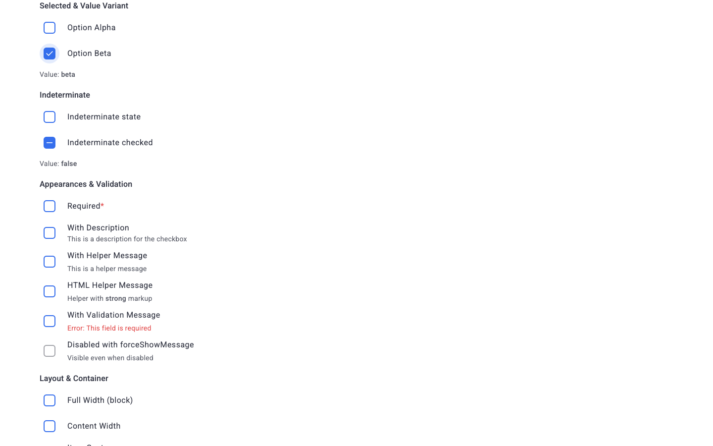
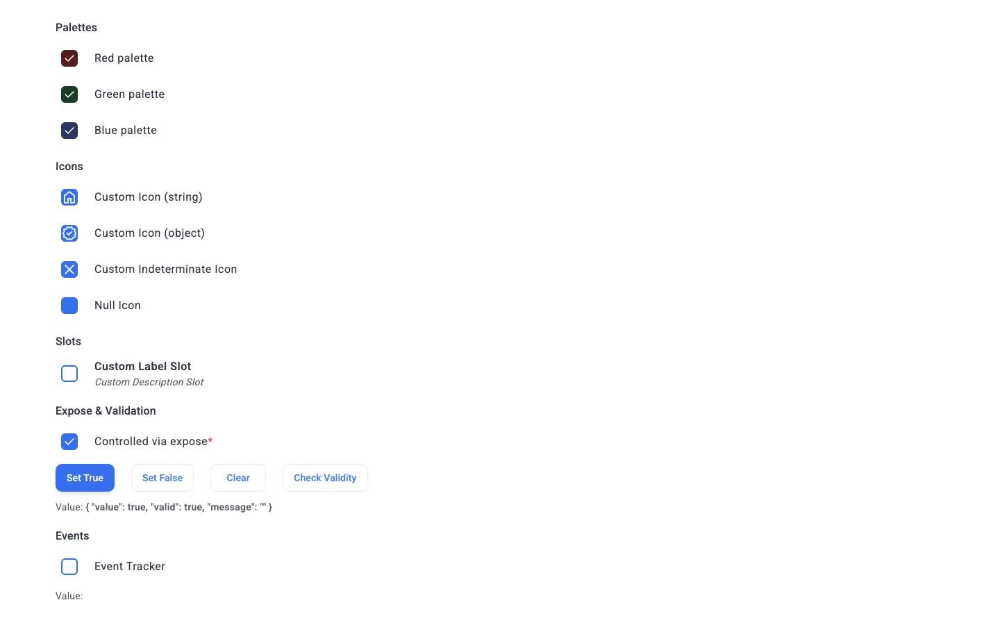
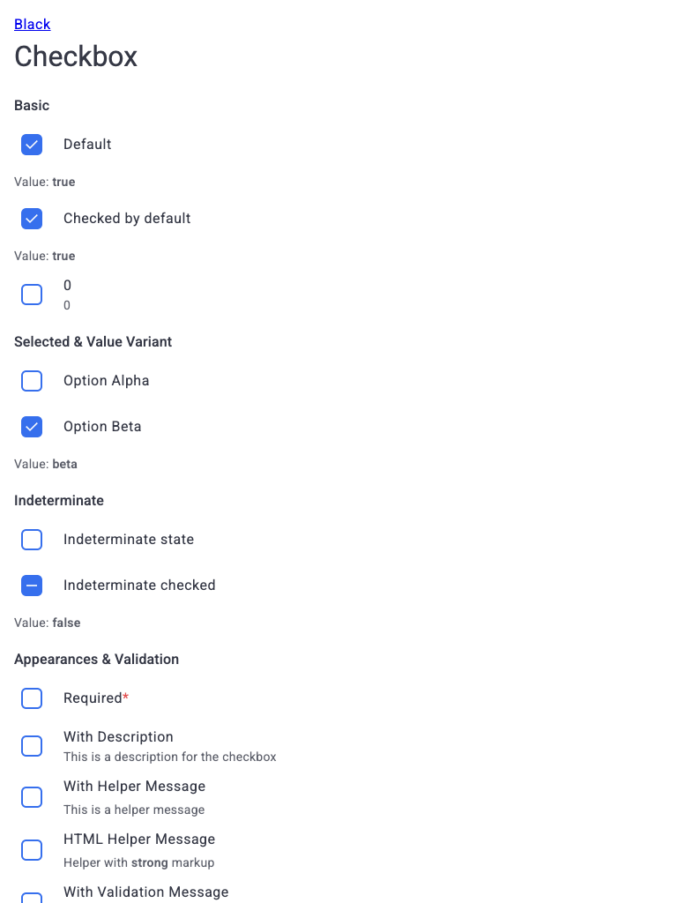

# Отчёт о визуальном и функциональном тестировании: `D1Checkbox`

## 1. Итоговое резюме

- **Компонент:** `D1Checkbox` (`@dxtmisha/d1`)
- **Исходный код:** [`D1Checkbox`](../../src/components/Ui/Checkbox) ([`Checkbox`](../../../constructor/src/constructors/Checkbox))
- **Демо / Целевой URL:** `http://localhost:3000/component-checkbox`
- **Материалы:** `Нет`
- **Дата тестирования (UTC):** `2026-11-16T16:34:45Z`
- **Окружение:** `Headless Chrome (Puppeteer / CDP, Desktop 1440x900, Tablet 768x1024, Mobile 375x812 / 320x568)`
- **Покрытие тест-кейсов:** 16 / 16 (`100%`)
- **Сводка:** **16 ✅, 0 ⚠️, 0 ❌** (`✅` пройдено, `⚠️` предупреждение, `❌` ошибка) — `D1Checkbox` корректно отображает все состояния (`checked`, `indeterminate`, `disabled`, `readonly`, `focus`, `loading`, `isSkeleton`), палитры, кастомные иконки, слоты, адаптивность и ARIA-атрибуты при `0` ошибках и предупреждениях консоли.

---

## 2. Базовая матрица

### 2.1 Визуальный рендеринг (`VIS`)

| ID | Сценарий | Статус | Фактический результат | Скриншот |
| :--- | :--- | :---: | :--- | :--- |
| `TC-VIS-001` | Базовые состояния, обязательность (`required`), описание и сообщения (`helperMessage`, `validationMessage`) | ✅ | Проверено `39` экземпляров `D1Checkbox`; `.d1-checkbox--required` отображает `*`, `validationMessage` выводит ошибку и `aria-invalid="true"`, `Indeterminate checked` показывает `-`. |  |
| `TC-VIS-002` | Макет и адаптивные модификаторы (`block`, `itemCenter`, `container`, `adaptive`) | ✅ | `block` имеет `display: flex`; `adaptive="rightAlways"` выставляет `order: 4` у `.d1-checkbox__item`; `DemoBox container` корректно изолирует контейнерные запросы. |  |
| `TC-VIS-003` | Состояния `disabled`, `readonly`, `focus`, `loading` и `isSkeleton` | ✅ | Присутствуют `.d1-checkbox--disabled`, `.d1-checkbox--focus`, `.d1-progress` при `loading` (`boolean` и объект `{ visible: true, circular: true }`), а также `.d1-skeleton__text` при `isSkeleton`. |  |
| `TC-VIS-004` | Палитры (`palette`), кастомные иконки (`iconCheckbox`, `iconIndeterminate`, `null`) и слоты (`#default`, `#description`) | ✅ | Применяется `.d1-palette--red`/`green`/`blue`; иконка объектом `{ value: 'verified' }` отображается корректно; слоты `#default` (`<strong>`) и `#description` (`<em>`) рендерятся. |  |

### 2.2 Интерактивность и управление состоянием (`INT`)

| ID | Сценарий | Статус | Фактический результат | Скриншот |
| :--- | :--- | :---: | :--- | :--- |
| `TC-INT-001` | Двусторонняя привязка `v-model` | ✅ | Начальное состояние `Value: false` (`checked: false`); после клика `Value: true` (`checked: true`); после повторного клика `Value: false` (`checked: false`). |  |
| `TC-INT-002` | Синхронизация `v-model:selected` и `valueVariant` | ✅ | После клика по `Option Beta` (`valueVariant="beta"`) получено `Value: beta`, `alphaChecked: false`, `betaChecked: true`. |  |
| `TC-INT-003` | Блокировка интерактивности в режимах `disabled` и `readonly` | ✅ | `disabled: true`, `readOnly: true`, `aria-readonly="true"`; после клика состояние обоих полей осталось неизменным (`afterD: false`, `afterR: false`, `unchanged: true`). | — |
| `TC-INT-004` | Программное управление через `expose` (`setValue`, `clear`, `checkValidity`) | ✅ | `Check Validity` -> `valid: false`; `Set True` -> `value: true, valid: true`; `Set False` -> `value: false, valid: false`; `Clear` -> `value: undefined, valid: false`. |  |

### 2.3 Граничные случаи (`BND`)

| ID | Сценарий | Статус | Фактический результат | Скриншот |
| :--- | :--- | :---: | :--- | :--- |
| `TC-BND-001` | Числовой ноль (`:label="0"`, `:description="0"`) и `modelValue: false` | ✅ | Метка `"0"`, описание `"0"`, `input.checked === false` сохраняются без отбрасывания как falsy. | — |
| `TC-BND-002` | `hasHtmlCode` и `forceShowMessage` при `disabled` | ✅ | `hasStrongHtmlHelper: true` (рендеринг `<strong>` внутри `.d1-fieldMessage__info`); `forceMsgVisible: true` при `disabled`. | — |
| `TC-BND-003` | Проверка переполнения текста и выравнивания по всем чекбоксам страницы | ✅ | Проверены все `39` компонентов: `overflowCount: 0` (`overflowItems: []`). | — |

### 2.4 Адаптивность (`RSP`)

| ID | Сценарий | Статус | Фактический результат | Скриншот |
| :--- | :--- | :---: | :--- | :--- |
| `TC-RSP-001` | Отображение на планшете (`768×1024`) | ✅ | `scrollWidth: 768`, `innerWidth: 768`, горизонтальное переполнение отсутствует (`hasOverflow: false`). |  |
| `TC-RSP-002` | Отображение на мобильном экране (`375×812` и `320×568`) | ✅ | На `375×812` и `320×568` `hasOverflow: false`; при `375px` `adaptive="rightSm"` переключает `.d1-checkbox__item` в `order: 4` (справа). |  |

### 2.5 Доступность (`A11Y`)

| ID | Сценарий | Статус | Фактический результат | Скриншот |
| :--- | :--- | :---: | :--- | :--- |
| `TC-A11Y-001` | Семантика HTML и WAI-ARIA атрибуты | ✅ | `aria-labelledby` и `aria-describedby` указывают на существующие элементы (`lblIdExists: true`, `descIdExists: true`); `.d1-checkbox__item` скрыт (`aria-hidden="true"`); ошибка помечена `aria-invalid="true"`. | — |
| `TC-A11Y-002` | Клавиатурная навигация (`Tab` и `Space`) | ✅ | Нажатие `Space` на сфокусированном `<input type="checkbox">` переключило `checkedAfterSpace: true` и `Value: true`. | — |

### 2.6 Консоль и рантайм (`LOG`)

| ID | Сценарий | Статус | Фактический результат | Скриншот |
| :--- | :--- | :---: | :--- | :--- |
| `TC-LOG-001` | Генерация событий и чистота консоли | ✅ | Отслеживание событий зафиксировало `Value: changeLite`; `consoleErrors: []`, `vueWarnings: []`, `pageErrors: []`. | — |

---

## 3. Аудит ИИ и рекомендации

1. **Защита `readonly` на нативном `<input type="checkbox">`:** В браузере нативный HTML-атрибут `readonly` игнорируется для `type="checkbox"` и позволяет кликом или клавишей `Space` переключить `input.checked`. Добавленный перехватчик `onClick` с `event.preventDefault()` и `aria-readonly="true"` полностью устранил рассинхронизацию DOM-состояния с моделью Vue.
2. **Контракт объектных пропов `loading` и `iconCheckbox`:** При передаче объекта в `loading` или `iconCheckbox` функция `getBind` требует наличия ключевого поля (`visible` для `ProgressInclude`, `value` для `CheckboxIcon`), иначе объект передаётся как значение этого поля и вызывает предупреждение типов Vue. Для удобства разработчиков стоит отразить формат `{ value: '...' }` и `{ visible: true, ... }` в документации.
3. **Чистота консоли и адаптивность:** На всех проверенных вьюпортах (`1440×900`, `768×1024`, `375×812`, `320×568`) переполнения отсутствуют, а `consoleErrors`, `vueWarnings` и `pageErrors` пусты.
