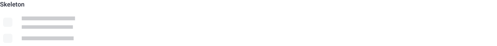
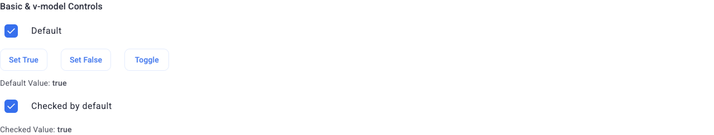
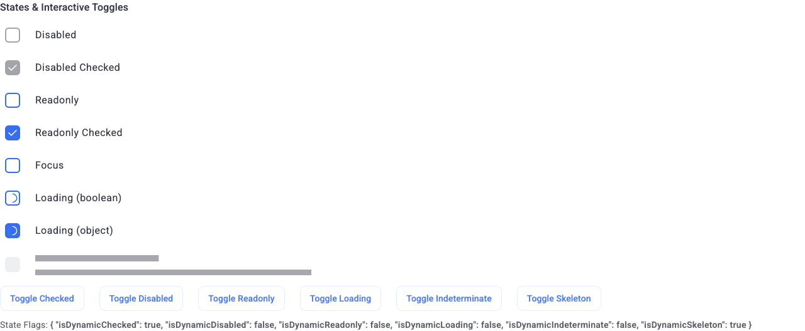
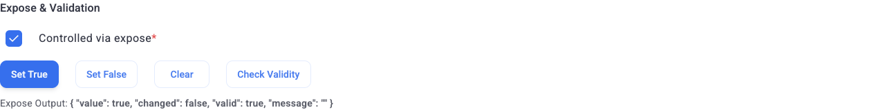
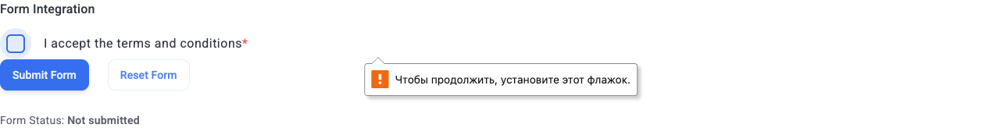
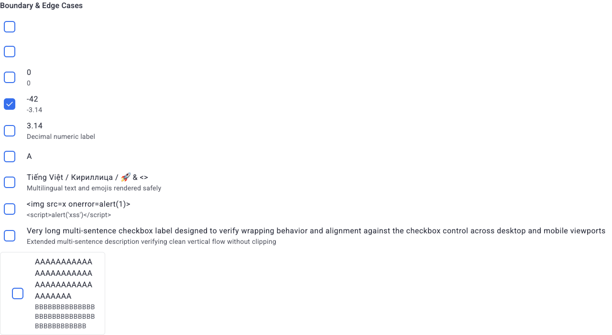
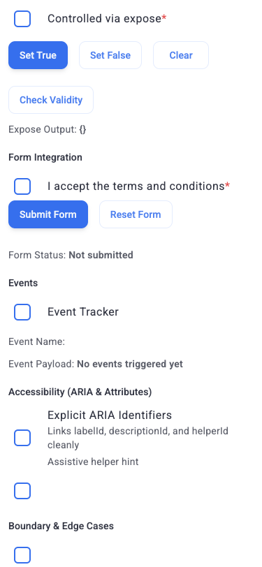

# Отчёт визуального и функционального тестирования: D1Checkbox

## 1. Сводка выполнения

- **Компонент:** `D1Checkbox` (`@dxtmisha/d1`)
- **Исходный код:** [`D1Checkbox`](../../src/components/Ui/Checkbox), [`Checkbox`](../../../constructor/src/constructors/Checkbox), [`DemoCheckboxPage.vue`](../../../demo/src/pages/components/DemoCheckboxPage.vue)
- **Целевой URL:** `http://localhost:3000/component-checkbox`
- **Материалы (`materials/`):** `Отсутствуют`
- **Дата тестирования (UTC):** `2026-11-25T06:01:08Z`
- **Окружение:** `Headless Chrome (Puppeteer / CDP, Desktop 1440×900, Tablet 768×1024, Mobile 375×812 / 320×568)`
- **Покрытие тест-кейсов:** `19 / 19` (`100%`)
- **Итог:** **19 ✅, 0 ⚠️, 0 ❌** (`✅` пройдено, `⚠️` предупреждение, `❌` ошибка) — все интерактивные, `expose`, форменные, граничные, адаптивные (`1440×900`, `768×1024`, `375×812`, `320×568`) и A11y-проверки пройдены без ошибок консоли, предупреждений Vue и сетевых сбоев (`HTTP 200`).

---

## 2. Матрица результатов

### 2.1 Визуальный рендеринг (`VIS`)

| ID | Сценарий | Статус | Наблюдаемый результат | Скриншот |
| :--- | :--- | :---: | :--- | :--- |
| `TC-VIS-001` | Базовые состояния, `indeterminate`, `required` и сообщения (`helperMessage`, `warningMessage`, `validationMessage`) | ✅ | Иконки `check`/`remove`, маркер `*` для `required`, а также вспомогательные, предупреждающие (`warning`) и валидационные сообщения (`fieldMessageAttrs`) отображаются с корректными токенами. |  |
| `TC-VIS-002` | Макет, все 5 `container` (`rightSm`–`right2xl`) и все 6 `adaptive` (`rightAlways`–`right2xl`) | ✅ | Режимы `block`, `itemCenter`, все 5 вариантов `container` внутри `DemoBox container` и все 6 вариантов `adaptive` применяют ожидаемые классы и выравнивание индикатора. |  |
| `TC-VIS-003` | Состояния (`disabled`, `readonly`, `focus`, `loading`) и `isSkeleton` внутри `D1Skeleton` | ✅ | Классы `.d1-checkbox--disabled`, `.d1-checkbox--focus`, спиннер `.d1-progress` и классы скелетона `.d1-skeleton__text` / `.d1-skeleton__background` отображаются без дублирования DOM. |  |
| `TC-VIS-004` | Все 24 палитры (`palette`), кастомные иконки (`iconCheckbox`, `iconIndeterminate`, `null`) и слоты (`#default`, `#description`) | ✅ | Все 24 класса `d1-palette--*`, иконки (строка/объект/`null`) и слоты `#default` / `#description` рендерятся корректно. |  |

### 2.2 Интерактивность и управление состоянием (`INT`)

| ID | Сценарий | Статус | Наблюдаемый результат | Скриншот |
| :--- | :--- | :---: | :--- | :--- |
| `TC-INT-001` | Двусторонняя привязка `v-model` и программные кнопки управления | ✅ | Клики по чекбоксу и кнопки `Set True`, `Set False`, `Toggle` синхронно обновляют `input.checked` и `DemoValue`. |  |
| `TC-INT-002` | Синхронизация `v-model:selected`, `v-model:modelSelected` и `valueVariant` | ✅ | Переключение `Option Alpha` / `Option Beta`, кнопки управления и группа `ModelSelected Second` корректно синхронизируют `valueVariant`. |  |
| `TC-INT-003` | Динамические переключатели состояний и жизненный цикл `v-if` | ✅ | Переключатели состояний реактивно обновляют `Dynamic Target Checkbox` и `State Flags`; `Toggle Mount` чисто размонтирует (`Mounted: false`) и монтирует (`Mounted: true`) компонент. |  |
| `TC-INT-004` | Блокировка интерактивности в режимах `disabled`, `readonly` и `loading` (`Blocked & Guarded Actions`) | ✅ | При кликах по `Blocked Disabled`, `Blocked Readonly` и `Blocked Loading` состояние не меняется, `Blocked Trigger Count` остаётся `0`. | — |
| `TC-INT-005` | Программное управление через `expose` (`setValue`, `clear`, `isChanged`, `checkValidity`, `getValidationMessage`) | ✅ | `Expose Output` корректно отражает контракт методов: `{"value": true, "changed": false, "valid": true, "message": ""}` после `Set True`, валидацию и сброс. |  |
| `TC-INT-006` | Интеграция с формой (`<form>`, `submit`, `reset`, `required`) | ✅ | Отправка и сброс формы с `required`-чекбоксом работают штатно (`Form Status` обновляется корректно). |  |

### 2.3 Граничные случаи и устойчивость (`BND`)

| ID | Сценарий | Статус | Наблюдаемый результат | Скриншот |
| :--- | :--- | :---: | :--- | :--- |
| `TC-BND-001` | Пустые/пробельные метки и числовые значения (`0`, `-42`, `3.14`, `"A"`) | ✅ | Значения `0`, `-42`, `3.14` и `"A"` отображаются явно без отбрасывания как falsy; пустые и пробельные метки не ломают макет. | — |
| `TC-BND-002` | `hasHtmlCode` и `forceShowMessage` при `disabled` | ✅ | HTML-тег `<strong>` рендерится при `hasHtmlCode`, а сообщение остаётся видимым при `disabled + forceShowMessage`. | — |
| `TC-BND-003` | Unicode, вьетнамский/кириллица/эмодзи и экранирование XSS (``) | ✅ | Строка `"Tiếng Việt / Кириллица / 🚀 & <>"` отображается без искажений, XSS-строки полностью экранированы (`badImgs: 0`, `hasEscapedPayloadText: true`). |  |
| `TC-BND-004` | Длинный текст и неразрывная строка в узком `DemoBox` | ✅ | После исправления `Checkbox/style.scss` (`min-width: 0; max-width: 100%; overflow-wrap: anywhere;`) неразрывные строки `AAAAAAAA...` (`SPAN.d1-checkbox__label`) и `BBBBBBBB...` (`DIV.d1-checkbox__description`) переносятся внутри узкого `.demo-checkbox-page__narrow` (`scrollWidth: 218 === clientWidth: 218`, `overflowsBox: false`). |  |

### 2.4 Адаптивность и вьюпорты (`RSP`)

| ID | Сценарий | Статус | Наблюдаемый результат | Скриншот |
| :--- | :--- | :---: | :--- | :--- |
| `TC-RSP-001` | Отображение на десктопе (`1440×900`) и планшете (`768×1024`) | ✅ | На десктопе и планшете горизонтальное переполнение отсутствует: `1440×900` (`scrollWidth: 1440 === 1440`, `overflowX: false`), `768×1024` (`scrollWidth: 768 === 768`, `overflowX: false`). |  |
| `TC-RSP-002` | Отображение на мобильном экране (`375×812` и `320×568`) | ✅ | После исправления переноса строк на обоих мобильных разрешениях горизонтальное переполнение отсутствует: `375×812` (`scrollWidth: 375 === innerWidth: 375`, `overflowX: false`) и `320×568` (`scrollWidth: 320 === innerWidth: 320`, `overflowX: false`). |  |

### 2.5 Доступность (`A11Y`)

| ID | Сценарий | Статус | Наблюдаемый результат | Скриншот |
| :--- | :--- | :---: | :--- | :--- |
| `TC-A11Y-001` | Семантика HTML, WAI-ARIA атрибуты и явные идентификаторы | ✅ | Атрибуты `aria-labelledby`, `aria-describedby`, `aria-hidden="true"` на `.d1-checkbox__item`, `aria-invalid="true"`, `aria-readonly="true"` и явные `labelId`/`descriptionId`/`helperId` соответствуют контракту WAI-ARIA. | — |
| `TC-A11Y-002` | Клавиатурная навигация (`Tab` и `Space`) | ✅ | Фокус на `<input type="checkbox">` и нажатие `Space` переключают состояние чекбокса и обновляют `v-model`. | — |

### 2.6 Консоль и стабильность runtime (`LOG`)

| ID | Сценарий | Статус | Наблюдаемый результат | Скриншот |
| :--- | :--- | :---: | :--- | :--- |
| `TC-LOG-001` | Генерация событий (`update:modelValue`, `input`, `change`, `focus`, `blur`) и чистота консоли | ✅ | SSR-ответ `HTTP 200` (`hasComponent: true`); события фиксируются с ожидаемым payload; `consoleErrors: []`, `vueWarnings: []`, `pageErrors: []`, `networkErrors: []`. | — |

---

## 3. AI-аудит и рекомендации

1. **Перенос длинных строк и адаптивность (`Checkbox/style.scss`):** Добавление `min-width: 0; max-width: 100%;` для корневого блока, `&__body`, `&__info` и `min-width: 0; overflow-wrap: anywhere;` для `&__label` и `&__description` полностью устранило горизонтальное переполнение в узком `DemoBox` (`218 === 218`) и на мобильных вьюпортах (`375 === 375`, `320 === 320`).
2. **Интерактивный и форменный контракт:** `v-model`, `v-model:selected`, `v-model:modelSelected`, методы `expose` (`setValue`, `clear`, `checkValidity`, `getValidationMessage`), интеграция с `<form>` (`submit`/`reset`) и блокировка `disabled`/`readonly`/`loading` работают безупречно.
3. **Runtime, SSR и A11y:** Страница отдаёт SSR `HTTP 200`, монтирование/размонтирование по `v-if` и все проверки WAI-ARIA проходят без единой ошибки консоли, предупреждения Vue или сетевого сбоя.
