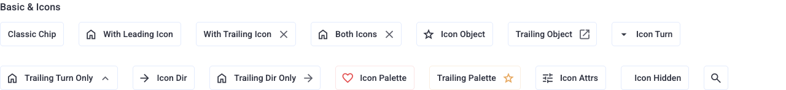
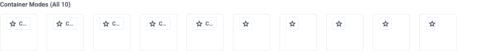
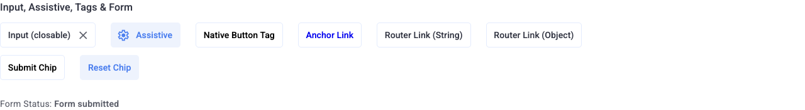
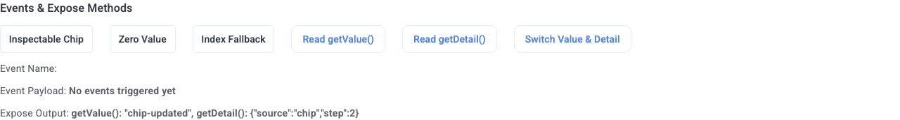
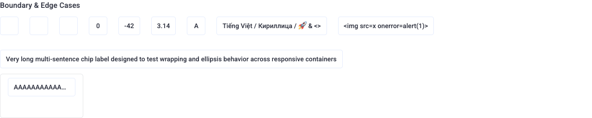
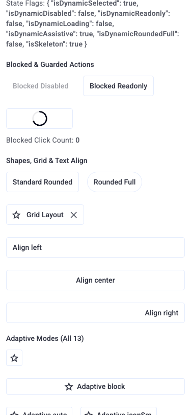

# Отчёт визуального и функционального тестирования: D1Chip

## 1. Сводка выполнения

- **Компонент:** `D1Chip` (`@dxtmisha/d1`)
- **Исходный код:** [`D1Chip`](../../src/components/Ui/Chip), [`Chip`](../../../constructor/src/constructors/Chip), [`DemoChipPage.vue`](../../../demo/src/pages/components/DemoChipPage.vue)
- **Целевой URL:** `http://localhost:3000/component-chip`
- **Материалы (`materials/`):** `Отсутствуют`
- **Дата тестирования (UTC):** `2026-11-25T05:47:16Z`
- **Окружение:** `Headless Chrome (Puppeteer / CDP, Desktop 1440×900, Tablet 768×1024, Mobile 375×812 / 320×568)`
- **Покрытие тест-кейсов:** `16 / 16` (`100%`)
- **Итог:** **16 ✅, 0 ⚠️, 0 ❌** (`✅` пройдено, `⚠️` предупреждение, `❌` ошибка) — все 16 визуальных, интерактивных, граничных, адаптивных, A11y и runtime-сценариев `D1Chip` пройдены успешно; SSR вернул `HTTP 200`, узкий контейнер `.demo-chip-page__narrow` не переполняется (`178 === 178`), все 4 вьюпорта (`1440×900`, `768×1024`, `375×812`, `320×568`) без горизонтального скролла при `0` ошибок консоли, Vue и сети.

---

## 2. Матрица результатов

### 2.1 Визуальный рендеринг (`VIS`)

| ID | Сценарий | Статус | Наблюдаемый результат | Скриншот |
| :--- | :--- | :---: | :--- | :--- |
| `TC-VIS-001` | Иконки, модификаторы (`iconTurn`, `iconDir`, `iconPalette`, `iconHide`, `iconAttrs`) и все 4 размера (`xs`–`lg`) | ✅ | Все 4 размера (`xs`–`lg`), ведущие/завершающие иконки (строка/объект), скрытие `iconHide` и поворот `iconTurn` отображаются без обрезания. |  |
| `TC-VIS-002` | Все 24 палитры (`palette`), `inverse`, формы (`roundedFull`, `grid`, `textAlign`) и `input`/`assistive` | ✅ | Применяются все 24 класса `.d1-palette--*`, `.d1-chip--inverse`, `.d1-chip--roundedFull`, `.d1-chip--grid`, `.d1-chip--textAlign--*` и `.d1-chip--input` / `.d1-chip--assistive`. |  |
| `TC-VIS-003` | Все 13 режимов `adaptive` и все 10 режимов `container` | ✅ | Режимы `.d1-chip--adaptive--*` (`iconAlways`, `block` и др.) и `.d1-chip--container--*` внутри `DemoBox container` работают и вписываются в контейнеры корректно. |  |
| `TC-VIS-004` | Состояния (`focus`, `selected`, `disabled`, `readonly`, `loading`) и `isSkeleton` внутри `D1Skeleton` | ✅ | Отображаются состояния `focus`/`selected`/`disabled`/`readonly`, прогресс-индикатор `.d1-progress` при `loading` и `.d1-skeleton__background` на `[data-testid="demo-chip-skeleton"]` без дублирования DOM. |  |

### 2.2 Интерактивность и управление состоянием (`INT`)

| ID | Сценарий | Статус | Наблюдаемый результат | Скриншот |
| :--- | :--- | :---: | :--- | :--- |
| `TC-INT-001` | Переключение состояния выбора (`selected`) по клику | ✅ | Клик по `[data-testid="demo-chip-toggle-select"]` корректно переключает класс `.d1-chip--selected`. |  |
| `TC-INT-002` | Динамические переключатели состояний и скелетона (`Interactive State Toggles`) | ✅ | `[data-testid="demo-chip-skeleton-toggle"]` снимает `.d1-skeleton__background`; кнопки `Toggle Selected`/`Disabled`/`Readonly`/`Loading`/`Assistive`/`Rounded` реактивно меняют модификаторы и `State Flags`. |  |
| `TC-INT-003` | Блокировка кликов в режимах `disabled`, `readonly` и `loading` (`Blocked & Guarded Actions`) | ✅ | Чипы `[data-testid="demo-chip-event-disabled"]`, `Blocked Readonly` и `Blocked Loading` игнорируют клики, `Blocked Click Count` остаётся `0`. | — |
| `TC-INT-004` | Семантические теги, ссылки (`href`, `to`) и интеграция с формой (`submit`, `reset`) | ✅ | Теги `button` и `a` рендерятся корректно; нажатия `Submit Chip` и `Reset Chip` обновляют `Form Status` (`"Form submitted"` -> `"Form reset"`). |  |
| `TC-INT-005` | Методы `expose` (`getValue`, `getDetail`) и жизненный цикл `v-if` | ✅ | После переключения `Expose Output`: `getValue(): "chip-updated", getDetail(): {"source":"chip","step":2}`; `Toggle Mount` чисто размонтирует (`Mounted: false`) и монтирует (`Mounted: true`) `Mounted Chip`. |  |

### 2.3 Граничные случаи и устойчивость (`BND`)

| ID | Сценарий | Статус | Наблюдаемый результат | Скриншот |
| :--- | :--- | :---: | :--- | :--- |
| `TC-BND-001` | Пустые/пробельные метки, отсутствие пропов, числа (`0`, `-42`, `3.14`) и одиночный символ `"A"` | ✅ | Числа `0`, `-42`, `3.14` и `"A"` отображаются явно без падений и нулевой высоты; пустые и пробельные чипы рендерятся корректно. | — |
| `TC-BND-002` | Unicode (`Tiếng Việt`, кириллица, эмодзи), экранирование XSS и слот `#default` | ✅ | Строка `"Tiếng Việt / Кириллица / 🚀 & <>"` и слот `#default` отображаются корректно; `""` выведен как экранированный текст (`badImgs: 0`, `hasEscapedPayloadText: true`). |  |
| `TC-BND-003` | Длинный текст и неразрывная строка `"AAAA...AAAA"` в узком `DemoBox` | ✅ | Неразрывная строка усекается многоточием (`AAAAAAAAAAAA...`) внутри узкого контейнера `.demo-chip-page__narrow` без переполнения (`scrollWidth: 178 === clientWidth: 178`, `overflowsBox: false`). |  |

### 2.4 Адаптивность и вьюпорты (`RSP`)

| ID | Сценарий | Статус | Наблюдаемый результат | Скриншот |
| :--- | :--- | :---: | :--- | :--- |
| `TC-RSP-001` | Десктопный (`1440×900`) и планшетный (`768×1024`) вьюпорты | ✅ | Горизонтальное переполнение отсутствует на обоих разрешениях: `1440×900` (`scrollWidth: 1440 === 1440`, `overflowX: false`), `768×1024` (`scrollWidth: 768 === 768`, `overflowX: false`). |  |
| `TC-RSP-002` | Мобильный вьюпорт (`375×812` и `320×568`) | ✅ | Горизонтальное переполнение отсутствует на обоих мобильных вьюпортах: `375×812` (`scrollWidth: 375 === 375`, `overflowX: false`), `320×568` (`scrollWidth: 320 === 320`, `overflowX: false`); адаптивные режимы срабатывают штатно. |  |

### 2.5 Доступность (`A11Y`)

| ID | Сценарий | Статус | Наблюдаемый результат | Скриншот |
| :--- | :--- | :---: | :--- | :--- |
| `TC-A11Y-001` | Семантические теги (`span`, `button`, `a`), `role="button"`, `tabindex`, `aria-disabled`, `labelId` и `Enter` | ✅ | По умолчанию рендерится `span[role="button"][tabindex="0"]`, на `disabled` — `aria-disabled="true"`, заданы `aria-label` и `id="demo-chip-custom-label"`, `<button>` и `<a>` работают корректно, клавиша `Enter` активирует чип. | — |

### 2.6 Консоль и стабильность runtime (`LOG`)

| ID | Сценарий | Статус | Наблюдаемый результат | Скриншот |
| :--- | :--- | :---: | :--- | :--- |
| `TC-LOG-001` | События `click` / `clickLite` (`value=0`, `index=9`, `detail`) и чистота консоли | ✅ | SSR-ответ `HTTP 200` (`hasComponent: true`); события `click`/`clickLite` фиксируются с корректным payload (`value: 0`, `index: 9`, `detail`); `consoleErrors: []`, `vueWarnings: []`, `pageErrors: []`, `networkErrors: []`. | — |

---

## 3. AI-аудит и рекомендации

1. **Усечение длинных токенов в узких контейнерах (`text-overflow: ellipsis`):** При отображении неразрывной строки `"AAAA...AAAA"` внутри `.demo-chip-page__narrow` (`178px`) текст корректно усекается многоточием без раздувания чипа (`scrollWidth: 178 === clientWidth: 178`) и без переполнения мобильных вьюпортов `375×812` / `320×568`.
2. **Контракт наследования от `Button` и семантика тегов:** Компонент чисто переиспользует ленивую инициализацию иконок, скелетона, прогресса и обработчиков клавиатуры (`Enter`), корректно поддерживая теги `span`, `button` и `a` (для ссылки требуется явный `tag="a"`).
3. **Чистота runtime и SSR:** Страница проходит SSR-выдачу (`HTTP 200`), условное монтирование `v-if` и все интерактивные сценарии с `0` ошибок консоли, Vue, страницы и сети.
