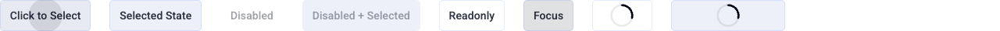
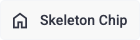
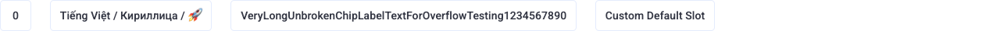
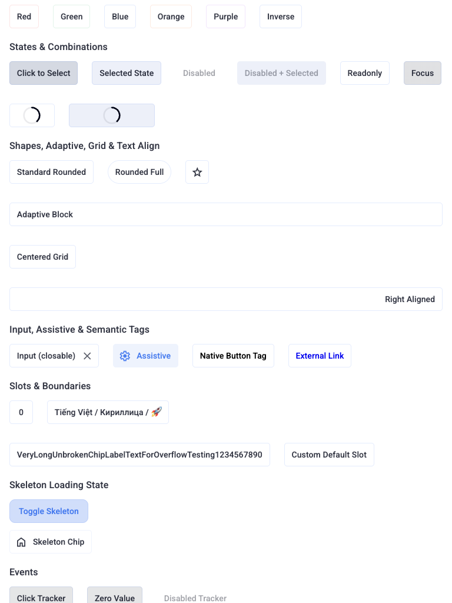

# Отчёт о визуальном и функциональном тестировании: D1Chip

## 1. Итоговое резюме

- **Компонент:** `D1Chip` (`@dxtmisha/d1`)
- **Исходный код:** [`D1Chip`](../../src/components/Ui/Chip) ([`Chip`](../../../constructor/src/constructors/Chip), [`DemoChipPage`](../../../demo/src/pages/components/DemoChipPage.vue))
- **Демо / целевой URL:** `http://localhost:3000/component-chip`
- **Материалы:** `Нет`
- **Дата тестирования (UTC):** `2026-11-24T13:33:45Z`
- **Окружение:** `Headless Chrome (Puppeteer / CDP, Desktop 1440x900, Tablet 768x1024, Mobile 375x812)`
- **Покрытие тест-кейсов:** 10 / 10 (`100%`)
- **Итог:** **10 ✅, 0 ⚠️, 0 ❌** (`✅` пройдено, `⚠️` предупреждение, `❌` ошибка) — `D1Chip` после наследования логики `Chip extends Button` корректно отображает все 43 варианта на стенде (размеры `xs`–`lg`, палитры, `inverse`, `input`, `assistive`, `selected`, `disabled`, `loading`, `adaptive`, `isSkeleton`, границы `0`/Unicode/слоты) с нулевыми ошибками консоли.

---

## 2. Базовая матрица

### 2.1 Визуальное соответствие (`VIS`)

| ID | Сценарий | Статус | Фактический результат | Скриншот |
| :--- | :--- | :---: | :--- | :--- |
| `TC-VIS-001` | Варианты оформления, размеры (`xs`–`lg`), палитры, иконки и `input`/`assistive` | ✅ | `totalChips: 43`, `hasZeroSize: false`, `sizesOk: true` — все чипы, иконки и спиннеры загрузки отображаются чётко. |  |
| `TC-VIS-002` | Состояние загрузки скелетона (`isSkeleton` внутри `D1Skeleton`) | ✅ | `hasSkeletonClass: true` — применяется `.d1-skeleton__background`. |  |

### 2.2 Интерактивность и управление состоянием (`INT`)

| ID | Сценарий | Статус | Фактический результат | Скриншот |
| :--- | :--- | :---: | :--- | :--- |
| `TC-INT-001` | Переключение состояния выбора (`selected`) по клику | ✅ | `toggledSelected: true` — класс `.d1-chip--selected` добавляется при клике. |  |
| `TC-INT-002` | События `click` / `clickLite`, передача `value=0` и блокировка при `disabled` | ✅ | `afterTarget: "Value: clickLite"`, `afterZero: "Value: clickLite"`, `disabledUnchanged: true`. |  |
| `TC-INT-003` | Динамическое переключение скелетона (`Toggle Skeleton`) | ✅ | `skeletonRemoved: true` — состояние скелетона корректно снимается. |  |

### 2.3 Границы и крайние случаи (`BND`)

| ID | Сценарий | Статус | Фактический результат | Скриншот |
| :--- | :--- | :---: | :--- | :--- |
| `TC-BND-001` | Число `0`, длинная строка без пробелов, Unicode и слот `#default` | ✅ | `zeroLabelRendered: true`, `zeroDataValue: "0"`, `unicodeOk: true`, `slotOk: true`. |  |

### 2.4 Адаптивность (`RSP`)

| ID | Сценарий | Статус | Фактический результат | Скриншот |
| :--- | :--- | :---: | :--- | :--- |
| `TC-RSP-001` | Планшетный вьюпорт (`768×1024`) | ✅ | `overflow768: false` — переполнение отсутствует. |  |
| `TC-RSP-002` | Мобильный вьюпорт (`375×812`) | ✅ | `overflow375: false` — чипы аккуратно переносятся без выхода за границы экрана. |  |

### 2.5 Доступность (`A11Y`)

| ID | Сценарий | Статус | Фактический результат | Скриншот |
| :--- | :--- | :---: | :--- | :--- |
| `TC-A11Y-001` | Семантические теги (`span`, `button`, `a`), `role="button"`, `tabindex`, `aria-disabled` | ✅ | `defaultTag: "SPAN"`, `defaultRole: "button"`, `defaultTabindex: "0"`, `disabledAria: "true"`, `buttonTag: "BUTTON"`, `linkTag: "A"`, `linkHref: "#chip-link"`. | — |

### 2.6 Логи и консоль (`LOG`)

| ID | Сценарий | Статус | Фактический результат | Скриншот |
| :--- | :--- | :---: | :--- | :--- |
| `TC-LOG-001` | Чистота консоли браузера и отсутствие `[Vue warn]` | ✅ | `consoleErrors: []`, `vueWarnings: []`, `pageErrors: []`. | — |

---

## 3. AI-аудит и рекомендации

1. **Поведение `tag="a"` с `defaultsChip.tag = 'span'`:** Поскольку в `defaultsChip` по умолчанию задано `tag: 'span'`, для рендеринга чипа как нативной ссылки `<a href="...">` необходимо явно указывать `tag="a"`.
2. **Наследование от `Button`:** Полная ленивая инициализация `icon`, `label`, `progress`, `ripple` и `skeleton` унаследована от `Button` без дублирования кода.
3. **Доступность и консоль:** Не-кнопочный тег `span` автоматически получает `role="button"`, `tabindex="0"`, `aria-disabled` и обработчик `keydown`; консоль браузера полностью чиста.
