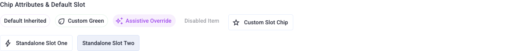
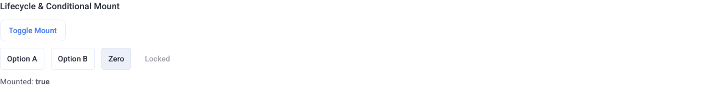
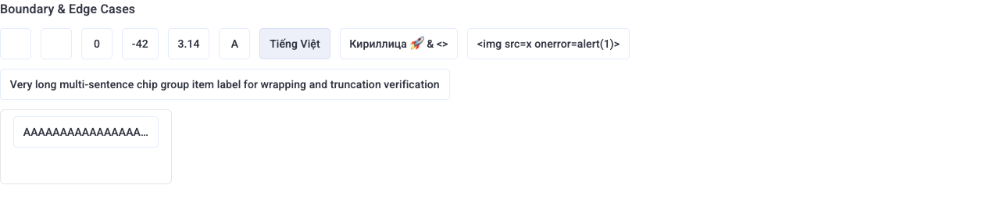
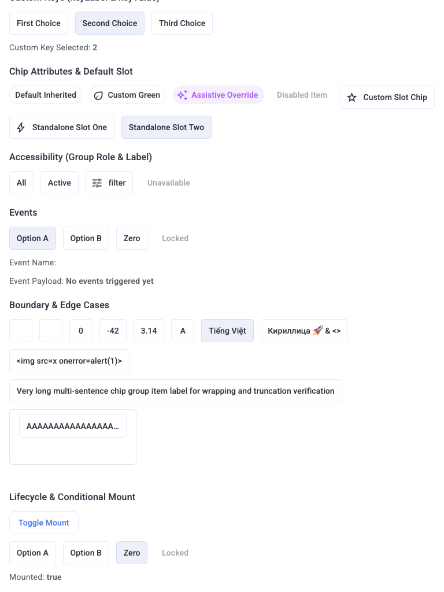
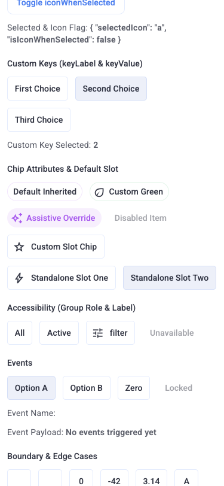

# Отчёт визуального и функционального тестирования: D1ChipGroup

## 1. Сводка выполнения

- **Компонент:** `D1ChipGroup` (`@dxtmisha/d1`)
- **Исходный код:** [`D1ChipGroup`](../../src/components/Ui/ChipGroup), [`ChipGroup`](../../../constructor/src/constructors/ChipGroup), [`DemoChipGroupPage.vue`](../../../demo/src/pages/components/DemoChipGroupPage.vue)
- **Целевой URL:** `http://localhost:3000/component-chip-group`
- **Материалы (`materials/`):** `Отсутствуют`
- **Дата тестирования (UTC):** `2026-11-25T05:47:16Z`
- **Окружение:** `Headless Chrome (Puppeteer / CDP, Desktop 1440×900, Tablet 768×1024, Mobile 375×812 / 320×568)`
- **Покрытие тест-кейсов:** `14 / 14` (`100%`)
- **Итог:** **14 ✅, 0 ⚠️, 0 ❌** (`✅` пройдено, `⚠️` предупреждение, `❌` ошибка) — все 14 визуальных, интерактивных, граничных, адаптивных, A11y и runtime-сценариев `D1ChipGroup` пройдены успешно; SSR вернул `HTTP 200`, узкий контейнер `.demo-chip-group-page__narrow` не переполняется (`218 === 218`), все 4 вьюпорта (`1440×900`, `768×1024`, `375×812`, `320×568`) без горизонтального скролла при `0` ошибок консоли, Vue и сети.

---

## 2. Матрица результатов

### 2.1 Визуальный рендеринг (`VIS`)

| ID | Сценарий | Статус | Наблюдаемый результат | Скриншот |
| :--- | :--- | :---: | :--- | :--- |
| `TC-VIS-001` | Базовый рендеринг групп чипов, `chipAttrs`, переопределений элементов и слота `#default` | ✅ | Группы `.d1-chipGroup` и элементы `.d1-chipGroup__item` рендерятся с ненулевой геометрией; общие `chipAttrs` (`palette="purple"`, `size="sm"`, `roundedFull`), переопределения элементов (`palette="green"`, `assistive: true`) и слот `#default` отображаются корректно. |  |
| `TC-VIS-002` | Скрытие иконки невыбранных чипов (`iconWhenSelected`) и динамическое переключение | ✅ | При `iconWhenSelected: true` в `[data-testid="demo-cg-icon"]` иконка видна только у выбранного чипа; после `Toggle iconWhenSelected` иконки отображаются на всех чипах списка. |  |

### 2.2 Интерактивность и управление состоянием (`INT`)

| ID | Сценарий | Статус | Наблюдаемый результат | Скриншот |
| :--- | :--- | :---: | :--- | :--- |
| `TC-INT-001` | Одиночный выбор (`v-model:selected` и `v-model:modelSelected`), числовой `0` и блокировка `disabled` | ✅ | Выбор `Zero` (`value: 0`) и кнопки управления обновляют `[data-testid="demo-cg-single-output"]`; клик по `Locked` (`disabled: true`) игнорируется; `v-model:modelSelected` синхронизирован. |  |
| `TC-INT-002` | Множественный выбор (`multiple`), добавление/удаление `0` и очистка (`Clear Selection`) | ✅ | Добавление и снятие `0` в `[data-testid="demo-cg-multiple"]` синхронно обновляют массив в `[data-testid="demo-cg-multiple-output"]`, кнопка `[data-testid="demo-cg-clear"]` сбрасывает выбор до `[]`. |  |
| `TC-INT-003` | Режим `readonly` (по умолчанию и переключаемый) и защита от мутаций | ✅ | Клик в `[data-testid="demo-cg-readonly"]` не меняет модель (`Blocked Readonly Updates: 0`); `Toggle Readonly` корректно блокирует и разблокирует выбор. | — |
| `TC-INT-004` | Кастомные ключи (`keyLabel` & `keyValue`, включая `code: 0`) | ✅ | Заголовки берутся из `title`, а выбор `First Choice` (`'1'`) и `Third Choice` (`0`) корректно обновляет `[data-testid="demo-cg-keys-output"]`. |  |
| `TC-INT-005` | Жизненный цикл и условный рендер (`v-if`) | ✅ | `Toggle Mount` чисто удаляет группу из DOM (`Mounted: false`) и повторно монтирует все 4 элемента (`Option A`, `Option B`, `Zero`, `Locked`; `Mounted: true`) с сохранением `selectedSingle`. |  |

### 2.3 Граничные случаи и устойчивость (`BND`)

| ID | Сценарий | Статус | Наблюдаемый результат | Скриншот |
| :--- | :--- | :---: | :--- | :--- |
| `TC-BND-001` | Пустые/пробельные элементы, числа (`0`, `-42`, `3.14`), `"A"` и пустой/отсутствующий список (`[]` / `undefined`) | ✅ | Чипы `0`, `-42`, `3.14`, `"A"` и пустые/пробельные элементы с `ariaLabel` отображаются корректно; `[data-testid="demo-cg-empty"]` и группа без `list` рендерят пустой контейнер без ошибок. | — |
| `TC-BND-002` | Unicode (`Tiếng Việt`, кириллица, эмодзи) и экранирование XSS (``) | ✅ | Строки `"Tiếng Việt"` и `"Кириллица 🚀 & <>"` отображаются без искажений; `""` рендерится как обычный текст (`badImgs: 0`, `hasEscapedPayloadText: true`). |  |
| `TC-BND-003` | Длинный текст и неразрывная строка `"AAAA...AAAA"` в узком `DemoBox` | ✅ | Неразрывная строка усекается многоточием (`AAAAAAAAAAAAAAAAAA...`) внутри узкого контейнера `.demo-chip-group-page__narrow` без переполнения (`scrollWidth: 218 === clientWidth: 218`, `overflowsBox: false`). |  |

### 2.4 Адаптивность и вьюпорты (`RSP`)

| ID | Сценарий | Статус | Наблюдаемый результат | Скриншот |
| :--- | :--- | :---: | :--- | :--- |
| `TC-RSP-001` | Десктопный (`1440×900`) и планшетный (`768×1024`) вьюпорты | ✅ | Горизонтальное переполнение отсутствует на обоих разрешениях: `1440×900` (`scrollWidth: 1440 === 1440`, `overflowX: false`), `768×1024` (`scrollWidth: 768 === 768`, `overflowX: false`); чипы переносятся через `flex-wrap: wrap`. |  |
| `TC-RSP-002` | Мобильный вьюпорт (`375×812` и `320×568`) | ✅ | Горизонтальное переполнение отсутствует на обоих мобильных вьюпортах: `375×812` (`scrollWidth: 375 === 375`, `overflowX: false`), `320×568` (`scrollWidth: 320 === 320`, `overflowX: false`). |  |

### 2.5 Доступность (`A11Y`)

| ID | Сценарий | Статус | Наблюдаемый результат | Скриншот |
| :--- | :--- | :---: | :--- | :--- |
| `TC-A11Y-001` | Роль группы (`role="group"`, `aria-label`) и доступность вложенных чипов | ✅ | Контейнер имеет `role="group"` и `aria-label="Filter options"`; активные чипы получают `role="button"` и `tabindex="0"`, иконочный — `aria-label="Open filter chip"`, `disabled` — `aria-disabled="true"`, выбор работает с клавиши `Enter`. | — |

### 2.6 Консоль и стабильность runtime (`LOG`)

| ID | Сценарий | Статус | Наблюдаемый результат | Скриншот |
| :--- | :--- | :---: | :--- | :--- |
| `TC-LOG-001` | События (`click`, `clickLite`, `update:selected`, `update:modelSelected`) и чистота консоли | ✅ | SSR-ответ `HTTP 200` (`hasComponent: true`); события и payload (включая `detail`) фиксируются корректно; `consoleErrors: []`, `vueWarnings: []`, `pageErrors: []`, `networkErrors: []`. | — |

---

## 3. AI-аудит и рекомендации

1. **Устойчивость к неразрывным строкам и адаптивность:** Элементы внутри `.d1-chipGroup` наследуют усечение переполненного текста (`AAAAAAAAAAAAAAAAAA...` в `.demo-chip-group-page__narrow`, `218 === 218`) и перенос строк по `flex-wrap`, обеспечивая отсутствие горизонтального скролла на `1440×900`, `768×1024`, `375×812` и `320×568`.
2. **Контракт выбора, числового `0` и `readonly`:** Одиночный и множественный выбор, кастомные ключи `keyLabel`/`keyValue`, обработка числового `0`, а также защита `readonly` и `disabled` работают без побочных мутаций и потери привязок при `v-if`.
3. **Чистота runtime и доступность:** Роль `role="group"`, ARIA-атрибуты вложенных чипов и SSR-рендеринг (`HTTP 200`) проходят с `0` ошибок консоли, предупреждений Vue и сетевых сбоев.
